# GIS from zero: one neighbourhood, one connected story

## The question we will answer

**How many people live near at least one school?**

We will build one invented neighbourhood near Dhaka. It has Schools A and B, homes, roads and a park. Each chapter solves the next small part of that same question. The data is for learning, not a real school survey.

Start with chapter 1 and follow the order. You do not need to know any GIS terms first: each new term is explained where we use it. Each chapter reminds you what we already know, develops one idea, and explains why the next step is needed.

The sequence is: **draw the places → locate them → measure carefully → add population → count people once → explain and share the result**.

The [website](index.html) follows this same order. After this connected first reading, [Part 2 contains the complete technical note](#full-technical-reading): every source section, table, formula, code listing, exercise, solution and Appendix A. Each chapter links to its full-detail readings. The [coverage index](SOURCE-COVERAGE.md) maps all 71 source sections to the chapters and website. The technical exercises use their own Dutch station dataset.

Each chapter also has a [programming challenge in Python or Go](exercises/README.md), with a starter file, runnable checks, a hint and a worked solution. Run these programs locally and use the website to save drafts and record completion.

## Read in order

1. [Start with a school, a road and a park](#topic-geometry)
2. [Give our school a position](#topic-axes)
3. [Agree on the Earth we measure from](#topic-earth)
4. [Keep our coordinate rules together](#topic-crs)
5. [Put the neighbourhood on a flat map](#topic-projections)
6. [Convert the numbers without moving the school](#topic-transformations)
7. [Measure from Home 1 to School A](#topic-distances)
8. [Ask how trustworthy our positions are](#topic-precision)
9. [Add people to the same neighbourhood](#topic-vector-raster)
10. [Find the middle of each population cell](#topic-geotransform)
11. [Change the grid without losing people](#topic-resampling)
12. [See where the school areas meet](#topic-topology)
13. [Turn our distance rule into computer steps](#topic-algorithms)
14. [Count the people near at least one school](#topic-coverage)
15. [Make the answer easy to read](#topic-cartography)
16. [Save our map without losing its meaning](#topic-formats)
17. [Open our school in QGIS](#topic-qgis)
18. [Check the whole chain when something looks wrong](#topic-debugging)

---

<a id="topic-geometry"></a>

## Chapter 1. Start with a school, a road and a park

**Our starting point:** This is the beginning. You do not need any map-making knowledge.

**Why this step matters:** Our question is: how many people live near at least one school? We will use the same invented neighbourhood throughout the guide.

### 1. First, decide what belongs on our map

Imagine a small neighbourhood near Dhaka. It has two schools, some homes, roads and a park. We will call the schools `School A` and `School B`. These are teaching examples, not real school locations.

Start by drawing School A as a dot. The dot answers one question: where is the school? GIS software calls one stored position a `Point`. GIS means Geographic Information System: tools for working with information about places.

### 2. Now add a path and an area

Draw a line along the road. A stored path made by joining positions in order is called a `LineString`. It tells us where the road goes.

Next, draw around the park and include the land inside its edge. That stored area is called a `Polygon`. Together, the point, line and area are examples of `geometry`: the position or shape we store for an object.

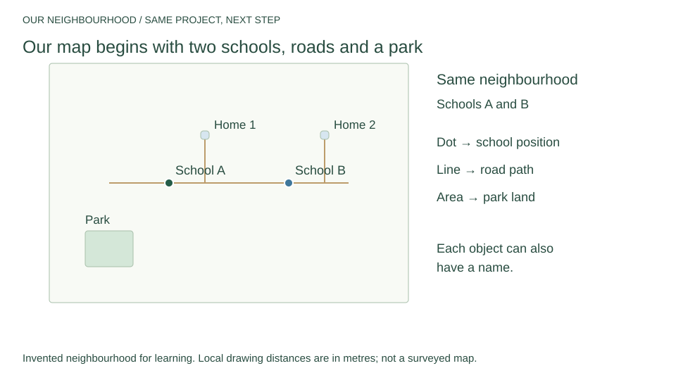

**Follow the picture:** Follow School A’s dot, the road line and the shaded park. Each drawing answers a different question: where is it, where does it go, or what land does it cover?

*[Original project illustration and calculation notes](assets/figures/CREDITS.md#connected-neighbourhood-story).*

### 3. Keep the school’s facts beside its dot

The dot cannot tell us the school’s name. Store “School A” as a fact attached to it. A fact such as a name is called an `attribute`.

Put both schools in one school `layer`. A layer is one collection of map data, such as all our school points. We can keep roads in another layer and show both layers together. We now have things to draw, but we still need numbers that tell the computer where to draw them.

**What we can now say:** A Point stores a position, a LineString stores a path, and a Polygon stores an area. Attributes store facts about them.

**Pause here:** If we rename School A, must we move its dot?

<details>
<summary>Read the explanation after trying</summary>

No. The name is an attribute. Its position can stay the same.

</details>

**Why we continue:** We have chosen what to draw. Next, we will give School A a position using two named numbers.

[Next: Name the coordinates →](#topic-axes)

**Full detail for this chapter:** [Core Geospatial Concepts for GIS Developers](#core-geospatial-concepts-for-gis-developers) · [1. Learning objectives, prerequisites and expected outcomes](#1-learning-objectives-prerequisites-and-expected-outcomes) · [1.1 Learning objectives](#11-learning-objectives) · [1.3 Expected outcomes](#13-expected-outcomes) · [1.4 Suggested study plan](#14-suggested-study-plan) · [2.4 The geometry model: OGC Simple Features](#24-the-geometry-model-ogc-simple-features) · [3.2 Geometry type hierarchy (OGC Simple Features)](#32-geometry-type-hierarchy-ogc-simple-features) · [4.4.5 Validity checks in code](#445-validity-checks-in-code) · [Exercise 3: Geometry model, validity and spatial relationships (Advanced)](#exercise-3-geometry-model-validity-and-spatial-relationships-advanced) · [Solution 3](#solution-3).

**Programming exercise:** [Find the neighbourhood’s bounding box](index.html#lesson/geometry/practice). Download the [Python starter](exercises/python/geometry.py) or [Go starter](exercises/go/geometry.go); both include runnable checks. [Setup and solution files](exercises/README.md).

---

<a id="topic-axes"></a>

## Chapter 2. Give our school a position

**Where we left off:** We drew School A as a Point and attached its name. The computer still needs to know where that Point belongs.

**Why this step matters:** We will describe the same school with two numbers, and keep their names attached so we cannot mix them up.

### 1. Begin with north and south

Picture a globe. The `equator` is the imaginary line around its middle, halfway between the North and South Poles. `Latitude` describes a place’s north–south position relative to that line.

Latitude is an angle, written in `degrees`. The symbol `°` means degrees; it does not mean metres. The equator is `0°`, and the North Pole is `90° N`.

### 2. Add east and west

`Longitude` describes east–west position relative to another agreed starting line, called the `prime meridian`. Longitude is also written in degrees.

For our invented School A, use an example position near Dhaka: longitude `90.4125° E`, latitude `23.8103° N`. Here `E` means east and `N` means north. Together these numbers are its `coordinates`: numbers describing a position.

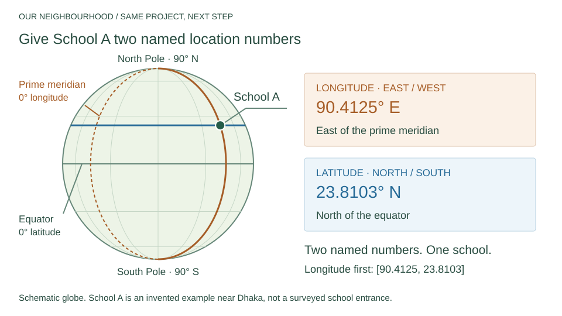

**Follow the picture:** Read the labels first and the numbers second. Both lines describe the same School A from the previous chapter.

*[Original project illustration and calculation notes](assets/figures/CREDITS.md#connected-neighbourhood-story).*

### 3. Keep each number in the right field

Write the names beside the numbers: `longitude = 90.4125` and `latitude = 23.8103`. If a tool asks for longitude first, the pair is `[90.4125, 23.8103]`.

The required number order is called `axis order`. Some tools expect the opposite order, so read the field names. Swapping the numbers does not swap the labels automatically. We also need agreement about the Earth model behind these coordinates; that is our next step.

**What we can now say:** Latitude tells north–south position. Longitude tells east–west position. Always keep the names or required order with the numbers.

**Pause here:** Our input form asks for longitude first. Which School A value goes first?

<details>
<summary>Read the explanation after trying</summary>

90.4125 goes first. The full pair is [90.4125, 23.8103].

</details>

**Why we continue:** We have named our school’s coordinates. Next, we will see why everyone must use an agreed reference for Earth.

[← Draw our map](#topic-geometry) · [Next: Agree on a reference →](#topic-earth)

**Full detail for this chapter:** [2.3 Axis order: latitude/longitude vs. longitude/latitude](#23-axis-order-latitudelongitude-vs-longitudelatitude) · [5.1 Scenario](#51-scenario) · [5.2 Step 1: Inspect the numbers](#52-step-1-inspect-the-numbers) · [5.3 Step 2: Test both axis hypotheses against the expected area](#53-step-2-test-both-axis-hypotheses-against-the-expected-area) · [Exercise 2: Axis order, reprojection and measuring the distortion (Intermediate)](#exercise-2-axis-order-reprojection-and-measuring-the-distortion-intermediate) · [Solution 2](#solution-2).

**Programming exercise:** [Resolve swapped coordinate fields](index.html#lesson/axes/practice). Download the [Python starter](exercises/python/axes.py) or [Go starter](exercises/go/axes.go); both include runnable checks. [Setup and solution files](exercises/README.md).

---

<a id="topic-earth"></a>

## Chapter 3. Agree on the Earth we measure from

**Where we left off:** School A now has a longitude and latitude. Those angles describe its position relative to a model of Earth.

**Why this step matters:** We need our school data and other people’s map data to use compatible references, so their positions line up.

### 1. Use a smooth model for calculations

Real ground has hills and valleys. GIS calls the actual ground `terrain`. Following every bump would make worldwide position calculations difficult.

Instead, calculations often use a smooth shape like a slightly flattened ball. That shape is called an `ellipsoid`. It is a calculation model, not a claim that the ground is smooth.

### 2. Fix that model to the real planet

A shape alone is not enough. We must also agree where its centre is and how it is positioned relative to Earth. The reference that ties the model to the real planet is called a `datum`.

`WGS 84` is the reference we will use for School A’s longitude and latitude. It is common in data from `GPS`, the satellite system used to find locations. Another collection of location data, called a `dataset`, can use a different reference. Similar-looking coordinates do not prove that its positions will line up with ours.

### 3. Apply the same “measured from what?” question to height

Suppose we also record the height of School A’s roof. A height of `50 m` is incomplete unless we know what surface we measured from.

The `geoid` is a gravity-based reference surface close to average sea level. It differs from the smooth ellipsoid. In the simplified picture, the roof is `50 m` above the ellipsoid and `30 m` above the geoid because the references are `20 m` apart there. The roof has not moved; only the starting surface differs.

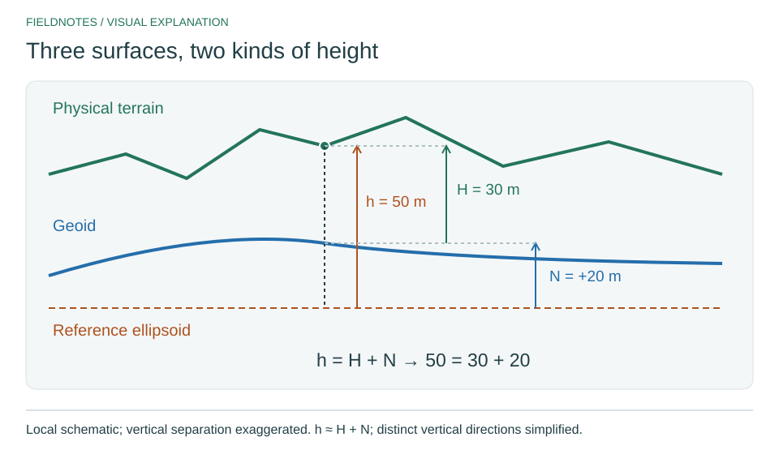

**Follow the picture:** Use the marked terrain point as our roof example. Trace each arrow down to its starting surface before comparing 50 m and 30 m. The surface separation is exaggerated.

*[Original project illustration and calculation notes](assets/figures/CREDITS.md#connected-neighbourhood-story).*

**What we can now say:** A reference tells us what our position or height is measured from. Check that reference before comparing datasets.

**Pause here:** Two reports give our roof different heights. What should we check first?

<details>
<summary>Read the explanation after trying</summary>

Check the starting reference and units in each report. Different reference surfaces can explain different numbers without the roof moving.

</details>

**Why we continue:** We now have coordinate names, units and an Earth reference. Next, we will keep those rules together under one label.

[← Name the coordinates](#topic-axes) · [Next: Label the coordinates →](#topic-crs)

**Full detail for this chapter:** [2. Conceptual foundations](#2-conceptual-foundations) · [2.1 Modelling the Earth: geoid, ellipsoid, datum](#21-modelling-the-earth-geoid-ellipsoid-datum) · [4.3 Datum transformations and PROJ pipelines](#43-datum-transformations-and-proj-pipelines).

**Programming exercise:** [Convert GPS height to geoid-referenced height](index.html#lesson/earth/practice). Download the [Python starter](exercises/python/earth.py) or [Go starter](exercises/go/earth.go); both include runnable checks. [Setup and solution files](exercises/README.md).

---

<a id="topic-crs"></a>

## Chapter 4. Keep our coordinate rules together

**Where we left off:** We chose longitude and latitude in degrees, using the WGS 84 reference. Those decisions give the numbers their meaning.

**Why this step matters:** We need a way to keep that meaning attached when we save or share the school data.

### 1. Give the instruction sheet its name

A `coordinate reference system`, shortened to `CRS`, collects the rules for describing positions. It includes the Earth reference, the coordinate directions and the units.

Think of it as the instruction sheet for the numbers. Without it, another person may not know how to read School A’s position.

### 2. Use a catalogue code for the full definition

Instead of copying the whole definition into every conversation, we can refer to a catalogue code. An `EPSG code` identifies one entry in a widely used catalogue of coordinate reference systems.

`EPSG:4326` identifies WGS 84 geographic coordinates in degrees. We will attach that label to our school data. This is a lookup code, not a formula you must calculate.

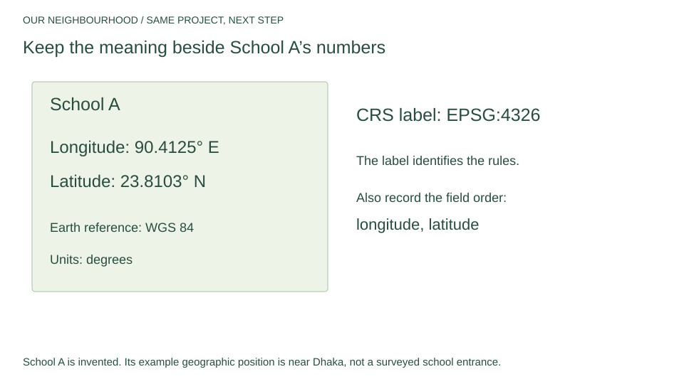

**Follow the picture:** Read the numbers, the WGS 84 reference and the degree units. EPSG:4326 identifies that coordinate system; the named fields still tell us which number is which.

*[Original project illustration and calculation notes](assets/figures/CREDITS.md#connected-neighbourhood-story).*

### 3. Record the file’s field order too

The CRS and the file or tool’s input rules work together. The EPSG:4326 definition lists latitude first, while some common file formats write longitude first.

For our table, we avoid uncertainty with named columns: `lon` means longitude and `lat` means latitude. Our documentation says `EPSG:4326`. We can now explain every part of the school’s stored position.

**What we can now say:** Keep the CRS label and field order with the coordinates. They explain how to read the numbers.

**Pause here:** Does EPSG:4326 mean our school’s coordinates are measured in metres?

<details>
<summary>Read the explanation after trying</summary>

No. Its geographic coordinates use degrees. We will choose a suitable metre-based system before local distance calculations.

</details>

**Why we continue:** Our school is correctly described on Earth. Next, we will see how to put that curved-Earth description onto a flat map.

[← Agree on a reference](#topic-earth) · [Next: Choose a flat map →](#topic-projections)

**Full detail for this chapter:** [2.2 Coordinate reference systems (CRS)](#22-coordinate-reference-systems-crs) · [3. Visual explanations](#3-visual-explanations) · [3.1 Conceptual overview: from the Earth to a styled map](#31-conceptual-overview-from-the-earth-to-a-styled-map) · [Exercise 1: CRS literacy, precision and your first QGIS session (Beginner)](#exercise-1-crs-literacy-precision-and-your-first-qgis-session-beginner) · [Solution 1](#solution-1).

**Programming exercise:** [Guard a metre-based analysis function](index.html#lesson/crs/practice). Download the [Python starter](exercises/python/crs.py) or [Go starter](exercises/go/crs.go); both include runnable checks. [Setup and solution files](exercises/README.md).

---

<a id="topic-projections"></a>

## Chapter 5. Put the neighbourhood on a flat map

**Where we left off:** We can locate School A using WGS 84 longitude and latitude. These are angles on a curved Earth model.

**Why this step matters:** Our eventual question involves “near a school”, so we need a useful way to measure local distances.

### 1. Understand why flattening needs a rule

A globe is curved, but our screen is flat. A `map projection` is the calculation that places locations from the curved surface onto a flat map.

Flattening changes some shapes, sizes or distances. Those changes are called `distortion`. No flat world map preserves all of them everywhere.

### 2. Choose for this neighbourhood

A CRS that uses a flat map projection is called a `projected CRS`. For our small area near Dhaka, we can use one from the `UTM` family. UTM divides much of Earth into numbered regions called zones, so each grid can suit a limited area.

Our example location lies in `zone 46`, in the Northern Hemisphere, meaning north of the equator. `EPSG:32646` identifies WGS 84 / UTM 46N. Its horizontal coordinate is called `easting`; its vertical coordinate is called `northing`. Both use metres.

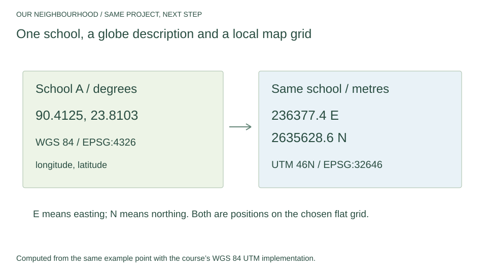

**Follow the picture:** Both boxes describe School A. The left uses degrees; the right uses the chosen local metre grid. E and N mean easting and northing.

*[Original project illustration and calculation notes](assets/figures/CREDITS.md#connected-neighbourhood-story).*

### 3. Keep the choice tied to the job

The familiar web-map system `EPSG:3857` is often convenient for display, but it stretches ground distances. Having metre units does not remove that stretching.

For this small teaching project, we will use EPSG:32646 for measurements. That choice belongs to this location and task; it is not a rule for every map. Now we need to calculate School A’s numbers in that system.

**What we can now say:** Choose a projected CRS that suits the region and measurement. A map’s metre units alone do not guarantee ground accuracy.

**Pause here:** Which system did we choose for local measurements around our example school?

<details>
<summary>Read the explanation after trying</summary>

WGS 84 / UTM 46N, identified by EPSG:32646.

</details>

**Why we continue:** We have chosen a metre grid. Next, we will convert the school coordinates into it without moving the school.

[← Label the coordinates](#topic-crs) · [Next: Convert the coordinates →](#topic-transformations)

**Full detail for this chapter:** [2.2 Coordinate reference systems (CRS)](#22-coordinate-reference-systems-crs) · [4.2 Map projections in practice](#42-map-projections-in-practice) · [5.5 Step 4: Pick a CRS for measurement and project](#55-step-4-pick-a-crs-for-measurement-and-project).

**Programming exercise:** [Choose a UTM zone, including the exceptions](index.html#lesson/projections/practice). Download the [Python starter](exercises/python/projections.py) or [Go starter](exercises/go/projections.go); both include runnable checks. [Setup and solution files](exercises/README.md).

---

<a id="topic-transformations"></a>

## Chapter 6. Convert the numbers without moving the school

**Where we left off:** School A is stored in EPSG:4326 degrees. We chose EPSG:32646 metres for the local analysis.

**Why this step matters:** We need a metre-coordinate copy that still points to exactly the same school.

### 1. First, make sure the input is labelled correctly

Suppose our table has the known longitude and latitude but no CRS label. Its documentation confirms WGS 84. We can now `assign` EPSG:4326: attach the correct label without changing the values.

After assignment, the pair is still `[90.4125, 23.8103]`. We have explained the numbers, not converted them.

### 2. Then calculate the new description

To `transform` coordinates means to calculate their values in another coordinate system. Transform our correctly labelled point to EPSG:32646.

School A becomes approximately easting `236377.4 m`, northing `2635628.6 m`. Those numbers are very different from the degree values, but they describe the same physical position.

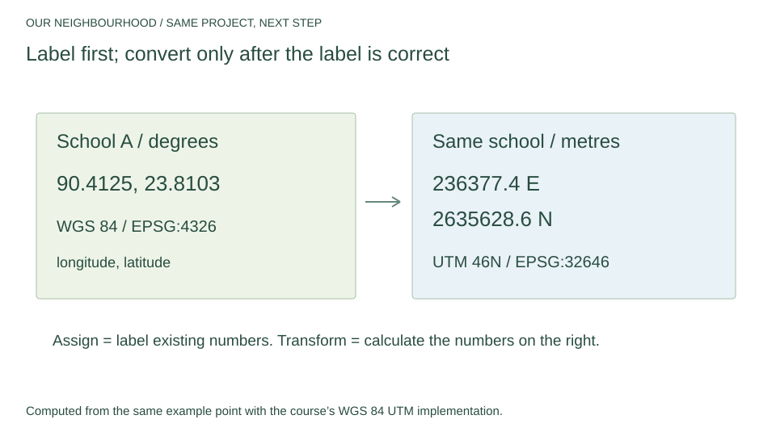

**Follow the picture:** Follow the same school from left to right. Assignment leaves the left-hand numbers alone; transformation calculates the right-hand numbers.

*[Original project illustration and calculation notes](assets/figures/CREDITS.md#connected-neighbourhood-story).*

### 3. Notice the mistake we avoided

If we merely changed the label to EPSG:32646, the numbers would remain 90.4125 and 23.8103. Software would read them as metres, which would put the point somewhere else.

The safe sequence is: verify what the original numbers mean, attach their correct label, then calculate the conversion. We now have positions that we can use for our neighbourhood measurements.

**What we can now say:** Assign means label existing values. Transform means calculate new values for the same place.

**Pause here:** Does writing “metres” beside a number measured in degrees convert it?

<details>
<summary>Read the explanation after trying</summary>

No. A label cannot perform the coordinate calculation.

</details>

**Why we continue:** Our positions now use a suitable metre grid. Next, we will decide what distance from home to school actually means.

[← Choose a flat map](#topic-projections) · [Next: Measure the journey →](#topic-distances)

**Full detail for this chapter:** [3.3 Workflow: diagnosing "my data is in the wrong place"](#33-workflow-diagnosing-my-data-is-in-the-wrong-place) · [3.4 Sequence: what happens during a reprojection](#34-sequence-what-happens-during-a-reprojection) · [4.3 Datum transformations and PROJ pipelines](#43-datum-transformations-and-proj-pipelines) · [4.8 File formats and spatial databases](#48-file-formats-and-spatial-databases) · [5.4 Step 3: Normalise and label (assign, do not transform)](#54-step-3-normalise-and-label-assign-do-not-transform) · [Exercise 2: Axis order, reprojection and measuring the distortion (Intermediate)](#exercise-2-axis-order-reprojection-and-measuring-the-distortion-intermediate) · [Solution 2](#solution-2).

**Programming exercise:** [Transform a local drawing’s coordinates](index.html#lesson/transformations/practice). Download the [Python starter](exercises/python/transformations.py) or [Go starter](exercises/go/transformations.go); both include runnable checks. [Setup and solution files](exercises/README.md).

---

<a id="topic-distances"></a>

## Chapter 7. Measure from Home 1 to School A

**Where we left off:** We converted our school location to a local metre grid. We can now compare positions using metre differences.

**Why this step matters:** Before counting “nearby” people, we must say which kind of distance we mean.

### 1. Follow the same home and school

In our invented neighbourhood, Home 1 lies `60 m` east and `80 m` north of School A. The road in the picture follows those two legs.

Along that drawn road, the distance is `60 + 80 = 140 m`. We added the lengths actually travelled.

### 2. Compare it with the direct line

The straight diagonal between these same positions is `100 m`. It is shorter because it cuts across rather than following the two road legs.

This is a `planar distance`: a ruler-like calculation on flat map coordinates. For larger Earth-surface measurements, a `geodesic distance` follows a chosen Earth model instead. Neither calculation automatically follows roads.

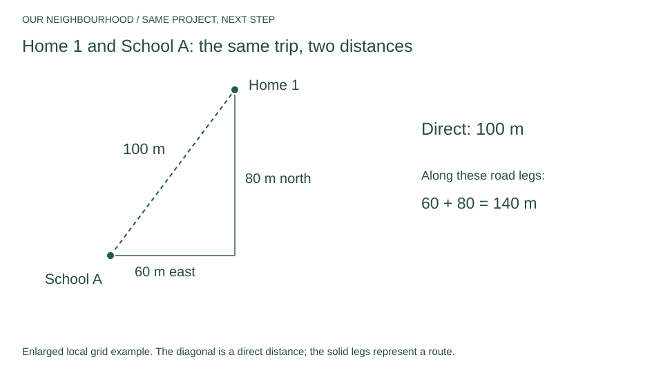

**Follow the picture:** Compare the solid road legs with the dashed direct line. The endpoints stay the same; the path changes.

*[Original project illustration and calculation notes](assets/figures/CREDITS.md#connected-neighbourhood-story).*

### 3. Choose an explicit rule for our project

For our first analysis, we will call a location near a school when its direct local-grid distance is at most `200 m`. We choose that simple rule so we can learn the counting process.

That result will mean “inside our 200 m distance rule”, not “a 200 m walk”. Answering a walking question would require a connected road dataset and information about usable paths. We now know what our result will and will not measure.

**What we can now say:** Our project uses a stated 200 m direct-distance rule. Road distance answers a different question.

**Pause here:** Is Home 1 inside our 200 m direct-distance rule?

<details>
<summary>Read the explanation after trying</summary>

Yes. Its direct distance is 100 m, which is less than 200 m.

</details>

**Why we continue:** We have a distance rule. Next, we will check how much confidence to place in the positions we measure from.

[← Convert the coordinates](#topic-transformations) · [Next: Check location quality →](#topic-precision)

**Full detail for this chapter:** [4.1 Geographic coordinates: lengths of degrees and distances on the ellipsoid](#41-geographic-coordinates-lengths-of-degrees-and-distances-on-the-ellipsoid) · [5.6 Step 5: Distances computed four ways](#56-step-5-distances-computed-four-ways) · [5.7 Step 6: Areas computed four ways](#57-step-6-areas-computed-four-ways) · [Exercise 2: Axis order, reprojection and measuring the distortion (Intermediate)](#exercise-2-axis-order-reprojection-and-measuring-the-distortion-intermediate) · [Solution 2](#solution-2) · [Appendix A — Reference implementation (geolib.py)](#appendix-a--reference-implementation-geolibpy).

**Programming exercise:** [Measure home-to-school distance](index.html#lesson/distances/practice). Download the [Python starter](exercises/python/distances.py) or [Go starter](exercises/go/distances.go); both include runnable checks. [Setup and solution files](exercises/README.md).

---

<a id="topic-precision"></a>

## Chapter 8. Ask how trustworthy our positions are

**Where we left off:** We decided to count positions within 200 m of a school. A position error could affect a home close to that edge.

**Why this step matters:** We need to separate the quality of the measurement from the number of digits displayed.

### 1. Compare readings with a known position

Imagine standing at School A’s entrance and recording its phone position several times. We also have a trusted position for the entrance, so we can compare the readings with it.

`Accuracy` means closeness to that true or accepted position. A reading far from the entrance has a large position error even if it contains many decimal places.

### 2. Ask whether repeated readings agree

`Precision` means how closely repeated readings agree with one another. A tight group is precise. If the whole group sits away from the entrance, it is precise but inaccurate.

A consistent shift is called `bias`. In the picture, each cross stands for the known entrance and the dots stand for repeated readings. Compare the location of the group as well as its spread.

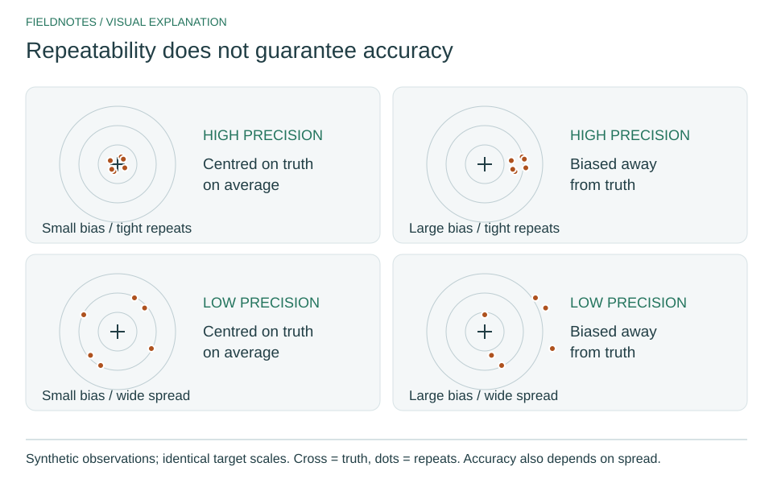

**Follow the picture:** Imagine the same school entrance at the centre of each target. Across a row, the group shifts; down a column, the readings spread out.

*[Original project illustration and calculation notes](assets/figures/CREDITS.md#connected-neighbourhood-story).*

### 3. Carry that uncertainty into our result

Suppose a home position has an estimated error of about `5 m`. A measured distance near `200 m` needs more care than one clearly far inside the boundary.

Storing extra digits does not reduce the original measurement error. Keep the source and its uncertainty with the data. With that limitation understood, we can now add population information to our map.

**What we can now say:** Accuracy is closeness to the accepted position. Precision is agreement between repeats. Extra decimal places prove neither.

**Pause here:** Our phone readings form a tight group away from the known entrance. What does that tell us?

<details>
<summary>Read the explanation after trying</summary>

They are precise because they agree, but inaccurate relative to the known entrance.

</details>

**Why we continue:** We know how to locate and measure the schools. Next, we will add the people our question asks us to count.

[← Measure the journey](#topic-distances) · [Next: Add a population grid →](#topic-vector-raster)

**Full detail for this chapter:** [2.6 Scale, accuracy, precision and resolution](#26-scale-accuracy-precision-and-resolution) · [4.6 Scale, precision and numeric representation](#46-scale-precision-and-numeric-representation) · [Exercise 1: CRS literacy, precision and your first QGIS session (Beginner)](#exercise-1-crs-literacy-precision-and-your-first-qgis-session-beginner) · [Solution 1](#solution-1).

**Programming exercise:** [Compare positions using a distance tolerance](index.html#lesson/precision/practice). Download the [Python starter](exercises/python/precision.py) or [Go starter](exercises/go/precision.go); both include runnable checks. [Setup and solution files](exercises/README.md).

---

<a id="topic-vector-raster"></a>

## Chapter 9. Add people to the same neighbourhood

**Where we left off:** We have school positions and a 200 m distance rule. We have also considered position uncertainty.

**Why this step matters:** We need population data before we can count the people living near a school.

### 1. Name the kind of data we already have

Our school Points, road LineStrings and park Polygon represent individual objects. This way of storing map data is called `vector` data.

Now suppose the population supplier gives us a grid rather than one record for every person. A grid of stored values is called a `raster`. It can describe the same neighbourhood as our vector layers.

### 2. Read what one cell means

A `cell`, also called a pixel, is one element of that grid. In our teaching dataset, every cell covers `100 m × 100 m` and stores `10 people`. The number is a population count for that whole cell.

There are `6 columns` and `4 rows`: `24 cells` altogether. Therefore the entire neighbourhood grid represents `24 × 10 = 240 people`. The values are invented so we can check every result ourselves.

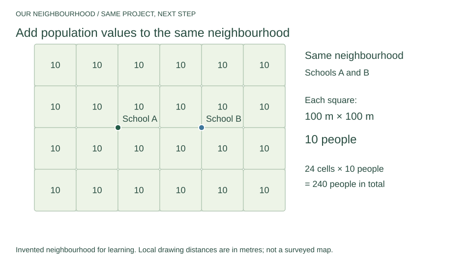

**Follow the picture:** The schools have stayed in the same places. The new squares add population counts; they are not new school or house locations.

*[Original project illustration and calculation notes](assets/figures/CREDITS.md#connected-neighbourhood-story).*

### 3. Keep the two layers together

The school layer supplies locations. The population raster supplies counts across the surrounding land. We will combine them by deciding which population cells satisfy our distance rule.

First we need to locate those cells precisely. A cell has both an edge and a middle; confusing them can change which cells get selected.

**What we can now say:** Vector stores individual objects. Raster stores a grid of values. Our raster contains 240 people in total.

**Pause here:** What does the 10 in one of our raster cells mean?

<details>
<summary>Read the explanation after trying</summary>

It means 10 people in the whole 100 m by 100 m cell, not 10 people at every position inside it.

</details>

**Why we continue:** We have the population counts. Next, we will find the map position of each cell’s centre.

[← Check location quality](#topic-precision) · [Next: Locate each cell →](#topic-geotransform)

**Full detail for this chapter:** [2.5 Raster vs. vector](#25-raster-vs-vector) · [4.5 Raster internals: geotransform, resampling, storage](#45-raster-internals-geotransform-resampling-storage) · [4.5.3 Size arithmetic and storage](#453-size-arithmetic-and-storage).

**Programming exercise:** [Budget raster memory before allocating it](index.html#lesson/vector-raster/practice). Download the [Python starter](exercises/python/vector_raster.py) or [Go starter](exercises/go/vector_raster.go); both include runnable checks. [Setup and solution files](exercises/README.md).

---

<a id="topic-geotransform"></a>

## Chapter 10. Find the middle of each population cell

**Where we left off:** Our population grid has 100 m cells, with 10 people in each cell. We must locate the cells before selecting any.

**Why this step matters:** For this teaching calculation, we will include a cell when its centre lies within 200 m of a school.

### 1. Start counting from the upper-left cell

A `row` runs across the grid. A `column` runs down it. Our software numbers both from zero, so the first cell is `row 0, column 0`.

Those numbers tell us which cell we want, but not where it is on the map. We also need the map position of the grid’s starting corner, the cell size and the directions the grid runs.

### 2. Move from the corner to the centre

Our grid has north at the top. From the first cell’s upper-left corner, move half a cell right and half a cell down. Half of `100 m` is `50 m`, so its centre is `50 m` east and `50 m` south of that corner.

The rule that converts grid positions into map positions is called a `geotransform`. In this simple grid it combines the starting corner, cell spacing and directions. Rotated grids need extra terms.

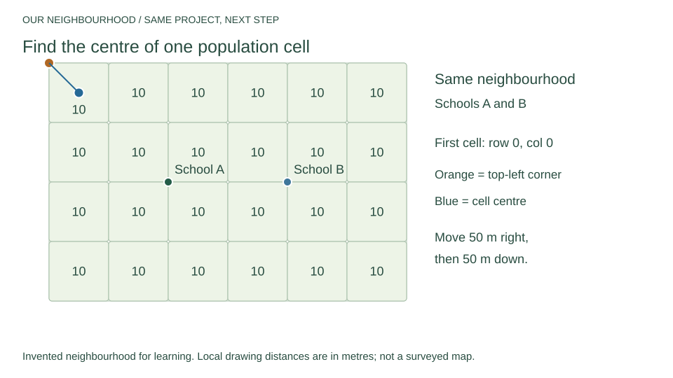

**Follow the picture:** Find the orange corner and blue centre of the top-left cell. The short line moves 50 m east and 50 m south.

*[Original project illustration and calculation notes](assets/figures/CREDITS.md#connected-neighbourhood-story).*

### 3. Apply one selection rule consistently

The next column’s centre is another `100 m` east. The next row’s centre is another `100 m` south. We can repeat that process for all 24 cells.

We will test these centres against our school-distance rule. This treats all 10 people in a selected cell as included; it does not tell us where each person lives inside the cell. That is a limitation of this counting method.

**What we can now say:** The cell centre is not its corner. Our selection uses centres and whole-cell population counts.

**Pause here:** How far is the first cell centre south of its upper-left corner?

<details>
<summary>Read the explanation after trying</summary>

50 m, because our cell is 100 m high.

</details>

**Why we continue:** We can locate every cell. Next, we will see what must happen to population values if someone changes the grid size.

[← Add a population grid](#topic-vector-raster) · [Next: Handle a new grid size →](#topic-resampling)

**Full detail for this chapter:** [4.5.1 The geotransform](#451-the-geotransform) · [Exercise 4: Applied challenge, a service-coverage audit (Applied)](#exercise-4-applied-challenge-a-service-coverage-audit-applied) · [Solution 4](#solution-4).

**Programming exercise:** [Locate a raster cell’s centre](index.html#lesson/geotransform/practice). Download the [Python starter](exercises/python/geotransform.py) or [Go starter](exercises/go/geotransform.go); both include runnable checks. [Setup and solution files](exercises/README.md).

---

<a id="topic-resampling"></a>

## Chapter 11. Change the grid without losing people

**Where we left off:** We know where our 100 m population cells are and what their values mean: counts of people per whole cell.

**Why this step matters:** Before combining grids from different sources, we must understand how a change of grid can affect our counts.

### 1. Keep the same land and change only the grid

Take a block of four neighbouring cells from our population raster. Each cell is `100 m × 100 m` and contains `10 people`. Together they contain `40 people`.

Suppose we replace that block with one `200 m × 200 m` cell covering exactly the same land. No people have moved; we changed only how their data is grouped.

### 2. Choose a value that preserves the meaning

Because our values are whole-cell population counts, add them: `10 + 10 + 10 + 10 = 40 people`. The new larger cell must store 40 in this aligned example.

Copying one old value would store only 10 and lose 30 people from the total. Averaging the four counts would also give 10, which answers a different question.

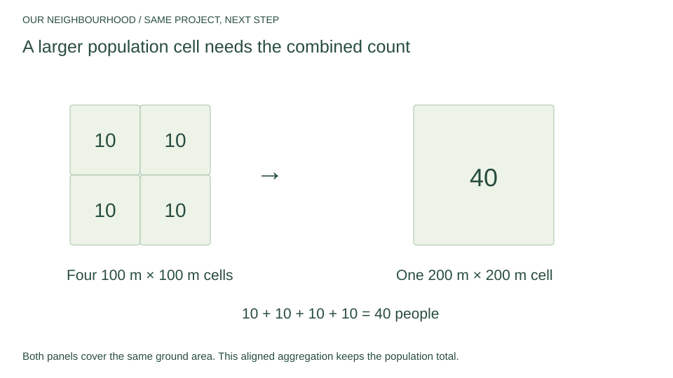

**Follow the picture:** Both panels cover the same land. The left has four values of 10; the right has their combined value of 40.

*[Original project illustration and calculation notes](assets/figures/CREDITS.md#connected-neighbourhood-story).*

### 3. Understand the wider term, then keep our original grid

Choosing or estimating values on a new grid is called `resampling`. Combining whole aligned cells by a summary such as a sum is called `aggregation`.

The right method depends on what the values mean. Counts need different treatment from measurements such as temperature. For our school calculation, we will keep the original 100 m grid, so its 240-person total and cell centres stay the same.

**What we can now say:** A grid change must respect the meaning of its values. For aligned whole-cell population totals, sum the counts.

**Pause here:** What would be wrong with putting 10 in the new larger cell?

<details>
<summary>Read the explanation after trying</summary>

It would represent only 10 of the original 40 people. The grid change would incorrectly reduce the population total.

</details>

**Why we continue:** Our population grid is ready. Next, we will draw the two school areas and look at where they meet.

[← Locate each cell](#topic-geotransform) · [Next: Compare the school areas →](#topic-topology)

**Full detail for this chapter:** [4.5.2 Resampling](#452-resampling) · [Exercise 4: Applied challenge, a service-coverage audit (Applied)](#exercise-4-applied-challenge-a-service-coverage-audit-applied) · [Solution 4](#solution-4).

**Programming exercise:** [Coarsen population cells without losing people](index.html#lesson/resampling/practice). Download the [Python starter](exercises/python/resampling.py) or [Go starter](exercises/go/resampling.go); both include runnable checks. [Setup and solution files](exercises/README.md).

---

<a id="topic-topology"></a>

## Chapter 12. See where the school areas meet

**Where we left off:** We kept our original population grid. We will select a cell when its centre is within 200 m of either school.

**Why this step matters:** We need to recognise the shared part before counting people, or we may count the same cells twice.

### 1. Draw the distance rule as an area

Draw a circle around School A with a distance of `200 m` from the school to the circle’s edge. That distance is its `radius`. Every position inside or on the edge of the circle satisfies our direct-distance rule.

An area containing positions within a chosen distance of a map object is called a `buffer`. Draw the same 200 m buffer around School B.

### 2. Look at the part inside both circles

Our schools are `200 m` apart on the local grid. Their 200 m buffers therefore share some area. That shared part is an `overlap`.

A population-cell centre in that overlap will pass the distance test for both schools. It is still one cell containing the same 10 people, not two different populations.

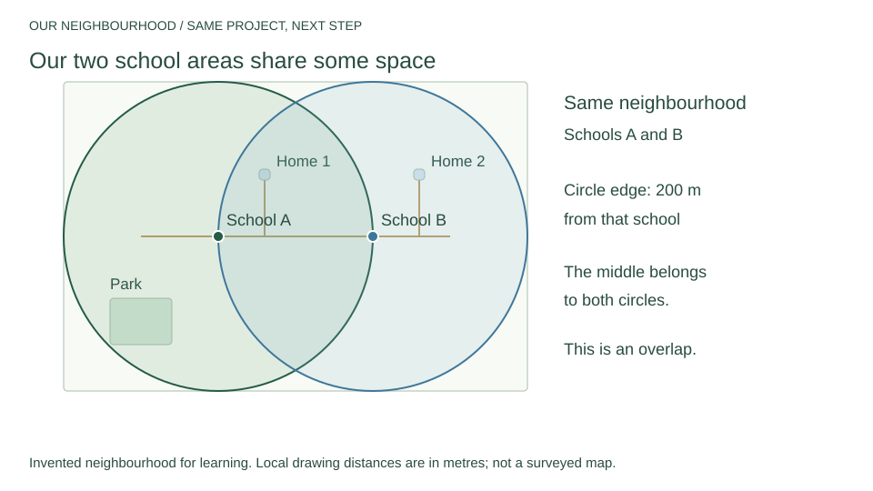

**Follow the picture:** Follow each school’s circle. The lens-shaped middle is inside both. The schools and neighbourhood have not changed.

*[Original project illustration and calculation notes](assets/figures/CREDITS.md#connected-neighbourhood-story).*

### 3. Give the relationship its meaning

GIS uses named tests for relationships between shapes. `Intersects` asks whether two shapes have any point in common. Our school buffers intersect because they share interior area.

These connection and overlap rules are part of `topology`. We do not need a relationship matrix to understand today’s result: the middle belongs to both school areas, so the final count must handle it once.

**What we can now say:** The school buffers overlap. A cell in that shared area can be selected by both schools.

**Pause here:** Does a cell selected by both schools contain twice as many people?

<details>
<summary>Read the explanation after trying</summary>

No. It is the same cell and the same people. We must count it once when asking about at least one school.

</details>

**Why we continue:** We can see the overlap. Next, we will briefly check how the computer stores the circular areas we are using.

[← Handle a new grid size](#topic-resampling) · [Next: Check the calculation →](#topic-algorithms)

**Full detail for this chapter:** [2.4 The geometry model: OGC Simple Features](#24-the-geometry-model-ogc-simple-features) · [4.4.3 Point-in-polygon (ray casting, even-odd rule)](#443-point-in-polygon-ray-casting-even-odd-rule) · [4.4.4 Spatial relationships: the DE-9IM](#444-spatial-relationships-the-de-9im) · [Exercise 3: Geometry model, validity and spatial relationships (Advanced)](#exercise-3-geometry-model-validity-and-spatial-relationships-advanced) · [Solution 3](#solution-3).

**Programming exercise:** [Distinguish a park’s interior, edge and exterior](index.html#lesson/topology/practice). Download the [Python starter](exercises/python/topology.py) or [Go starter](exercises/go/topology.go); both include runnable checks. [Setup and solution files](exercises/README.md).

---

<a id="topic-algorithms"></a>

## Chapter 13. Turn our distance rule into computer steps

**Where we left off:** We drew 200 m buffers around our two schools. Their overlap matters for counting population cells.

**Why this step matters:** We need to know whether the stored shape matches the distance rule closely enough for the calculation.

### 1. Start with the instruction we actually want

For every cell centre, measure its direct distance to a school. If that distance is `200 m` or less, select the cell. Repeating these instructions is an `algorithm`: a step-by-step method for solving a problem.

Our teaching count uses this direct distance test. It does not rely on how smooth the circle looks on screen.

### 2. Understand a stored buffer outline

Many GIS tools store a circular buffer as a Polygon made from short straight sides. A stored corner is called a `vertex`; the plural is vertices.

Four corners make a poor circle. More corners follow it more closely. The picture compares 4 and 64 corners for the same 200 m area. A rough outline can affect whether a point near the edge is included.

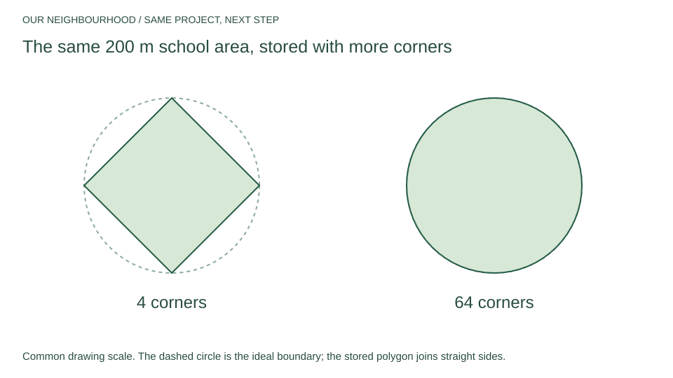

**Follow the picture:** Both panels represent the same school radius at the same drawing scale. Only the number of stored corners changes.

*[Original project illustration and calculation notes](assets/figures/CREDITS.md#connected-neighbourhood-story).*

### 3. Check with answers we already know

Home 1 is 100 m from School A, so our 200 m test must include it. A position 300 m away must fail. These easy examples help us check the instructions.

Our park is `80 m` by `60 m`, so a polygon-area calculation should give `4800 m²`. The symbol m² means square metres, a measure of area. Simple known answers help catch mistakes before a bigger analysis.

**What we can now say:** Check the algorithm and its inputs with known answers. A smooth-looking drawing alone does not prove a correct calculation.

**Pause here:** Should a cell centre 100 m from a school pass our 200 m rule?

<details>
<summary>Read the explanation after trying</summary>

Yes. It is inside the allowed distance.

</details>

**Why we continue:** Our distance test is defined and checked. Next, we can finally count the people selected by at least one school.

[← Compare the school areas](#topic-topology) · [Next: Count people once →](#topic-coverage)

**Full detail for this chapter:** [4. Technical deep dive](#4-technical-deep-dive) · [4.4 Geometry algorithms and spatial relationships](#44-geometry-algorithms-and-spatial-relationships) · [4.4.1 Orientation test and segment intersection](#441-orientation-test-and-segment-intersection) · [4.4.2 Area and centroid of a simple polygon (shoelace formula)](#442-area-and-centroid-of-a-simple-polygon-shoelace-formula) · [4.4.3 Point-in-polygon (ray casting, even-odd rule)](#443-point-in-polygon-ray-casting-even-odd-rule) · [4.4.6 Simplification, buffering and units](#446-simplification-buffering-and-units) · [4.7.2 Label anchors: centroid vs. representative point](#472-label-anchors-centroid-vs-representative-point) · [Exercise 3: Geometry model, validity and spatial relationships (Advanced)](#exercise-3-geometry-model-validity-and-spatial-relationships-advanced) · [Solution 3](#solution-3) · [Appendix A — Reference implementation (geolib.py)](#appendix-a--reference-implementation-geolibpy).

**Programming exercise:** [Implement signed polygon area](index.html#lesson/algorithms/practice). Download the [Python starter](exercises/python/algorithms.py) or [Go starter](exercises/go/algorithms.go); both include runnable checks. [Setup and solution files](exercises/README.md).

---

<a id="topic-coverage"></a>

## Chapter 14. Count the people near at least one school

**Where we left off:** We have two school positions, a checked 200 m distance rule, and 24 population cells containing 10 people each.

**Why this step matters:** We will count selected cells once, including cells that are near both schools.

### 1. Count each school separately first

Testing the cell centres selects `12 cells` around School A and `12 cells` around School B. At 10 people per cell, each school’s separate total is `120 people`.

Adding those totals gives 240, but we already know the circles overlap. Before accepting that answer, inspect the shared cells.

### 2. Remove one copy of the shared count

`4 cells` are selected by both schools. Those cells represent `40 people`. They have appeared once in A’s total and once in B’s total.

Subtract one copy: `120 + 120 − 40 = 200 people`. The combined area belonging to either school is called the `union`. Counting that union selects `20 distinct cells`.

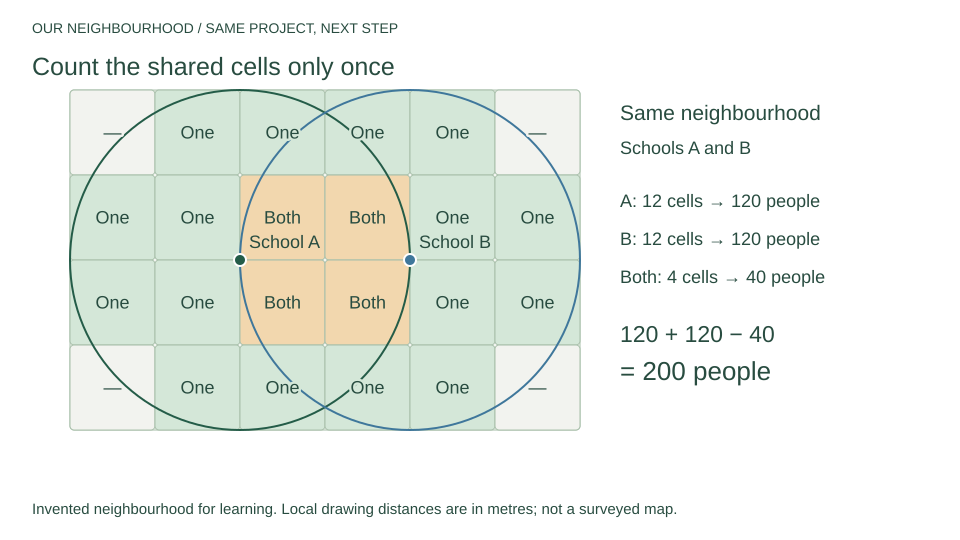

**Follow the picture:** The cells labelled Both form the duplicate count. There are four of them; removing one copy keeps their people in the final total exactly once.

*[Original project illustration and calculation notes](assets/figures/CREDITS.md#connected-neighbourhood-story).*

### 3. State exactly what we found

Our whole grid contains 240 people, and our rule selected 200. The remaining `40 people` are in the four cells whose centres fail both distance tests.

Our result is: “200 people in population cells whose centres are within 200 m of at least one school.” It is a teaching estimate, not a verified walking-access count. This wording keeps the distance rule and cell-selection assumption visible.

**What we can now say:** For our two schools, 120 + 120 − 40 = 200 people near at least one school under the stated rule.

**Pause here:** Why is the separate-school sum of 240 too large?

<details>
<summary>Read the explanation after trying</summary>

It includes the same 40 people in the shared cells twice. The unique selected total is 200.

</details>

**Why we continue:** We have our answer. Next, we will make a map that explains it clearly to someone who has not followed our calculations.

[← Check the calculation](#topic-algorithms) · [Next: Explain the map →](#topic-cartography)

**Full detail for this chapter:** [7. Progressive exercises](#7-progressive-exercises) · [Exercise 4: Applied challenge, a service-coverage audit (Applied)](#exercise-4-applied-challenge-a-service-coverage-audit-applied) · [8. Solutions and explanations](#8-solutions-and-explanations) · [Solution 4](#solution-4).

**Programming exercise:** [Count people near either school exactly once](index.html#lesson/coverage/practice). Download the [Python starter](exercises/python/coverage.py) or [Go starter](exercises/go/coverage.go); both include runnable checks. [Setup and solution files](exercises/README.md).

---

<a id="topic-cartography"></a>

## Chapter 15. Make the answer easy to read

**Where we left off:** Our calculation selected 20 cells, representing 200 people, under the 200 m direct-distance rule.

**Why this step matters:** We need the reader to understand the result without guessing what the colours or circles mean.

### 1. Give each visual choice one job

Keep a clear marker for each school. Draw the two 200 m outlines. Colour selected cells green and unselected cells grey. The green is now a category: it means “selected by our rule”.

Add a `legend`, which is the explanation of the map’s symbols and colours. Include the date and data source when working with real data. Designing maps so people can read them is called `cartography`.

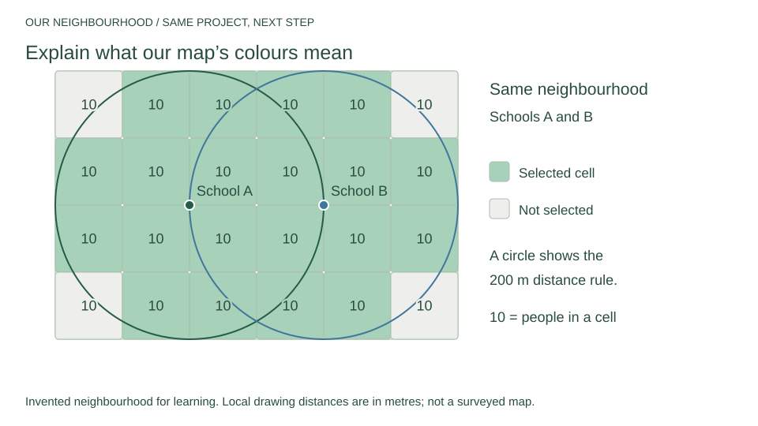

**Follow the picture:** Read the legend before the colours. Green means selected; the number 10 still means the population of a cell.

*[Original project illustration and calculation notes](assets/figures/CREDITS.md#connected-neighbourhood-story).*

### 2. Do not let colour change the question

Our green cells do not contain more people than the grey cells: every cell still contains 10. They are green because their centres pass the distance test.

If we later colour areas by population concentration, we need `density`: people per unit area. That answers a different question from our current selected/not-selected map. State the variable before choosing colours.

### 3. Write a title that carries the main assumption

A useful title is “Population cells within 200 m of a school”. Add “Direct distance; cell-centre selection” nearby so readers know how we counted.

Now the map and the sentence “200 people selected” support each other. The next step is to package the data so another person can reproduce what the map shows.

**What we can now say:** Use labels and a legend to explain the measured variable, distance rule and selection method.

**Pause here:** Does a green cell necessarily contain more people than a grey cell here?

<details>
<summary>Read the explanation after trying</summary>

No. Both contain 10 people. Green only means the cell centre satisfies our school-distance rule.

</details>

**Why we continue:** Our map communicates the result. Next, we will save its data with enough information for someone else to use it.

[← Count people once](#topic-coverage) · [Next: Package the data →](#topic-formats)

**Full detail for this chapter:** [2.7 Basic cartography](#27-basic-cartography) · [4.7 Classification and labelling algorithms](#47-classification-and-labelling-algorithms) · [4.7.1 Classification methods](#471-classification-methods) · [4.7.2 Label anchors: centroid vs. representative point](#472-label-anchors-centroid-vs-representative-point) · [Exercise 4: Applied challenge, a service-coverage audit (Applied)](#exercise-4-applied-challenge-a-service-coverage-audit-applied) · [Solution 4](#solution-4).

**Programming exercise:** [Give class boundaries one consistent meaning](index.html#lesson/cartography/practice). Download the [Python starter](exercises/python/cartography.py) or [Go starter](exercises/go/cartography.go); both include runnable checks. [Setup and solution files](exercises/README.md).

---

<a id="topic-formats"></a>

## Chapter 16. Save our map without losing its meaning

**Where we left off:** We have a labelled map and a result: 200 people selected by our stated school-distance rule.

**Why this step matters:** We want another person to open the school data in the correct place and understand what it represents.

### 1. Keep data and its explanation together

Our school data needs positions and names. It also needs the CRS, field order, source and date. Information describing the data is called `metadata`.

The method belongs with the result too: 200 m direct distance, cell-centre selection, and 10 people per original population cell. A picture alone does not preserve these calculation rules.

### 2. Choose a container for the next person’s task

A `file format` is a way of packaging data. `GeoPackage` is a convenient single-file container for GIS layers, their attributes and CRS information.

`GeoJSON` is a text format often used to share vector data with websites. Its geographic position rule is fixed: WGS 84 longitude first, latitude second. School A’s position is therefore `[90.4125, 23.8103]` in that format.

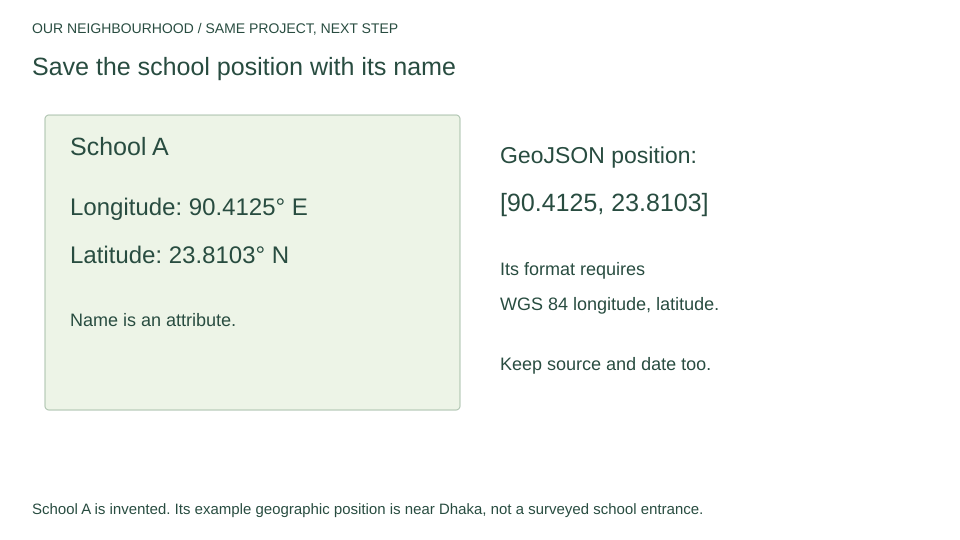

**Follow the picture:** This is still our original School A. The coordinate order is a file-format rule, not a new location.

*[Original project illustration and calculation notes](assets/figures/CREDITS.md#connected-neighbourhood-story).*

### 3. Start with the smallest file we can inspect

For the next chapter, we will use `neighbourhood-school.csv`. A CSV is a simple text table. Our file has one row for School A and columns named `name`, `lon` and `lat`.

This CSV does not contain a full CRS definition. Its accompanying instructions specify EPSG:4326. We will give those instructions to QGIS when opening the file, then save a GIS copy with the coordinate information attached.

**What we can now say:** Keep geometry, attributes and metadata together. Choose the file format for the receiving tool and task.

**Pause here:** Our CSV has lon and lat columns. Does the file extension alone prove its CRS?

<details>
<summary>Read the explanation after trying</summary>

No. Use the accompanying source information. This teaching file is explicitly documented as EPSG:4326.

</details>

**Why we continue:** We have prepared a small school file. Next, we will open that exact file in QGIS and check the result.

[← Explain the map](#topic-cartography) · [Next: Open the same data →](#topic-qgis)

**Full detail for this chapter:** [3.5 Data model: GeoPackage metadata tables (simplified)](#35-data-model-geopackage-metadata-tables-simplified) · [4.5.3 Size arithmetic and storage](#453-size-arithmetic-and-storage) · [4.8 File formats and spatial databases](#48-file-formats-and-spatial-databases) · [5.8 Step 7: Same results in SQL (PostGIS)](#58-step-7-same-results-in-sql-postgis).

**Programming exercise:** [Serialize School A as GeoJSON](index.html#lesson/formats/practice). Download the [Python starter](exercises/python/formats.py) or [Go starter](exercises/go/formats.go); both include runnable checks. [Setup and solution files](exercises/README.md).

---

<a id="topic-qgis"></a>

## Chapter 17. Open our school in QGIS

**Where we left off:** We saved School A in a CSV with name, lon and lat columns. Its documented CRS is EPSG:4326.

**Why this step matters:** We will turn that table into a visible point layer and check it before doing more work.

### 1. Load the file we just prepared

`QGIS` is a free desktop program for viewing and analysing map data. Download our neighbourhood-school.csv from the link below, then open QGIS.

Use its `Delimited Text` import tool and choose the CSV. “Delimited” means that a separator, here a comma, divides the table’s fields. Menu locations can differ between QGIS versions.

### 2. Tell QGIS what the fields mean

For this geographic point import, choose `lon` for the `X` field and `lat` for the `Y` field. Set the geometry CRS to `EPSG:4326`, as documented for our file.

Add the layer and use `Zoom to Layer`. Inspect the school’s name and stored coordinates. The point should be at our example location near Dhaka. The import has used our existing coordinates; it has not made a new survey.

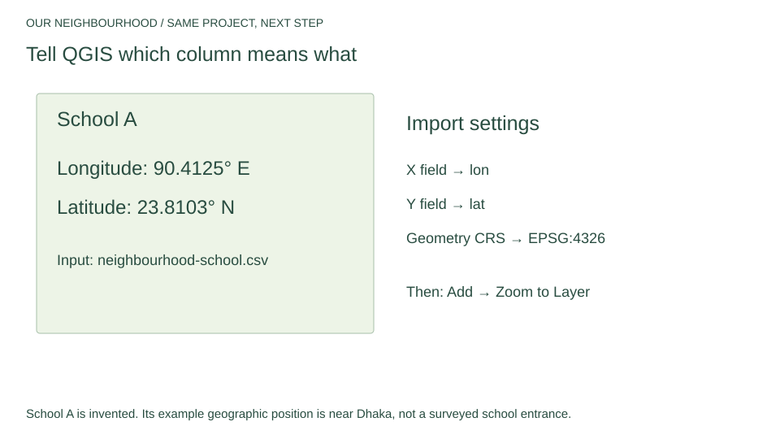

**Follow the picture:** The left box shows our file’s known values. The right box shows the import settings that give those values their intended meaning.

*[Original project illustration and calculation notes](assets/figures/CREDITS.md#connected-neighbourhood-story).*

### 3. Separate the display from the stored data

The `layer CRS` describes the stored school coordinates. The `project CRS` controls the map view. Changing the view does not rewrite the source CSV.

To make our metre-based analysis copy, export the layer with target CRS EPSG:32646, for example into a GeoPackage. Check School A against the conversion we already calculated: about 236377.4 m east and 2635628.6 m north.

[Download our School A CSV](data/neighbourhood-school.csv). The documented source CRS is `EPSG:4326`; `lon` is longitude and `lat` is latitude.

**What we can now say:** Import named fields with the verified source CRS. Exporting to another CRS converts coordinates; changing the project view does not.

**Pause here:** Which CSV field goes into X for this import?

<details>
<summary>Read the explanation after trying</summary>

lon goes into X. lat goes into Y. The geometry CRS is EPSG:4326.

</details>

**Why we continue:** We have opened the school and checked its position. Finally, we will use the same chain of ideas to investigate a map that looks wrong.

[← Package the data](#topic-formats) · [Next: Check our finished work →](#topic-debugging)

**Full detail for this chapter:** [1.2 Prerequisites](#12-prerequisites) · [4.9 Hands-on lab: QGIS as a visual debugger for your future code](#49-hands-on-lab-qgis-as-a-visual-debugger-for-your-future-code) · [Exercise 1: CRS literacy, precision and your first QGIS session (Beginner)](#exercise-1-crs-literacy-precision-and-your-first-qgis-session-beginner) · [Solution 1](#solution-1).

**Programming exercise:** [Prepare density attributes for QGIS](index.html#lesson/qgis/practice). Download the [Python starter](exercises/python/qgis.py) or [Go starter](exercises/go/qgis.go); both include runnable checks. [Setup and solution files](exercises/README.md).

---

<a id="topic-debugging"></a>

## Chapter 18. Check the whole chain when something looks wrong

**Where we left off:** We created shapes, located them, chose a CRS, measured distances, counted raster cells and opened the data in QGIS.

**Why this step matters:** We will use that sequence to find a mistake rather than moving the drawing until it looks convincing.

### 1. Return to one known map object

Start with School A because we know its name, longitude, latitude and CRS. `Debugging` means finding and explaining the cause of an unexpected result.

If the point appears in the wrong place, compare the file fields with our source record. If latitude has become 90.4125°, the fields were likely swapped: allowed latitude runs only from −90° to +90°. Confirm the column mapping before making a correction.

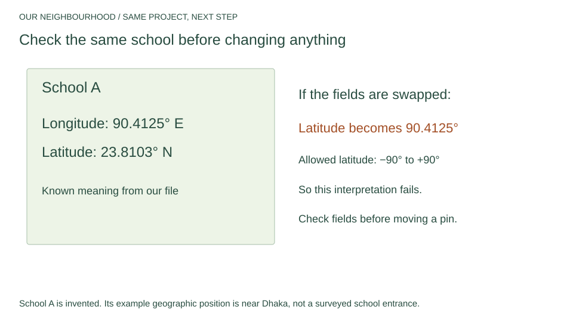

**Follow the picture:** Compare the suspected error against the same School A record. There is no need to invent a new example or drag the point by eye.

*[Original project illustration and calculation notes](assets/figures/CREDITS.md#connected-neighbourhood-story).*

### 2. Follow the order of our earlier decisions

If the fields are correct, check the CRS label. If a distance area is far too large, check whether the tool interpreted 200 as degrees rather than metres. If raster selection is shifted, check whether corners were used instead of centres.

If the map looks right but the total is 240, inspect whether the four shared cells were counted twice. Each symptom leads back to a specific choice we made, rather than to an arbitrary visual adjustment.

### 3. Explain the finished result from start to end

Our school points supply positions. Our chosen CRS makes local measurement possible. Our 200 m direct-distance rule selects cell centres. Our original cells each hold 10 people. Counting selected cells once gives 200 people.

That is the full connection. We can now explain what we did, why each step was needed, and what the answer means. Keep the original data and record any corrections so another person can follow the same reasoning.

**What we can now say:** Check the chain in order: map object → coordinates → CRS → distance rule → cell selection → unique count → clear explanation.

**Pause here:** Our separate school totals sum to 240. What earlier fact explains why the unique result is 200?

<details>
<summary>Read the explanation after trying</summary>

The schools share four selected cells, or 40 people. Those people appeared in both separate totals, so one copy must be removed.

</details>

**The complete picture:** You have completed the connected first reading. Revisit any chapter where the explanation still feels unclear, or use the optional reference material to deepen one idea at a time.

[← Open the same data](#topic-qgis) · [Review the whole path](#read-in-order)

**Full detail for this chapter:** [3.3 Workflow: diagnosing "my data is in the wrong place"](#33-workflow-diagnosing-my-data-is-in-the-wrong-place) · [5. Worked GIS example: "Why are my stations in the Indian Ocean?"](#5-worked-gis-example-why-are-my-stations-in-the-indian-ocean) · [5.1 Scenario](#51-scenario) · [5.2 Step 1: Inspect the numbers](#52-step-1-inspect-the-numbers) · [5.3 Step 2: Test both axis hypotheses against the expected area](#53-step-2-test-both-axis-hypotheses-against-the-expected-area) · [5.9 Conclusions of the example](#59-conclusions-of-the-example) · [6. Common pitfalls and best practices](#6-common-pitfalls-and-best-practices) · [6.1 Pitfall catalogue](#61-pitfall-catalogue) · [6.2 Best practices](#62-best-practices) · [6.3 A minimal ingest-validation function](#63-a-minimal-ingest-validation-function) · [9. Summary, glossary and further reading](#9-summary-glossary-and-further-reading) · [9.1 Key takeaways](#91-key-takeaways) · [9.2 Glossary](#92-glossary) · [9.3 Further reading and authoritative references](#93-further-reading-and-authoritative-references) · [9.4 Where to go next](#94-where-to-go-next).

**Programming exercise:** [Audit coordinates before they reach the map](index.html#lesson/debugging/practice). Download the [Python starter](exercises/python/debugging.py) or [Go starter](exercises/go/debugging.go); both include runnable checks. [Setup and solution files](exercises/README.md).

---

<a id="full-technical-reading"></a>

# Part 2 — The complete technical reading

The original note follows in full, in its own sequence. Use the chapter links above to revisit its prerequisites. On the website, [full readings](index.html#reference) include short clarifications about precision terminology, projection assumptions, QGIS raster styling and the limits of the teaching code. The original source text is retained below.

---

# Core Geospatial Concepts for GIS Developers

> **Completely new to GIS? Start with [GIS from zero: one connected neighbourhood story](beginner-geospatial-guide.md).** Follow the same schools through 18 ordered chapters: draw the places, locate them, measure distances, add population, count people once, then explain and share the result. Each chapter recalls what came before, explains new words when needed, and shows why the next step matters. This longer document is the technical reference, with formulas, programming exercises and separate example datasets.

**Phase 1 study note** · Coordinate reference systems · Geometry model · Raster vs. vector · Accuracy and precision · Basic cartography · QGIS hands-on

| | |
|---|---|
| **Audience** | Software engineers who are new to GIS and want to become domain experts |
| **Level** | Beginner → intermediate |
| **Suggested time** | 2–4 weeks (see the study plan below) |
| **Languages / tools** | Python 3 (examples), SQL/PostGIS (examples), QGIS 3.x (hands-on), GDAL/OGR command line (reference) |
| **How numbers were checked** | The core numeric benchmarks in this note were produced by the dependency-free reference code in [Appendix A](#appendix-a--reference-implementation-geolibpy). That code was validated against independent checks (a numerical meridian-arc integral for the UTM implementation, and a published geodesic test line for the distance code). PROJ/pyproj results should agree to within millimetres to a few centimetres. Compare with a tolerance, not with `==`. Outputs attributed to third-party tools (pyproj, Shapely, PostGIS, QGIS, GDAL) are *expected results* derived from the same formulas and the standards; they were not executed while this note was written, so run them and compare. The added SVG diagrams use the course's JavaScript reference calculations or explicitly labelled synthetic geometry; their generator is linked in the figure credits. |

> **Read the visuals.** The inline SVG diagrams use explicit geometry and reference calculations; each states its scale assumptions. Height, accuracy and coverage examples use labelled synthetic values. ASCII drawings and Mermaid diagrams are *schematics*, showing relationships rather than true shapes or distances. Open any image for a larger view. [Figure provenance and rebuild instructions](assets/figures/CREDITS.md).

---

## 1. Learning objectives, prerequisites and expected outcomes

### 1.1 Learning objectives

After working through this note you should be able to:

1. **Explain** the chain *Earth → ellipsoid → datum → CRS → projection* and choose an appropriate CRS for storage, analysis and display.
2. **Read and write** EPSG codes correctly, and predict the **axis order** that a given library, format or web service will use.
3. **Diagnose** the classic "my data is in the wrong place" bugs: missing CRS, wrong CRS, swapped axes, unit confusion and ignored datum shifts.
4. **Describe and apply** the OGC Simple Features geometry model: geometry types, validity rules, the DE-9IM relationship matrix and basic topology concepts.
5. **Choose** between raster and vector representations, and explain cell size, geotransform, resolution and resampling.
6. **Distinguish** scale, resolution, accuracy and precision, and reason about how many coordinate decimals are meaningful.
7. **Apply** basic cartographic practice: visual variables, data classification methods, label placement and design principles.
8. **Use QGIS** to load, reproject, style and process data, and map each GUI action to the code you will later write.

### 1.2 Prerequisites

- Comfortable with Python (functions, lists, `numpy` arrays) and basic SQL.
- High-school trigonometry (sine, cosine, logarithm) and the idea of a matrix. No geodesy background is assumed.
- Software: Python 3.10+ with `numpy` and `matplotlib`. Recommended: `pyproj`, `shapely` (2.x), `geopandas`, `rasterio`. Install **QGIS 3.x** (a Long Term Release is a good choice). Optional: PostgreSQL + PostGIS, GDAL command-line tools.

### 1.3 Expected outcomes

At the end you will have:

- a one-page CRS cheat sheet in your own words,
- a small, tested Python toolkit (reprojection, distance, area, geometry validity, classification),
- a reproduced "service coverage" analysis both in code and in QGIS,
- the vocabulary to read PROJ, GDAL, PostGIS and QGIS documentation without getting lost.

### 1.4 Suggested study plan

| Week | Focus | Note sections | Hands-on |
|---|---|---|---|
| 1 | CRS, datums, EPSG, axis order | 2.1–2.3, 4.1–4.3 | QGIS lab part A–B; Exercise 1 |
| 2 | Geometry model, validity, topology | 2.4, 4.4 | Exercise 2–3 |
| 3 | Raster vs. vector, accuracy and precision | 2.5–2.6, 4.5–4.6 | QGIS lab part C; worked example |
| 4 | Cartography, integration | 2.7, 4.7–4.9, 5–6 | Exercise 4 (applied challenge) |

---

## 2. Conceptual foundations

### 2.1 Modelling the Earth: geoid, ellipsoid, datum


**Read it:** Follow each arrow from its reference surface to the same point. In this simplified local example, *h ≈ H + N*: the different height reports do not imply that the terrain moved. Surface separation is exaggerated.

Positions on the Earth are only meaningful relative to a **model of the Earth's shape**.

- **Physical surface**: the terrain we walk on. Too irregular to compute with.
- **Geoid**: the equipotential surface of gravity that best fits mean sea level. It is the reference for *heights above sea level* (orthometric heights). It undulates by roughly ±100 m relative to a smooth ellipsoid.
- **Reference ellipsoid**: an oblate spheroid (a squashed sphere) defined by a semi-major axis *a* and a flattening *f*. It is the reference for *latitude, longitude and ellipsoidal height*.
- **Datum** (geodetic reference frame): an ellipsoid **plus** the information that fixes it to the real Earth (origin, orientation, scale, and, for modern frames, how it evolves in time). Two datums can use the *same* ellipsoid and still give different coordinates for the same physical point.

| Ellipsoid | Semi-major axis *a* (m) | Inverse flattening 1/*f* | Used by |
|---|---|---|---|
| WGS 84 | 6 378 137.0 | 298.257223563 | WGS 84 datum (GPS), most web data |
| GRS 80 | 6 378 137.0 | 298.257222101 | ETRS89, NAD83 |

WGS 84 and GRS 80 differ by roughly 0.1 mm in the semi-minor axis, which is irrelevant for almost every application. The datums built on them differ far more, for the reasons below.

| Datum / frame | Region | Key idea |
|---|---|---|
| **WGS 84** | Global | Reference frame of GPS broadcast orbits; realised in several versions (G730, G873, G1150, G1674, G1762, G2139). Roughly aligned with ITRF. |
| **ETRS89** | Europe | Fixed to the stable part of the Eurasian plate, coinciding with ITRS at epoch 1989.0. Because Europe drifts relative to the global frame (about 2–3 cm per year), ETRS89 and WGS 84 now differ by roughly a metre in many places. |
| **NAD83** | North America | Tied to the North American plate. Differs from WGS 84 by about 1–2 m over much of the continent. Realisations such as NAD83(2011) exist. |

> **Why this matters for developers.** A metre of datum offset is invisible on a country-scale web map but is a visible error when overlaying cadastral parcels, building footprints or utility networks. Many "mysterious" 1–2 m shifts are a missing or ignored datum transformation.

### 2.2 Coordinate reference systems (CRS)

A **coordinate reference system** is a datum plus a *coordinate system* (axes, order, units) and, for projected systems, a *map projection* with its parameters.

| Kind | Coordinates | Units | Typical use | Example EPSG codes |
|---|---|---|---|---|
| **Geographic** (2D) | latitude φ, longitude λ | degrees | storage, GPS, data exchange | 4326 (WGS 84), 4258 (ETRS89), 4269 (NAD83) |
| **Projected** | easting *E*, northing *N* (or *x*, *y*) | metres (usually) | measurement, analysis, large-scale maps | 32631 (WGS 84 / UTM 31N), 25831 (ETRS89 / UTM 31N), 26918 (NAD83 / UTM 18N), 3035 (ETRS89-extended / LAEA Europe), 5070 (NAD83 / Conus Albers) |
| **Web display** | *x*, *y* | metres | web map tiles | 3857 (WGS 84 / Pseudo-Mercator) |
| **Geocentric** (3D) | *X*, *Y*, *Z* | metres | geodesy, satellite positioning | 4978 (WGS 84 geocentric) |
| **Vertical / compound** | height *h* (plus horizontal) | metres | elevation | EGM96/EGM2008 heights, compound codes |

**EPSG codes** identify entries in the EPSG Geodetic Parameter Dataset (maintained by the IOGP). In code you write `EPSG:4326`; in OGC URN form it is `urn:ogc:def:crs:EPSG::4326`. A code identifies a *complete* definition: datum, axes, units and (if any) projection parameters.

**Projection properties.** Flattening a curved surface always distorts something. Each projection preserves some properties at the expense of others:

| Property preserved | Name | Consequence | Examples |
|---|---|---|---|
| Local angles / shapes | **Conformal** | Areas are distorted, more so far from the projection's centre | Mercator, Transverse Mercator (UTM), Lambert Conformal Conic, stereographic |
| Areas | **Equal-area** | Shapes and angles are distorted | Albers, Lambert Azimuthal Equal-Area (LAEA), Mollweide |
| Distances along specific lines | **Equidistant** | Only along certain lines or from certain points | Azimuthal equidistant, plate carrée (along meridians) |
| None exactly (compromise) | **Compromise** | Looks balanced for world maps | Robinson, Winkel Tripel |

No projection is simultaneously conformal and equal-area (except for trivial cases). The rule for developers: **store in a geographic CRS or a suitable national CRS, compute in a projected CRS appropriate to the task and region, display in whatever the client needs.**

### 2.3 Axis order: latitude/longitude vs. longitude/latitude

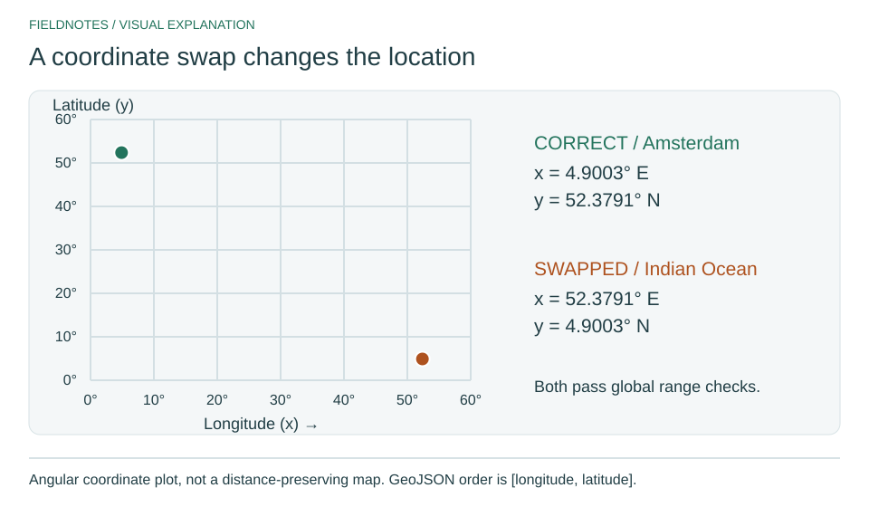

**Read it:** The green dot uses longitude 4.9003°, latitude 52.3791°. The orange dot reverses those values. Both pass global numeric-range checks; only one lies in the expected area. The axes measure angles, not ground distances.

Mathematicians write points as (*x*, *y*), meaning (east, north). Geodesists write geographic positions as (latitude, longitude), meaning (north, east). Both conventions are alive in today's software, and this is the origin of an enormous number of bugs.

```
Geographic position of Amsterdam Centraal (approx.), WGS 84

   EPSG registry axis order (EPSG:4326):    (lat , lon ) = (52.3791 ,  4.9003)
   GeoJSON (RFC 7946), WKT POINT, PostGIS:  (lon , lat ) = ( 4.9003 , 52.3791)
   OGC "CRS84" (urn ...:OGC:1.3:CRS84):     (lon , lat ) = ( 4.9003 , 52.3791)

   Same place, same datum (WGS 84). Only the order of the numbers differs.
```

| Context | Axis order for WGS 84 geographic coordinates |
|---|---|
| EPSG registry definition of EPSG:4326 | latitude, longitude |
| GeoJSON (RFC 7946) | **longitude, latitude** (always; the format has no CRS member any more) |
| WKT / WKB geometries, PostGIS `ST_MakePoint(x, y)` | x = longitude, y = latitude |
| WMS 1.1.1 `SRS=EPSG:4326` | longitude, latitude |
| WMS 1.3.0 `CRS=EPSG:4326` | **latitude, longitude** (follows the authority definition). `CRS:84` is lon/lat |
| OGC API – Features default CRS (CRS84) | longitude, latitude |
| PROJ / pyproj `Transformer` | follows the CRS definition (lat, lon for 4326) **unless** `always_xy=True` |
| GDAL ≥ 3 (OSR) | follows the CRS definition **unless** the "traditional GIS order" axis mapping is set (the default in the Python bindings of many tools) |
| QGIS | internally uses x = easting/longitude, y = northing/latitude |

Some **projected** CRSs also have a northing-first definition. For example, EPSG:3035 (ETRS89-extended / LAEA Europe) is defined with northing before easting. Always read the axis definition (for example `pyproj.CRS.from_epsg(3035).axis_info`) instead of assuming.

> **Rule of thumb.** Inside your application, normalise to **(x, y) = (easting or longitude, northing or latitude)** at the system boundary, and use `always_xy=True` (or the equivalent) everywhere.

### 2.4 The geometry model: OGC Simple Features

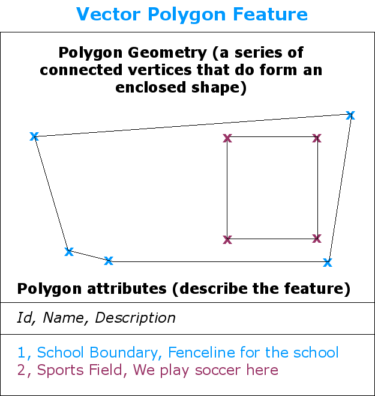

**Read it:** Separate the boundary coordinates from the descriptive attributes. A Polygon includes the enclosed area, excluding holes; a LinearRing is just a curve. *Source: QGIS, A Gentle Introduction to GIS, GNU FDL 1.2 or later; [full attribution](assets/figures/CREDITS.md#qgis-a-gentle-introduction-to-gis).*

The **OGC Simple Feature Access** standard (also ISO 19125) defines the geometry types that nearly every GIS database, file format and library implements (PostGIS, GEOS/Shapely, GDAL/OGR, GeoPackage, GeoJSON with small differences).

| Type | Dimension | Meaning |
|---|---|---|
| `Point` | 0 | One position |
| `LineString` | 1 | Ordered sequence of ≥ 2 points joined by straight segments |
| `LinearRing` | 1 | A closed, simple `LineString` (first point = last point); building block of polygons |
| `Polygon` | 2 | One exterior ring and zero or more interior rings (holes) |
| `MultiPoint`, `MultiLineString`, `MultiPolygon` | 0, 1, 2 | Collections of one type, used for one logical feature with several parts (an archipelago, a river with a braid) |
| `GeometryCollection` | mixed | Heterogeneous collection (avoid in data models; many tools handle it poorly) |

Every geometry has an **interior**, a **boundary** and an **exterior**, which are the sets used to define spatial relationships (see DE-9IM in section 4.4).

| Geometry | Interior | Boundary |
|---|---|---|
| Point | the point itself | empty |
| LineString (open) | all points except the two endpoints | the two endpoints |
| LineString (closed) | the whole curve | empty |
| Polygon | the enclosed area | the rings |

**Validity rules for polygons** (informal summary of the OGC definition):

1. Every ring is **closed** and **simple** (no self-intersection or self-touching).
2. Holes lie **inside** the exterior ring.
3. Rings may touch each other at **single points** at most; they must not cross or share a segment.
4. The **interior of the polygon is connected** (holes together with touching points must not split it into pieces).
5. In a `MultiPolygon`, member polygon interiors must not overlap; they may touch at points only.

Examples (schematic):

```
 VALID                    INVALID: bow-tie          INVALID: hole outside
 (square with hole)       (self-intersection)       the shell

 +-----------+            1 +-----+ 2              +--------+     +----+
 |  +-----+  |              \   /                  |        |     | ho |
 |  |hole |  |               \ /   <- ring crosses |  shell |     |    |
 |  +-----+  |               / \      itself        |        |     +----+
 +-----------+              /   \                   +--------+
                          4 +-----+ 3
```

> **Dialect warning.** Different systems define "valid" slightly differently. For example, OGC treats a ring that touches itself at a point as invalid; Esri-style data may contain such "self-touching ring" polygons. Always validate with the library that will consume the data.

**Topology** concerns the connectivity and adjacency of features, independent of exact shape. The Simple Features model is **not topological**: each feature stores its own coordinates, so two neighbouring parcels store the shared boundary twice and can drift apart, producing **gaps**, **overlaps** and **slivers**. Topological models (PostGIS Topology, TopoJSON, "coverage" operations in GEOS/JTS, planar-graph tools in QGIS) store each shared edge once. Practical consequences:

- Editing one polygon may open a gap with its neighbour unless snapping or topology rules are enforced.
- Simplifying polygons *independently* breaks shared borders. Use topology-aware simplification (for example mapshaper, TopoJSON) for administrative boundaries.

### 2.5 Raster vs. vector

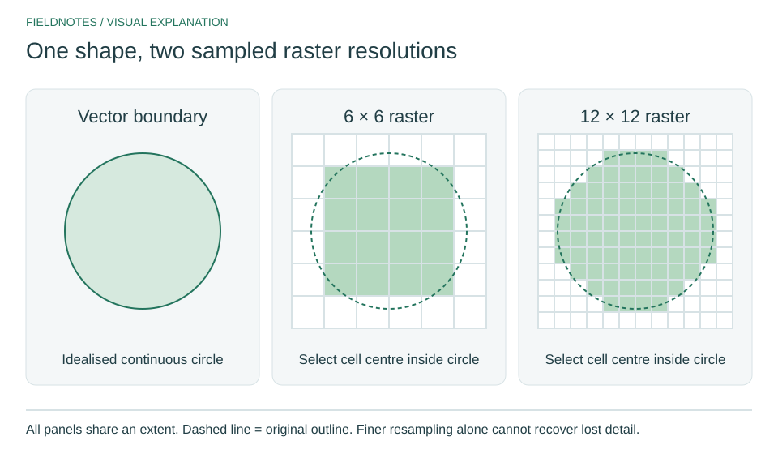

**Read it:** The dashed circle remains fixed. A cell is filled when its centre lies inside that circle. Smaller cells approximate the boundary more closely; enlarging an existing coarse raster cannot recover unsampled detail.

| | **Vector** | **Raster** |
|---|---|---|
| Structure | Geometries with attributes | Regular grid of cells (pixels), each with a value per band |
| Best for | Discrete objects: roads, parcels, boundaries, points of interest | Continuous or sampled fields: elevation, temperature, imagery, land-cover classes |
| Precision | Coordinates are exact up to floating point; scale-independent | Limited by cell size; coarser cells lose detail |
| Storage | Grows with number and complexity of features | Grows with *area ÷ cell size²* and number of bands |
| Typical analysis | Overlay, buffer, network routing, joins | Map algebra, slope/aspect, zonal statistics, classification |
| Typical formats | GeoPackage, Shapefile, GeoJSON, FlatGeobuf, PostGIS | GeoTIFF, Cloud Optimized GeoTIFF (COG), NetCDF/Zarr |

Key raster vocabulary:

- **Cell size (pixel size, resolution)**: ground distance covered by one cell edge (for example 2 m or 30 m). *Higher resolution = smaller cells.* Beware: "high resolution" also means "small cell size", which numerically is a *small* number.
- **Extent**: bounding rectangle of the raster in CRS units.
- **Geotransform**: an affine function from (column, row) to (x, y) in the CRS (section 4.5).
- **NoData**: sentinel value meaning "no measurement" (not zero!).
- **Resampling**: computing new cell values when the grid changes (reprojection, resolution change). The method must match the data type: **nearest** for categories, **bilinear/cubic** for continuous surfaces, **average/mode** for aggregation (section 4.5).

Rule of thumb for the choice: *if you would naturally say "this feature has an outline and attributes", use vector; if you would say "what is the value at this place?" for every place, use raster.* Converting between them (rasterise, vectorise) always loses or invents information.

### 2.6 Scale, accuracy, precision and resolution


**Read it:** Compare across for a change in bias and down for a change in spread. A tight cluster can miss the truth. A widely spread sample centred on truth has low bias, but its individual observations still have substantial error.

These words are often used interchangeably. They are not the same.

| Term | Meaning | Example |
|---|---|---|
| **Map scale** | Ratio of map distance to ground distance, written as a representative fraction such as 1:25 000 | 1 cm on the map is 250 m on the ground at 1:25 000 |
| **Resolution** | Smallest unit the data model can distinguish (raster cell size, coordinate grid step) | 10 m cells |
| **Precision** | Number of significant digits stored or reported (a property of the *representation*) | `52.379189123456` has many digits |
| **Accuracy** | Closeness to the true value (a property of the *measurement process*) | A phone GPS is typically accurate to a few metres under open sky |
| **Uncertainty** | Quantified doubt about a value (for example a 95 % confidence radius) | ±4.9 m at 95 % |

> **A coordinate with 10 decimals is not 10-decimals accurate.** One degree of latitude is about 111 km, so the 10th decimal of a degree corresponds to roughly 11 micrometres. Consumer GNSS yields metres of error, survey-grade RTK yields centimetres. Digits beyond the accuracy of the source are noise that creates a false impression of exactness and inflates file sizes.

**Scale and generalisation.** Features are simplified, merged, displaced or omitted as scale decreases (a river polyline at 1:1 000 000 is not the river at 1:5 000). Cartographers commonly assume about **0.25 mm** as the smallest reliably distinguishable distance on paper, so at 1:25 000 the "graphical accuracy" is about 6.25 m on the ground. Data compiled for 1:25 000 should not be used to claim 1 m accuracy at 1:500.

### 2.7 Basic cartography

A map is an argument made with graphic variables. Developers who own styling code (vector tiles, SLD, QML, Mapbox/MapLibre style JSON) benefit from knowing the rules.

**Visual variables** (after Bertin): position, size, shape, orientation, colour hue, colour value (lightness), colour saturation, texture. They differ in how well they convey *categories* (hue, shape) versus *order or magnitude* (value, size).

| Data type | Suitable encoding | Example |
|---|---|---|
| Nominal (categories) | hue, shape, texture | land-cover classes |
| Ordinal (ranked) | lightness steps of one hue | hazard level low/medium/high |
| Interval / ratio (numeric) | sequential or diverging colour ramps, proportional symbols | population density, temperature anomaly |

**Choropleth maps** (areas shaded by class) should show **rates or densities** (people per km²), not raw counts, because the area of the enumeration unit itself drives the visual weight. Counts belong in proportional symbols.

**Classification methods** group a continuous variable into a small number of classes (typically 4–7). Definitions and formulas are in section 4.7.

| Method | Idea | Strength | Weakness |
|---|---|---|---|
| Equal interval | Equal-width ranges | Easy legend | Empty classes with skewed data |
| Quantile | Equal number of features per class | Balanced map colours | Can put very different values in one class |
| Natural breaks (Jenks / Fisher) | Minimise within-class variance | Follows the data's structure | Breaks are dataset-specific; hard to compare across maps |
| Standard deviation | Classes in multiples of σ from the mean | Shows deviation from average | Assumes roughly symmetric data |
| Manual / domain thresholds | Thresholds from law or science | Comparable across maps and time | Requires domain knowledge |

**Colour.** Use **sequential** ramps for ordered data, **diverging** ramps when there is a meaningful midpoint (zero, average), **qualitative** palettes for categories. Prefer palettes that remain legible for colour-vision deficiency (ColorBrewer is the standard reference). Never use a rainbow ramp for magnitude: its perceived lightness is non-monotonic.

**Label placement.** Good labels follow cartographic preferences: points get labels at preferred positions (for example upper right), lines get labels that follow the curve and avoid sharp bends, polygons get labels inside, near the visual centre. A polygon's **centroid** can lie *outside* the polygon (for a crescent or U shape), so label engines use a *representative point* or the **pole of inaccessibility** (the interior point farthest from the boundary). Label placement is an optimisation problem (maximise placed labels, avoid collisions, respect priorities).

**Design principles.**

- **Visual hierarchy and figure-ground**: the theme stands out, the base map recedes.
- **Legend, scale bar, north arrow (when orientation is not obvious), data source, CRS or projection note** on print products.
- **Projection fit for purpose**: equal-area for density comparison, conformal for navigation and local shape.
- **Generalise for scale**; do not draw every vertex at a small scale.
- **Contrast and legibility** over decoration.

---

## 3. Visual explanations

### 3.1 Conceptual overview: from the Earth to a styled map

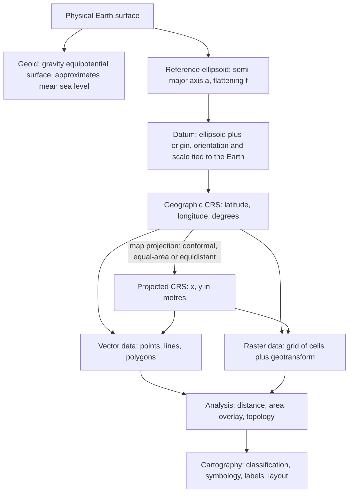

**How to read it.** The top row is *modelling*: you cannot assign numbers to positions without choosing an ellipsoid and a datum. The middle row is *representation*: the same datum can be expressed as angles (geographic) or as metres on a plane (projected), and the data itself is either vector or raster. The bottom row is *use*: measurement needs a CRS whose distortion is acceptable for the task, and cartography needs classified, styled values. Most bugs come from skipping a box (for example doing area analysis directly on geographic degrees).

### 3.2 Geometry type hierarchy (OGC Simple Features)

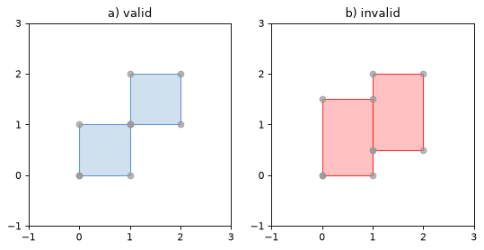

**Read it:** One logical feature can have multiple polygon parts. Member interiors must not overlap, and their boundaries may meet only at isolated points. *Source: Sean Gillies and Shapely contributors, CC BY 3.0 US; [full attribution](assets/figures/CREDITS.md#the-shapely-user-manual).*

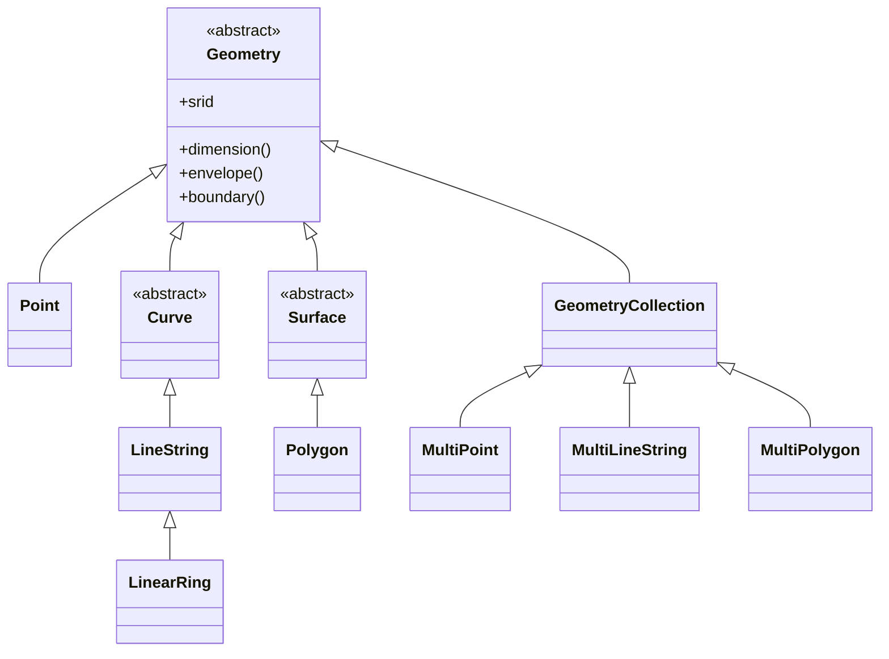

**Interpretation.** Concrete types you instantiate are `Point`, `LineString`, `Polygon`, the three `Multi*` types and `GeometryCollection`. `Curve` and `Surface` are abstract classes in the standard; `LinearRing` is a closed simple `LineString` used for polygon rings. Every geometry can carry an SRID (the CRS identifier), but the Simple Features *geometry itself does not know its CRS* in plain WKT/WKB; the container (database column, file layer) does.

### 3.3 Workflow: diagnosing "my data is in the wrong place"

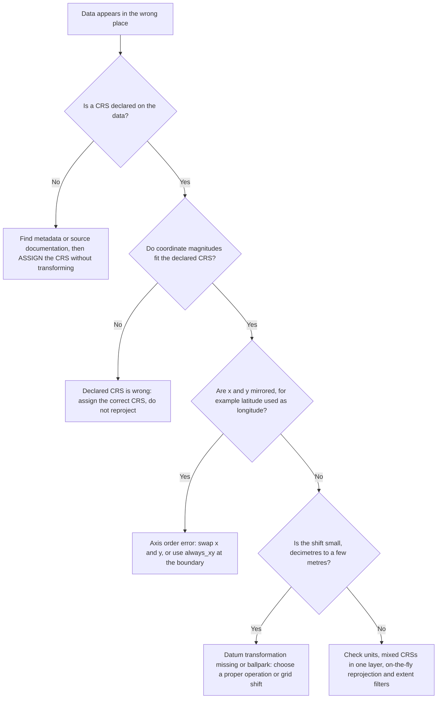

**Key distinction: assign vs. transform.** *Assigning* a CRS (sometimes called "define projection" or `ogr2ogr -a_srs`) only changes the label and leaves numbers untouched. It repairs missing or wrong metadata. *Transforming* (reprojecting, `-t_srs`, `ST_Transform`) changes the numbers to express the same place in another CRS. Using one when you need the other is the single most common reprojection error.

### 3.4 Sequence: what happens during a reprojection

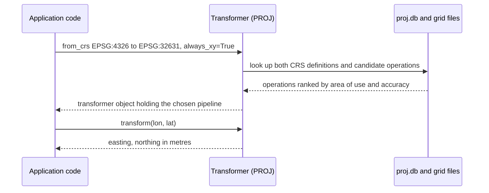

**Interpretation.** Creating the transformer is the expensive step (database lookups, possibly grid files); applying it is cheap. In real code, build a `Transformer` once and reuse it for many coordinates (vectorised arrays are preferred over Python loops).

### 3.5 Data model: GeoPackage metadata tables (simplified)

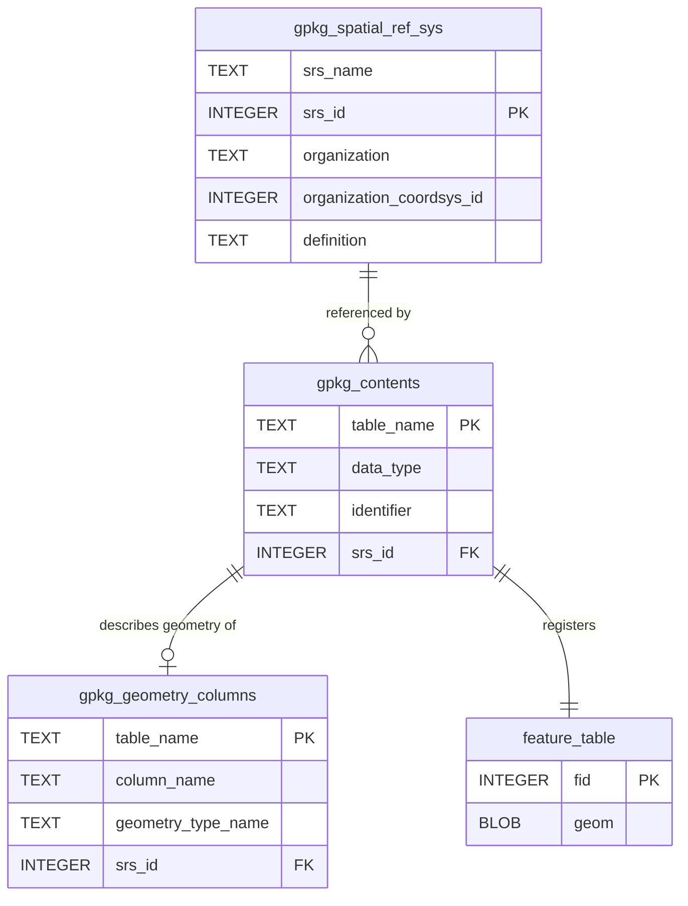

**Interpretation.** A GeoPackage is a SQLite file in which CRS definitions, layer registry and geometry-column metadata are ordinary tables. The CRS travels *with* the data, which is a major reason GeoPackage is preferred over Shapefile (whose CRS lives in a loose `.prj` text file that is often missing or ambiguous).

---

## 4. Technical deep dive

### 4.1 Geographic coordinates: lengths of degrees and distances on the ellipsoid

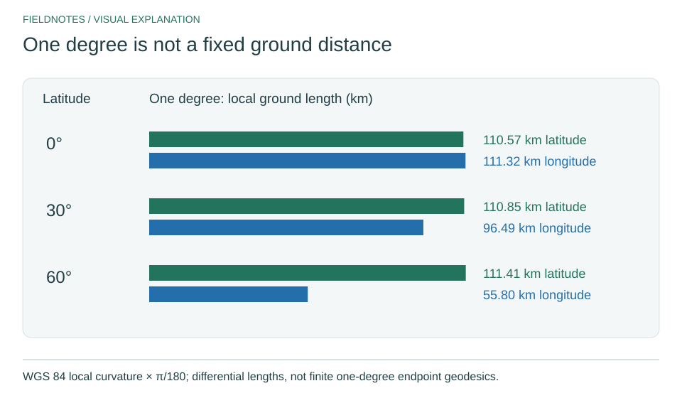

**Read it:** Blue longitude bars get shorter toward the poles. Green latitude bars remain close to 111 km but are not exactly constant. These are local curvature-based lengths per degree, not finite endpoint-to-endpoint geodesics.

With ellipsoid parameters *a* (semi-major axis) and *e*² = *f*(2 − *f*) = 0.00669437999 (WGS 84), the radii of curvature at latitude φ are

$$
N(\varphi) = \frac{a}{\sqrt{1 - e^2 \sin^2\varphi}}, \qquad
M(\varphi) = \frac{a\,(1 - e^2)}{\left(1 - e^2 \sin^2\varphi\right)^{3/2}}
$$

The ground length of one degree is then

$$
\text{1° of latitude} \approx \frac{\pi}{180}\, M(\varphi), \qquad
\text{1° of longitude} \approx \frac{\pi}{180}\, N(\varphi)\cos\varphi
$$

| Latitude φ | 1° latitude (m) | 1° longitude (m) | Mercator scale *k* = sec φ | Area factor *k*² |
|---|---:|---:|---:|---:|
| 0° | 110 574.3 | 111 319.5 | 1.000 | 1.00 |
| 30° | 110 852.4 | 96 486.3 | 1.155 | 1.33 |
| 45° | 111 131.8 | 78 846.8 | 1.414 | 2.00 |
| 52.3791° | 111 274.5 | 68 096.4 | 1.638 | 2.68 |
| 60° | 111 412.3 | 55 800.0 | 2.000 | 4.00 |
| 70° | 111 562.0 | 38 186.5 | 2.924 | 8.55 |
| 80° | 111 659.9 | 19 393.5 | 5.759 | 33.16 |

(The last two columns anticipate Web Mercator in section 4.2.)

**Takeaway.** A degree of longitude shrinks with cos φ, so *a "square" of 0.01° × 0.01° is not square on the ground* except at the equator. Any computation that treats degrees as if they were metres (planar distance, buffer radius, area) is wrong, and increasingly so towards the poles.

**Distance between two geographic points**

1. **Haversine (spherical).** Treat the Earth as a sphere of mean radius *R* = 6 371 008.8 m:

$$
a = \sin^2\!\frac{\Delta\varphi}{2} + \cos\varphi_1\cos\varphi_2\sin^2\!\frac{\Delta\lambda}{2}, \qquad
d = 2R\,\arcsin\!\sqrt{a}
$$

   Cheap and numerically stable for short distances, but the spherical assumption introduces errors of up to about 0.5 %.

2. **Geodesic on the ellipsoid.** Vincenty's inverse formula (iterative, accurate to about 0.5 mm, may fail to converge for nearly antipodal points) or **Karney's algorithm** (robust, accurate to nanometres; implemented by `pyproj.Geod`, GeographicLib and PostGIS `geography`). Use this when accuracy matters.

3. **Planar distance in a suitable projected CRS.** Fast and simple; accurate to the projection's local scale error (for UTM within its zone, a few parts in 10 000).

```python
# Reference implementations: see Appendix A (geolib.py)
from geolib import haversine, vincenty_inverse

ams = (52.3791, 4.9003)     # (lat, lon)  Amsterdam Centraal, approximate
utr = (52.0894, 5.1103)     # (lat, lon)  Utrecht Centraal, approximate
print(round(vincenty_inverse(*ams, *utr), 1))   # geodesic    -> 35283.9
print(round(haversine(*ams, *utr), 1))          # haversine   -> 35244.9  (-0.11 %)

# Equivalent with pyproj (Karney):
#   from pyproj import Geod
#   az12, az21, dist = Geod(ellps="WGS84").inv(4.9003, 52.3791, 5.1103, 52.0894)  # lon, lat order!
```

> Note the argument order: `pyproj.Geod.inv(lon1, lat1, lon2, lat2)` takes **longitude first**, while the helper above takes `(lat, lon)`. Mixing conventions inside one code base is a bug factory; wrap them behind one function with a documented order.

### 4.2 Map projections in practice

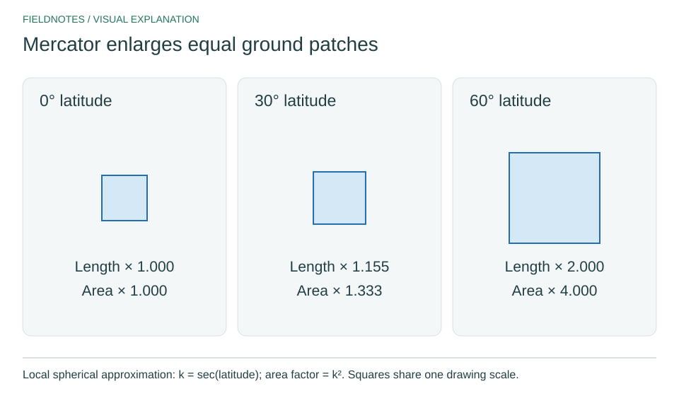

**Read it:** All panels share one drawing scale. At 60°, the length factor is 2, so the area factor is 2² = 4. This local spherical approximation illustrates distortion; it is not a universal correction for large polygons.

**Web Mercator (EPSG:3857).** Used by virtually all slippy-map tiles. It applies the *spherical* Mercator formulas with radius *R* = *a* = 6 378 137 m to WGS 84 geographic coordinates (λ, φ in radians):

$$
x = R\,\lambda, \qquad y = R\,\ln\tan\!\left(\frac{\pi}{4} + \frac{\varphi}{2}\right)
$$

- Valid for |φ| ≤ 85.0511287798° (the latitude at which the world becomes a square); the *x*/*y* extent is ±20 037 508.342789244 m (= π*R*).
- Local linear scale is *k* = sec φ and area scale is sec² φ (table in 4.1). At 52.4° N, lengths are inflated by 1.64 and areas by 2.68.
- It is a **display** CRS. **Never measure distances or areas in it.** (EPSG:3857 is also not strictly conformal relative to the WGS 84 ellipsoid because it uses spherical formulas on ellipsoidal latitudes; for display this is irrelevant.)

**UTM (Universal Transverse Mercator).** Splits the world into 60 zones of 6° longitude, each with a Transverse Mercator projection:

| Parameter | Value |
|---|---|
| Zone number | `zone = floor((lon + 180) / 6) + 1` (zone 31 covers 0°E–6°E) |
| Central meridian | `lon0 = 6·zone − 183` (zone 31: 3°E) |
| Scale factor on central meridian | *k*₀ = 0.9996 |
| False easting | 500 000 m |
| False northing | 0 m (northern hemisphere), 10 000 000 m (southern hemisphere) |
| EPSG codes (WGS 84) | `32600 + zone` (north), `32700 + zone` (south) |
| EPSG codes (ETRS89, zones 28–38) | `25800 + zone` (for example 25831, 25832) |
| EPSG codes (NAD83, zones 1–23) | `26900 + zone` (for example 26918) |

- Scale is 0.9996 on the central meridian, about 1.0000 roughly 180 km from it, and rises to about 1.0010 at the edge of the zone at the equator. Conformal: shapes are locally preserved.
- Exceptions: southwest Norway (zone 32V is widened) and Svalbard (zones 31X, 33X, 35X and 37X are widened to 12° and 32X, 34X, 36X are not used).
- Accurate series formulas (Krüger series, as in Karney 2011) are used in practice; the reference implementation in Appendix A uses a sixth-order series.
- Do not use one UTM zone for a dataset that spans many zones (continental or global): choose a national CRS, an equal-area/conformal CRS designed for the region (for example EPSG:3035 for pan-European statistics), or analyse in segments.

**Choosing a CRS for a task**

| Task | Good choice | Avoid |
|---|---|---|
| Storage and interchange | EPSG:4326 (or the national geographic CRS), GeoPackage/GeoJSON | Storing only in 3857 |
| Local measurement (a city, a country) | National grid or UTM zone | Geographic degrees, 3857 |
| Comparing areas / densities across a region | Equal-area (LAEA 3035, Albers 5070) | Mercator-family |
| Web display | 3857 tiles | Measuring on the map |
| Global analysis of distances | Geodesic computations (`geography`, `Geod`) | Any single planar CRS |

### 4.3 Datum transformations and PROJ pipelines

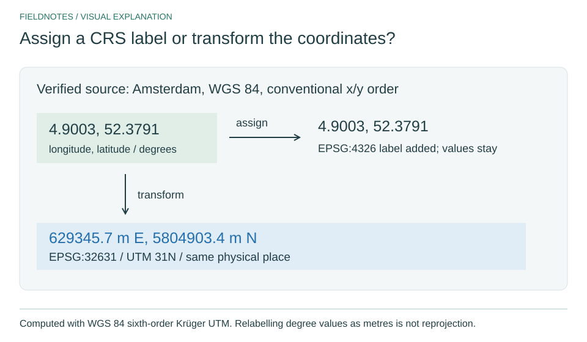

**Read it:** The horizontal arrow adds verified CRS metadata. The downward arrow changes the coordinates and their units while preserving the physical location. This example changes projection within WGS 84; changing datums can require additional operations.

Changing **datum** (not just projection) needs a **coordinate operation**:

| Operation type | What it does | Typical accuracy |
|---|---|---|
| **Null / ballpark** | Assumes the two datums coincide; used when no better operation is known | Metre-level or worse; PROJ flags it as "ballpark" with unknown accuracy |
| **Helmert (7-parameter)** | 3 translations, 3 rotations, 1 scale on geocentric XYZ | Decimetres to metres |
| **Grid shift** (NTv2, NADCON, national grids) | Interpolates shift values from a file | Centimetres to decimetres |
| **Time-dependent Helmert / plate motion** | Includes velocities and a **coordinate epoch** | Centimetres; needed for dynamic frames (ITRF, recent WGS 84 realisations) |

The Helmert transformation in geocentric coordinates, with small-angle rotations (sign conventions differ between the *position vector* and *coordinate frame* variants, so always check which one the EPSG operation uses):

$$
\begin{pmatrix}X'\\Y'\\Z'\end{pmatrix}
=
\begin{pmatrix}T_x\\T_y\\T_z\end{pmatrix}
+ (1 + s\cdot 10^{-6})
\begin{pmatrix}1 & -r_z & r_y\\ r_z & 1 & -r_x\\ -r_y & r_x & 1\end{pmatrix}
\begin{pmatrix}X\\Y\\Z\end{pmatrix}
$$

**Practical rules**

1. Let PROJ choose the operation, but *inspect* the choice: `Transformer.description`, `Transformer.accuracy`, `TransformerGroup` (lists alternatives and whether grid files are missing), or the command line `projinfo -s EPSG:4326 -t EPSG:32631`.
2. If a required grid is not installed, PROJ may silently use a less accurate operation. Enable network grids (`PROJ_NETWORK=ON`) or install the grid package when sub-metre accuracy matters.
3. WGS 84 ↔ ETRS89 and WGS 84 ↔ NAD83 are *not identity* at the metre level; do not assume they are for precision work.
4. For mapping-grade work (metres) you can often ignore the epoch; for geodetic work you cannot.

```python
from pyproj import CRS, Transformer

wgs84 = CRS.from_epsg(4326)
print(wgs84.is_geographic, [a.abbrev for a in wgs84.axis_info])        # True ['Lat', 'Lon']   (lat first!)

utm31 = CRS.from_epsg(32631)
print(utm31.is_projected, [a.abbrev for a in utm31.axis_info])         # True ['E', 'N']
print(utm31.axis_info[0].unit_name)                                    # metre

to_utm = Transformer.from_crs("EPSG:4326", "EPSG:32631", always_xy=True)
print(to_utm.transform(4.9003, 52.3791))                               # approx (629345.7, 5804903.4)   (lon, lat) in
```

A typical `projinfo` result for this pair (abridged; run it yourself to see the version-specific output):

```text
+proj=pipeline
  +step +proj=axisswap +order=2,1
  +step +proj=unitconvert +xy_in=deg +xy_out=rad
  +step +proj=utm +zone=31 +ellps=WGS84
```

The first step (`axisswap`) is the axis-order handling from section 2.3 made explicit: EPSG:4326 input arrives as latitude, longitude.

### 4.4 Geometry algorithms and spatial relationships

#### 4.4.1 Orientation test and segment intersection

The sign of the 2D cross product tells whether point *c* lies to the left of, to the right of, or on the directed line *a→b*:

$$
\operatorname{orient}(a,b,c) = (b_x - a_x)(c_y - a_y) - (b_y - a_y)(c_x - a_x)
$$

Two segments properly intersect if the endpoints of each lie on opposite sides of the other. Collinear overlaps need an extra bounding-box check. Testing a ring for self-intersection by comparing all non-adjacent edge pairs is O(*n*²); production libraries use sweep-line or spatial indexes.

#### 4.4.2 Area and centroid of a simple polygon (shoelace formula)

For a ring with vertices (*x*ᵢ, *y*ᵢ), *i* = 0…*n*−1 and indices taken modulo *n*:

$$
A = \tfrac12 \sum_{i=0}^{n-1}\left(x_i y_{i+1} - x_{i+1} y_i\right), \qquad
C_x = \frac{1}{6A}\sum_{i}(x_i + x_{i+1})(x_i y_{i+1} - x_{i+1} y_i)
$$

(*C*ᵧ analogous with *y*ᵢ + *y*ᵢ₊₁.) The sign of *A* encodes orientation: positive for counter-clockwise rings. These are **planar** formulas and therefore only meaningful in a projected CRS. For a self-intersecting ring the signed pieces cancel, and the result is meaningless.

#### 4.4.3 Point-in-polygon (ray casting, even-odd rule)

Cast a horizontal ray from the test point to +∞; an odd number of edge crossings means inside.

```python
def point_in_ring(pt, ring):
    """Even-odd ray casting. ring: list of (x, y), open or closed. Boundary behaviour is not guaranteed."""
    x, y = pt
    inside = False
    n = len(ring)
    for i in range(n):
        x1, y1 = ring[i]
        x2, y2 = ring[(i + 1) % n]
        if (y1 > y) != (y2 > y):                         # edge straddles the ray's y level
            x_cross = x1 + (y - y1) * (x2 - x1) / (y2 - y1)
            if x_cross > x:                              # crossing to the right of the point
                inside = not inside
    return inside

square = [(0, 0), (4, 0), (4, 4), (0, 4)]
for p in [(2, 2), (5, 2), (0, 2), (4, 4), (-1, -1), (2, 4)]:
    print(p, point_in_ring(p, square))
# (2, 2) True | (5, 2) False | (0, 2) True | (4, 4) False | (-1, -1) False | (2, 4) False
```

Observe the **boundary cases**: `(0, 2)` on the left edge is reported inside and `(2, 4)` on the top edge outside. The half-open comparison `(y1 > y) != (y2 > y)` makes the test consistent for tiled polygons (a point on a shared edge is counted in exactly one neighbour) but it is *not* a boundary-aware predicate. Libraries expose `contains`, `covers`, `intersects`, `touches` for this reason (below).

#### 4.4.4 Spatial relationships: the DE-9IM

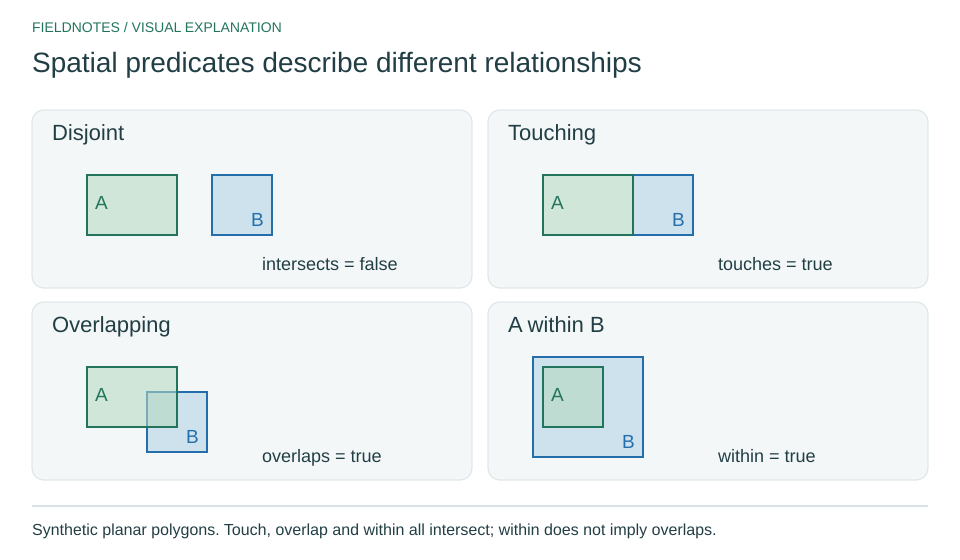

**Read it:** A shared edge is enough for `intersects`, but not `overlaps`. Full containment also intersects without satisfying `overlaps`. The outlines and labels distinguish A from B independently of colour.

The **Dimensionally Extended 9-Intersection Model** describes how two geometries *A* and *B* relate by the dimension of the intersection of their **interior (I)**, **boundary (B)** and **exterior (E)** sets:

```
                 B: Interior   B: Boundary   B: Exterior
 A: Interior    [ dim(IA∩IB)   dim(IA∩BB)    dim(IA∩EB) ]
 A: Boundary    [ dim(BA∩IB)   dim(BA∩BB)    dim(BA∩EB) ]
 A: Exterior    [ dim(EA∩IB)   dim(EA∩BB)    dim(EA∩EB) ]

 Each entry is one of:  F (empty) | 0 (points) | 1 (lines) | 2 (areas)
 Read row by row into a 9-character string, e.g. "212101212".
 In patterns: T = any non-empty (0, 1 or 2),  * = anything.
```

Worked examples (schematic squares; coordinates are plain *x*, *y*):

| Case | A | B | DE-9IM | Named relation |
|---|---|---|---|---|
| Overlap | square (0,0)–(2,2) | square (1,1)–(3,3) | `212101212` | overlaps, intersects |
| Touch along an edge | square (0,0)–(1,1) | square (1,0)–(2,1) | `FF2F11212` | touches, intersects |
| Containment | square (1,1)–(2,2) | square (0,0)–(3,3) | `2FF1FF212` | A within B |

Pattern definitions for the common named predicates (OGC SFA):

| Predicate | Pattern(s) |
|---|---|
| `equals` | `T*F**FFF*` |
| `disjoint` | `FF*FF****` |
| `intersects` | not `disjoint` |
| `touches` | `FT*******` or `F**T*****` or `F***T****` |
| `within` | `T*F**F***` |
| `contains` | `T*****FF*` |
| `overlaps` (area/area, point/point) | `T*T***T**` |
| `crosses` (line/line) | `0********` |

The `relate(A, B)` function returns the matrix string; `relate_pattern(A, B, pattern)` tests it against a pattern. *Prefer the named predicates for readability and the matrix when you need an exact, unusual relation.*

> **`touches` vs. `intersects`.** Two parcels that share only a border *intersect* (they have common points) but their *interiors* do not, so `overlaps` is false and `touches` is true. Spatial joins that should find "parcels inside district X" usually need `within` or `covers`, not `intersects`, otherwise neighbours that merely touch are included.

#### 4.4.5 Validity checks in code

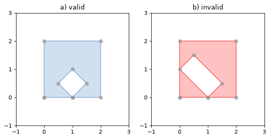

**Read it:** Follow the remaining polygon interior around the hole. Ring closure alone cannot prove validity: contacts must not split the interior into disconnected pieces. *Source: Sean Gillies and Shapely contributors, CC BY 3.0 US; [full attribution](assets/figures/CREDITS.md#the-shapely-user-manual).*

```python
# Reference helpers: orientation test, segment intersection, shoelace (Appendix A + below)
from geolib import shoelace

def orient(a, b, c):
    v = (b[0]-a[0])*(c[1]-a[1]) - (b[1]-a[1])*(c[0]-a[0])
    return (v > 0) - (v < 0)

def on_seg(a, b, c):
    return min(a[0], b[0]) <= c[0] <= max(a[0], b[0]) and min(a[1], b[1]) <= c[1] <= max(a[1], b[1])

def seg_intersect(p1, p2, p3, p4):
    o1, o2, o3, o4 = orient(p1, p2, p3), orient(p1, p2, p4), orient(p3, p4, p1), orient(p3, p4, p2)
    if o1 != o2 and o3 != o4:
        return True
    return ((o1 == 0 and on_seg(p1, p2, p3)) or (o2 == 0 and on_seg(p1, p2, p4)) or
            (o3 == 0 and on_seg(p3, p4, p1)) or (o4 == 0 and on_seg(p3, p4, p2)))

def ring_is_simple(ring):
    n = len(ring)
    edges = [(ring[i], ring[(i + 1) % n]) for i in range(n)]
    for i in range(n):
        for j in range(i + 1, n):
            if j == i + 1 or (i == 0 and j == n - 1):      # neighbours share an endpoint by construction
                continue
            if seg_intersect(*edges[i], *edges[j]):
                return False
    return True

bow = [(0, 0), (2, 2), (2, 0), (0, 2)]          # bow-tie: edges (0,0)-(2,2) and (2,0)-(0,2) cross at (1,1)
box = [(0, 0), (2, 0), (2, 2), (0, 2)]
print(ring_is_simple(bow), ring_is_simple(box))   # False True
print(shoelace(bow), shoelace(box))               # 0.0 4.0   <- the bow-tie "area" is 0: signed lobes cancel
```

Repair: split the bow-tie at the crossing (1, 1) into two triangles, (0,0)-(1,1)-(0,2) and (1,1)-(2,2)-(2,0), each of area 1, total area 2. Libraries automate this:

```python
from shapely.geometry import Polygon
from shapely.validation import explain_validity, make_valid

bt = Polygon([(0, 0), (2, 2), (2, 0), (0, 2)])
print(bt.is_valid, explain_validity(bt))   # False  Self-intersection[1 1]
fixed = make_valid(bt)
print(fixed.geom_type, fixed.area)         # MultiPolygon 2.0   (two triangles; vertex order may differ)
```

In PostGIS: `SELECT ST_IsValid(g), ST_IsValidReason(g), ST_MakeValid(g)`. **Caution:** `ST_Buffer(g, 0)` / `buffer(0)` is a popular quick fix but can silently drop parts of a polygon; prefer `make_valid`.

#### 4.4.6 Simplification, buffering and units

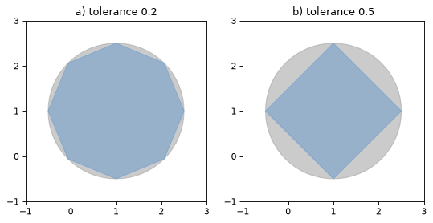

**Read it:** Compare retained vertices and boundary departures. The simplification tolerance is measured in the geometry's CRS units, so a tolerance of `1` does not always mean one metre. *Source: Sean Gillies and Shapely contributors, CC BY 3.0 US; [full attribution](assets/figures/CREDITS.md#the-shapely-user-manual).*

- **Douglas–Peucker** simplification removes vertices that deviate less than a *tolerance* from the simplified line. The tolerance is in **CRS units**: `simplify(0.001)` on EPSG:4326 means 0.001° (about 111 m of latitude), on EPSG:32631 it means 1 mm. Choose the unit deliberately.
- **Buffer** distance is also in CRS units. `buffer(100)` on a geographic geometry means 100 **degrees**, which wraps around the planet. Reproject to a projected CRS first (or use PostGIS `geography`, which takes metres).
- A buffered point is a polygon with a finite vertex count. With the default of 16 segments per quarter circle (64 vertices), a polygon inscribed in a circle of radius *r* has area ½·64·*r*²·sin(2π/64) = 0.99839·π*r*², i.e. about 0.16 % smaller than the true circle.

### 4.5 Raster internals: geotransform, resampling, storage

#### 4.5.1 The geotransform

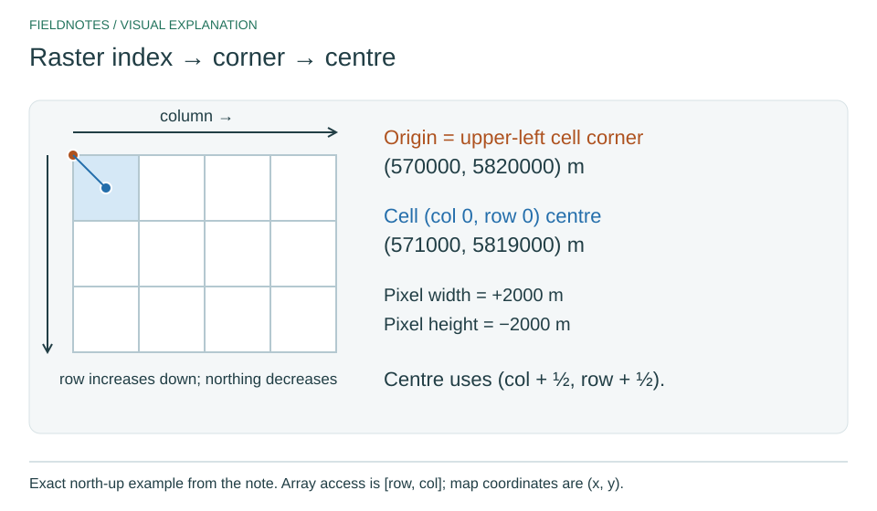

**Read it:** Move half a cell right and half a cell down from the orange corner to reach the blue centre. Easting increases; northing decreases. Array indices are `[row, col]`, while map positions are `(x, y)`.

GDAL describes the placement of a raster with six numbers `(GT0 … GT5)`:

$$
X_{geo} = GT_0 + \text{col}\cdot GT_1 + \text{row}\cdot GT_2, \qquad
Y_{geo} = GT_3 + \text{col}\cdot GT_4 + \text{row}\cdot GT_5
$$

| Element | Meaning | North-up raster |
|---|---|---|
| `GT0`, `GT3` | *x*, *y* of the **upper-left corner of the upper-left cell** | e.g. 570000.0, 5820000.0 |
| `GT1` | cell width (west→east) | +2000.0 |
| `GT5` | cell height (north→south) | **negative**, −2000.0 (rows count downwards) |
| `GT2`, `GT4` | rotation / shear terms | 0 for north-up rasters |

For `col`, `row` integers the formula gives the **corner** of the cell. Add 0.5 to both to get the **cell centre**. Forgetting this half-cell offset produces the classic "everything is shifted by half a pixel" error.

```python
GT = (570000.0, 2000.0, 0.0, 5820000.0, 0.0, -2000.0)     # EPSG:32631, 2 km cells, north-up

def cell_to_xy(col, row, gt=GT, centre=True):
    off = 0.5 if centre else 0.0
    return (gt[0] + (col + off) * gt[1] + (row + off) * gt[2],
            gt[3] + (col + off) * gt[4] + (row + off) * gt[5])

def xy_to_cell(x, y, gt=GT):                    # valid for north-up rasters (gt[2] == gt[4] == 0)
    return (x - gt[0]) / gt[1], (y - gt[3]) / gt[5]

print(cell_to_xy(0, 0, centre=False))           # (570000.0, 5820000.0)  upper-left corner of the raster
print(cell_to_xy(29, 7))                        # (629000.0, 5805000.0)  centre of cell col=29,row=7
c, r = xy_to_cell(629345.7, 5804903.4)          # Amsterdam Centraal in EPSG:32631
print(round(c, 3), round(r, 3), int(c // 1), int(r // 1))   # 29.673 7.548 29 7
```

Array indexing convention: `array[row, col]`, i.e. `array[y, x]`. Mixing this up with `(x, y)` is a very common bug.

**Pixel-is-area vs. pixel-is-point.** GeoTIFF by default treats a cell value as representing the whole *area* of the cell (`RasterPixelIsArea`); some products (for example elevation grids sampled at grid nodes) use pixel-is-point semantics. The two interpretations differ by half a cell in position. Check the metadata when overlaying rasters from different producers.

#### 4.5.2 Resampling

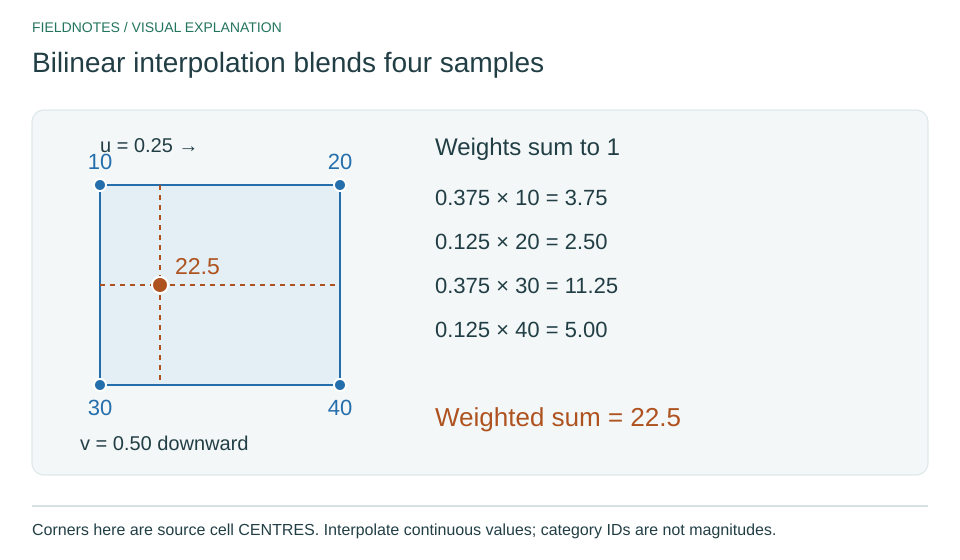

**Read it:** The four blue sample positions are **cell centres**, not cell corners. The target is nearer the left pair, so those values receive larger weights. The weights sum to one. Blending category identifiers this way would invent a meaningless code.

Whenever the grid changes (reprojecting, changing the cell size, building overviews) new values must be computed:

| Method (`gdalwarp -r …`) | How the value is computed | Use for |
|---|---|---|
| `near` | value of the nearest source cell | **categorical** data (land cover, classes); preserves original values; creates a blocky look |
| `bilinear` | weighted mean of the 2 × 2 nearest cell centres | continuous data (elevation, temperature) |
| `cubic`, `cubicspline`, `lanczos` | smoother kernels over 4 × 4 or larger neighbourhoods | continuous imagery, upsampling; may overshoot (values beyond the source range) |
| `average` | mean of all source cells covered by the target cell | **downsampling** continuous data |
| `mode` | most frequent source value | **downsampling categorical** data |
| `min`, `max`, `med`, `sum` … | the named statistic | specialised aggregation |

Bilinear interpolation for a point at fractional offsets *u* (to the right) and *v* (downwards) between four cell centres *z*₀₀ (top-left), *z*₀₁ (top-right), *z*₁₀ (bottom-left), *z*₁₁ (bottom-right):

$$
z = (1-u)(1-v)\,z_{00} + u(1-v)\,z_{01} + (1-u)v\,z_{10} + uv\,z_{11}
$$

For *z* = [[10, 20], [30, 40]], *u* = 0.25, *v* = 0.5 the result is 22.5.

**Why the method matters.** Take a 4 × 4 land-cover raster with class codes 1 = water, 2 = forest, 3 = urban, 4 = field, and aggregate 2 × 2 blocks to a 2 × 2 raster:

```python
import numpy as np
lc = np.array([[1, 1, 2, 2],
               [1, 1, 2, 4],
               [3, 3, 2, 2],
               [3, 3, 4, 2]])

blocks = lc.reshape(2, 2, 2, 2).swapaxes(1, 2).reshape(2, 2, 4)       # each 2x2 block flattened
mean  = lc.reshape(2, 2, 2, 2).mean(axis=(1, 3))
mode  = [[int(np.bincount(b).argmax()) for b in row] for row in blocks]
near  = lc[::2, ::2]                                                    # sample the top-left cell of each block

print(mean)   # [[1.  2.5]  [3.  2.5]]   <- 2.5 is not a land-cover class: the average INVENTED a category
print(mode)   # [[1, 2], [3, 2]]
print(near)   # [[1 2] [3 2]]
```

For a continuous elevation grid `[[10,12,20,22],[11,13,21,23],[30,32,40,42],[31,33,41,43]]`, `average` gives `[[11.5, 21.5], [31.5, 41.5]]`, which is exactly what you want. Never average class codes, and never use `bilinear` for categorical data.

Reprojecting a raster is itself a resampling operation, so each reprojection slightly changes the values; avoid repeated round-trips and keep a master copy in the original CRS.

#### 4.5.3 Size arithmetic and storage

- Grid dimensions: `ncols = ceil((xmax − xmin) / cell_size)`, `nrows = ceil((ymax − ymin) / cell_size)`.
- Memory: `ncols × nrows × bands × bytes_per_value`. A 1° × 1° area at about 30 m cells (3600 × 3600 cells) in `float32` needs 12 960 000 × 4 B = 51 840 000 B ≈ 49.4 MiB per band. Halving the cell size quadruples this.
- **Cloud Optimized GeoTIFF (COG)**: a GeoTIFF with internal tiling and overviews (pre-computed reduced-resolution copies), laid out so clients can read just the needed bytes over HTTP range requests. Build overviews with an appropriate resampling method (`near`/`mode` for categories, `average` or `bilinear` for continuous data).
- Choose the **data type** to fit the data (`uint8` for classes, `int16` for elevation in metres, `float32` for continuous values) and define a **NoData** value that cannot occur in real data.

### 4.6 Scale, precision and numeric representation

**Decimal places of a degree.** Ground distance represented by one unit in the *n*-th decimal place, at about 52.4° N (north–south uses about 111.27 km per degree here, east–west uses about 68.10 km per degree):

| Decimals *n* | Step | North–south | East–west at 52.4° N | Realistic source of that accuracy |
|---:|---|---:|---:|---|
| 0 | 1° | 111.3 km | 68.1 km | country/region |
| 1 | 0.1° | 11.13 km | 6.81 km | city |
| 2 | 0.01° | 1.113 km | 681 m | neighbourhood |
| 3 | 0.001° | 111.3 m | 68.1 m | street |
| 4 | 0.0001° | 11.13 m | 6.81 m | consumer GNSS, rough |
| 5 | 0.00001° | 1.113 m | 68.1 cm | differential GNSS |
| 6 | 10⁻⁶° | 11.13 cm | 6.81 cm | **sensible default for GeoJSON** (RFC 7946 notes about 0.1 m) |
| 7 | 10⁻⁷° | 1.113 cm | 6.81 mm | survey-grade GNSS (RTK) |
| 8 | 10⁻⁸° | 1.113 mm | 0.68 mm | beyond almost any real measurement |
| 10 | 10⁻¹⁰° | 11 µm | 7 µm | meaningless for geographic data |

**Floating-point representation.** `float64` has 15–16 significant decimal digits: ample for any coordinate on Earth (millimetre precision at 20 000 km would need about 11 digits). `float32` has only about 7 significant digits. In a projected CRS with large coordinates this becomes visible:

- Values in [262 144, 524 288) are spaced **0.031 25 m** apart in `float32` (so an easting near 500 000 m has a resolution of about 3 cm).
- Values in [4 194 304, 8 388 608) are spaced **0.5 m** apart (so a UTM northing near 5 800 000 m can only be represented to the nearest half metre).

This is why GPU-based renderers (WebGL) subtract an origin ("relative to centre" rendering) before converting to `float32`, and why you should keep coordinates in `float64` throughout the processing pipeline.

**Accuracy budget.** Errors add (usually in quadrature if independent). A phone GNSS fix (≈ 5 m), a metre-level datum mismatch and 0.25 mm of digitising error on a 1:25 000 source (≈ 6 m) give a combined uncertainty on the order of 8 m. Displaying that data to 7 decimals is cosmetic only.

**Tolerances in code.** Never compare floating-point coordinates with `==`. Use a tolerance that reflects the data's accuracy and units (for example 1 mm in a projected CRS, 1e-9° in degrees), or snap to a grid with a *precision model* when robustness matters (for example `shapely.set_precision`).

### 4.7 Classification and labelling algorithms

#### 4.7.1 Classification methods

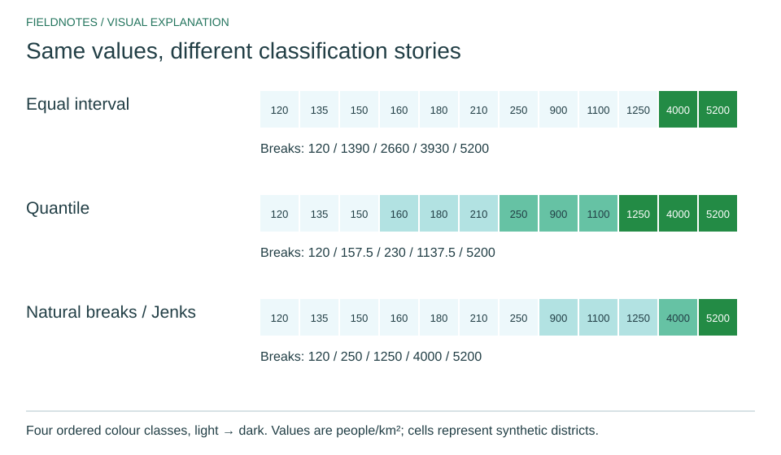

**Read it:** Each value stays in the same position in all three rows. Colours change only because class boundaries change. Compare the first seven districts before inferring a spatial pattern from a colour ramp.

For *n* values, *k* classes and edges *e*₀ < *e*₁ < … < *e*ₖ:

- **Equal interval**: *e*ⱼ = min + *j*·(max − min)/*k*.
- **Quantile**: *e*ⱼ is the *j*/*k* quantile. Libraries differ in how they interpolate between ranks (NumPy's default is linear interpolation), so edges can differ slightly between tools.
- **Natural breaks (Jenks / Fisher)**: choose class boundaries on the sorted data that minimise the sum of within-class squared deviations (SSD). Fisher's dynamic-programming solution is exact and runs in O(*k*·*n*²) time; GIS packages often use a sampled or heuristic variant for large *n*.
- **Goodness of Variance Fit**: GVF = 1 − SDCM / SDAM, where SDAM is the sum of squared deviations from the overall mean and SDCM is the sum of squared deviations from each class mean. GVF is between 0 (useless) and 1 (perfect); use it to compare classifications of the *same* data.

```python
import numpy as np

def equal_interval(v, k):  return np.linspace(v.min(), v.max(), k + 1)
def quantile(v, k):        return np.quantile(v, np.linspace(0, 1, k + 1))

def jenks_edges(data, k):
    """Fisher-Jenks optimal breaks. Returns [min, upper_1, ..., upper_k] where class j is (upper_{j-1}, upper_j]."""
    d = np.sort(np.asarray(data, float)); n = len(d)
    cs, cs2 = np.concatenate([[0], np.cumsum(d)]), np.concatenate([[0], np.cumsum(d * d)])
    ssd = lambda i, j: cs2[j] - cs2[i] - (cs[j] - cs[i]) ** 2 / (j - i)      # SSD of d[i:j]
    best = np.full((n + 1, k + 1), np.inf); back = np.zeros((n + 1, k + 1), int); best[0, 0] = 0
    for c in range(1, k + 1):
        for j in range(c, n + 1):
            for i in range(c - 1, j):
                cand = best[i, c - 1] + ssd(i, j)
                if cand < best[j, c]: best[j, c], back[j, c] = cand, i
    uppers, j = [], n
    for c in range(k, 0, -1):
        uppers.append(d[j - 1]); j = back[j, c]
    return np.array([d[0]] + uppers[::-1])

def gvf(v, edges):
    v = np.asarray(v, float)
    cls = np.digitize(v, edges[1:-1], right=True)
    sdcm = sum(((v[cls == c] - v[cls == c].mean()) ** 2).sum() for c in np.unique(cls))
    return 1 - sdcm / ((v - v.mean()) ** 2).sum()

density = np.array([120, 135, 150, 160, 180, 210, 250, 900, 1100, 1250, 4000, 5200], float)  # people per km2, synthetic
for name, e in [("equal", equal_interval(density, 4)), ("quantile", quantile(density, 4)), ("jenks", jenks_edges(density, 4))]:
    print(f"{name:9s} edges={np.round(e, 1)}  GVF={gvf(density, e):.3f}")
# equal     edges=[ 120. 1390. 2660. 3930. 5200.]   GVF=0.919
# quantile  edges=[ 120.  157.5  230. 1137.5 5200.]  GVF=0.725
# jenks     edges=[ 120.  250. 1250. 4000. 5200.]    GVF=0.998
```

**Interpretation.** The data have a dense cluster of 7 low values, a group of 3 mid values and two outliers. Equal interval puts 10 of 12 values into the first class (wasting three colours). Quantile splits the low cluster arbitrarily and merges 250, 900 and 1100. Natural breaks recovers the low cluster and the mid group and gives each outlier its own class (GVF 0.998). Whether that is "better" depends on the message: natural breaks serve exploration; quantiles serve rank comparison; fixed domain thresholds serve comparison across maps.

#### 4.7.2 Label anchors: centroid vs. representative point

```python
from geolib import shoelace

def centroid(ring):
    a, cx, cy = shoelace(ring), 0.0, 0.0
    pts = list(ring) + [ring[0]]
    for (x1, y1), (x2, y2) in zip(pts[:-1], pts[1:]):
        w = x1 * y2 - x2 * y1
        cx += (x1 + x2) * w; cy += (y1 + y2) * w
    return cx / (6 * a), cy / (6 * a)

u_shape = [(0, 0), (10, 0), (10, 10), (7, 10), (7, 3), (3, 3), (3, 10), (0, 10)]   # schematic U, arms 3 wide
print(shoelace(u_shape), centroid(u_shape))                 # 72.0 (5.0, 4.416666666666667)
print(point_in_ring(centroid(u_shape), u_shape))            # False  (the centroid sits in the notch, outside the polygon)
```

The centroid is the centre of mass, which for non-convex shapes can lie outside. Use `representative_point()` (Shapely/PostGIS `ST_PointOnSurface`) for a guaranteed interior point, or **pole of inaccessibility** (`polylabel`, `ST_MaximumInscribedCircle` in recent PostGIS) for the point that is farthest from the boundary and therefore gives the largest label area.

### 4.8 File formats and spatial databases

| Format | Type | CRS information | Notes |
|---|---|---|---|
| **GeoJSON** (RFC 7946) | vector, text | Fixed: WGS 84, **lon, lat** order, no `crs` member | Exterior rings counter-clockwise, holes clockwise (parsers should accept either); geometries crossing the antimeridian should be cut; precision tied to text length |
| **Shapefile** (`.shp .shx .dbf .prj`, plus optional `.cpg`) | vector, multi-file | `.prj` WKT text, often missing or non-EPSG flavour | 2 GB limit per component, field names ≤ 10 characters, one geometry type per file, no true `NULL` for some types. Avoid for new work |
| **GeoPackage** (`.gpkg`, OGC) | vector, raster and tiles in SQLite | Stored in `gpkg_spatial_ref_sys` per layer | Recommended default exchange/storage format; single file; indexed |
| **FlatGeobuf** | vector, binary | embedded | Streaming and HTTP range reads, spatial index |
| **GeoTIFF / COG** | raster | embedded tags (GeoKeys) | COG for cloud access |
| **PostGIS** | database | `spatial_ref_sys` + SRID per column | `geometry` (planar, SRID units) and `geography` (spheroidal, metres) |
| **WKT / WKB / EWKT** | geometry text / binary | none (EWKT adds `SRID=4326;`) | Interchange of single geometries |

```json
{
  "type": "Feature",
  "properties": { "name": "Amsterdam Centraal" },
  "geometry": { "type": "Point", "coordinates": [4.9003, 52.3791] }
}
```

(GeoJSON coordinate order is **[longitude, latitude]**, here `[4.9003, 52.3791]`.)

```sql
-- PostGIS: geometry vs geography, assign vs transform
CREATE TABLE station (name text, geom geometry(Point, 4326));
INSERT INTO station VALUES
  ('Amsterdam Centraal', ST_SetSRID(ST_MakePoint(4.9003, 52.3791), 4326)),   -- ST_MakePoint(x = lon, y = lat)
  ('Utrecht Centraal',   ST_SetSRID(ST_MakePoint(5.1103, 52.0894), 4326));

SELECT ST_Distance(a.geom::geography, b.geom::geography)                       AS geodesic_m,
       ST_Distance(ST_Transform(a.geom, 32631), ST_Transform(b.geom, 32631))   AS utm31_m,
       ST_Distance(ST_Transform(a.geom, 3857),  ST_Transform(b.geom, 3857))    AS webmerc_m
FROM station a, station b
WHERE a.name LIKE 'Amsterdam%' AND b.name LIKE 'Utrecht%';
-- geodesic_m ≈ 35283.9 | utm31_m ≈ 35278.0 | webmerc_m ≈ 57613.6   (last digit may vary by version)
```

**Assign vs. transform across tools**

| Tool | *Assign* CRS label (numbers unchanged) | *Transform* coordinates |
|---|---|---|
| PostGIS | `ST_SetSRID(geom, 4326)` | `ST_Transform(geom, 32631)` |
| GeoPandas | `gdf.set_crs(4326, allow_override=True)` | `gdf.to_crs(32631)` |
| `ogr2ogr` | `-a_srs EPSG:4326` | `-t_srs EPSG:32631` (and `-s_srs` to override the source) |
| `gdal_translate` / `gdalwarp` | `gdal_translate -a_srs EPSG:4326` | `gdalwarp -t_srs EPSG:32631 -r near\|bilinear` |
| QGIS GUI | Layer *Properties → Source → Assigned CRS*, or Processing *Assign projection* | Processing *Reproject layer*, *Warp (reproject)*, or *Export → Save Features As…* with another CRS |

### 4.9 Hands-on lab: QGIS as a visual debugger for your future code

> **Goal.** Build intuition for what your code will automate. Each step names the code equivalent.

**Part A: Install and orient (30–60 min)**
1. Install QGIS 3.x (the Long Term Release is recommended for stability) from the official QGIS download page.
2. Explore the interface: *Browser* panel, *Layers* panel, map canvas, *Processing Toolbox* (Ctrl+Alt+T), *Python Console* (Ctrl+Alt+P), and the **CRS indicator** at the bottom-right of the window (it shows the *project* CRS).
3. Add a base map: *Browser → XYZ Tiles → OpenStreetMap*. Notice the project CRS becomes EPSG:3857.
4. Download a small public dataset (for example Natural Earth country polygons) and add it with *Layer → Add Layer → Add Vector Layer*.

**Part B: CRS behaviour (1–2 h)**
5. Create `stations.csv` (Exercise 1) and import it via *Layer → Add Layer → Add Delimited Text Layer*. Set *X field* = `lon`, *Y field* = `lat`, *Geometry CRS* = `EPSG:4326`. Points land in the Netherlands.
6. Re-import with **X = `lat`, Y = `lon`** (deliberately wrong). The points fall in the Indian Ocean east of Somalia. This is axis-order failure made visible.
7. Open *Project → Properties → CRS* and switch between EPSG:3857, EPSG:32631 and EPSG:4326. Watch the shapes of countries and the Netherlands change. **The layer's own CRS and data do not change**: QGIS reprojects on the fly for display only.
8. Open *Project → Properties → General → Measurements* and set the ellipsoid to WGS84. Use the *Measure Line* tool between Amsterdam and Utrecht stations under different project CRSs. The ellipsoidal measurement stays near 35.3 km regardless of project CRS, whereas planar measurement in EPSG:3857 would be inflated by about 1.63.
9. Export a persistent copy: right-click layer → *Export → Save Features As…* → GeoPackage → CRS EPSG:32631. Inspect the coordinates in the attribute table (*Field calculator*: `$x`, `$y`). This is the **transform**; code equivalent: `to_crs`.

**Part C: Geometry and processing (2–3 h)**
10. Run *Processing Toolbox → Vector geometry → Check validity* and *Fix geometries* on a polygon layer (create a bow-tie with the *Add Polygon Feature* tool to test).
11. Run *Buffer* on the projected stations layer with a distance of 15 000 m, then on the unprojected layer with a distance of 0.1 and compare the shapes (degrees are not metres).
12. Run *Dissolve*, *Clip*, *Intersection* and observe the attribute handling.
13. Create a raster: *Raster → Miscellaneous → ...*, or *Processing → Create grid* and *Rasterize*. Run *Warp (reproject)* with `nearest` and `bilinear` resampling on a small categorical raster and compare.
14. Run *Zonal statistics* with the buffers as zones over a raster (this is Exercise 4).

**Part D: Cartography (1–2 h)**
15. Open the *Layer Styling* panel, choose *Graduated*, pick a sequential colour ramp, set 5 classes, and switch the *Mode* between *Equal Interval*, *Equal Count (Quantile)*, *Natural Breaks (Jenks)* and *Standard Deviation*. Watch the legend and map change; compare with section 4.7.
16. Add labels (*Single labels*), try the *Placement* options (around point, horizontal, curved for lines), enable *Show all labels* to see collisions, and experiment with label priority and buffers.
17. Create a *Print Layout*: map, legend, scale bar, title and a note naming the CRS and data source.

**Part E: Script it**

```python
# QGIS Python Console (PyQGIS). QgsPointXY(x, y) uses x = longitude, y = latitude for EPSG:4326.
from qgis.core import QgsCoordinateReferenceSystem, QgsCoordinateTransform, QgsPointXY, QgsProject

src = QgsCoordinateReferenceSystem("EPSG:4326")
dst = QgsCoordinateReferenceSystem("EPSG:32631")
xf = QgsCoordinateTransform(src, dst, QgsProject.instance())
p = xf.transform(QgsPointXY(4.9003, 52.3791))
print(round(p.x(), 1), round(p.y(), 1))        # approx 629345.7 5804903.4
```

```bash
# GDAL/OGR command line equivalents (assign vs transform)
ogrinfo -so -al stations.gpkg                              # layer summary incl. CRS and extent
ogr2ogr -t_srs EPSG:32631 stations_utm.gpkg stations.gpkg  # transform
gdalwarp -t_srs EPSG:32631 -r bilinear dem.tif dem_utm.tif # raster transform with continuous resampling

# QGIS Processing algorithms from the shell (no GUI)
qgis_process run native:reprojectlayer --INPUT=stations.gpkg --TARGET_CRS=EPSG:32631 --OUTPUT=stations_utm.gpkg
```

**GUI action → code equivalent**

| In QGIS | In code |
|---|---|
| Delimited text import with Geometry CRS | `GeoDataFrame(df, geometry=points_from_xy(df.lon, df.lat), crs=4326)` |
| Project CRS switch (on-the-fly) | Client-side display transform only; **no** data change |
| *Reproject layer* / *Save As* with CRS | `gdf.to_crs(32631)`, `ST_Transform`, `ogr2ogr -t_srs` |
| *Assign projection* | `gdf.set_crs(...)`, `ST_SetSRID`, `ogr2ogr -a_srs` |
| *Check validity* / *Fix geometries* | `explain_validity` / `make_valid`, `ST_IsValidReason` / `ST_MakeValid` |
| *Buffer* | `geom.buffer(distance_in_crs_units)` |
| *Zonal statistics* | `rasterstats.zonal_stats`, or numpy masks (Exercise 4) |
| *Warp (reproject)* | `gdalwarp`, `rasterio.warp.reproject` |
| Graduated style, mode *Natural Breaks* | `mapclassify.NaturalBreaks`, section 4.7 code |

---

## 5. Worked GIS example: "Why are my stations in the Indian Ocean?"

### 5.1 Scenario

A colleague sends `stations_raw.csv`, intended for a rail-service coverage dashboard. The file has no CRS information and uses generic column names:

```csv
name,x,y
Amsterdam Centraal,52.3791,4.9003
Utrecht Centraal,52.0894,5.1103
Rotterdam Centraal,51.9244,4.4690
Den Haag Centraal,52.0806,4.3248
```

(Coordinates are approximate, rounded to four decimals, which is about 11 m in latitude. They are good for teaching and not for survey work.)

You must (1) establish what the numbers mean, (2) store them correctly, (3) measure distances and areas between and around the stations, and (4) quantify the error of the shortcuts people usually take.

### 5.2 Step 1: Inspect the numbers

Magnitudes are between 4 and 53, so they cannot be projected metres (those would be hundreds of thousands). They are plausibly degrees. Both columns are valid as latitude *and* as longitude (|latitude| ≤ 90, |longitude| ≤ 180), so a **range check cannot detect an axis swap**. Only an **area-of-interest check** can.

### 5.3 Step 2: Test both axis hypotheses against the expected area

The dataset is supposed to describe Dutch stations. The Netherlands lies roughly within longitude 3.0°–7.3° E and latitude 50.5°–53.7° N.

| Hypothesis | Meaning of `(x, y)` | Amsterdam Centraal becomes | Inside the Netherlands? |
|---|---|---|---|
| A | (longitude, latitude) | 52.3791° E, 4.9003° N: Indian Ocean, east of Somalia | **No** (all 4 rows) |
| B | (latitude, longitude) | 4.9003° E, 52.3791° N: Amsterdam | **Yes** (all 4 rows) |

Hypothesis B holds. The producer wrote `(lat, lon)`, which is the EPSG:4326 authority order, under generic names `x`, `y`.

### 5.4 Step 3: Normalise and label (assign, do not transform)

Reorder to `(lon, lat)`, and *assign* EPSG:4326. The numbers describe the same places; only the interpretation was missing. No coordinate arithmetic is involved, so this is an assignment.

```python
import csv, io
RAW = open("stations_raw.csv", encoding="utf-8").read()
stations = [(r["name"], float(r["x"]), float(r["y"])) for r in csv.DictReader(io.StringIO(RAW))]  # (name, lat, lon)

# GeoPandas equivalent:
#   df = pandas.read_csv("stations_raw.csv")
#   gdf = geopandas.GeoDataFrame(df, geometry=geopandas.points_from_xy(df.y, df.x), crs="EPSG:4326")   # x = lon, y = lat
#   (here df.y holds longitude and df.x holds latitude, hence the "swap")
```

### 5.5 Step 4: Pick a CRS for measurement and project

All four stations lie between 4.3° E and 5.1° E, inside UTM zone 31 (0°–6° E). The WGS 84 realisation is **EPSG:32631** (`32600 + 31`). (For Dutch national work you would normally use the Dutch national grid, EPSG:28992; the reasoning below is identical.)

```python
from geolib import utm, web_mercator            # Appendix A; with pyproj: Transformer.from_crs("EPSG:4326", "EPSG:32631", always_xy=True)
for name, lat, lon in stations:
    e, n = utm(lat, lon, zone=31)
    x, y = web_mercator(lat, lon)
    print(f"{name:20s} E={e:10.1f}  N={n:10.1f}   3857: x={x:10.1f} y={y:10.1f}")
```

Expected output (values in metres):

| Station | UTM 31N easting | UTM 31N northing | Web Mercator *x* | Web Mercator *y* |
|---|---:|---:|---:|---:|
| Amsterdam Centraal | 629 345.7 | 5 804 903.4 | 545 498.9 | 6 868 964.0 |
| Utrecht Centraal | 644 576.5 | 5 773 082.7 | 568 876.0 | 6 816 306.3 |
| Rotterdam Centraal | 601 014.8 | 5 753 649.3 | 497 486.8 | 6 786 467.5 |
| Den Haag Centraal | 590 782.8 | 5 770 830.9 | 481 434.5 | 6 814 712.1 |

Sanity checks: eastings are near the false easting of 500 000 m (stations are within about 150 km of the central meridian at 3° E), and the northings of about 5.75–5.80 million metres are the distance from the equator times 0.9996, which matches 52° N (≈ 5.76 × 10⁶ m on the central meridian).

### 5.6 Step 5: Distances computed four ways

```python
import itertools, math
from geolib import vincenty_inverse, haversine
for (n1, a1, o1), (n2, a2, o2) in itertools.combinations(stations, 2):
    g = vincenty_inverse(a1, o1, a2, o2)                      # geodesic on WGS 84 (reference)
    h = haversine(a1, o1, a2, o2)                             # sphere, R = 6371008.8 m
    u = math.dist(utm(a1, o1, 31), utm(a2, o2, 31))           # planar in EPSG:32631
    w = math.dist(web_mercator(a1, o1), web_mercator(a2, o2)) # planar in EPSG:3857
    print(f"{n1[:3]}-{n2[:3]}  geodesic={g:9.1f}  haversine={h:9.1f}  utm={u:9.1f}  3857={w:9.1f}  3857/geodesic={w/g:.3f}")
```

| Pair | Geodesic (m) | Haversine (m) | Planar UTM 31N (m) | Planar Web Mercator (m) | 3857 ÷ geodesic |
|---|---:|---:|---:|---:|---:|
| Ams–Utr | 35 283.9 | 35 244.9 (−0.11 %) | 35 278.0 (−0.017 %) | 57 613.6 | 1.633 |
| Ams–Rot | 58 576.8 | 58 499.7 (−0.13 %) | 58 563.0 (−0.024 %) | 95 450.7 | 1.629 |
| Ams–Den | 51 471.9 | 51 360.8 (−0.22 %) | 51 459.1 (−0.025 %) | 83 949.5 | 1.631 |
| Utr–Rot | 47 710.0 | 47 575.5 (−0.28 %) | 47 699.9 (−0.021 %) | 77 374.2 | 1.622 |
| Utr–Den | 53 853.0 | 53 680.7 (−0.32 %) | 53 840.8 (−0.023 %) | 87 456.0 | 1.624 |
| Rot–Den | 20 003.2 | 19 977.7 (−0.13 %) | 19 997.5 (−0.029 %) | 32 487.4 | 1.624 |

**Interpretation**

- Planar distances in the UTM zone are within about 0.03 % of the geodesic. UTM 31N has a scale factor slightly below 1 here (≈ 0.9998), which is why every projected distance is a little shorter.
- Haversine is within about 0.1–0.3 %: fine for a rough filter, not for engineering.
- Web Mercator is inflated by about 1.62–1.63 at this latitude (sec 52°N ≈ 1.6; section 4.1). Any dashboard that reports a "distance" computed from Web Mercator coordinates is wrong by more than 60 %.

### 5.7 Step 6: Areas computed four ways

Take a 0.01° × 0.01° graticule cell centred on Amsterdam Centraal: latitude 52.3741°–52.3841° N, longitude 4.8953°–4.9053° E. The exact ellipsoidal area has a closed form (Appendix A, `graticule_cell_area`); the others are shoelace areas of the projected corners.

```python
from geolib import graticule_cell_area, shoelace
lat1, lat2, lon1, lon2 = 52.3741, 52.3841, 4.8953, 4.9053
corners = [(lat1, lon1), (lat1, lon2), (lat2, lon2), (lat2, lon1)]            # (lat, lon)

true_area = graticule_cell_area(lat1, lat2, lon2 - lon1)
utm_area  = abs(shoelace([utm(la, lo, 31) for la, lo in corners]))
wm_area   = abs(shoelace([web_mercator(la, lo) for la, lo in corners]))
deg_area  = abs(shoelace([(lo, la) for la, lo in corners]))
print(round(true_area, 1), round(utm_area, 1), round(wm_area, 1), deg_area)
```

| Method | Area | Ratio to true |
|---|---:|---:|
| Exact ellipsoidal area (WGS 84) | 757 739.2 m² | 1.0000 |
| Shoelace in EPSG:32631 (metres) | 757 444.3 m² | 0.99961 |
| Shoelace in EPSG:3857 (metres) | 2 030 035.4 m² | **2.679** |
| Shoelace in EPSG:4326 (degrees) | 0.0001 "deg²" | meaningless (no unit conversion exists) |

The UTM result is low by 0.04 %, which equals the squared scale factor (0.9998² ≈ 0.9996). The Web Mercator result is the exact area times sec² φ (2.68 at this latitude, section 4.1). The degree result is a number without a physical meaning: it would be *the same* at the equator, where the true area is about 1.23 km², and at 52° N, where it is 0.76 km².

### 5.8 Step 7: Same results in SQL (PostGIS)

See the query in section 4.8: `geography` gives about 35 283.9 m, transformed UTM geometry about 35 278.0 m, transformed Web Mercator about 57 613.6 m.

### 5.9 Conclusions of the example

1. **Metadata is evidence, not truth.** The file carried none; plausibility tests against the expected area resolved the ambiguity. A range check alone could not.
2. **Assign first, transform second.** Reordering and labelling is not reprojection.
3. **Measure in an appropriate projected CRS (or geodesically); display in Web Mercator.**
4. **Know the size of your shortcuts.** Haversine 0.1–0.3 %, UTM within a zone about 0.03 % here, Web Mercator 62 % at this latitude.

---

## 6. Common pitfalls and best practices

### 6.1 Pitfall catalogue

| # | Pitfall | Symptom | Prevention / fix |
|---|---|---|---|
| 1 | **Missing CRS** | Layer shows "unknown CRS"; data far from basemap or at the origin | Find the source documentation. Test hypotheses against the expected area. *Assign* the verified CRS. Never guess silently |
| 2 | **Wrong CRS assigned** | Everything displaced by a constant or scaled offset; coordinates out of the CRS's valid range | Check magnitudes (degrees vs. hundreds of thousands of metres), `area_of_use`, EPSG definition |
| 3 | **Axis order** | Points mirrored across the 45° line (Netherlands → Indian Ocean); WMS 1.3.0 `BBOX` ignored or empty | Normalise to (x, y) = (lon, lat) at boundaries; `always_xy=True`; read `axis_info`; test with a point whose location you know |
| 4 | **Assign vs. transform confusion** | Data moves to a wrong, but plausible, place after "reprojecting"; or does not move at all | Use clear function names; log source and target CRS; unit-test with a known point |
| 5 | **Degrees treated as metres** | `buffer(100)` produces a continent-sized shape; distance of 0.001 reported as "metres"; `simplify(1)` collapses a city | Reproject first; keep units in variable names (`dist_m`, `tol_deg`); use `geography` for metre-based work on lon/lat |
| 6 | **Measuring in Web Mercator** | Areas ×2.7 and distances ×1.6 at 52° N | Use equal-area or local projected CRS or geodesic functions |
| 7 | **Ignoring the datum shift** | Consistent 1–2 m offset between sources; layers do not align at large scale | Inspect the transformation chosen by PROJ; install grids; record datum in metadata (for example ETRS89 vs. WGS 84) |
| 8 | **Mixed CRSs in one layer/column** | `ST_Transform` error or wrong results for some rows | Enforce one SRID per column (`geometry(Point, 4326)` type modifier) and constraints |
| 9 | **Using the wrong UTM zone / wide area in one zone** | Increasing scale error towards the zone edge; wrapping across zones | Choose the zone from the data's centre; use a national or regional CRS for large extents |
| 10 | **Invalid geometries** | Overlay errors (`TopologyException`), zero or negative areas, missing features after clipping | `ST_IsValid` / `is_valid` on ingest; repair with `make_valid`; log reasons with `explain_validity` |
| 11 | **Slivers, gaps and overlaps** | Thin artifacts after overlay; totals do not add up | Snap to a tolerance; use topology-aware editing and simplification; prefer shared-edge models for administrative boundaries |
| 12 | **Wrong predicate** | `intersects` returns neighbours; `contains` misses boundary points | Choose `within`/`covers`/`touches` deliberately; test with boundary cases |
| 13 | **Antimeridian and poles** | Polygons spanning ±180° become world-wide stripes; area or buffer fails near poles | Cut features at the antimeridian (GeoJSON recommendation); use spherical/geodesic algorithms, or split the geometry |
| 14 | **Wrong resampling** | Class codes invented (2.5); speckled imagery | `near`/`mode` for categories; `bilinear`/`average` for continuous data |
| 15 | **Half-pixel shift** | Raster offset by half a cell relative to vector | Remember upper-left *corner* vs. cell centre; check pixel-is-area/point |
| 16 | **Precision confusion** | Claims of "millimetre accuracy" from a phone GPS; huge text files | Round to meaningful decimals (for example 6 for degrees); document accuracy separately |
| 17 | **Float32 coordinates** | Jittering vertices in big projected coordinates | Keep `float64`; offset to a local origin before casting |
| 18 | **Shapefile limitations** | Truncated field names, missing `.prj`, encoding problems, 2 GB limit | Use GeoPackage; if you must use Shapefile, ship the `.prj` and `.cpg` |
| 19 | **Cartographic misuse** | Choropleth of raw counts; rainbow ramp; too many classes | Use rates/densities, sequential/diverging ramps, 4–7 classes, document the classification method |
| 20 | **On-the-fly reprojection masking errors** | Map looks right in the GUI but the exported data is wrong | Inspect each layer's own CRS, not just the project CRS; verify with *Identify* and the attribute table |

### 6.2 Best practices

1. **Make the CRS explicit everywhere.** In data files, database columns (with SRID type modifiers), API contracts and variable names.
2. **Pick three CRSs on purpose:** a *storage* CRS (usually geographic or a national CRS), an *analysis* CRS (projected, fit for the region and the measured property) and a *display* CRS (often 3857).
3. **Normalise axis order at the boundary** of your system and document it.
4. **Validate on ingest:** CRS present and plausible, coordinates inside the area of interest, geometry types consistent, geometries valid, no empty or NaN coordinates, attribute ranges plausible.
5. **Keep a lossless master** in the original CRS and precision; derive simplified or reprojected copies.
6. **Choose predicates and resampling methods deliberately**, and unit-test boundary cases.
7. **Be honest about accuracy** in metadata and UIs; round to what the source supports.
8. **Performance:**
   - Build spatial indexes (GiST/SP-GiST in PostGIS, STRtree in Shapely, GeoPackage R-tree) and filter with bounding boxes before exact predicates.
   - Create `Transformer` objects once and transform coordinate arrays, not single points in a loop.
   - Use vectorised Shapely 2 / GeoPandas operations instead of Python loops.
   - Simplify and tile for display (vector tiles, overviews/COG), not for analysis.
   - For rasters, read windows/blocks, not whole files.
9. **Edge cases to test:** empty geometries, single-point lines, duplicate consecutive vertices, polygons with holes touching the shell, multi-part features, Z/M values, features at ±180° and near the poles, extremely small slivers, null/NaN coordinates.
10. **Know your tools' conventions** (see the axis-order table in section 2.3 and the assign/transform table in section 4.8).

### 6.3 A minimal ingest-validation function

```python
def check_lonlat_points(points, aoi):
    """points: iterable of (lon, lat); aoi: dict(lon=(min,max), lat=(min,max)). Returns a list of problems."""
    problems = []
    for i, (lon, lat) in enumerate(points):
        if not (lon == lon and lat == lat):                               # NaN check
            problems.append((i, "NaN coordinate")); continue
        if not (-180 <= lon <= 180 and -90 <= lat <= 90):
            problems.append((i, "outside valid lon/lat range")); continue
        inside = aoi["lon"][0] <= lon <= aoi["lon"][1] and aoi["lat"][0] <= lat <= aoi["lat"][1]
        swapped = aoi["lon"][0] <= lat <= aoi["lon"][1] and aoi["lat"][0] <= lon <= aoi["lat"][1]
        if not inside:
            problems.append((i, "outside area of interest" + (" (looks like swapped lat/lon)" if swapped else "")))
    return problems

NL = dict(lon=(3.0, 7.3), lat=(50.5, 53.7))
print(check_lonlat_points([(4.9003, 52.3791), (52.3791, 4.9003), (4.9, float("nan"))], NL))
# [(1, 'outside area of interest (looks like swapped lat/lon)'), (2, 'NaN coordinate')]
```

---

## 7. Progressive exercises

The four exercises build on one another. Keep your files in one folder; each exercise reuses the previous deliverables.

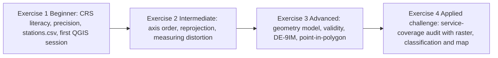

Reference numbers for checking come from Appendix A. If you use `pyproj`, `shapely` or QGIS, expect agreement within a few centimetres for coordinates and about 0.01 % for areas. The "success criteria" give tolerances.

---

### Exercise 1: CRS literacy, precision and your first QGIS session (Beginner)

**Task**

1. Create `stations.csv` (below) in a working folder.
2. Complete the CRS table below in a file `crs_notes.md`: for each EPSG code state *geographic or projected*, *units*, *axis order as defined by EPSG*, and *one suitable use*. Use QGIS (*Layer CRS selector*), `pyproj.CRS.from_epsg(code)` or the EPSG registry to look them up.
3. Answer the precision questions.
4. In QGIS, import `stations.csv` once correctly and once with X and Y deliberately swapped. Record where the swapped points land. Switch the project CRS to EPSG:3857 and EPSG:32631 and note what changes and what does not.

**Prerequisites:** sections 2.1–2.3 and 4.9 (Parts A–B).

**Sample input**

`stations.csv`

```csv
name,lat,lon
Amsterdam Centraal,52.3791,4.9003
Utrecht Centraal,52.0894,5.1103
Rotterdam Centraal,51.9244,4.4690
Den Haag Centraal,52.0806,4.3248
```

CRS table to complete:

| EPSG | Name | Geographic / projected | Units | Axis order (EPSG definition) | One suitable use |
|---|---|---|---|---|---|
| 4326 | | | | | |
| 3857 | | | | | |
| 32631 | | | | | |
| 4258 | | | | | |
| 3035 | | | | | |
| 4269 | | | | | |
| 26918 | | | | | |
| 5070 | | | | | |

Precision questions:

- (a) What ground distance does the **6th decimal of latitude** represent? What about the 6th decimal of **longitude at 52.38° N**?
- (b) At 52.38° N, how many metres is a longitude difference of **0.001°**?
- (c) A colleague stores coordinates as `52.37919123456789, 4.90031234567891`. What is the smallest claim of accuracy that is *justified* for a phone-GPS source? How many decimals would you keep, and why?
- (d) You are given the UTM 31N coordinate `E = 629345.7, N = 5804903.4` in a `float32` column. What is the largest rounding error you may expect in each component?

**Expected deliverable:** `crs_notes.md` (completed table and four short answers) plus three QGIS screenshots (correct import, swapped import, project CRS switched), each with a one-line caption.

**Success criteria**

- Every table row is correct (geographic vs. projected, units, axis order).
- (a) ≈ 0.11 m (latitude) and ≈ 0.068 m (longitude at 52.38° N), with the reasoning that a degree of longitude shrinks with cos φ.
- (b) between 67.9 m and 68.2 m.
- (c) You justify no better than metre-level accuracy and keep about 5 decimals at most (≈ 1 m), and you explain that the other digits are noise.
- (d) You identify the `float32` spacing for each component: 0.0625 m for the easting (values in [524 288, 1 048 576)) and 0.5 m for the northing (values in [4 194 304, 8 388 608)); the maximum rounding error is half of that: about 3.1 cm and 0.25 m.
- The screenshots show that the swapped import lands in the Indian Ocean, and that changing the project CRS does not alter the layer's stored coordinates.

**Hint:** For (b) multiply 0.001° by the length of one degree of longitude at that latitude (section 4.1 table). For the axis-order column, remember that the EPSG registry defines EPSG:4326 as *latitude, longitude*; check EPSG:3035 explicitly rather than assuming.

---

### Exercise 2: Axis order, reprojection and measuring the distortion (Intermediate)

**Task**

Write `reproject_stations.py` that:

1. Reads `stations_mixed.csv` (below). The file mixes two conventions: some rows are `(lat, lon)` and some `(lon, lat)`.
2. Implements `resolve_axis_order(first, second, aoi)` that returns `(lon, lat)` using an area-of-interest box for the Netherlands (lon 3.0–7.3, lat 50.5–53.7). It must **raise `ValueError` rather than guess** when both or neither interpretation fits.
3. Converts each station to EPSG:32631 and EPSG:3857 (use `pyproj` with `always_xy=True`, or the reference code of Appendix A).
4. Computes the six pairwise distances four ways (geodesic, haversine, planar UTM, planar Web Mercator) and the percentage deviation of each from the geodesic.
5. Writes `stations_utm.csv` with columns `name,lon,lat,easting,northing`.

**Prerequisites:** Exercise 1 (`stations.csv`), sections 2.3, 4.1–4.3, 5.

**Sample input**

`stations_mixed.csv`

```csv
name,a,b
Amsterdam Centraal,52.3791,4.9003
Utrecht Centraal,5.1103,52.0894
Rotterdam Centraal,51.9244,4.4690
Den Haag Centraal,4.3248,52.0806
```

**Expected deliverable:** `reproject_stations.py`, `stations_utm.csv`, and a printed distance table.

**Success criteria**

- The resolved coordinates equal those in `stations.csv` (all four rows become `lon ≈ 4.3–5.1`, `lat ≈ 51.9–52.4`).
- `resolve_axis_order(10.0, 20.0, aoi=dict(lon=(0, 60), lat=(0, 60)))` raises `ValueError` (ambiguous), and `resolve_axis_order(100.0, 100.0)` raises `ValueError` (neither fits).
- `stations_utm.csv` easting/northing agree with the table in section 5.5 within 0.1 m.
- Distances agree with the table in section 5.6 within 0.5 m (geodesic), 0.5 m (haversine), 0.5 m (UTM) and 1 m (Web Mercator).
- You state in one sentence per method how large its error is and why.

**Hint:** Compute the two candidate interpretations separately and test each against the box. Create the `Transformer` once, outside the loop. If you use `pyproj.Geod.inv`, note it expects `lon, lat` order.

---

### Exercise 3: Geometry model, validity and spatial relationships (Advanced)

**Task**

Write `geometry_toolkit.py` implementing, **without** a geometry library (you may cross-check against Shapely afterwards):

1. `circle_polygon(centre, r, n=64)`: a counter-clockwise ring with `n` vertices on a circle.
2. `shoelace(ring)`, `point_in_ring(pt, ring)`, `ring_is_simple(ring)` (section 4.4).
3. A convex-polygon intersection (Sutherland–Hodgman clipping) so that you can compute the **overlap area** of two buffers.

Then, using the projected station points from Exercise 2:

a. Build a 15 km "service area" polygon (64 vertices) for each station. Report the polygon area and compare with π*r*².
b. For all six station pairs report the centre distance, whether the service areas are *disjoint* or *overlap*, the expected DE-9IM string, and (if they overlap) the overlap area. Compare with the closed-form circle lens area.
c. For four test points (the Rotterdam–Den Haag midpoint, and the three station points Rotterdam, Den Haag, Amsterdam) state in which service areas each lies.
d. Show that the bow-tie `[(0,0),(2,2),(2,0),(0,2)]` is invalid, that its shoelace "area" is 0, and compute the area after splitting it at the crossing into two triangles. Show that the centroid of the U-shaped polygon `[(0,0),(10,0),(10,10),(7,10),(7,3),(3,3),(3,10),(0,10)]` lies **outside** it.

**Prerequisites:** Exercise 2 outputs (`stations_utm.csv`), sections 2.4, 4.4, 4.7.2.

**Sample input:** the four station points in EPSG:32631 from `stations_utm.csv`; radius 15 000 m; the two test polygons given above.

**Expected deliverable:** `geometry_toolkit.py` with a `__main__` block printing the results of (a)–(d), and a short note (`geometry_notes.md`) explaining the DE-9IM strings for the two relation types you found.

**Success criteria**

- (a) Each polygon area is 705 723 410.4 m² (± 1 m²), i.e. 0.99839 × π*r*² = 706 858 347.1 m².
- (b) Exactly one pair (Rotterdam–Den Haag, centre distance ≈ 19 997.5 m) overlaps; the other five are disjoint. Overlap polygon area ≈ 154 326 525.9 m² (± 5 000 m²; see the sensitivity note in Solution 3), slightly below the closed-form circle lens area (≈ 154 930 533 m²) because the polygons are inscribed in the circles. DE-9IM: disjoint pairs `FF2FF1212`, overlapping pair `212101212`.
- (c) The midpoint lies in the Rotterdam and Den Haag areas; each station point lies only in its own area, with Amsterdam in the Amsterdam area only.
- (d) `ring_is_simple` is `False` for the bow-tie and `True` for a square; the split triangles have total area 2.0; the U-shape area is 72.0, its centroid is `(5.0, 4.4167)`, and `point_in_ring` is `False` for it.

**Hint:** For the lens area of two equal circles with radius *r* and centre distance *d* use 2*r*² arccos(*d* / 2*r*) − (*d* / 2) √(4*r*² − *d*²). In Sutherland–Hodgman clipping, keep the vertices on the left of each clip edge (both polygons counter-clockwise) and add the intersection points when an edge crosses it. Optional cross-check: `shapely.Point(x, y).buffer(15000).area` should equal the same inscribed-polygon area, and `a.relate(b)` should return the DE-9IM strings above.

---

### Exercise 4: Applied challenge, a service-coverage audit (Applied)

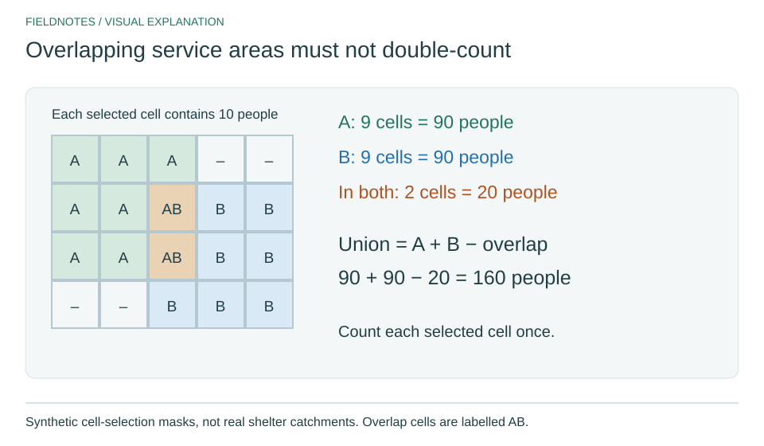

**Read it:** Count cells labelled A or B, including AB in each separate total. Then subtract one copy of the two AB cells. This small synthetic example explains union counting; the station exercise below has its own computed population grid and totals.

**Scenario.** A transport agency wants to know how many people live within 15 km (straight-line) of each of the four stations, how many people are covered by *at least one* station, how many are double-counted because service areas overlap, and how to present the result on a map.

**Task**

1. **Data.** Using the station points from Exercise 2 (EPSG:32631), generate the *synthetic* population raster described below (no external data needed).
2. **Zonal statistics.** For each station's 15 km service area (Exercise 3 polygons), sum the population of all cells whose **cell centre** lies inside the polygon. Report cells and population per station.
3. **Union and overlap.** Compute the number of covered cells and population for the union of the four areas; how many cells fall in 0, 1, 2, 3 areas; and the double-counted population (sum of per-station totals minus the union total).
4. **Classification.** Classify the covered cells' values into 5 classes with equal-interval, quantile and natural-breaks methods; report the edges and the GVF of each.
5. **Map.** Produce `coverage_map.png`: the covered cells in the 5-class ramp of your choice (justify the classification method), stations as markers, a legend with class ranges, axis labels naming the CRS and units, and a scale bar.
6. **QGIS replication.** Write the raster to GeoTIFF (EPSG:32631), then reproduce steps 2 and 4 in QGIS (*Buffer*, *Zonal statistics*, *Graduated* style with the three modes). Note any differences between QGIS and your script and explain them.
7. **Report.** One page (`coverage_report.md`) with the key figures, the map, and three caveats (for example synthetic data, straight-line distance vs. travel time, cell-centre rule and cell size).

**Prerequisites:** Exercises 1–3, sections 4.5, 4.7, 4.9.

**Sample input (synthetic raster specification, so that everyone gets identical numbers)**

| Item | Value |
|---|---|
| CRS | EPSG:32631 |
| Geotransform | `(570000.0, 2000.0, 0.0, 5820000.0, 0.0, -2000.0)` (north-up, 2 km cells) |
| Size | 45 columns × 40 rows |
| Cell value | `round(20 + Σ amp_s · exp(−d_s² / (2·8000²)))`, *d_s* = distance (m) from the **cell centre** to station *s*, rounded with `numpy.rint` and stored as integer "people per cell" |
| Amplitudes | Amsterdam 900, Utrecht 600, Rotterdam 800, Den Haag 700 |
| Service area | 64-vertex polygon, radius 15 000 m, around each station point |
| Colour ramp suggestion (5 classes) | `#ffffb2 #fecc5c #fd8d3c #f03b20 #bd0026` (ColorBrewer YlOrRd) |

**Expected deliverable:** `service_coverage.py`, `population.tif`, `coverage_map.png`, QGIS project `coverage.qgz`, `coverage_report.md`.

**Success criteria**

- Raster: total 329 481, minimum 20, maximum 919, 1 800 cells.
- Per station (cells / population): Amsterdam 179 / 79 031; Utrecht 178 / 53 908; Rotterdam 175 / 82 813; Den Haag 179 / 77 700.
- Union: 674 cells, population 270 955. Sum of per-station populations 293 452; double-counted population 22 497. Cells covered by 0 / 1 / 2 / 3 service areas: 1 126 / 637 / 37 / 0.
- Classification of the 674 covered cells (min 125, max 919): equal interval edges `125, 283.8, 442.6, 601.4, 760.2, 919` (GVF 0.950); quantile edges `125, 213, 300.2, 425.8, 593, 919` (GVF 0.942); natural breaks edges `125, 247, 366, 502, 662, 919` (GVF 0.956).
- The map has a legend with class ranges, CRS/unit labels and a scale bar, and your report states which classification you chose and why.
- In QGIS, per-station sums are within ±5 % of your values; differences are explained (for example how QGIS treats partially covered cells versus the cell-centre rule, and the *Segments* parameter of *Buffer*: use 16 to match a 64-gon).

**Hint:** Build `cx, cy` arrays of cell-centre coordinates with `numpy.meshgrid` and the geotransform (section 4.5.1) and evaluate the Gaussian terms vectorised. A boolean mask per station from `point_in_ring` (or `shapely.contains_xy`) lets you sum with `pop[mask].sum()`. For the union use `numpy.any` over the masks and for overlap counts `numpy.sum` over them. Write the GeoTIFF with `rasterio` using `Affine(2000.0, 0, 570000.0, 0, -2000.0, 5820000.0)`.

---

## 8. Solutions and explanations

> Attempt each exercise before reading its solution. Where a solution depends on numbers, the verification method is given.

### Solution 1

**CRS table**

| EPSG | Name | Geographic / projected | Units | Axis order (EPSG) | One suitable use |
|---|---|---|---|---|---|
| 4326 | WGS 84 | Geographic 2D | degree | latitude, longitude | GPS data, storage and exchange |
| 3857 | WGS 84 / Pseudo-Mercator | Projected | metre | easting (X), northing (Y) | web map tiles and display |
| 32631 | WGS 84 / UTM zone 31N | Projected | metre | easting, northing | measurement in 0°–6° E, northern hemisphere |
| 4258 | ETRS89 | Geographic 2D | degree | latitude, longitude | European data storage and exchange |
| 3035 | ETRS89-extended / LAEA Europe | Projected (equal-area) | metre | **northing, easting** | pan-European area and density statistics |
| 4269 | NAD83 | Geographic 2D | degree | latitude, longitude | North American data storage |
| 26918 | NAD83 / UTM zone 18N | Projected | metre | easting, northing | measurement in 78°–72° W, USA/Canada |
| 5070 | NAD83 / Conus Albers | Projected (equal-area) | metre | easting, northing | area comparison across the contiguous US |

Verify each row programmatically, for example:

```python
from pyproj import CRS
for code in (4326, 3857, 32631, 4258, 3035, 4269, 26918, 5070):
    c = CRS.from_epsg(code)
    print(code, c.name, "geographic" if c.is_geographic else "projected",
          [a.abbrev for a in c.axis_info], c.axis_info[0].unit_name)
```

**(a)** One degree of latitude is about 111.27 km at 52.38° N, so 10⁻⁶° ≈ 0.111 m. A degree of longitude there is about 68.10 km, so 10⁻⁶° ≈ 0.068 m. (The 6th decimal is *finer* east–west because meridians converge.)

**(b)** 0.001° × 68 096 m/° ≈ **68.1 m** (the spherical shortcut 111 319.5 × cos φ × 0.001 gives 67.95 m, within 0.2 %, which is why a range of 67.9–68.2 m is accepted).

**(c)** A phone fix is accurate to metres, so claiming better than about 1 m is unjustified, and 5 decimals (1.1 m in latitude) is already generous. Digits 6–14 are numerical noise; keeping them wastes storage and signals false exactness. For RFC 7946 GeoJSON, 6 decimals (≈ 0.1 m) is the usual maximum.

**(d)** `float32` has a 24-bit significand, so the spacing between representable values in [2ᵏ, 2ᵏ⁺¹) is 2ᵏ⁻²³. The easting 629 345.7 lies in [524 288, 1 048 576) = [2¹⁹, 2²⁰), spacing 2⁻⁴ = 0.0625 m, so it is rounded to a multiple of 6.25 cm (maximum error ≈ 3.1 cm). The northing 5 804 903.4 lies in [4 194 304, 8 388 608) = [2²², 2²³), spacing 2⁻¹ = 0.5 m, so the maximum rounding error is 0.25 m. Conclusion: `float32` cannot hold UTM coordinates at centimetre precision; keep `float64`. (For comparison, an easting of exactly 500 000 m lies in [2¹⁸, 2¹⁹) with spacing 0.031 25 m, as quoted in section 4.6.)

**QGIS observations.** Correct import: points in the Netherlands. Swapped import (X = lat, Y = lon): all points near 4.9° N, 52.4° E, in the Indian Ocean east of Somalia. Changing the project CRS reprojects the *display* only; the layer's CRS and its stored coordinates (check the attribute table and the *Layer Properties → Information*) are unchanged.

---

### Solution 2

```python
# reproject_stations.py  (pure-Python reference; swap in pyproj as shown in the comments)
import csv, io, itertools, math
from geolib import utm, web_mercator, vincenty_inverse, haversine     # Appendix A
# from pyproj import Transformer, Geod
# to_utm = Transformer.from_crs("EPSG:4326", "EPSG:32631", always_xy=True)   # create ONCE
# to_wm  = Transformer.from_crs("EPSG:4326", "EPSG:3857",  always_xy=True)
# geod   = Geod(ellps="WGS84")                                               # geod.inv(lon1, lat1, lon2, lat2)

MIXED = """name,a,b
Amsterdam Centraal,52.3791,4.9003
Utrecht Centraal,5.1103,52.0894
Rotterdam Centraal,51.9244,4.4690
Den Haag Centraal,4.3248,52.0806
"""
NL = dict(lon=(3.0, 7.3), lat=(50.5, 53.7))

def _inside(lon, lat, aoi):
    return aoi["lon"][0] <= lon <= aoi["lon"][1] and aoi["lat"][0] <= lat <= aoi["lat"][1]

def resolve_axis_order(first, second, aoi=NL):
    """Return (lon, lat). Refuse to guess when both or neither interpretation fits the area of interest."""
    a, b = _inside(first, second, aoi), _inside(second, first, aoi)
    if a and b: raise ValueError("ambiguous: both interpretations fall inside the area of interest")
    if a:       return first, second
    if b:       return second, first
    raise ValueError("neither interpretation falls inside the area of interest")

pts = []
for r in csv.DictReader(io.StringIO(MIXED)):
    lon, lat = resolve_axis_order(float(r["a"]), float(r["b"]))
    pts.append((r["name"], lon, lat))

with open("stations_utm.csv", "w", newline="", encoding="utf-8") as f:
    w = csv.writer(f); w.writerow(["name", "lon", "lat", "easting", "northing"])
    for n, lon, lat in pts:
        e, nn = utm(lat, lon, 31)                     # pyproj: to_utm.transform(lon, lat)
        w.writerow([n, lon, lat, round(e, 1), round(nn, 1)])

print("pair | geodesic | haversine | UTM | WebMerc | WM/geodesic")
for (n1, o1, a1), (n2, o2, a2) in itertools.combinations(pts, 2):
    g = vincenty_inverse(a1, o1, a2, o2); h = haversine(a1, o1, a2, o2)
    u = math.dist(utm(a1, o1, 31), utm(a2, o2, 31)); wm = math.dist(web_mercator(a1, o1), web_mercator(a2, o2))
    print(f"{n1[:3]}-{n2[:3]}  {g:9.1f} {h:9.1f} ({(h/g-1)*100:+.2f}%) {u:9.1f} ({(u/g-1)*100:+.3f}%) {wm:9.1f}  {wm/g:.3f}")
```

Output of the checks: the resolved rows print `lon=4.9003 lat=52.3791`, `lon=5.1103 lat=52.0894`, `lon=4.4690 lat=51.9244`, `lon=4.3248 lat=52.0806`; `resolve_axis_order(10.0, 20.0, aoi=dict(lon=(0,60), lat=(0,60)))` raises `ValueError: ambiguous: ...`; `resolve_axis_order(100.0, 100.0)` raises `ValueError: neither interpretation ...`. The coordinate and distance tables are those of sections 5.5 and 5.6.

**Explanation.** A range check alone cannot disambiguate `(52.3791, 4.9003)`, because both numbers are valid longitudes and latitudes. The area of interest supplies the missing prior. If the AOI is so large that both interpretations fit (the 0–60° box), guessing would silently corrupt data, so the function must refuse. Errors: haversine understates by 0.1–0.3 % (spherical model); UTM planar understates by 0.02–0.03 % (its scale factor in this region is about 0.9998); Web Mercator overstates by 62–63 % (scale factor sec φ ≈ 1.64 at 52.4° N, averaged along the line).

**Verification.** Cross-check any one geodesic with `pyproj.Geod(ellps="WGS84").inv(4.9003, 52.3791, 5.1103, 52.0894)[2]` (≈ 35 283.9 m), or with PostGIS `ST_Distance(...::geography)`.

---

### Solution 3

```python
# geometry_toolkit.py
import itertools, math
from geolib import shoelace
# stations_utm.csv holds the projected station points (EPSG:32631); here inline for self-containment
XY = {"Amsterdam Centraal": (629345.7, 5804903.4), "Utrecht Centraal": (644576.5, 5773082.7),
      "Rotterdam Centraal": (601014.8, 5753649.3), "Den Haag Centraal": (590782.8, 5770830.9)}

def circle_polygon(c, r, n=64):
    return [(c[0] + r * math.cos(2 * math.pi * k / n), c[1] + r * math.sin(2 * math.pi * k / n)) for k in range(n)]

def point_in_ring(pt, ring):
    x, y = pt; inside = False
    for i in range(len(ring)):
        x1, y1 = ring[i]; x2, y2 = ring[(i + 1) % len(ring)]
        if (y1 > y) != (y2 > y) and x1 + (y - y1) * (x2 - x1) / (y2 - y1) > x:
            inside = not inside
    return inside

def clip_convex(subject, clipper):
    """Sutherland-Hodgman. Both polygons convex and counter-clockwise."""
    out = subject
    for i in range(len(clipper)):
        a, b = clipper[i], clipper[(i + 1) % len(clipper)]
        side = lambda p: (b[0] - a[0]) * (p[1] - a[1]) - (b[1] - a[1]) * (p[0] - a[0])   # >0: left of a->b
        inp, out = out, []
        for j in range(len(inp)):
            p, q = inp[j], inp[(j + 1) % len(inp)]
            sp, sq = side(p), side(q)
            if sp >= 0: out.append(p)
            if (sp >= 0) != (sq >= 0):                       # edge crosses the clip line
                t = sp / (sp - sq); out.append((p[0] + t * (q[0] - p[0]), p[1] + t * (q[1] - p[1])))
        if not out: break
    return out

R = 15000.0
rings = {n: circle_polygon(c, R) for n, c in XY.items()}
print("polygon area:", round(shoelace(rings["Amsterdam Centraal"]), 1), " pi*r^2:", round(math.pi * R * R, 1))
for a, b in itertools.combinations(XY, 2):
    d = math.dist(XY[a], XY[b]); inter = clip_convex(rings[a], rings[b])
    area = abs(shoelace(inter)) if len(inter) >= 3 else 0.0
    lens = 2 * R * R * math.acos(d / (2 * R)) - d / 2 * math.sqrt(4 * R * R - d * d) if d < 2 * R else 0.0
    rel = "overlaps  212101212" if area > 0 else "disjoint  FF2FF1212"
    print(f"{a[:3]}-{b[:3]}  d={d:9.1f} m  {rel}  overlap={area:14.1f}  circle lens={lens:14.1f}")
```

Output:

```text
polygon area: 705723410.4  pi*r^2: 706858347.1
Ams-Utr  d= 35278.0 m  disjoint  FF2FF1212  overlap=           0.0  circle lens=           0.0
Ams-Rot  d= 58563.0 m  disjoint  FF2FF1212  overlap=           0.0  circle lens=           0.0
Ams-Den  d= 51459.1 m  disjoint  FF2FF1212  overlap=           0.0  circle lens=           0.0
Utr-Rot  d= 47699.9 m  disjoint  FF2FF1212  overlap=           0.0  circle lens=           0.0
Utr-Den  d= 53840.8 m  disjoint  FF2FF1212  overlap=           0.0  circle lens=           0.0
Rot-Den  d= 19997.5 m  overlaps  212101212  overlap=   154326525.9  circle lens=   154930533.3
```

(Output shown was produced from unrounded UTM coordinates. The overlap area is sensitive to the centre distance *d*: the area changes by about 22 000 m² per metre of *d*, so station coordinates rounded to 0.1 m, as in the listing above, shift the overlap area by up to a few thousand m². Polygon areas and the disjoint/overlap classification are unaffected.)

**Explanations**

- **(a)** The 64-gon is inscribed in the circle: area = ½·64·*r*²·sin(2π/64) = 0.99839·π*r*².
- **(b)** Two discs overlap iff the centre distance is less than 2*r* = 30 000 m. Only Rotterdam–Den Haag (≈ 20.0 km) qualifies; Amsterdam–Utrecht (35.3 km) is the next closest and is disjoint. DE-9IM for two disjoint polygons: interiors, boundaries and the other's interior/boundary do not meet (`F`), each polygon's interior meets the other's exterior in an area (`2`), boundaries meet the other's exterior in lines (`1`) and the exteriors meet in an area (`2`): `FF2FF1212`. For two partially overlapping polygons the interiors share an area (`2`), the interior of one meets the boundary of the other in a line (`1`), and the two boundaries cross at two points (`0`): `212101212`, the same pattern as the overlapping squares in section 4.4.4. The overlap polygon is slightly smaller than the circle lens because the polygons lie inside their circles.
- **(c)** Test points: the Rotterdam–Den Haag midpoint is inside both areas (it is ≈ 10 km from each centre); each station is within 15 km of itself and more than 15 km from the others (nearest neighbour is 20.0 km).
- **(d)** Bow-tie: edges (0,0)→(2,2) and (2,0)→(0,2) intersect at (1,1), so `ring_is_simple` returns `False`; the signed lobes cancel (+1 and −1), so the shoelace gives 0.0; after splitting, the triangles (0,0)-(1,1)-(0,2) and (1,1)-(2,2)-(2,0) each have area 1, total 2.0. The U-shape's centroid (5.0, 4.4167) lies in the notch (x between 3 and 7, y above 3), outside the polygon, so `point_in_ring` returns `False`: use a representative point or pole of inaccessibility for labels.

**Verification with Shapely (optional).** `Point(x, y).buffer(15000)` has the same area (65 coordinates, 64 distinct) up to floating-point error; `a.relate(b)` returns `FF2FF1212` and `212101212`; `Polygon(bow).is_valid` is `False` with reason `Self-intersection[1 1]`; `make_valid` returns a MultiPolygon of area 2.0.

---

### Solution 4

```python
# service_coverage.py
import math, numpy as np
from geolib import utm, shoelace                                   # Appendix A

stations = {"Amsterdam Centraal": (52.3791, 4.9003, 900), "Utrecht Centraal": (52.0894, 5.1103, 600),
            "Rotterdam Centraal": (51.9244, 4.4690, 800), "Den Haag Centraal": (52.0806, 4.3248, 700)}
xy = {n: utm(lat, lon, 31) for n, (lat, lon, _) in stations.items()}          # EPSG:32631

# 1. synthetic raster ---------------------------------------------------------
GT = (570000.0, 2000.0, 0.0, 5820000.0, 0.0, -2000.0); NCOL, NROW = 45, 40
cols, rows = np.meshgrid(np.arange(NCOL), np.arange(NROW))
cx = GT[0] + (cols + 0.5) * GT[1]                                              # cell-centre coordinates
cy = GT[3] + (rows + 0.5) * GT[5]
pop = np.full((NROW, NCOL), 20.0)
for n, (_, _, amp) in stations.items():
    x0, y0 = xy[n]
    pop += amp * np.exp(-((cx - x0) ** 2 + (cy - y0) ** 2) / (2 * 8000.0 ** 2))
pop = np.rint(pop).astype(int)
print("raster total", pop.sum(), "min", pop.min(), "max", pop.max(), "cells", pop.size)

# 2. zonal sums (cell-centre rule) -------------------------------------------
def circle(c, r, n=64): return [(c[0] + r * math.cos(2 * math.pi * k / n), c[1] + r * math.sin(2 * math.pi * k / n)) for k in range(n)]
def pip(pt, ring):
    x, y = pt; inside = False
    for i in range(len(ring)):
        x1, y1 = ring[i]; x2, y2 = ring[(i + 1) % len(ring)]
        if (y1 > y) != (y2 > y) and x1 + (y - y1) * (x2 - x1) / (y2 - y1) > x: inside = not inside
    return inside

masks = {}
for n in stations:
    ring = circle(xy[n], 15000.0)
    masks[n] = np.array([[pip((cx[r, c], cy[r, c]), ring) for c in range(NCOL)] for r in range(NROW)])
    print(f"{n:20s} cells {masks[n].sum():3d}  pop {pop[masks[n]].sum()}")

# 3. union and overlap --------------------------------------------------------
stack = np.array(list(masks.values()))
union, count = stack.any(axis=0), stack.sum(axis=0)
total_each = sum(pop[m].sum() for m in masks.values())
print("union cells", union.sum(), "pop", pop[union].sum(), "| sum of per-station", total_each, "| double-counted", total_each - pop[union].sum())
print("cells covered by 0,1,2,3 areas:", [int((count == k).sum()) for k in range(4)])

# 4. classification of covered cells ------------------------------------------
# paste equal_interval/quantile/jenks_edges/gvf from section 4.7.1 above this line (or import them)
vals = pop[union].astype(float)
for name, edges in [("equal", np.linspace(vals.min(), vals.max(), 6)),
                    ("quantile", np.quantile(vals, np.linspace(0, 1, 6))),
                    ("jenks", jenks_edges(vals, 5))]:                    # from section 4.7.1
    print(f"{name:9s} {np.round(edges, 1)}  GVF={gvf(vals, edges):.4f}")
```

Output:

```text
raster total 329481 min 20 max 919 cells 1800
Amsterdam Centraal   cells 179  pop 79031
Utrecht Centraal     cells 178  pop 53908
Rotterdam Centraal   cells 175  pop 82813
Den Haag Centraal    cells 179  pop 77700
union cells 674 pop 270955 | sum of per-station 293452 | double-counted 22497
cells covered by 0,1,2,3 areas: [1126, 637, 37, 0]
equal     [125.  283.8 442.6 601.4 760.2 919. ]  GVF=0.9496
quantile  [125.  213.  300.2 425.8 593.  919. ]  GVF=0.9419
jenks     [125. 247. 366. 502. 662. 919. ]  GVF=0.9560
```

Station cells for reference (column, row → value): Amsterdam (29, 7) → 919, Utrecht (37, 23) → 619, Rotterdam (15, 33) → 843, Den Haag (10, 24) → 754.

**Map and GeoTIFF**

```python
import matplotlib; matplotlib.use("Agg")
import matplotlib.pyplot as plt
from matplotlib.colors import BoundaryNorm, ListedColormap

edges = jenks_edges(vals, 5)                      # chosen: natural breaks, highest GVF and clear class groups
cmap = ListedColormap(["#ffffb2", "#fecc5c", "#fd8d3c", "#f03b20", "#bd0026"])
norm = BoundaryNorm(edges, cmap.N)
fig, ax = plt.subplots(figsize=(8, 7))
im = ax.imshow(np.ma.masked_where(~union, pop), cmap=cmap, norm=norm,
               extent=(GT[0], GT[0] + NCOL * 2000, GT[3] - NROW * 2000, GT[3]))   # extent: left, right, bottom, top
for n, (x, y) in xy.items():
    ax.plot(x, y, "k^"); ax.annotate(n.split()[0], (x, y), textcoords="offset points", xytext=(6, 6), fontsize=8)
ax.set_xlabel("Easting (m), EPSG:32631"); ax.set_ylabel("Northing (m), EPSG:32631")
cb = fig.colorbar(im, ax=ax, ticks=edges, label="People per 2 km cell (synthetic)")
ax.plot([575000, 585000], [5743000, 5743000], "k-", lw=3); ax.text(580000, 5744000, "10 km", ha="center", fontsize=8)   # scale bar
fig.savefig("coverage_map.png", dpi=150, bbox_inches="tight")

# GeoTIFF for the QGIS part (requires rasterio)
import rasterio
from rasterio.transform import Affine
with rasterio.open("population.tif", "w", driver="GTiff", height=NROW, width=NCOL, count=1, dtype="int32",
                   crs="EPSG:32631", transform=Affine(2000.0, 0, 570000.0, 0, -2000.0, 5820000.0)) as dst:
    dst.write(pop.astype("int32"), 1)
```

**Why natural breaks here.** The covered values form a smooth but strongly peaked distribution (dense cores around each station, a long tail of lower values); natural breaks achieves the highest GVF (0.956 vs. 0.950 equal interval and 0.942 quantile), but the margin is small, so a defensible alternative is quantiles (equal number of cells per colour, easy to read as "top 20 % of cells") or domain thresholds fixed in advance for comparison over time. State the choice and the reason in the legend or report.

**QGIS replication notes.** *Buffer* with *Segments* = 16 yields the same 64-vertex polygons. *Zonal statistics* sums raster cells per polygon, but its treatment of cells that are only partly covered can differ from the cell-centre rule used here, so expect per-station sums within a few percent. A larger difference signals a CRS or geotransform error (for example a half-cell offset or a wrong CRS on the GeoTIFF). *Graduated* with *Natural Breaks (Jenks)* may report slightly different edges because QGIS uses a sampled/heuristic algorithm for large inputs.

**Report caveats (example).**

1. The raster is synthetic. Real population grids have different spatial structure, and the results do not describe real coverage.
2. The 15 km radius is a straight-line distance; travel time over the road or rail network is the relevant measure for real service areas.
3. Results depend on cell size and on the cell-centre rule (the modifiable areal unit problem): 2 km cells make a 15 km radius only 7–8 cells wide, so boundary cells matter.

**Verification checklist.** Raster total, min and max equal the success criteria; the per-station cell counts differ by at most a few cells if you use a different boundary rule; the sum identity `union_total + double_counted = sum_of_per_station_totals` holds; and the map's coloured area is bounded by four circular arcs of radius 15 km (a visual test for CRS or geotransform errors).

---

## 9. Summary, glossary and further reading

### 9.1 Key takeaways

1. **Coordinates need a CRS.** A pair of numbers without a CRS, datum and axis order is not a location. Always record the EPSG code and the axis order convention.
2. **Know assign vs. transform.** Assigning repairs metadata; transforming changes numbers. Mixing them up is the commonest "wrong place" bug.
3. **Axis order differs between standards.** EPSG:4326 is latitude-longitude; GeoJSON, WKT and PostGIS use longitude-latitude. Normalise at the boundary and test with a known point.
4. **Datums matter at the metre level.** WGS 84, ETRS89 and NAD83 differ by about a metre or more; check which transformation your software applied.
5. **Measure in the right space.** Never measure in degrees or in Web Mercator; use a local projected CRS, an equal-area CRS for areas, or geodesic functions.
6. **The Simple Features model has rules.** Validate geometries, choose spatial predicates deliberately (DE-9IM), and remember that the model is not topological.
7. **Raster and vector are complementary.** Use geotransforms precisely, and match resampling to data type (nearest/mode for categories, bilinear/average for continuous).
8. **Precision is not accuracy.** Keep `float64`, but report only the digits your source supports.
9. **Cartography encodes decisions.** Classification method, colour ramp and projection change the message; document the choices.
10. **QGIS is your debugger.** Reproduce problems visually before and after you automate them.

### 9.2 Glossary

| Term | Definition |
|---|---|
| **Accuracy** | Closeness of a measured value to the true value. |
| **Affine transformation** | Linear transformation plus translation; the geotransform is one. |
| **Antimeridian** | The 180° meridian where longitude wraps from +180° to −180°. |
| **Axis order** | The sequence in which coordinate values are listed (for example latitude, longitude). |
| **Ballpark transformation** | A datum change that PROJ approximates (often as identity) because no better operation is available; accuracy is unknown. |
| **Boundary** | The set that separates a geometry's interior from its exterior (a polygon's rings, a line's endpoints). |
| **Cell size / resolution** | The ground size of one raster cell edge. |
| **Choropleth** | A thematic map in which areas are shaded according to a classified value. |
| **Conformal projection** | A projection that preserves local angles and shapes. |
| **CRS** | Coordinate reference system: datum, coordinate system and, for projected CRSs, a map projection. |
| **Datum** | A model that ties a coordinate system to the Earth (ellipsoid, origin, orientation, scale). |
| **DE-9IM** | Dimensionally Extended 9-Intersection Model, a matrix describing the relationship between two geometries. |
| **Ellipsoid** | A flattened sphere (spheroid) approximating the Earth, defined by *a* and *f*. |
| **EPSG code** | An integer identifying a CRS or operation in the EPSG Geodetic Parameter Dataset. |
| **Equal-area projection** | A projection that preserves area. |
| **Geodesic** | The shortest path between two points on a curved surface. |
| **Geographic CRS** | A CRS whose coordinates are angles (latitude, longitude). |
| **Geoid** | An equipotential surface of gravity approximating mean sea level. |
| **Geotransform** | Six parameters mapping raster (column, row) to CRS (x, y). |
| **GVF** | Goodness of Variance Fit, a measure of classification quality. |
| **Helmert transformation** | A 7-parameter similarity transformation between geocentric datums. |
| **Interior** | The set of points of a geometry excluding its boundary. |
| **NoData** | A value that marks cells without valid data. |
| **Pole of inaccessibility** | The interior point farthest from a polygon's boundary. |
| **Precision** | The number of significant digits recorded or reported; a property of representation, not of truth. |
| **Projected CRS** | A CRS whose coordinates are planar (typically metres) derived from a geographic CRS by a map projection. |
| **Resampling** | Computing new raster cell values on a new grid. |
| **Scale (map)** | Ratio of a map distance to the corresponding ground distance. |
| **Simple Features** | The OGC/ISO model of vector geometry types and operations. |
| **SRID** | Spatial reference identifier, a database key for a CRS (often equal to the EPSG code). |
| **Topology** | Properties of adjacency and connectivity independent of exact shape. |
| **UTM** | Universal Transverse Mercator, a system of 60 six-degree zones. |
| **Validity** | Conformance of a geometry to the rules of its type (for example a simple, closed polygon ring). |
| **WKT / WKB** | Well-Known Text / Binary representations of geometries (and, for WKT, also CRS definitions). |

### 9.3 Further reading and authoritative references

Only primary sources and well-established references are listed; verify editions and current URLs yourself.

- **EPSG Geodetic Parameter Dataset**, IOGP (registry at `epsg.org`): definitive CRS definitions, axis orders and operations.
- **PROJ documentation** (`proj.org`): coordinate operations, pipelines, grids, `projinfo`, "ballpark" transformations.
- **GDAL/OGR documentation** (`gdal.org`): raster and vector formats, `ogr2ogr`, `gdalwarp`, geotransform, COG driver.
- **pyproj** (`pyproj4.github.io/pyproj`), **Shapely** (`shapely.readthedocs.io`), **GeoPandas** (`geopandas.org`), **PostGIS** (`postgis.net`) and **QGIS** (`docs.qgis.org`, including the User Guide and Training Manual) documentation.
- **OGC Simple Feature Access, Part 1: Common Architecture** (OGC 06-103r4, also ISO 19125-1): geometry model, validity, DE-9IM.
- **IETF RFC 7946, The GeoJSON Format** (2016): coordinate order, precision guidance, antimeridian handling.
- **OGC GeoPackage Encoding Standard**: GeoPackage metadata tables and geometry encoding.
- J. P. Snyder, *Map Projections: A Working Manual*, USGS Professional Paper 1395 (1987): projection formulas, including Mercator, Transverse Mercator and Lambert Azimuthal Equal-Area.
- C. F. F. Karney, "Transverse Mercator with an accuracy of a few nanometers", *Journal of Geodesy* 85 (2011); and "Algorithms for geodesics", *Journal of Geodesy* 87 (2013).
- T. Vincenty, "Direct and inverse solutions of geodesics on the ellipsoid with application of nested equations", *Survey Review* 23 (1975).
- M. J. Egenhofer and R. D. Franzosa, "Point-set topological spatial relations", *International Journal of Geographical Information Systems* 5 (1991); and E. Clementini, P. Di Felice, P. van Oosterom (1993) on the dimension-extended relations.
- W. D. Fisher, "On grouping for maximum homogeneity", *Journal of the American Statistical Association* 53 (1958): the optimal-partition algorithm behind Jenks natural breaks.
- J. Bertin, *Semiology of Graphics* (1967; English translation 1983); T. Slocum et al., *Thematic Cartography and Geovisualization*; M. Monmonier, *How to Lie with Maps*.
- C. Brewer, **ColorBrewer** colour schemes for cartography (`colorbrewer2.org`).
- P. Longley, M. Goodchild, D. Maguire, D. Rhind, *Geographic Information Science and Systems*: general GIS foundations.

### 9.4 Where to go next

With Phase 1 complete you can read geospatial documentation and diagnose most data-placement problems. Natural next steps are spatial databases and indexing (PostGIS, R-trees), the GDAL/OGR and GeoPandas data-processing toolchain, web mapping (tile pyramids, vector tiles, MapLibre/OpenLayers), and OGC web services (WMS, WFS, WMTS, OGC API – Features).

---

## Appendix A — Reference implementation (`geolib.py`)

Dependency-free (`numpy` is not even required) reference code used to produce every number in this note. It mirrors what PROJ/pyproj and PostGIS compute. Validation performed: (1) UTM easting on the central meridian equals 500 000 m and the northing equals *k*₀ times a numerically integrated meridian arc (agreement to better than 1 µm at 52° N and 40° N); (2) `vincenty_inverse` reproduces the published test line (50.06632° N, −5.71475° E to 58.64402° N, −3.07009° E) as 969 954.166 m and gives 111 319.491 m for 1° of longitude on the equator.

```python
"""Minimal, dependency-light geodesy helpers used to verify the study note."""
import math

# WGS 84 ellipsoid (EPSG:7030)
A = 6378137.0
INV_F = 298.257223563
F = 1.0 / INV_F
B = A * (1 - F)
E2 = F * (2 - F)
R_MEAN = 6371008.8  # IUGG mean radius, used for haversine


def haversine(lat1, lon1, lat2, lon2, r=R_MEAN):
    p1, p2 = math.radians(lat1), math.radians(lat2)
    dphi = p2 - p1
    dlmb = math.radians(lon2 - lon1)
    a = math.sin(dphi / 2) ** 2 + math.cos(p1) * math.cos(p2) * math.sin(dlmb / 2) ** 2
    return 2 * r * math.asin(math.sqrt(a))


def vincenty_inverse(lat1, lon1, lat2, lon2, tol=1e-12, maxit=200):
    """Geodesic distance (m) on the WGS 84 ellipsoid (Vincenty 1975). Not for nearly antipodal points."""
    L = math.radians(lon2 - lon1)
    U1 = math.atan((1 - F) * math.tan(math.radians(lat1)))
    U2 = math.atan((1 - F) * math.tan(math.radians(lat2)))
    sU1, cU1, sU2, cU2 = math.sin(U1), math.cos(U1), math.sin(U2), math.cos(U2)
    lam = L
    for _ in range(maxit):
        sl, cl = math.sin(lam), math.cos(lam)
        sin_sigma = math.hypot(cU2 * sl, cU1 * sU2 - sU1 * cU2 * cl)
        cos_sigma = sU1 * sU2 + cU1 * cU2 * cl
        sigma = math.atan2(sin_sigma, cos_sigma)
        sin_alpha = cU1 * cU2 * sl / sin_sigma
        cos2_alpha = 1 - sin_alpha ** 2
        cos2sm = cos_sigma - 2 * sU1 * sU2 / cos2_alpha if cos2_alpha else 0.0
        C = F / 16 * cos2_alpha * (4 + F * (4 - 3 * cos2_alpha))
        lam_new = L + (1 - C) * F * sin_alpha * (
            sigma + C * sin_sigma * (cos2sm + C * cos_sigma * (-1 + 2 * cos2sm ** 2)))
        if abs(lam_new - lam) < tol:
            lam = lam_new
            break
        lam = lam_new
    u2 = cos2_alpha * (A ** 2 - B ** 2) / B ** 2
    k1 = (math.sqrt(1 + u2) - 1) / (math.sqrt(1 + u2) + 1)
    Aa = (1 + k1 ** 2 / 4) / (1 - k1)
    Bb = k1 * (1 - 3 * k1 ** 2 / 8)
    dsigma = Bb * sin_sigma * (cos2sm + Bb / 4 * (cos_sigma * (-1 + 2 * cos2sm ** 2)
             - Bb / 6 * cos2sm * (-3 + 4 * sin_sigma ** 2) * (-3 + 4 * cos2sm ** 2)))
    return B * Aa * (sigma - dsigma)


def web_mercator(lat, lon):
    """EPSG:4326 (lat, lon) -> EPSG:3857 (x, y) metres."""
    x = A * math.radians(lon)
    y = A * math.log(math.tan(math.pi / 4 + math.radians(lat) / 2))
    return x, y


def utm(lat, lon, zone=None, north=True):
    """WGS 84 geographic (lat, lon) -> UTM (easting, northing); Krueger n-series, Karney (2011)."""
    if zone is None:
        zone = int((lon + 180) // 6) + 1
    lon0 = 6 * zone - 183
    k0, E0 = 0.9996, 500000.0
    N0 = 0.0 if north else 10000000.0
    n = F / (2 - F)
    Ahat = A / (1 + n) * (1 + n**2 / 4 + n**4 / 64 + n**6 / 256)
    al = [None,
          n/2 - 2*n**2/3 + 5*n**3/16 + 41*n**4/180 - 127*n**5/288 + 7891*n**6/37800,
          13*n**2/48 - 3*n**3/5 + 557*n**4/1440 + 281*n**5/630 - 1983433*n**6/1935360,
          61*n**3/240 - 103*n**4/140 + 15061*n**5/26880 + 167603*n**6/181440,
          49561*n**4/161280 - 179*n**5/168 + 6601661*n**6/7257600,
          34729*n**5/80640 - 3418889*n**6/1995840,
          212378941*n**6/319334400]
    phi = math.radians(lat)
    lam = math.radians(lon - lon0)
    c = 2 * math.sqrt(n) / (1 + n)
    t = math.sinh(math.atanh(math.sin(phi)) - c * math.atanh(c * math.sin(phi)))
    xi_p = math.atan2(t, math.cos(lam))
    eta_p = math.atanh(math.sin(lam) / math.sqrt(1 + t * t))
    xi = xi_p + sum(al[j] * math.sin(2*j*xi_p) * math.cosh(2*j*eta_p) for j in range(1, 7))
    eta = eta_p + sum(al[j] * math.cos(2*j*xi_p) * math.sinh(2*j*eta_p) for j in range(1, 7))
    return E0 + k0 * Ahat * eta, N0 + k0 * Ahat * xi


def shoelace(coords):
    """Signed area of a ring (counter-clockwise positive). Ring may be open or closed."""
    pts = list(coords)
    if pts[0] != pts[-1]:
        pts.append(pts[0])
    s = 0.0
    for (x1, y1), (x2, y2) in zip(pts[:-1], pts[1:]):
        s += x1 * y2 - x2 * y1
    return s / 2.0


def graticule_cell_area(lat1, lat2, dlon_deg):
    """Exact area (m2) of an ellipsoidal lat/lon quadrilateral on WGS 84 (authalic formula)."""
    e = math.sqrt(E2)
    def q(phi_deg):
        s = math.sin(math.radians(phi_deg))
        return (1 - E2) * (s / (1 - E2 * s * s) - (1 / (2 * e)) * math.log((1 - e * s) / (1 + e * s)))
    return A ** 2 / 2 * math.radians(dlon_deg) * (q(lat2) - q(lat1))
```
