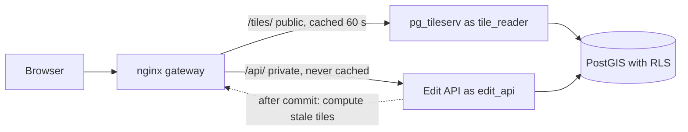

### Solution 4 — secure, editable inventory (reference design)

**Architecture and rules**



| Concern | Decision |
|---|---|
| Public data | Only `tile_reader` serves tiles; RLS policy `USING (is_public)`; tiles are public-only, so a shared cache is safe |
| User-specific data | Only through `/api/`, with `Cache-Control: private, no-store` |
| Identity | JWT verified in the API; `owner_org` and `sub` from claims, passed with transaction-local `set_config` |
| Concurrency | `ETag` = row version; `If-Match` required on `PUT`/`PATCH`/`DELETE`; `412` on mismatch, `428` if missing |
| Freshness | Short TTL (60 s) on public tiles + versioned tile URL (`?v=`) in the editing client; `tiles_to_purge` drives purging if you add a CDN/Varnish with a purge API (open-source nginx has no selective purge without extra modules) |

**API routes shaped like OGC API – Features Part 4**

| Method and path | Meaning | Success | Failure |
|---|---|---|---|
| `POST /collections/poi/items` | Create from a GeoJSON Feature | `201`, `Location`, `ETag` | `400` invalid geometry, `401` |
| `PUT /collections/poi/items/{id}` | Replace | `200`/`204`, new `ETag` | `404`, `412` |
| `PATCH /collections/poi/items/{id}` | Partial update | `200`, new `ETag` | `404`, `412`, `428` |
| `DELETE /collections/poi/items/{id}` | Delete | `204` | `404`, `412` |

Key handler (extends the `session()` helper of Section 5.6; the table gets a `version` column and `CHECK (geometrytype(geom) = 'POINT' AND ST_IsValid(geom))`):

```python
import json
from fastapi import HTTPException, Request, Response

@app.patch("/collections/poi/items/{item_id}")
def patch_item(item_id: int, feature: dict, request: Request, response: Response,
               c: Claims = Depends(claims)):
    raw = request.headers.get("if-match")
    if raw is None:
        raise HTTPException(428, "If-Match header required")
    try:
        version = int(raw.strip('"'))
    except ValueError:
        raise HTTPException(400, "malformed ETag")
    props, geom = feature.get("properties", {}), feature.get("geometry")
    with session(c) as conn:
        row = conn.execute("""UPDATE city.poi SET
                 kind    = COALESCE(%(kind)s, kind),
                 geom    = COALESCE(ST_SetSRID(ST_GeomFromGeoJSON(%(geom)s::text), 4326), geom),
                 version = version + 1
               WHERE id = %(id)s AND version = %(version)s
               RETURNING id, version""",
            {"kind": props.get("kind"), "geom": json.dumps(geom) if geom else None,
             "id": item_id, "version": version}).fetchone()
        exists = None if row else conn.execute("SELECT 1 FROM city.poi WHERE id = %s", (item_id,)).fetchone()
    if row is None:
        raise HTTPException(412 if exists else 404, "precondition failed" if exists else "not found")
    response.headers["ETag"] = f'"{row["version"]}"'
    response.headers["Cache-Control"] = "private, no-store"
    return row
```

Add `expose_headers=["ETag"]` to the `CORSMiddleware` call — browsers hide non-safelisted response headers from cross-origin scripts, so the client could not read the new `ETag` otherwise.

**Gateway (nginx excerpt)**

```nginx
proxy_cache_path /var/cache/nginx/tiles levels=1:2 keys_zone=tiles:50m max_size=2g inactive=1h use_temp_path=off;

server {
  listen 8080;
  location /tiles/ {                          # PUBLIC tiles only: a shared cache is safe here
    proxy_pass http://tiles:7800/;
    proxy_cache tiles;
    proxy_cache_valid 200 60s;
    add_header X-Cache $upstream_cache_status always;
  }
  location /api/ {                            # user-specific: never cached
    proxy_pass http://edit:8000/;
    proxy_no_cache 1;
    proxy_cache_bypass 1;
    add_header Cache-Control "private, no-store" always;
  }
}
```

**Editor UI with OpenLayers** (send EPSG:4326 to the API, keep the ETag per feature):

```js
import GeoJSON from 'ol/format/GeoJSON.js';
const fmt = new GeoJSON();
const toApi = (f) => fmt.writeFeatureObject(f, { dataProjection: 'EPSG:4326', featureProjection: 'EPSG:3857' });

modify.on('modifyend', async (e) => {
  for (const f of e.features.getArray()) {
    const r = await fetch(`${API}/collections/poi/items/${f.getId()}`, {
      method: 'PATCH',
      headers: { ...auth, 'If-Match': f.get('etag') },
      body: JSON.stringify({ geometry: toApi(f).geometry })
    });
    if (r.status === 412) { alert('Changed by someone else; reloading.'); await reloadFeatures(); }
    else if (r.ok) f.set('etag', r.headers.get('ETag'));
  }
});
```

**Tests** (`pytest`, run against the compose stack):

```python
import time, threading, jwt, requests

API, SECRET = "http://localhost:8080/api", "dev-only-change-me"

def hdr(org, sub="tester"):
    tok = jwt.encode({"sub": sub, "org": org, "exp": int(time.time()) + 600}, SECRET, algorithm="HS256")
    return {"Authorization": f"Bearer {tok}", "Content-Type": "application/json"}

def feat(kind="cafe", lon=4.9, lat=52.37):
    return {"type": "Feature", "geometry": {"type": "Point", "coordinates": [lon, lat]}, "properties": {"kind": kind}}

def create(org):
    r = requests.post(f"{API}/collections/poi/items", headers=hdr(org), json=feat())
    assert r.status_code == 201, r.text
    return r.json()["id"], r.headers["ETag"]

def test_missing_token_is_401():
    assert requests.get(f"{API}/collections/poi/items").status_code == 401

def test_cross_org_patch_is_404():
    pid, etag = create("parks")
    r = requests.patch(f"{API}/collections/poi/items/{pid}", headers={**hdr("harbor"), "If-Match": etag},
                       json={"properties": {"kind": "x"}})
    assert r.status_code == 404                                  # same as a missing id

def test_stale_etag_is_412():
    pid, etag = create("parks")
    url = f"{API}/collections/poi/items/{pid}"
    assert requests.patch(url, headers={**hdr("parks"), "If-Match": etag}, json={"properties": {"kind": "a"}}).status_code == 200
    assert requests.patch(url, headers={**hdr("parks"), "If-Match": etag}, json={"properties": {"kind": "b"}}).status_code == 412

def test_forged_owner_in_body_is_ignored():
    f = feat(); f["properties"]["owner_org"] = "harbor"
    r = requests.post(f"{API}/collections/poi/items", headers=hdr("parks"), json=f)
    pid = r.json()["id"]
    assert requests.get(f"{API}/collections/poi/items/{pid}", headers=hdr("harbor")).status_code == 404

def test_concurrent_patch_exactly_one_wins():
    pid, etag = create("parks")
    url, codes = f"{API}/collections/poi/items/{pid}", []
    def go(k): codes.append(requests.patch(url, headers={**hdr("parks"), "If-Match": etag}, json={"properties": {"kind": k}}).status_code)
    ts = [threading.Thread(target=go, args=(k,)) for k in ("a", "b")]
    [t.start() for t in ts]; [t.join() for t in ts]
    assert sorted(codes) == [200, 412]
```

Write at least three more: *delete across organisations is `404`*; *expired token is `401`*; *a public tile that contains a known non-public POI decodes without it* (decode with `mapbox_vector_tile`, three tiles). A cache test: request the same `/api/…` URL as `parks` then `harbor` through the gateway and assert the second response contains no `parks` data and carries `Cache-Control: private, no-store`.

**Threat model (excerpt)**

| Threat | Impact | Mitigation | Test |
|---|---|---|---|
| Forged or expired JWT | Unauthorised edits | Signature + `exp` verification; short lifetimes; asymmetric keys in production | `test_missing_token_is_401`, expired-token test |
| Client sets `owner_org` | Cross-tenant writes | Owner from token; RLS `WITH CHECK` | `test_forged_owner…` |
| Cross-tenant read/update via guessed ids | Data disclosure | RLS; `404` for hidden rows | `test_cross_org_patch_is_404` |
| Shared cache serves private data | Disclosure | Public-only tiles in shared cache; private API uncached | cache test |
| Lost updates | Data corruption | `If-Match`/version | concurrency test |
| Superuser or `BYPASSRLS` role used by a service | Total RLS bypass | Dedicated least-privilege roles; `FORCE ROW LEVEL SECURITY` | role audit query on `pg_roles` |
| SQL injection | Full compromise | Bound parameters only; typed function arguments | code review + fuzz test |

**How to verify the whole system.** Run the stack, execute the test suite, run `bench.py` against `/tiles/` (cached) and directly against the tile server (uncached) to quantify the cache benefit, perform an edit in the UI, and watch the edited point appear within the freshness target (60 s TTL, or immediately with the versioned URL in the editing session).

---

