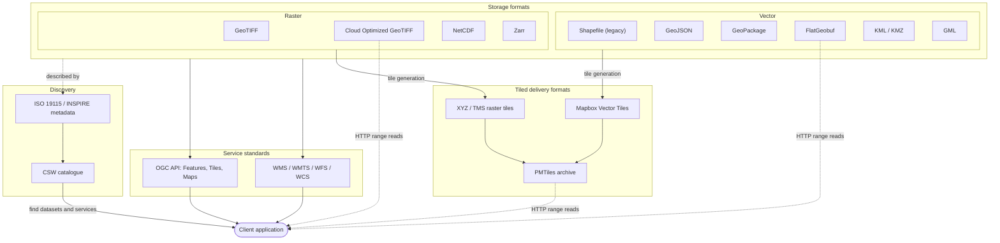
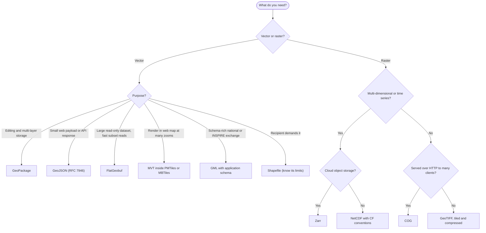
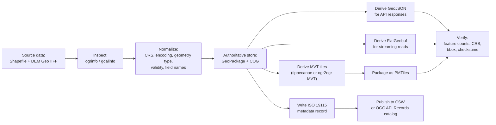
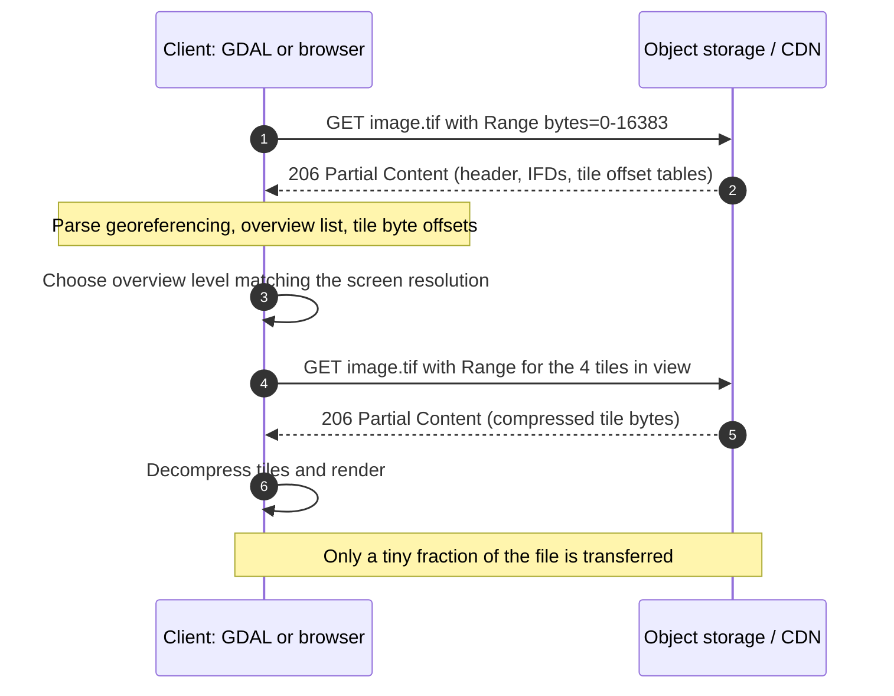
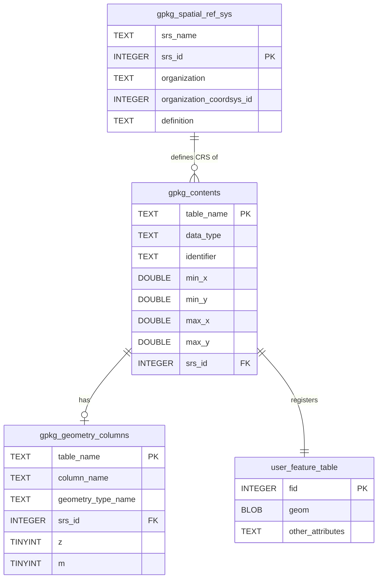
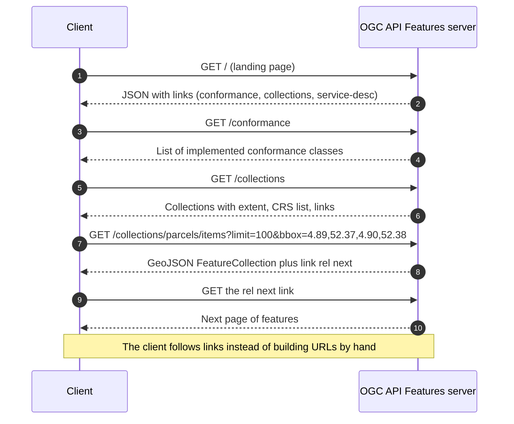

# GIS Data Formats and Standards — Study Note (Phase 2)

> **Audience:** a software engineer moving into the GIS domain, with Phase 1 (CRS, geometry model, raster vs vector, accuracy, basic cartography, QGIS) completed.
> **Estimated time:** 2–3 weeks. **Hands-on tooling:** GDAL/OGR (`ogr2ogr`, `ogrinfo`, `gdalinfo`, `gdalwarp`, `gdal_translate`, `gdaladdo`), plus Python 3 (standard library only for the checkers in this note).

---

## 1. Learning objectives and prerequisites

### 1.1 Prerequisites (from Phase 1)

- Geographic vs projected CRS; EPSG codes; axis order (`EPSG:4326` is *latitude, longitude* in the authority definition, but most file formats and tools use *longitude, latitude*).
- OGC Simple Features geometry types (Point, LineString, Polygon, Multi\*, GeometryCollection), validity, ring orientation.
- Raster concepts: cell size, bands, NoData, resampling.
- Comfort with a command line and basic JSON/XML/SQL.

### 1.2 After this note you can

| # | Objective | How it is assessed |
|---|-----------|--------------------|
| 1 | Choose an appropriate vector, raster, or tiled format for a given workload and justify the choice | Exercises 1, 5 |
| 2 | Explain the structural limits of Shapefile and avoid them (field names, size, encoding, geometry type) | §4.2, Exercise 1 |
| 3 | Describe what makes a format *cloud-native* (internal tiling, overviews, index first, HTTP range requests) | §4.5, Exercises 1, 3 |
| 4 | Compute XYZ/TMS tile indices and tile bounds in `EPSG:3857` | §5, Exercise 2 |
| 5 | Convert between formats with `ogr2ogr`, `gdalwarp`, `gdal_translate` and know their common quirks | §4.6, §5, §6, Exercises 1–4 |
| 6 | Distinguish WMS / WMTS / WFS / WCS / CSW from OGC API (Features, Tiles, Maps) and build valid requests | §4.7, Exercises 2, 5 |
| 7 | Read and write essential ISO 19115 / INSPIRE metadata elements | §4.8, Exercise 5 |
| 8 | Inspect binary structures (GeoPackage geometry blob, MVT command integers) | Exercise 4 |

### 1.3 How to use this note

Read §2–§4 for theory, work through the worked example in §5 (all numbers were computed and checked), study the pitfalls in §6, then do the exercises in §7 **in order**: each one builds on the previous one's output. Solutions are in §8; try before you look.

> **Note on verification.** Numbers derived from formulas (tile indices, bounds, COG overview sizes, byte layouts, MVT integers) were recomputed with standalone Python while writing this note. `ogr2ogr`/`gdal*` command *behavior* is described from GDAL documentation knowledge; GDAL options and defaults change between releases, so run `ogr2ogr --formats`, `ogr2ogr --help`, and the driver pages at <https://gdal.org> for your installed version, and check output yourself with `ogrinfo` / `gdalinfo`.

---

## 2. Conceptual foundations

### 2.1 What is a "format" vs a "standard"?

- A **data format** defines how bytes represent data (e.g., a `.tif` file, a `.gpkg` SQLite file, a GeoJSON text document).
- A **service standard** defines how clients *talk to a server* over a network (e.g., WFS `GetFeature`, OGC API `GET /collections/{id}/items`).
- A **metadata standard** defines how to *describe* datasets and services (title, extent, lineage, constraints) so they can be discovered and trusted.

Phase 2 covers all three layers, because a real GIS system uses them together: data is **stored** in formats, **served** through standards, and **discovered** through metadata.

### 2.2 Core vocabulary

| Term | Definition |
|------|------------|
| **Vector data** | Geometry (points, lines, polygons) plus attributes, stored as coordinates. |
| **Raster / coverage** | A grid of cells (pixels) with values, georeferenced by an affine transform and a CRS. |
| **Tile** | A fixed-size chunk of a map or dataset addressed by `(zoom, column, row)`. |
| **Tile pyramid** | A set of tiles at multiple zoom levels; each zoom level halves the cell size (doubles the resolution). |
| **Overview** | A reduced-resolution copy of a raster stored inside/next to the file (also called pyramid level). |
| **Internal tiling** | Pixel data stored in square blocks (e.g., 512×512) rather than in long scanlines (strips). |
| **Spatial index** | A structure (R-tree, Hilbert-sorted R-tree, quadtree) that answers "what intersects this box?" without reading everything. |
| **Cloud-native format** | A format designed so a client can read *only the bytes it needs* using HTTP range requests, without a server-side service. |
| **HTTP range request** | An HTTP `Range: bytes=start-end` header that asks for part of a file. |
| **Capabilities document** | A machine-readable description of what an OGC service offers (layers, CRSs, formats, operations). |
| **Lineage** | Metadata describing how a dataset was produced (sources, processing steps). |
| **SDI** | Spatial Data Infrastructure: policies, standards, and services (e.g., INSPIRE in the EU) that enable sharing geodata. |

### 2.3 Design axes that explain nearly every format

Almost every format decision reduces to a handful of trade-offs:

1. **Text vs binary.** Text (GeoJSON, GML, KML) is human-readable and easy to debug but verbose and slow to parse. Binary (GeoPackage, FlatGeobuf, GeoTIFF, MVT) is compact and fast.
2. **Single file vs file set vs service.** A Shapefile is a *set* of sidecar files; GeoPackage is *one* file; WFS is a *service*.
3. **Random access vs sequential.** Is there an index? Can I read a subset without scanning the whole file? (This is the heart of "cloud-native".)
4. **Read-optimized vs write-optimized.** GeoPackage supports transactions and updates; FlatGeobuf and PMTiles are essentially write-once, read-many.
5. **Self-describing vs not.** Does the file carry its CRS, schema, and nulls? (Shapefile: partially via `.prj`/`.dbf`; GeoJSON: no CRS member in RFC 7946, always WGS 84.)
6. **Data vs presentation.** KML mixes data and styling; MVT carries data only (styling lives in a separate style spec); WMS returns *rendered pictures*, WFS returns *data*.

### 2.4 The format landscape at a glance

| Category | Format | Container / encoding | Typical role |
|----------|--------|----------------------|--------------|
| Vector | **Shapefile** | Multi-file: `.shp .shx .dbf .prj .cpg` | Legacy exchange; avoid for new work |
| Vector | **GeoJSON** (RFC 7946) | JSON text | Web APIs, small data, interchange |
| Vector | **GeoPackage** (OGC) | SQLite database | General-purpose storage and exchange |
| Vector | **FlatGeobuf** | FlatBuffers binary + packed R-tree | Fast streaming, cloud-friendly reads |
| Vector | **KML / KMZ** (OGC) | XML (KMZ = zipped) | Earth-browser visualization, presentation |
| Vector | **GML** (OGC / ISO 19136) | XML + XSD application schemas | Authoritative, schema-rich exchange (INSPIRE, national mapping) |
| Raster | **GeoTIFF** | TIFF + GeoKey tags | General raster exchange |
| Raster | **COG** | GeoTIFF with required layout | Cloud-optimized raster access |
| Raster (N-D) | **NetCDF** | HDF5-based (NetCDF-4) | Climate, ocean, atmosphere arrays |
| Raster (N-D) | **Zarr** | Chunked arrays in a key-value store | Cloud-native N-D arrays |
| Tiled | **MVT** | Protocol Buffers | Vector tiles for web maps |
| Tiled | **PMTiles** | Single-file archive of tiles | Serverless tile hosting |
| Tiled | **XYZ / TMS** | Directory-like URL scheme of PNG/JPEG/WebP | Raster tiles |
| Services | **WMS, WMTS, WFS, WCS, CSW** | OGC web services (XML/KVP) | Classic SDI services |
| Services | **OGC API – Features / Tiles / Maps** | HTTP + JSON, OpenAPI | Modern replacements for classic services |
| Metadata | **ISO 19115 (-1, -2)**, **INSPIRE** | XML (ISO 19139 / 19115-3) | Discovery and compliance |

---

## 3. Visual explanations

### 3.1 Conceptual overview: formats, services, and metadata



**How to read it.** Solid arrows are transformations or service exposure; dotted arrows are *direct* byte-range access with no map server in between. The key architectural idea of the last decade is the dotted path: COG, FlatGeobuf, and PMTiles allow a browser or desktop app to read directly from object storage (e.g., S3-compatible storage behind a CDN).

### 3.2 Choosing a format (decision flow)



**How to read it.** This is a *starting heuristic*, not a rule. Real systems often keep one **authoritative** store (GeoPackage or a spatial database) and **derive** delivery formats (GeoJSON, MVT/PMTiles, COG) from it.

### 3.3 Workflow: a conversion and publishing pipeline



**How to read it.** Every arrow is a place where information can be lost (precision, attribute types, CRS, NoData). The "Verify" node is not optional; Exercise 1 and 3 practice it.

### 3.4 Sequence: a cloud-native read (COG over HTTP)



### 3.5 Data model: GeoPackage core tables



**How to read it.** A GeoPackage is an ordinary SQLite database plus registry tables. Because it is SQLite, you can inspect it with any SQL client. Each layer's rows live in a *user table*; the registry tells GIS software which table is a layer, its CRS, and its geometry column.

---

## 4. Technical deep dive

### 4.1 Cross-cutting concepts

#### 4.1.1 How formats store the CRS

| Format | Where the CRS lives | Notes |
|--------|---------------------|-------|
| Shapefile | `.prj` sidecar (WKT, ESRI flavor) | Often lacks an EPSG authority code, so identification can be ambiguous; no `.prj` means *unknown CRS*. |
| GeoJSON (RFC 7946) | Nowhere: **always WGS 84** (`EPSG:4326` datum, lon/lat in degrees) | The legacy 2008 `crs` member exists in old files; RFC 7946 removed it. |
| GeoPackage | `gpkg_spatial_ref_sys` + per-layer `srs_id` | Any CRS; a geometry blob also carries its own `srs_id`. |
| FlatGeobuf | Header (CRS code and/or WKT) | Typically an EPSG code. |
| KML | Implicit: WGS 84 | Coordinates are `longitude,latitude[,altitude]`. |
| GML | `srsName` attribute per geometry/collection | **Axis order depends on the URI/URN form** (see 4.1.2). |
| GeoTIFF | GeoKeys (EPSG code or user-defined parameters) | Plus tie point/pixel scale or a full model transformation. |
| NetCDF / Zarr | CF `grid_mapping` variable / attributes | Often absent or incomplete: always check. |
| MVT | Implicit: tile grid CRS (normally `EPSG:3857`) | Coordinates are integers local to the tile. |

#### 4.1.2 Axis order, once more (because it breaks real systems)

The authority definition of `EPSG:4326` is **(latitude, longitude)**. Many formats and libraries historically use **(longitude, latitude)**, i.e., `x = lon`, `y = lat`. The same point can therefore be written two ways:

| Notation | Meaning | Order |
|----------|---------|-------|
| GeoJSON `[4.8926, 52.3731]` | RFC 7946 | lon, lat |
| `CRS:84` / `OGC:CRS84` / `http://www.opengis.net/def/crs/OGC/1.3/CRS84` | WGS 84 with lon/lat order | lon, lat |
| `urn:ogc:def:crs:EPSG::4326` | EPSG definition | **lat, lon** |
| WMS 1.3.0 `CRS=EPSG:4326`, `BBOX=minLat,minLon,maxLat,maxLon` | per EPSG axis order | **lat, lon** |
| WMS 1.1.1 `SRS=EPSG:4326`, `BBOX=minLon,minLat,maxLon,maxLat` | legacy | lon, lat |

Rule of thumb: **projected CRSs are (easting, northing) in practice; geographic `EPSG:4326` is where bugs hide.** When you must request geographic data from a service, prefer `CRS84` or request a projected CRS and test with a known point.

#### 4.1.3 Raster georeferencing: the affine geotransform

GDAL describes the position of every pixel with six numbers `(GT0 … GT5)`:

```
X_geo = GT0 + col * GT1 + row * GT2
Y_geo = GT3 + col * GT4 + row * GT5
```

For a north-up image: `GT1 > 0` is the pixel width, `GT5 < 0` is *minus* the pixel height (rows go down, northing goes up), and `GT2 = GT4 = 0` (no rotation). `(GT0, GT3)` is the **outer top-left corner of the top-left pixel** under GDAL's *pixel-is-area* convention.

Example (a Dutch RD New grid, `EPSG:28992`, 0.5 m cells): `GT = (121000.0, 0.5, 0.0, 487000.0, 0.0, -0.5)`.

| Pixel `(col, row)` | Geographic `(X, Y)` | Meaning |
|--------------------|---------------------|---------|
| `(0, 0)` | `(121000.0, 487000.0)` | outer top-left corner |
| `(1000, 2000)` | `(121500.0, 486000.0)` | corner of pixel 1000, 2000 |
| `(0.5, 0.5)` | `(121000.25, 486999.75)` | centre of first pixel |

### 4.2 Vector formats

#### 4.2.1 Shapefile (Esri) and its limitations

A "Shapefile" is a **set of files sharing a basename**:

```
parcels.shp   geometry (variable-length records)
parcels.shx   index: offsets into .shp
parcels.dbf   attributes (dBase table)
parcels.prj   CRS as WKT (usually Esri-flavored)
parcels.cpg   text encoding of the .dbf (e.g., UTF-8)      [optional but important]
parcels.sbn/.sbx  Esri spatial index                        [optional]
parcels.qix       GDAL/MapServer quadtree index             [optional]
```

Moving, emailing, or uploading only the `.shp` silently drops the CRS, the attributes, and the index.

| Limitation | Detail | Practical consequence |
|------------|--------|-----------------------|
| **Field names ≤ 10 characters** | `population_total` and `population_density` both become `population`-prefixed 10-char names | Silent name collisions/renames (see §5.4) |
| **~2 GB per `.shp` and `.dbf`** | Offsets and sizes are 32-bit-based | Large datasets must be split |
| **One geometry type per file** | Points *or* lines *or* polygons (a "Polygon" file holds multi-part polygons) | Mixed data requires several files |
| **Character fields ≤ 254 bytes** | DBF limit | Long text is truncated |
| **No real date-time, limited types** | Dates only; no native timestamp, JSON, list, or 64-bit-safe integer semantics | Convert timestamps to strings explicitly |
| **Weak NULL semantics** | DBF cannot represent NULL for every type reliably | `NULL` vs `0` vs empty ambiguity |
| **Encoding ambiguity** | Depends on `.cpg` (or a legacy code-page byte) | Mojibake for accented names if `.cpg` is missing |
| **Ring orientation opposite to GeoJSON** | Shapefile exterior rings are **clockwise**, holes counter-clockwise | Converters must re-orient (GDAL does) |
| **No topology, no curves, no true 3D/M richness** | Z/M supported by distinct shape types, not curves | |
| **CRS identification** | Esri WKT without authority code | Reprojection may need `-s_srs` to be explicit |

Use Shapefile only when a recipient demands it. Prefer GeoPackage otherwise.

#### 4.2.2 GeoJSON (RFC 7946)

A JSON text format. Object types: `Point`, `MultiPoint`, `LineString`, `MultiLineString`, `Polygon`, `MultiPolygon`, `GeometryCollection`, `Feature`, `FeatureCollection`.

Key rules of **RFC 7946** (the 2016 standard; media type `application/geo+json`):

- Coordinate order is **`[longitude, latitude]`** (optionally `[lon, lat, elevation]`).
- CRS is **WGS 84** only. Reproject before writing.
- **Polygon rings:** exterior ring **counter-clockwise**, interior rings (holes) **clockwise** (right-hand rule). Parsers should accept both, but writers should follow the rule.
- Rings are closed (first position equals last) and have ≥ 4 positions.
- Geometries crossing the **antimeridian (±180°)** should be cut into parts.
- A `bbox` member is optional. `id` is optional on `Feature`. Foreign members are allowed.
- Six decimal places of degrees is about 0.11 m at the equator (`1e-6 × 111,320 m ≈ 0.111 m`); more digits are usually false precision and cost bytes.

Strengths: ubiquitous, trivial to debug, native in JavaScript. Weaknesses: verbose, no spatial index, whole-document parse, no date/time type (use ISO 8601 strings), no curves, no schema. For large data use **newline-delimited GeoJSON** (GeoJSON Text Sequences, RFC 8142, driver `GeoJSONSeq`) which allows streaming.

```json
{
  "type": "Feature",
  "id": 1,
  "properties": { "name": "Dam Square (approx.)" },
  "geometry": { "type": "Point", "coordinates": [4.8926, 52.3731] }
}
```

#### 4.2.3 GeoPackage (OGC)

A GeoPackage is an **SQLite 3 database** (`.gpkg`) conforming to the OGC standard. It can hold **multiple vector layers, raster/tile pyramids, plain attribute tables, and extensions** in one file, supports transactions and incremental edits, and enforces a schema through registry tables (see the ER diagram in §3.5).

Identification facts you can verify with SQLite alone:

- `PRAGMA application_id;` returns `1196444487` (= `0x47504B47`, the ASCII bytes of `GPKG`).
- `PRAGMA user_version;` encodes the standard version (for example `10300` for 1.3.0).
- Registry tables: `gpkg_spatial_ref_sys`, `gpkg_contents`, `gpkg_geometry_columns`, and others.

**Geometry encoding (StandardGeoPackageBinary):** each geometry cell is a BLOB = *GeoPackage header* + *OGC WKB*.

| Offset | Size | Field | Notes |
|-------:|-----:|-------|-------|
| 0 | 2 | magic | ASCII `GP` (`0x47 0x50`) |
| 2 | 1 | version | `0` for version 1 |
| 3 | 1 | flags | bit 0: header byte order (1 = little-endian); bits 1–3: envelope type (0 = none); bit 4: empty geometry; bit 5: extended type (0 = standard) |
| 4 | 4 | `srs_id` | int32, in header byte order |
| 8 | 0, 32, 48 or 64 | envelope | present if envelope type ≠ 0 |
| … | n | WKB | standard OGC WKB geometry |

Spatial indexing uses the **RTree extension**: a SQLite R\*Tree virtual table `rtree_<table>_<geomcolumn>` kept in sync by triggers. GDAL creates it by default (`SPATIAL_INDEX=YES`).

Strengths: single file, SQL, any CRS, typed columns including dates and datetimes, many layers, widely supported (QGIS default format). Limits: SQLite's single-writer model; not designed for random HTTP-range access (reading from remote storage works but is inefficient compared with FlatGeobuf or COG).

#### 4.2.4 FlatGeobuf

A binary vector format built on **Google FlatBuffers** (zero-copy deserialization) with an optional **packed Hilbert R-tree** spatial index. File layout:

```
[ magic bytes ]  [ header (schema, CRS, extent, geometry type, feature count) ]
[ packed Hilbert R-tree index (optional) ]  [ feature 1 ][ feature 2 ] ...
```

- Features are **sorted along a Hilbert curve** so nearby features are near each other on disk.
- The index sits **before** the features, so a client can fetch the header and index with a few range requests, then fetch only the features whose bounding boxes intersect the viewport.
- The index is **static**: it is computed at write time, so FlatGeobuf is essentially *write-once, read-many*. Editing means rewriting.
- Extension `.fgb`. Supported in GDAL (driver `FlatGeobuf`), QGIS, and JavaScript libraries.

#### 4.2.5 KML / KMZ (OGC)

XML designed for *presentation* in Earth browsers. A `Placemark` combines geometry, name/description, style, and optional `ExtendedData`. Coordinates are written **`longitude,latitude,altitude`** (comma-separated tuples, whitespace between tuples) and the CRS is always WGS 84. **KMZ** is a ZIP containing `doc.kml` and resources (icons, images).

```xml
<Placemark>
  <name>Dam Square (approx.)</name>
  <Point><coordinates>4.8926,52.3731,0</coordinates></Point>
</Placemark>
```

Weaknesses for data work: weak attribute typing, styling mixed with data, limited schema support, and large files parse slowly. Strengths: simple sharing and rich visualization (icons, `NetworkLink`, time-animation).

#### 4.2.6 GML (OGC / ISO 19136)

The **Geography Markup Language** is an XML grammar for geographic features. Rather than a single fixed schema, GML defines building blocks (geometry primitives including curves and surfaces, feature, coordinate systems, time) that communities combine into **application schemas** (XSD), for example INSPIRE themes or national topographic models. It is the default response encoding of WFS 1.x/2.0.

```xml
<gml:Point gml:id="p1" srsName="http://www.opengis.net/def/crs/OGC/1.3/CRS84">
  <gml:pos>4.8926 52.3731</gml:pos>   <!-- lon lat because CRS84 -->
</gml:Point>

<gml:Point gml:id="p2" srsName="urn:ogc:def:crs:EPSG::4326">
  <gml:pos>52.3731 4.8926</gml:pos>   <!-- lat lon because EPSG axis order -->
</gml:Point>
```

Strengths: precise semantics, complex features, validation against XSD, 3D and curved geometry. Weaknesses: verbose, slow, complex schemas, axis-order traps. GDAL's GML driver can read GML without a schema by scanning the file and writing a `.gfs` sidecar describing the inferred layers and fields.

#### 4.2.7 Vector format comparison

| Property | Shapefile | GeoJSON | GeoPackage | FlatGeobuf | KML | GML |
|----------|:---------:|:-------:|:----------:|:----------:|:---:|:---:|
| Single file | ✗ | ✓ | ✓ | ✓ | ✓ (KMZ zip) | ✓ |
| Encoding | binary + DBF | text | binary (SQLite) | binary | text (XML) | text (XML) |
| Any CRS | ✓ (weakly) | ✗ (WGS 84) | ✓ | ✓ | ✗ (WGS 84) | ✓ |
| Spatial index in file | optional sidecar | ✗ | ✓ (R-tree) | ✓ (Hilbert R-tree) | ✗ | ✗ |
| Multiple layers | ✗ | ✗ | ✓ | ✗ (one layer) | folders | ✓ (feature types) |
| Rich attribute types | limited | JSON types | ✓ | ✓ | limited | ✓ (XSD) |
| Edit in place | ✓ | rewrite | ✓ | rewrite | rewrite | rewrite |
| Remote subset reads | ✗ | ✗ | poor | ✓ | ✗ | ✗ |
| Best use | legacy exchange | web APIs, small data | general storage | large read-only data | visualization | schema-rich exchange |

### 4.3 Raster formats

#### 4.3.1 GeoTIFF

A **GeoTIFF** is a TIFF file with extra tags that embed georeferencing:

| TIFF tag | Number | Purpose |
|----------|-------:|---------|
| `ModelPixelScaleTag` | 33550 | Pixel size in model (CRS) units |
| `ModelTiepointTag` | 33922 | Links a raster position to a model coordinate |
| `ModelTransformationTag` | 34264 | Full affine transform (rotation, shear) |
| `GeoKeyDirectoryTag` | 34735 | CRS definition (EPSG code or parameters) |

Important properties:

- **Pixel-is-area vs pixel-is-point** (`GTRasterTypeGeoKey`): changes where the tie point refers to by half a pixel. GDAL normalizes this, but other tools may not.
- **Layout:** *strips* (rows) or **tiles** (e.g., 256×256 or 512×512). Tiles are essential for efficient windowed reads.
- **Interleave:** `PIXEL` (band-interleaved by pixel) or `BAND` (separate planes).
- **Compression:** `DEFLATE`, `LZW`, `ZSTD`, `LERC`, `JPEG`, `WEBP`, `PACKBITS`, none. For integer data `PREDICTOR=2` and for floating point `PREDICTOR=3` usually improve `DEFLATE`/`LZW`/`ZSTD`. Lossy `JPEG`/`WEBP` suit imagery, **not** analytical or categorical data.
- **Size:** classic TIFF is limited to about 4 GB; `BIGTIFF=YES` (or `IF_SAFER`) lifts it.
- **Sidecars:** `.aux.xml` (GDAL metadata/statistics), `.ovr` (external overviews), world files `.tfw`.
- **Data type** (`Byte`, `UInt16`, `Int16`, `Float32`, …) and **NoData** value are essential and must be set deliberately.

#### 4.3.2 Cloud Optimized GeoTIFF (COG)

A **COG** is a regular GeoTIFF with a **specific internal organization** that enables efficient partial reads over HTTP. It is still readable by every GeoTIFF reader. Requirements and recommendations:

1. **Internal tiling** (commonly 512×512; 256 also used).
2. **Overviews** (reduced-resolution levels), themselves tiled.
3. **Header/IFD ordering:** metadata (the IFDs, which hold tile offset/size tables) is placed **at the start of the file**, so a client can learn the layout with one small range request.
4. Compression appropriate to the data.

```
Schematic byte layout of a COG (not to scale)

 byte 0                                                          end of file
  |                                                                  |
  v                                                                  v
  [TIFF header][IFD: full-res][IFD: ovr 1][IFD: ovr 2] ... [ovr data lowest-res ... ][ full-res tiles ]
   \_______________ read first with 1 range request _______/ \____ fetched on demand, tile by tile ____/
```

Create one with GDAL's `COG` driver (it handles layout and overviews for you):

```bash
gdal_translate -of COG input.tif output_cog.tif \
  -co COMPRESS=DEFLATE -co PREDICTOR=2 -co BLOCKSIZE=512 -co RESAMPLING=AVERAGE
```

Choose the overview resampling by data meaning: `AVERAGE`/`BILINEAR`/`CUBIC` for continuous data (elevation, reflectance), **`NEAREST` or `MODE` for categorical data** (land-use codes). Averaging class codes produces meaningless values. Verify with `gdalinfo output_cog.tif` (recent GDAL versions list `LAYOUT=COG` under *Image Structure Metadata* and show `Overviews:`), and with GDAL's `validate_cloud_optimized_geotiff.py` sample script if available.

Overview arithmetic (verified): a 20,000 × 15,000 pixel raster with explicit levels 2, 4, 8, 16, 32 has overview sizes (using `ceil(size / factor)`):

| Factor | Columns | Rows | Pixels |
|-------:|--------:|-----:|-------:|
| 1 (base) | 20,000 | 15,000 | 300,000,000 |
| 2 | 10,000 | 7,500 | 75,000,000 |
| 4 | 5,000 | 3,750 | 18,750,000 |
| 8 | 2,500 | 1,875 | 4,687,500 |
| 16 | 1,250 | 938 | 1,172,500 |
| 32 | 625 | 469 | 293,125 |

All overviews together add ≈ **33.3 %** more pixels (the geometric series `1/4 + 1/16 + … → 1/3`).

#### 4.3.3 NetCDF and Zarr (multidimensional data)

Many geoscience datasets are **N-dimensional arrays** (for example `temperature[time, level, lat, lon]`), not single 2-D images.

**NetCDF** (Network Common Data Form):

- Model: **dimensions**, **variables** (arrays over dimensions), **attributes** (metadata).
- NetCDF-4 files are built on **HDF5**; "classic" NetCDF is a simpler older binary layout.
- **CF Conventions** (Climate and Forecast) standardize names, units, time encoding, and the `grid_mapping` variable that carries CRS information. Without CF metadata, georeferencing may be missing or ambiguous.
- GDAL reads variables as 2-D rasters/subdatasets (`NETCDF:"file.nc":variable`) and also has a **multidimensional API** (`gdalmdiminfo file.nc`).

**Zarr**:

- Stores an N-D array as **many compressed chunks** (each chunk is a separate object/file) plus small JSON metadata (Zarr v2: `.zarray`, `.zattrs`, `.zgroup`; Zarr v3: `zarr.json`).
- Because each chunk is an independent key in a key-value store (filesystem, S3-style object store), clients read **only the chunks they need** and writers can write chunks **in parallel**. This makes Zarr a cloud-native counterpart to NetCDF, commonly used with Python tools such as xarray and Dask.
- Trade-off: a large dataset becomes **millions of small objects**, which can be slow to list or copy; consolidated metadata and sharding (Zarr v3) mitigate this.
- Georeferencing conventions for Zarr (e.g., GeoZarr efforts) are less settled than for GeoTIFF: verify what your dataset provides.

| Aspect | GeoTIFF/COG | NetCDF-4 | Zarr |
|--------|-------------|----------|------|
| Dimensions | 2-D × bands | N-D | N-D |
| Single file | ✓ | ✓ | ✗ (directory or object prefix) |
| Cloud-native access | ✓ (COG) | partial (needs special readers or kerchunk-style indexes) | ✓ |
| CRS metadata maturity | high | medium (CF) | evolving |
| Typical domain | imagery, DEM | climate, ocean, weather | large-scale analysis in the cloud |

### 4.4 Tiled formats

#### 4.4.1 The Web Mercator tile grid (XYZ)

Most web tile schemes use **Web Mercator** (`EPSG:3857`), a *projected* CRS on a sphere with radius `R = 6,378,137 m`. The world is a square:

```
X range = Y range = [-20,037,508.342789244 , +20,037,508.342789244] m      (= ±π·R)
```

Forward projection from WGS 84 degrees (`lon`, `lat` in degrees; valid only for |lat| < ≈ 85.0511°):

```
x = R · lon · π/180
y = R · asinh( tan( lat · π/180 ) )          # equivalently R · ln( tan(π/4 + φ/2) )
```

A tile is addressed `z/x/y`. At zoom `z` the world is `2^z × 2^z` tiles (`4^z` tiles in total): `z=0` → 1 tile, `z=1` → 4, `z=10` → 1,048,576, `z=14` → 268,435,456.

```
XYZ addressing (y counted from the TOP):          TMS addressing (y counted from the BOTTOM):

  z=1                                              z=1
  +-------+-------+                                +-------+-------+
  | 1/0/0 | 1/1/0 |   <- y = 0                     | 1/0/1 | 1/1/1 |   <- y = 1
  +-------+-------+                                +-------+-------+
  | 1/0/1 | 1/1/1 |   <- y = 1                     | 1/0/0 | 1/1/0 |   <- y = 0
  +-------+-------+                                +-------+-------+
   x=0      x=1                                     x=0      x=1
```

Conversions (for `256 × 256` px tiles):

```
n          = 2^z
x_tile     = floor( (lon + 180) / 360 · n )
y_tile     = floor( (1 − asinh(tan(lat·π/180)) / π) / 2 · n )       # XYZ (origin top-left)
y_tms      = n − 1 − y_tile                                          # TMS / MBTiles (origin bottom-left)
resolution = (2·π·R / 256) / 2^z   metres per pixel at the equator   # z=0 → 156,543.03392804097
tile_width_3857 = 2·π·R / 2^z
```

Ground distance per pixel shrinks with `cos(latitude)`: at z=14, the nominal 9.555 m/px becomes ≈ **5.83 m/px at 52.3731° N** (`9.5546 × 0.6105`).

#### 4.4.2 XYZ and TMS raster tiles

- **XYZ ("slippy map")**: URL template `https://tiles.example.org/{z}/{x}/{y}.png`, origin top-left, used by OpenStreetMap-style servers, Leaflet, OpenLayers, MapLibre.
- **TMS** (Tile Map Service, OSGeo spec): origin **bottom-left**, so `y` is flipped. The **MBTiles** container (SQLite: `tiles(zoom_level, tile_column, tile_row, tile_data)`) also stores **TMS row order**, a classic source of upside-down maps.
- Typical payloads: PNG (lossless, transparency), JPEG (photos), WebP.
- **WMTS** is the OGC equivalent with explicit `TileMatrixSet` definitions (the common `GoogleMapsCompatible` set matches XYZ's grid; its `TileRow` counts from the top).

#### 4.4.3 Mapbox Vector Tiles (MVT)

A vector tile contains **vector features for one tile**, encoded as **Protocol Buffers** (specification v2.1, maintained in the Mapbox `vector-tile-spec` repository; media type commonly `application/vnd.mapbox-vector-tile`, often gzip-compressed on the wire; file extensions `.mvt` or `.pbf`).

Structure: `Tile → Layer[] → Feature[]`.

| Element | Content |
|---------|---------|
| Layer | `name`, `version`, `extent` (default **4096**), shared `keys[]` and `values[]` tables |
| Feature | optional `id`, `tags[]` (pairs of indexes into keys/values), `type` (1 = POINT, 2 = LINESTRING, 3 = POLYGON), `geometry[]` (command stream) |

**Coordinates** are integers in a local grid of `extent × extent` with the origin at the **top-left** of the tile and **y pointing down**. A feature's position in the world is derived from the tile's `z/x/y` plus these local integers.

**Geometry command stream.** Each *command integer* packs a command ID and a repeat count: `(id & 0x7) | (count << 3)`, with `MoveTo = 1`, `LineTo = 2`, `ClosePath = 7`. Each coordinate parameter is a **delta** from the cursor, **zigzag-encoded**: `(v << 1) ^ (v >> 31)` (so `0→0, −1→1, 1→2, −2→3, 25→50, 17→34, −3→5`).

Verified examples:

| Geometry | Encoded `geometry[]` | Decoding |
|----------|----------------------|----------|
| Point at local `(25, 17)` | `[9, 50, 34]` | `9 = MoveTo ×1`; `50→25`; `34→17` |
| Triangle ring `(3,6) → (8,12) → (20,34)` | `[9, 6, 12, 18, 10, 12, 24, 44, 15]` | `MoveTo(3,6)`; `LineTo ×2` (`18`) with deltas `(5,6)` → `(10,12)` and `(12,22)` → `(24,44)`; `ClosePath` (`15`) |

Production notes:

- Tile generators **simplify, clip (with a small buffer), and drop or coalesce features** at low zooms; your data in a tile is *not* your source data.
- Tools: **tippecanoe** (feature-dense GeoJSON/FlatGeobuf → MBTiles/PMTiles), **Planetiler** (OpenStreetMap-scale), **PostGIS** (`ST_AsMVT`, `ST_TileEnvelope`), and GDAL's **MVT driver** (`ogr2ogr -f MVT`).
- Rendering style is **not** in the tile: it is in a separate style document (for example MapLibre/Mapbox style JSON).

#### 4.4.4 PMTiles

**PMTiles** (version 3) is a **single-file archive of tiles** designed for **serverless hosting on static storage** using HTTP range requests.

```
[ header: fixed 127 bytes ][ root directory ][ metadata JSON ][ leaf directories ][ tile data ]
```

- The header records offsets/lengths of each section, tile type (MVT, PNG, JPEG, WebP, …), compression, and zoom/bounds.
- Tiles are ordered by position along a **Hilbert curve across zoom levels** ("tile ID"), keeping spatially close tiles close together and enabling a compact, two-level directory.
- A client fetches the header and root directory (one request), then the directory and tile it needs (a few more), with **no tile server**.
- Tools: the `pmtiles` CLI (`pmtiles show`, `pmtiles convert in.mbtiles out.pmtiles`, `pmtiles extract`), and tippecanoe can write PMTiles directly (`-o out.pmtiles`) in current releases.
- Compared with MBTiles (SQLite): MBTiles needs server code (or SQLite-over-HTTP tricks) to serve tiles; PMTiles is directly range-readable.

### 4.5 The cloud-native access pattern

A format is "cloud-native" when a client can **fetch just the needed bytes** from plain object storage. The recurring recipe:

| Ingredient | COG | FlatGeobuf | PMTiles | Zarr |
|------------|-----|------------|---------|------|
| Data split into addressable chunks | internal tiles | features sorted by Hilbert order | tiles | array chunks |
| **Index/metadata first** | IFDs at file start | header + R-tree before features | header + directories | `.zarray`/`zarr.json` per array |
| Multi-resolution | overviews | (none inherent) | zoom levels | (optional pyramids) |
| Compression per chunk | ✓ | – (features uncompressed) | ✓ | ✓ |

Operational requirements and caveats:

- The server must support **`Range` requests** (`Accept-Ranges: bytes`, status `206`).
- Browsers need **CORS** headers that expose `Content-Range` and allow the `Range` header.
- Latency, not bandwidth, dominates: many small requests are slow. Tile size (256 vs 512), HTTP/2 or HTTP/3, and a CDN matter.
- Access control uses signed URLs or authenticated gateways; test range reads with them.
- GDAL reads remote files through virtual file systems: `gdalinfo /vsicurl/https://example.org/data/image_cog.tif`, `/vsis3/bucket/key.tif`. Helpful config: `GDAL_DISABLE_READDIR_ON_OPEN=EMPTY_DIR` (avoid directory listing requests), `CPL_VSIL_CURL_ALLOWED_EXTENSIONS=.tif`.

---

### 4.6 The GDAL/OGR toolbox

**GDAL** (raster) and **OGR** (vector) are one library (<https://gdal.org>) with drivers for hundreds of formats. Its command-line utilities are the *lingua franca* of format conversion.

| Tool | Domain | Purpose |
|------|--------|---------|
| `ogrinfo` | vector | Inspect datasets, layers, schema, CRS, extent; run SQL |
| `ogr2ogr` | vector | Convert, reproject, filter, clip, append, run SQL |
| `gdalinfo` | raster | Inspect size, CRS, geotransform, bands, NoData, overviews, metadata |
| `gdal_translate` | raster | Convert format, change data type, subset (window/bands), rescale, assign metadata |
| `gdalwarp` | raster | Reproject, resample, mosaic, clip with a cutline |
| `gdaladdo` | raster | Build overviews |
| `gdalmdiminfo` / `gdalmdimtranslate` | multidimensional | Inspect/convert NetCDF, Zarr and similar |

> **Newer CLI.** Recent GDAL releases (3.11 and later) add a unified `gdal` command (for example `gdal vector convert`, `gdal raster reproject`) alongside the classic programs. The classic utilities remain widely deployed and are used throughout this note. Check `gdal --version` and the docs for your install.

#### 4.6.1 `ogr2ogr` anatomy

```text
ogr2ogr [options] <destination> <source> [layer ...]
          ^                ^          ^
          |                |          └─ destination comes FIRST, source SECOND
          |                └─ -f <driver>, -lco, -dsco control the destination
          └─ -t_srs, -where, -sql, -spat, -select, -nln, -nlt, -append/-overwrite/-update ...
```

| Option | Purpose and quirk |
|--------|-------------------|
| `-f <driver>` | Output format (`GPKG`, `GeoJSON`, `FlatGeobuf`, `"ESRI Shapefile"`, `MVT`, `KML`, `GML`, …). List with `ogr2ogr --formats`. |
| `-t_srs EPSG:xxxx` | **Reprojects** coordinates. |
| `-a_srs EPSG:xxxx` | **Assigns** a CRS label **without** transforming coordinates (use only when the label is missing or wrong). |
| `-s_srs EPSG:xxxx` | Overrides the *source* CRS for the transformation. |
| `-lco KEY=VALUE` | Layer creation option (e.g., `ENCODING=UTF-8`, `RFC7946=YES`, `GEOMETRY_NAME=geom`, `SPATIAL_INDEX=YES`). |
| `-dsco KEY=VALUE` | Dataset creation option. |
| `-oo KEY=VALUE` | Open option for the source (e.g., `ENCODING=ISO-8859-1` for a Shapefile read). |
| `-nln name` | New layer/table name (otherwise taken from the source). |
| `-nlt TYPE` | Force geometry type; **`PROMOTE_TO_MULTI`** avoids "mixed Polygon/MultiPolygon" failures. |
| `-select f1,f2` | Keep only listed fields. |
| `-where "SQL expr"`, `-sql "SELECT …"` | Attribute filter / full SQL (`-dialect SQLITE` or `OGRSQL`). |
| `-spat xmin ymin xmax ymax` | Spatial filter, in the **source CRS** unless `-spat_srs` is given. |
| `-clipsrc` / `-clipdst` | Clip geometries by a rectangle or polygon. |
| `-overwrite` / `-append` / `-update` | Replace the layer / add rows / open an existing destination for modification. Without them, writing to an existing file may fail. |
| `-makevalid` | Repair invalid geometries (GEOS-based). |
| `-explodecollections` | Split multi-part and collection geometries into single parts. |
| `-skipfailures` | Continue after errors (**may hide data loss**: compare counts). |
| `-gt N` | Features per transaction; large values speed up writing to transactional formats. |
| `-progress` | Progress bar. |

#### 4.6.2 `gdal_translate` and `gdalwarp` anatomy

| Task | Command |
|------|---------|
| Inspect | `gdalinfo -stats image.tif` or `gdalinfo -json image.tif` |
| Convert to compressed tiled GeoTIFF | `gdal_translate -of GTiff -co TILED=YES -co COMPRESS=DEFLATE -co PREDICTOR=2 in.tif out.tif` |
| Cut a window by *geographic* extent | `gdal_translate -projwin <ulx> <uly> <lrx> <lry> in.tif out.tif` (**upper-left then lower-right**) |
| Cut a window by *pixels* | `gdal_translate -srcwin <xoff> <yoff> <xsize> <ysize> in.tif out.tif` |
| Change data type with rescale | `gdal_translate -ot Byte -scale <srcmin> <srcmax> 0 255 in.tif out.tif` |
| Assign (not reproject) a CRS | `gdal_translate -a_srs EPSG:28992 in.tif out.tif` |
| Set NoData | `gdal_translate -a_nodata -9999 in.tif out.tif` |
| Reproject | `gdalwarp -t_srs EPSG:3857 -r bilinear in.tif out.tif` |
| Reproject categorical data | `gdalwarp -t_srs EPSG:28992 -r near in.tif out.tif` (or `-r mode`) |
| Fixed output resolution and extent | `gdalwarp -tr 10 10 -te <xmin> <ymin> <xmax> <ymax> in.tif out.tif` |
| Clip to a polygon | `gdalwarp -cutline area.gpkg -cl layer -crop_to_cutline -dstnodata -9999 in.tif out.tif` |
| Mosaic | `gdalwarp a.tif b.tif mosaic.tif` |
| Build overviews | `gdaladdo -r average image.tif 2 4 8 16` |
| Cloud Optimized GeoTIFF | `gdal_translate -of COG in.tif out_cog.tif -co COMPRESS=DEFLATE` |

#### 4.6.3 Quirks that bite (a checklist)

**Vector (`ogr2ogr`)**

1. **Destination before source.** Reversing them can overwrite your input.
2. **`-t_srs` vs `-a_srs`.** One moves coordinates, the other only relabels them.
3. **Shapefile names/types:** field names are truncated to 10 characters and de-duplicated by the driver (exact result varies by version; verify with `ogrinfo`); a Shapefile layer has one geometry type; add `-nlt PROMOTE_TO_MULTI` when the source mixes Polygon and MultiPolygon.
4. **Encoding:** write Shapefiles with `-lco ENCODING=UTF-8` so a `.cpg` is produced; when reading legacy data with a wrong or missing `.cpg`, use `-oo ENCODING=<codepage>`.
5. **GeoJSON output:** use `-t_srs EPSG:4326 -lco RFC7946=YES` (RFC 7946 mode enforces right-hand-rule polygons and limits coordinate precision by default). Without `RFC7946=YES`, GDAL writes the older GeoJSON dialect, which may include a `crs` member.
6. **Axis order.** The OGR command-line tools normally output *lon/lat* for `EPSG:4326`. When data come from a **WFS 1.1/2.0** server or **GML** with `urn:ogc:def:crs:EPSG::4326`, check a known coordinate to confirm that x really is longitude.
7. **Date/time and integer types** may be converted differently per format (`Integer64` to a Shapefile numeric field, `DateTime` to text or date): inspect `ogrinfo -so -al` on the output.
8. **Silent partial failure:** `-skipfailures` plus invalid geometries = missing features. Always compare feature counts.
9. **GeoPackage specifics:** the default geometry column name has differed between GDAL versions; set `-lco GEOMETRY_NAME=geom` to be explicit. The primary key is `fid`. Writing many features is much faster inside a transaction (`-gt 65536` and the default behavior help).
10. **FlatGeobuf holds one layer** per file and a static index: use `-lco SPATIAL_INDEX=YES` (default) for fast range access.

**Raster (`gdal_translate`, `gdalwarp`)**

1. **Default resampling is nearest neighbour** in `gdalwarp`. Fine for categorical data, poor for continuous data when resolution changes.
2. **NoData:** without `-srcnodata/-dstnodata` (or an alpha band, `-dstalpha`), reprojection creates black or zero borders that look like valid data.
3. **`gdalwarp` writes into an existing output file** (acting like a mosaic) unless you pass `-overwrite`.
4. **Output grid:** GDAL guesses an output pixel size if you omit `-tr`. For reproducible, stackable rasters specify `-tr`, `-te`, and optionally `-tap` (align to the resolution grid).
5. **`-projwin` order is `ulx uly lrx lry`** (not `xmin ymin xmax ymax`).
6. **`-ot Byte` without `-scale`** wraps or clips values depending on data: scale deliberately.
7. **Overviews and COG:** overviews are *not* automatically carried over when you convert (use `-co COPY_SRC_OVERVIEWS=YES` for GTiff) and the `COG` driver builds its own. Do not hand-edit a COG with tools that rewrite layout; **re-create** it.
8. **Lossy compression** (`JPEG`, `WEBP`) on elevation or class data corrupts values.
9. **Vertical datums** (for example, geoid vs ellipsoid heights) are *not* converted by a plain horizontal `-t_srs`.

### 4.7 OGC standards

The **Open Geospatial Consortium (OGC)** publishes interface and encoding standards. Two generations coexist: the **classic OWS services** (XML-based, `SERVICE=…&REQUEST=…` key-value requests) and the newer **OGC API** family (resource-oriented HTTP + JSON, described with OpenAPI).

#### 4.7.1 Classic services

| Service | Returns | Core operations | Typical request style |
|---------|---------|-----------------|-----------------------|
| **WMS** (Web Map Service) | A rendered **map image** (PNG/JPEG) for an arbitrary bbox | `GetCapabilities`, `GetMap`, `GetFeatureInfo` (+ `GetLegendGraphic` as common extension) | KVP over HTTP GET |
| **WMTS** (Web Map Tile Service) | Pre-defined **tiles** from a `TileMatrixSet` | `GetCapabilities`, `GetTile`, `GetFeatureInfo` | KVP, RESTful URL templates, SOAP |
| **WFS** (Web Feature Service) | **Vector features** (GML by default; other formats by server) | `GetCapabilities`, `DescribeFeatureType`, `GetFeature`, `GetPropertyValue`, `ListStoredQueries`; transactional `Transaction` | KVP and XML POST; filters via OGC Filter Encoding (FES) |
| **WCS** (Web Coverage Service) | **Coverage data** (raster/grid values, not a picture) | `GetCapabilities`, `DescribeCoverage`, `GetCoverage` | KVP/XML; subsetting by axis |
| **CSW** (Catalogue Service for the Web) | **Metadata records** | `GetCapabilities`, `DescribeRecord`, `GetRecords`, `GetRecordById`, `Harvest`, `Transaction` | KVP or XML POST |

Key distinction: **WMS and WMTS return pictures; WFS and WCS return data.** A map picture cannot be analyzed or restyled by the client; data can.

Example requests (placeholders: replace `https://example.org/ows` with a real endpoint; layer names and namespaces are illustrative). The bounding box below is the `EPSG:3857` extent of tile `14/8414/5384` (computed in §5.2):

```text
# WMS 1.3.0 GetMap: one 256x256 picture covering exactly that tile
https://example.org/ows?SERVICE=WMS&VERSION=1.3.0&REQUEST=GetMap
  &LAYERS=roads&STYLES=&CRS=EPSG:3857
  &BBOX=543008.649,6865879.629,545454.634,6868325.614
  &WIDTH=256&HEIGHT=256&FORMAT=image/png&TRANSPARENT=TRUE

# WMTS 1.0.0 GetTile (KVP): the same tile fetched by index (TileRow counts from the top)
https://example.org/ows?SERVICE=WMTS&VERSION=1.0.0&REQUEST=GetTile
  &LAYER=roads&STYLE=default&TILEMATRIXSET=GoogleMapsCompatible
  &TILEMATRIX=14&TILEROW=5384&TILECOL=8414&FORMAT=image/png

# WFS 2.0.0 GetFeature: first 10 features, one page (names/namespaces illustrative)
https://example.org/ows?SERVICE=WFS&VERSION=2.0.0&REQUEST=GetFeature
  &TYPENAMES=ns:parcels&COUNT=10&STARTINDEX=0
  &SRSNAME=urn:ogc:def:crs:EPSG::28992&OUTPUTFORMAT=application/json

# WCS 2.0.1 GetCoverage: a spatial subset as GeoTIFF (axis labels depend on the server)
https://example.org/ows?SERVICE=WCS&VERSION=2.0.1&REQUEST=GetCoverage
  &COVERAGEID=dem&SUBSET=x(121000,122000)&SUBSET=y(486000,487000)&FORMAT=image/tiff
```

Version-specific traps:

- **WMS 1.1.1 vs 1.3.0:** `SRS` → `CRS`; with 1.3.0 and `EPSG:4326` the `BBOX` order is **lat,lon** (see §4.1.2).
- **WFS 1.x vs 2.0:** `TYPENAME`/`MAXFEATURES` (1.x) became `TYPENAMES`/`COUNT` (2.0); paging uses `STARTINDEX`. Always check the capabilities document for the supported `OUTPUTFORMAT`s (`application/json` is a common server extension, not part of the core).
- **WMTS:** the `TileMatrixSet`, `TILEMATRIX` identifiers and scale denominators come from `GetCapabilities`; do not assume they equal XYZ zoom numbers.
- **Servers** that implement these: GeoServer, MapServer, QGIS Server, deegree (WFS/WMS/WCS/CSW), pycsw and GeoNetwork (CSW).

#### 4.7.2 The OGC API family

OGC APIs are **resource-oriented**: URLs identify things, HTTP verbs act on them, responses are usually JSON/GeoJSON with **hypermedia links**, and each API publishes an **OpenAPI** definition. They are modular: all share *OGC API – Common* concepts (landing page `/`, `/conformance`, `/collections`).

| API | Replaces / complements | Main resources |
|-----|------------------------|----------------|
| **OGC API – Features** (Part 1: Core; Part 2: CRS by reference; Part 3: Filtering/CQL2) | WFS | `/collections`, `/collections/{id}/items`, `/collections/{id}/items/{featureId}` |
| **OGC API – Tiles** | WMTS | `/collections/{id}/tiles/{tileMatrixSetId}/{tileMatrix}/{tileRow}/{tileCol}` |
| **OGC API – Maps** | WMS | `/collections/{id}/map` (rendered image; `bbox`, `width`, `height`, `crs`) |
| **OGC API – Coverages** | WCS | `/collections/{id}/coverage` |
| **OGC API – Records** | CSW | `/collections/{id}/items` (metadata records) |

Status and part numbers evolve: check <https://ogcapi.ogc.org> for which parts are approved standards and which are drafts, and check your server's `/conformance` response for what it actually implements.

**Features Part 1 essentials**

- Default CRS is **CRS84** (lon/lat, WGS 84) unless you request another with Part 2's `crs` and `bbox-crs` parameters.
- Query parameters: `limit` (page size), `bbox=minLon,minLat,maxLon,maxLat`, `datetime` (instant or interval, e.g., `2026-01-01T00:00:00Z/..`), `f=json` (format hint on some servers); Part 3 adds `filter` with **CQL2**.
- **Paging** is link-driven: follow the `rel="next"` link; do not construct offsets yourself.
- Responses are GeoJSON `FeatureCollection`s with `numberReturned` and, optionally, `numberMatched`, plus `links`.



GDAL reads these services as vector sources: `ogrinfo WFS:"https://example.org/ows"` for classic WFS and `ogrinfo OAPIF:"https://example.org/features"` for OGC API Features, so `ogr2ogr` can convert any of them to a local file.

#### 4.7.3 Classic vs OGC API: when to use which

| Question | Classic OWS | OGC API |
|----------|-------------|---------|
| Existing SDI, INSPIRE download/view services, desktop GIS | Widely deployed, often mandatory | Growing support |
| New web or mobile client, developers expect JSON | Heavy (XML, capabilities parsing) | Natural fit |
| Discoverability for browsers and crawlers | Weak | Strong (links, OpenAPI) |
| Rich server-side filtering | OGC Filter Encoding (XML) | CQL2 (text or JSON) |
| Transactions (insert/update) | WFS-T | Emerging (Features Part 4) |

### 4.8 Metadata: ISO 19115 and INSPIRE

**Metadata** answers: *what is this dataset, where and when does it apply, how was it made, how good is it, who owns it, how may I use it?*

#### 4.8.1 The ISO geographic information metadata family

| Standard | Scope |
|----------|-------|
| **ISO 19115-1:2014** | Fundamentals: identification, extent, lineage, constraints, distribution, reference system, content, spatial representation |
| **ISO 19115-2** | Extensions for imagery and gridded data (acquisition, processing, bands) |
| **ISO 19119** | Service metadata (describing OGC services) |
| **ISO 19157** | Data quality (measures and reporting) |
| **ISO/TS 19139** | Older XML implementation of 19115 (the `gmd:`/`gco:` namespaces, still ubiquitous in catalogues) |
| **ISO 19115-3** | Newer XML implementation (the `mdb:`/`cit:`/`mri:` family of namespaces) |

Core content groups: **identification** (title, abstract, dates, topic category, keywords, resource language), **extent** (geographic bounding box, temporal extent, vertical), **reference system**, **spatial representation / resolution**, **quality and lineage**, **constraints** (use and access), **distribution** (online resources, formats), and **metadata about the metadata** (contact, date, language, identifier).

An abridged, illustrative ISO 19139-style record (not schema-complete: required `codeList` URLs and several mandatory elements are omitted; use a catalogue editor such as GeoNetwork's or QGIS's metadata editor to produce valid records):

```xml
<gmd:MD_Metadata xmlns:gmd="http://www.isotc211.org/2005/gmd"
                 xmlns:gco="http://www.isotc211.org/2005/gco">
  <gmd:fileIdentifier><gco:CharacterString>demo-parcels-0001</gco:CharacterString></gmd:fileIdentifier>
  <gmd:identificationInfo>
    <gmd:MD_DataIdentification>
      <gmd:citation>
        <gmd:CI_Citation>
          <gmd:title><gco:CharacterString>Demo parcels</gco:CharacterString></gmd:title>
        </gmd:CI_Citation>
      </gmd:citation>
      <gmd:abstract><gco:CharacterString>Three demonstration parcel polygons.</gco:CharacterString></gmd:abstract>
      <gmd:extent>
        <gmd:EX_Extent>
          <gmd:geographicElement>
            <gmd:EX_GeographicBoundingBox>
              <gmd:westBoundLongitude><gco:Decimal>4.892</gco:Decimal></gmd:westBoundLongitude>
              <gmd:eastBoundLongitude><gco:Decimal>4.8945</gco:Decimal></gmd:eastBoundLongitude>
              <gmd:southBoundLatitude><gco:Decimal>52.3728</gco:Decimal></gmd:southBoundLatitude>
              <gmd:northBoundLatitude><gco:Decimal>52.3744</gco:Decimal></gmd:northBoundLatitude>
            </gmd:EX_GeographicBoundingBox>
          </gmd:geographicElement>
        </gmd:EX_Extent>
      </gmd:extent>
    </gmd:MD_DataIdentification>
  </gmd:identificationInfo>
</gmd:MD_Metadata>
```

(The bounding box values match the verified extent of the sample dataset in §5.1.)

#### 4.8.2 INSPIRE (European Union)

**INSPIRE** is the EU's spatial data infrastructure, established by **Directive 2007/2/EC**. It covers 34 spatial data themes (in three annexes, such as Addresses, Cadastral Parcels, Hydrography, Elevation, Land Use), and requires **metadata**, **interoperable data** (data specifications published as GML application schemas), and **network services** (discovery, view, download, transformation, invoke).

- INSPIRE metadata is based on **ISO 19115 / ISO 19119** (datasets and services) and, per the INSPIRE Technical Guidance, is encoded in **ISO 19139 XML**. It is published and searched through **CSW** catalogues.
- Core INSPIRE metadata elements include: resource title, abstract, type and locator; unique resource identifier; resource language; topic category; keywords (including one from the INSPIRE spatial data theme vocabulary); geographic bounding box; temporal reference (dates); lineage; spatial resolution; **conformity** (degree of conformity with INSPIRE implementing rules); conditions for access and use; limitations on public access; responsible organisation; and the metadata point of contact, date, and language.
- **Download services** are commonly provided as WFS, Atom feeds, or OGC API Features; **view services** as WMS/WMTS.
- INSPIRE rules, technical guidance versions, and the status of the Directive's review change over time: always read the current documents at <https://inspire.ec.europa.eu> and your national geoportal (for the Netherlands, the national SDI platform PDOK and the national georegister).

#### 4.8.3 Practical metadata guidance

- Treat metadata as part of the dataset: update it in the same change as the data.
- Record **CRS (EPSG), resolution/scale, lineage, licence, update frequency, and a contact**; these answer 80% of user questions.
- Prefer controlled vocabularies (e.g., INSPIRE themes, GEMET) for keywords so catalogues can facet and translate.
- File-level metadata is also available inside formats (GeoPackage `gpkg_metadata` extension, GeoTIFF/GDAL metadata domains, NetCDF/CF attributes), but **catalogue-level** ISO records are what enable discovery.
- For large collections of imagery assets, the **STAC** specification (SpatioTemporal Asset Catalog; outside this note's list) is a lightweight JSON alternative to ISO/CSW for *discovery of rasters*; ISO records remain the norm for INSPIRE and institutional catalogues.

---

## 5. Worked GIS example: from one source to a publishing set

**Scenario.** A municipality hands you a small parcel dataset (`parcels.geojson`) and an elevation grid (`dem.asc`). You must (a) check and archive the vector data, (b) derive delivery formats, (c) compute how web tiles address the area, and (d) turn the elevation grid into a cloud-optimized raster. Everything below is reproducible; values marked **verified** were computed with the Python scripts shown, and values marked **expected** describe GDAL behavior you must confirm on your installation with `ogrinfo`/`gdalinfo`.

Create a working directory and save the files from §5.1 and §5.2 into it.

### 5.1 The vector source and a standards check

`parcels.geojson` (WGS 84, three small polygons in central Amsterdam; the third has a hole):

```json
{
  "type": "FeatureCollection",
  "features": [
    {"type": "Feature", "id": 1,
     "properties": {"parcel_id": "P001", "land_use_class": "residential", "population_total": 120, "population_density": 5400.5},
     "geometry": {"type": "Polygon", "coordinates": [[[4.8920,52.3728],[4.8930,52.3728],[4.8930,52.3734],[4.8920,52.3734],[4.8920,52.3728]]]}},
    {"type": "Feature", "id": 2,
     "properties": {"parcel_id": "P002", "land_use_class": "commercial", "population_total": 15, "population_density": 800.0},
     "geometry": {"type": "Polygon", "coordinates": [[[4.8935,52.3728],[4.8935,52.3734],[4.8945,52.3734],[4.8945,52.3728],[4.8935,52.3728]]]}},
    {"type": "Feature", "id": 3,
     "properties": {"parcel_id": "P003", "land_use_class": "park", "population_total": null, "population_density": null},
     "geometry": {"type": "Polygon", "coordinates": [
        [[4.8920,52.3736],[4.8940,52.3736],[4.8940,52.3744],[4.8920,52.3744],[4.8920,52.3736]],
        [[4.8927,52.3739],[4.8927,52.3741],[4.8933,52.3741],[4.8933,52.3739],[4.8927,52.3739]]]}}
  ]
}
```

Save this checker as `check_geojson.py` (standard library only). It implements the RFC 7946 rules from §4.2.2: closed rings, coordinate range, exterior counter-clockwise, holes clockwise, using the **shoelace formula** (`A = ½ Σ (x_i·y_{i+1} − x_{i+1}·y_i)`; positive area means counter-clockwise when x points east and y points north).

```python
#!/usr/bin/env python3
"""Stdlib-only RFC 7946 sanity checker: ring closure, winding order, lon/lat range."""
import json, sys

def signed_area(ring):
    """Shoelace formula. > 0 means counter-clockwise (x east, y north)."""
    s = 0.0
    for (x1, y1), (x2, y2) in zip(ring, ring[1:]):
        s += x1 * y2 - x2 * y1
    return s / 2.0

def check_polygon(coords, label):
    problems = []
    for i, ring in enumerate(coords):
        pts = [tuple(p[:2]) for p in ring]
        if len(pts) < 4 or pts[0] != pts[-1]:
            problems.append(f"{label} ring {i}: not closed or fewer than 4 positions")
            continue
        for lon, lat in pts:
            if not (-180 <= lon <= 180 and -90 <= lat <= 90):
                problems.append(f"{label} ring {i}: position out of lon/lat range")
                break
        a = signed_area(pts)
        want_ccw = (i == 0)  # exterior CCW, holes CW (RFC 7946 section 3.1.6)
        if (a > 0) != want_ccw:
            kind = "exterior" if i == 0 else "hole"
            problems.append(f"{label} ring {i} ({kind}): winding is {'CCW' if a > 0 else 'CW'}, expected {'CCW' if want_ccw else 'CW'}")
    return problems

def main(path):
    fc = json.load(open(path, encoding="utf-8"))
    xs, ys, problems = [], [], []
    for f in fc["features"]:
        g = f["geometry"]
        label = f"feature {f.get('id', '?')}"
        if g["type"] == "Polygon":
            problems += check_polygon(g["coordinates"], label)
            for ring in g["coordinates"]:
                for x, y in ring:
                    xs.append(x); ys.append(y)
    print(f"features: {len(fc['features'])}")
    print(f"bbox: [{min(xs)}, {min(ys)}, {max(xs)}, {max(ys)}]")
    print("problems:" if problems else "problems: none")
    for p in problems:
        print("  -", p)

if __name__ == "__main__":
    main(sys.argv[1])
```

Run `python3 check_geojson.py parcels.geojson`. **Verified output:**

```text
features: 3
bbox: [4.892, 52.3728, 4.8945, 52.3744]
problems:
  - feature 2 ring 0 (exterior): winding is CW, expected CCW
```

Interpretation: the dataset is readable (parsers must accept either winding) but feature 2 violates the RFC 7946 *writer* rule. The authoritative bounding box is `[4.892, 52.3728, 4.8945, 52.3744]` (lon/lat order); we reuse it in §4.8.1 and §5.4.

### 5.2 Tile addressing: where does this area live in the tile pyramid?

Save as `tilemath.py`:

```python
#!/usr/bin/env python3
"""Web Mercator (EPSG:3857) XYZ/TMS tile math. Standard library only."""
import math

R = 6378137.0
ORIGIN = math.pi * R                      # 20037508.342789244

def lonlat_to_3857(lon, lat):
    return R * math.radians(lon), R * math.asinh(math.tan(math.radians(lat)))

def tile_xyz(lon, lat, z):
    n = 2 ** z
    x = int((lon + 180.0) / 360.0 * n)
    y = int((1.0 - math.asinh(math.tan(math.radians(lat))) / math.pi) / 2.0 * n)
    return min(max(x, 0), n - 1), min(max(y, 0), n - 1)

def tms_y(y, z):
    return 2 ** z - 1 - y

def tile_bounds_3857(x, y, z):
    size = 2 * ORIGIN / 2 ** z
    minx = -ORIGIN + x * size
    maxy = ORIGIN - y * size
    return minx, maxy - size, minx + size, maxy

if __name__ == "__main__":
    lon, lat = 4.8926, 52.3731
    print("EPSG:3857 x,y = %.2f, %.2f" % lonlat_to_3857(lon, lat))
    for z in (0, 5, 10, 14):
        x, y = tile_xyz(lon, lat, z)
        print(f"z={z:2d}  x={x:5d}  y={y:5d}  tms_y={tms_y(y, z):5d}")
    b = tile_bounds_3857(*tile_xyz(lon, lat, 14), 14)
    print("z14 bounds: %.3f %.3f %.3f %.3f" % b)
```

**Verified output** for the point `(lon 4.8926, lat 52.3731)`:

```text
EPSG:3857 x,y = 544641.74, 6867869.91
z= 0  x=    0  y=    0  tms_y=    0
z= 5  x=   16  y=   10  tms_y=   21
z=10  x=  525  y=  336  tms_y=  687
z=14  x= 8414  y= 5384  tms_y=10999
z14 bounds: 543008.649 6865879.629 545454.634 6868325.614
```

Checks you can do by hand: at z=14 `n = 16384`; `(4.8926 + 180)/360 × 16384 = 8414.9…` → `x = 8414`. `tms_y = 16383 − 5384 = 10999`. The point's `x = 544,641.74` lies inside `[543,008.649, 545,454.634]` and `y = 6,867,869.91` inside `[6,865,879.629, 6,868,325.614]`. The tile is 2,445.985 m wide in `EPSG:3857` units (`2·π·R / 2^14`), about 1,493 m on the ground at this latitude (`× cos 52.3731° = 0.6105`).

### 5.3 Vector conversion chain with `ogr2ogr`

```bash
# (a) The "legacy" delivery: Shapefile (UTF-8 attribute encoding recorded in .cpg)
ogr2ogr -f "ESRI Shapefile" shp_out parcels.geojson -nln parcels -lco ENCODING=UTF-8

# (b) The authoritative store: GeoPackage, polygons promoted to MultiPolygon for a homogeneous layer
ogr2ogr -f GPKG parcels.gpkg parcels.geojson -nln parcels -nlt PROMOTE_TO_MULTI -lco GEOMETRY_NAME=geom

# (c) Same data in the national grid (EPSG:28992, RD New) for local analysis
ogr2ogr -f GPKG parcels_rd.gpkg parcels.gpkg -nln parcels -t_srs EPSG:28992

# (d) Delivery formats derived from the authoritative GeoPackage
ogr2ogr -f GeoJSON parcels_rfc7946.geojson parcels.gpkg -t_srs EPSG:4326 -lco RFC7946=YES
ogr2ogr -f FlatGeobuf parcels.fgb parcels.gpkg
```

**Inspect every output** (never trust a conversion you have not read back):

```bash
ogrinfo -so -al shp_out/parcels.shp
ogrinfo -so -al parcels.gpkg
ogrinfo -so -al parcels_rd.gpkg
ogrinfo -so -al parcels.fgb
```

**Expected results** (confirm with your GDAL version):

| Output | Feature count | CRS | What to check |
|--------|--------------:|-----|---------------|
| `shp_out/parcels.shp` (+ `.shx .dbf .prj .cpg`) | 3 | WGS 84 (`.prj` present) | `land_use_class` appears as `land_use_c` (first 10 characters); `population_total` and `population_density` **both start with `population`**, so the driver must rename one: read the actual names with `ogrinfo`. `parcel_id` (9 characters) is unchanged. |
| `parcels.gpkg` | 3 | `EPSG:4326` | Full field names; geometry type `Multi Polygon`; geometry column `geom`. |
| `parcels_rd.gpkg` | 3 | `EPSG:28992` | Extent in metres. Sanity range for central Amsterdam: easting between 120,000 and 123,000 and northing between 485,000 and 489,000 (an order-of-magnitude check, not an exact value). |
| `parcels_rfc7946.geojson` | 3 | WGS 84 (implicit) | Re-run `check_geojson.py`: **expected `problems: none`**, because RFC 7946 mode writes right-hand-rule rings. If it still reports a problem, your GDAL version does not re-orient rings: fix with `-makevalid` or a rewind step. |
| `parcels.fgb` | 3 | `EPSG:4326` | Extent `4.892, 52.3728, 4.8945, 52.3744`. |

Inspect the GeoPackage as a SQLite database (no GIS software needed):

```bash
sqlite3 parcels.gpkg "PRAGMA application_id;"                       # 1196444487  (verified: bytes 'GPKG')
sqlite3 parcels.gpkg "SELECT table_name, data_type, srs_id FROM gpkg_contents;"   # expected: parcels|features|4326
sqlite3 parcels.gpkg "SELECT COUNT(*) FROM parcels;"                # expected: 3
sqlite3 parcels.gpkg "SELECT hex(substr(geom, 1, 8)) FROM parcels LIMIT 1;"
```

The last query should show a value beginning `4750` (ASCII `GP`), then `00` (version), a flags byte (`01` without an envelope; `03` when GDAL stores an XY envelope, which it normally does for non-point geometries), and `E6100000` (`4326` as a little-endian int32: `0x10E6 = 4326`).

### 5.4 The Shapefile pitfall made visible

The naive 10-character truncation of the three long field names can be computed deterministically:

```python
names = ["population_total", "population_density", "land_use_class", "parcel_id"]
trunc = {}
for n in names:
    trunc.setdefault(n[:10], []).append(n)
print(trunc)
# {'population': ['population_total', 'population_density'], 'land_use_c': ['land_use_class'], 'parcel_id': ['parcel_id']}
```

Two distinct attributes collapse onto `population`. A conversion tool must invent a new name; a script that later reads `population` may silently pick the wrong one. **Rule:** keep the authoritative copy in GeoPackage, and if a Shapefile is demanded, rename fields *yourself* to short, unique names (`-sql "SELECT population_total AS pop_tot, ..."`) and ship a data dictionary.

### 5.5 Vector tiles and PMTiles

Which tiles cover the parcels? Save as `tiles_cover.py` (it imports `tilemath.py`):

```python
#!/usr/bin/env python3
"""List XYZ tiles covering a lon/lat bbox for a range of zooms. Standard library only."""
from tilemath import tile_xyz, tms_y

def cover(bbox, zmin, zmax):
    minlon, minlat, maxlon, maxlat = bbox
    for z in range(zmin, zmax + 1):
        x0, y1 = tile_xyz(minlon, minlat, z)   # south-west corner -> larger y (rows grow southward)
        x1, y0 = tile_xyz(maxlon, maxlat, z)   # north-east corner -> smaller y
        for x in range(x0, x1 + 1):
            for y in range(y0, y1 + 1):
                yield z, x, y, tms_y(y, z)

if __name__ == "__main__":
    bbox = (4.892, 52.3728, 4.8945, 52.3744)
    counts = {}
    for z, x, y, ty in cover(bbox, 10, 16):
        counts[z] = counts.get(z, 0) + 1
    print(counts, "total", sum(counts.values()))
```

**Verified output:** `{10: 1, 11: 1, 12: 1, 13: 1, 14: 1, 15: 1, 16: 2} total 8`. At z=14 the single tile is `14/8414/5384` (TMS row 10999); at z=16 two tiles are needed, `16/33658/21536` and `16/33659/21536` (TMS row 43999), because the dataset straddles a vertical tile edge at that zoom.

Generate vector tiles and package them (the `pmtiles` CLI is a separate tool from the go-pmtiles project):

```bash
# GDAL's MVT driver: writes a z/x/y directory tree of .pbf tiles in EPSG:3857 tiling
ogr2ogr -f MVT parcels_tiles parcels.gpkg -dsco MINZOOM=10 -dsco MAXZOOM=16 -dsco NAME=parcels

# Or write an MBTiles container, then convert to a single-file PMTiles archive
ogr2ogr -f MVT parcels.mbtiles parcels.gpkg -dsco FORMAT=MBTILES -dsco MINZOOM=10 -dsco MAXZOOM=16 -dsco NAME=parcels
pmtiles convert parcels.mbtiles parcels.pmtiles
pmtiles show parcels.pmtiles
```

**Expected:** tiles exist exactly for the 8 tile addresses above (for the directory output, paths like `parcels_tiles/14/8414/5384.pbf`; MBTiles stores the *TMS* row, so the z=14 tile is row `10999` inside the SQLite table). `pmtiles show` reports the min/max zoom (10 and 16) and the tile type MVT.

### 5.6 A cloud-optimized elevation raster

Save as `make_dem.py`; it writes `dem.asc` (an **Esri ASCII grid**: a plain-text raster that GDAL reads with its `AAIGrid` driver) and prints reference statistics computed independently of GDAL:

```python
#!/usr/bin/env python3
"""Write a synthetic DEM as an Esri ASCII grid (dem.asc) and print reference statistics.
Grid: 1200 x 800 cells, 2.5 m cells, lower-left corner (121000, 486000) in EPSG:28992 (RD New).
Surface: a smooth hill (metres above an arbitrary datum) plus a NoData block."""
import math

NCOLS, NROWS, CELL = 1200, 800, 2.5
XLL, YLL, NODATA = 121000.0, 486000.0, -9999

def height(x, y):
    return 2.0 + 8.0 * math.exp(-(((x - 122500.0) / 600.0) ** 2 + ((y - 487000.0) / 400.0) ** 2))

def is_nodata(col, row):                    # row 0 is the TOP row of the file
    return 100 <= col < 200 and 100 <= row < 150

valid, total, vmin, vmax = 0, 0.0, float("inf"), float("-inf")
with open("dem.asc", "w") as f:
    f.write(f"ncols {NCOLS}\nnrows {NROWS}\nxllcorner {XLL}\nyllcorner {YLL}\ncellsize {CELL}\nNODATA_value {NODATA}\n")
    for row in range(NROWS):
        y = YLL + (NROWS - row - 0.5) * CELL       # cell-centre northing
        vals = []
        for col in range(NCOLS):
            if is_nodata(col, row):
                vals.append(str(NODATA)); continue
            x = XLL + (col + 0.5) * CELL           # cell-centre easting
            h = round(height(x, y), 2)
            vals.append(f"{h:.2f}")
            valid += 1; total += h; vmin = min(vmin, h); vmax = max(vmax, h)
        f.write(" ".join(vals) + "\n")

print("cells:", NCOLS * NROWS, "valid:", valid, "nodata:", NCOLS * NROWS - valid)
print("min %.2f  max %.2f  mean %.4f" % (vmin, vmax, total / valid))
print("extent x: %.1f..%.1f  y: %.1f..%.1f" % (XLL, XLL + NCOLS * CELL, YLL, YLL + NROWS * CELL))
```

**Verified output** (the file is about 4.8 MB):

```text
cells: 960000 valid: 955000 nodata: 5000
min 2.00  max 10.00  mean 3.0096
extent x: 121000.0..124000.0  y: 486000.0..488000.0
```

Convert and verify:

```bash
# 1. Make a GeoTIFF; assign the CRS (the .asc has none), tile and compress it
gdal_translate -of GTiff -a_srs EPSG:28992 -a_nodata -9999 \
  -co TILED=YES -co COMPRESS=DEFLATE -co PREDICTOR=3 dem.asc dem.tif
gdalinfo -stats dem.tif

# 2. Make a Cloud Optimized GeoTIFF (the COG driver builds overviews and the required layout)
gdal_translate -of COG dem.tif dem_cog.tif -co COMPRESS=DEFLATE -co PREDICTOR=3 -co BLOCKSIZE=256 -co RESAMPLING=AVERAGE
gdalinfo dem_cog.tif

# 3. Reproject for web display: continuous data, so bilinear (or cubic), and keep NoData explicit
gdalwarp -t_srs EPSG:3857 -r bilinear -srcnodata -9999 -dstnodata -9999 dem.tif dem_3857.tif
```

**Expected `gdalinfo` facts for `dem.tif`** (derived from the header of `dem.asc`):

| Item | Expected value | Why |
|------|----------------|-----|
| Size | `1200, 800` | `ncols`, `nrows` |
| Pixel size | `(2.5, -2.5)` | `cellsize`; negative because rows run south |
| Origin (upper-left) | `(121000.0, 488000.0)` | `yllcorner + nrows × cellsize = 486000 + 2000` |
| Lower-right corner | `(124000.0, 486000.0)` | `xll + 1200 × 2.5`, `yll` |
| NoData | `-9999` | set explicitly |
| `-stats` minimum / maximum | `2.00` / `10.00` | verified above (GDAL may print more decimals) |
| `-stats` mean | ≈ `3.0096` | verified above; **NoData cells must be excluded** |
| Data type | `Float32` | values have decimals |

For `dem_cog.tif` expect: the same size, CRS and statistics (compression with `DEFLATE` is lossless), internal tiles of 256 × 256, one or more overview levels listed by `gdalinfo`, and (in recent GDAL versions) `LAYOUT=COG`. The first overview of a 1200 × 800 raster is 600 × 400 (`ceil(size/2)`). For `dem_3857.tif` expect the CRS to be `EPSG:3857`, the same NoData value, and a pixel size that GDAL chose for you (state it explicitly with `-tr` if you need reproducibility). Do not expect round numbers: verify the extent by reprojecting the four corner coordinates with a tool you trust (for example `gdaltransform`).

### 5.7 End-to-end verification checklist for this example

| Check | Command or method | Pass condition |
|-------|-------------------|----------------|
| Feature counts equal | `ogrinfo -so -al` on each output | All equal 3 |
| Bounding boxes agree | `ogrinfo -so -al` extents; `check_geojson.py` | WGS 84 outputs match `[4.892, 52.3728, 4.8945, 52.3744]` to 1e-7 |
| GeoJSON is RFC 7946 clean | `check_geojson.py parcels_rfc7946.geojson` | `problems: none` |
| GeoPackage identity | `PRAGMA application_id` | `1196444487` |
| Tile list | `tiles_cover.py` vs produced tiles | 8 tiles, as listed |
| Raster georeferencing | `gdalinfo` | origin `(121000, 488000)`, pixel `(2.5, -2.5)` |
| Raster values | `gdalinfo -stats` vs `make_dem.py` | min 2.00, max 10.00, mean ≈ 3.0096 |

---

## 6. Common pitfalls and best practices

### 6.1 Coordinate systems and axis order

| Pitfall | Symptom | Best practice |
|---------|---------|---------------|
| Treating `EPSG:4326` as lon/lat everywhere | Features appear in the wrong hemisphere or off the coast of Somalia (lat/lon swapped) | Test with a known point; prefer `CRS84`; read the service's capabilities |
| `-a_srs` used where `-t_srs` was needed (or the reverse) | Data labeled in metres but still degrees, or shifted | `-a_srs` only to fix a missing label; `-t_srs` to transform |
| Missing/ambiguous `.prj` | "Unknown CRS", GDAL guesses a different datum | Always record an EPSG code; keep a README with the CRS |
| GeoJSON in a projected CRS | Coordinates like `121500, 487300` plotted at the wrong place | Reproject to `EPSG:4326` first |
| Web Mercator used for area/distance | Large errors away from the equator | Use `EPSG:3857` for display only; measure in an equal-area or local projected CRS |
| Antimeridian crossing | Polygons stretch across the whole map | Split at ±180° (RFC 7946) |

### 6.2 Format-specific traps

| Format | Trap | Mitigation |
|--------|------|------------|
| Shapefile | Field-name truncation, 2 GB limit, one geometry type, encoding loss, clockwise ring orientation | Prefer GeoPackage; test with `ogrinfo`; set `ENCODING=UTF-8`; deliver a data dictionary |
| GeoJSON | Huge files, floating-point bloat, no schema, no datetime type | Limit precision (6 decimals), use GeoJSONSeq/FlatGeobuf for large data, ISO 8601 strings |
| GeoPackage | Multiple writers, WAL (`-wal`, `-shm`) sidecar files copied incompletely | One writer at a time; checkpoint/close before copying; store only the `.gpkg` after closing |
| FlatGeobuf | Static index; no in-place edits | Treat as a derived, read-optimized copy |
| KML | Style and data mixed; attribute types lost | Use for visualization only |
| GML | Axis order, huge XML, schema mismatch | Validate against the XSD; check coordinates with a known point |
| GeoTIFF | Pixel-is-area vs pixel-is-point half-pixel shift; no NoData; wrong data type | Inspect with `gdalinfo`; set NoData; choose type deliberately |
| COG | "Looks like a COG" but is not (strips, no overviews, metadata at the end) | Create with the COG driver; validate; never append overviews in place afterwards |
| NetCDF/Zarr | Missing CRS, dimension order differs (`time, y, x` vs `x, y, time`), scale/offset packing | Read CF attributes; apply `scale_factor`/`add_offset`; check `grid_mapping` |
| MVT | Features simplified or dropped at low zoom; attribute values are not typed per feature | Do not use tiles as the analysis source; document zoom/attribute policy |
| MBTiles/TMS | Upside-down map | Flip `y` with `2^z − 1 − y` |
| PMTiles | Wrong CORS or no `Range` support | Test headers; use a CDN that serves `206 Partial Content` |

### 6.3 Services and metadata

- **Don't call services at scale without paging and caching.** Honor `count/limit` and `rel="next"`; set a `User-Agent`; respect server limits.
- **Check capabilities.** Supported CRSs, formats, max feature counts, and layer names are all discoverable. Hard-coding guesses leads to brittle clients.
- **Never mix up pictures and data.** WMS output is for display. For analysis request WFS/OGC API Features/WCS.
- **Treat service responses as untrusted input.** Validate geometry and attribute types before writing them to your database.
- **Keep metadata and data in sync** and version both. An outdated `lineage` or `extent` is worse than none because users trust it.
- **INSPIRE conformity is declared, not assumed.** Validate records with the official validator tools and keep the conformity statement honest.

### 6.4 Performance and validation

1. **Pick the format for the access pattern:** many random small reads (COG, FlatGeobuf, PMTiles over HTTP) vs bulk sequential processing (GeoPackage/Parquet locally).
2. **Tile and compress** rasters; match overview resampling to data meaning (nearest/mode for classes).
3. **Index** vectors (`SPATIAL_INDEX=YES`, R-tree) and keep geometries valid (`-makevalid`, `ST_IsValid`).
4. **Round-trip tests:** convert A → B → A and compare feature counts, schemas, bounding boxes, checksums of attribute columns, and NoData counts.
5. **Automate checks** (as in §5.7) in CI so a format change cannot silently drop attributes.
6. **Record the tool versions** (`gdalinfo --version`) with every published dataset: behavior and defaults differ across releases.

---

## 7. Progressive exercises

The five exercises build on each other. Keep all outputs in one working directory: Exercise 2 reuses the bounding box from Exercise 1, Exercise 4 inspects the GeoPackage from Exercise 1 and the tile/MVT ideas from Exercise 2, and Exercise 5 assembles everything. Solutions are in §8; try each exercise before reading its solution.

---

### Exercise 1 (Beginner): Inspect, check, and convert vector data

**Task.**
1. Save `parcels.geojson` from §5.1 and run `check_geojson.py` on it.
2. Convert it to a Shapefile, a GeoPackage (layer `parcels`), and a FlatGeobuf with `ogr2ogr`.
3. With `ogrinfo -so -al`, fill in this table for each output: feature count, CRS, geometry type, field names.
4. Produce an RFC 7946-compliant GeoJSON from the GeoPackage and show that the checker now reports no problems.
5. For each scenario choose one format and justify it in two sentences: (i) delivering data to a legacy system that only reads "Shapefiles"; (ii) the editable master copy with several layers; (iii) a large read-only layer fetched by a web map with a bounding-box filter over HTTP.

**Prerequisites.** GDAL/OGR installed; §4.2; §4.6.

**Sample input.** `parcels.geojson` (§5.1).

**Deliverable.** `report_ex1.md` containing the filled table, the checker output before and after, and the three justified choices.

**Success criteria.**
- All outputs have 3 features; the GPKG and FlatGeobuf keep the full field names.
- You identify exactly which Shapefile field names were changed and why the `population_*` fields are at risk.
- The only problem reported by the checker for the *original* file is the clockwise exterior ring of feature 2, and the RFC 7946 output reports none.
- Each format choice cites a concrete property (single file, index, HTTP range reads, limits).

**Hint.** If the Shapefile output reports renamed fields, trust `ogrinfo`, not your guess. For step 4 use `-lco RFC7946=YES` and `-t_srs EPSG:4326`.

---

### Exercise 2 (Intermediate): Tile addressing and OGC requests

**Task.**
1. Using the bounding box of the dataset from Exercise 1, write `tiles.py` (reuse `tilemath.py`) that writes `tiles.csv` with columns `z,x,y,tms_y` for zooms 10 to 16.
2. Report the tile count per zoom and explain why z=16 needs more than one tile.
3. Write the following requests into `requests.txt` for a placeholder server `https://example.org/ows`:
   a. WMS **1.3.0** `GetMap` in `EPSG:4326` covering the dataset bbox;
   b. the **same** request as WMS **1.1.1**;
   c. a WMS 1.3.0 `GetMap` in `CRS:84`;
   d. a WMS 1.3.0 `GetMap` in `EPSG:3857` for tile `14/8414/5384` and the equivalent WMTS `GetTile`.
4. For the z=16 tiles, state the row value you would query in an **MBTiles** file.

**Prerequisites.** Exercise 1 (bbox); §4.1.2; §4.4; §4.7.1.

**Sample input.** bbox `(minLon, minLat, maxLon, maxLat) = (4.892, 52.3728, 4.8945, 52.3744)`.

**Deliverable.** `tiles.py`, `tiles.csv`, `requests.txt`, and a three-line explanation.

**Success criteria.**
- Counts per zoom: `{10: 1, 11: 1, 12: 1, 13: 1, 14: 1, 15: 1, 16: 2}`; 8 rows in total.
- The `EPSG:4326` WMS 1.3.0 `BBOX` is written **lat,lon order**; WMS 1.1.1 and `CRS:84` use **lon,lat** order.
- The WMTS request uses `TILEROW=5384`, `TILECOL=8414`, `TILEMATRIX=14`; the `EPSG:3857` bbox matches §5.2.

**Hint.** The south-west corner of the bbox gives the *largest* `y` (rows increase southward in XYZ).

---

### Exercise 3 (Intermediate): From ASCII grid to verified COG

**Task.**
1. Run `make_dem.py` (§5.6) to create `dem.asc`.
2. Create `dem.tif` (with CRS `EPSG:28992`, NoData `-9999`, tiled, `DEFLATE`, predictor 3) and `dem_cog.tif` with `gdal_translate`.
3. Compare `gdalinfo -stats` output with the statistics printed by `make_dem.py`.
4. Compute by hand the sizes of overview levels 2, 4 and 8 of the base raster, and the uncompressed size in bytes of the base `Float32` pixel data.
5. Create `dem_no_nodata.tif` **without** setting NoData and compare its statistics to `dem.tif`. Explain the difference.
6. Answer: which resampling would you use when reprojecting (a) this DEM and (b) a land-use class raster? Why?

**Prerequisites.** Exercise 1 working environment; §4.3; §4.6.2–4.6.3.

**Sample input.** Output of `make_dem.py` (`dem.asc`, 1200 × 800 cells, 2.5 m, lower-left `(121000, 486000)`).

**Deliverable.** `raster_report.md` with the `gdalinfo` excerpts, your hand calculations and the answers.

**Success criteria.**
- Size `1200 × 800`; upper-left origin `(121000.0, 488000.0)`; pixel size `(2.5, -2.5)`.
- Valid-cell statistics: min 2.00, max 10.00, mean ≈ 3.0096; without NoData the minimum becomes `-9999`.
- Correct overview sizes and byte count; correct resampling answers with reasons.

**Hint.** `Float32` uses 4 bytes per cell. GDAL derives the upper-left origin from the *lower-left* header values of an Esri ASCII grid.

---

### Exercise 4 (Advanced): Read the bytes: GeoPackage geometry and vector-tile commands

**Task.**
1. Write `gpkg_blob.py` with a function `parse_gpkg_blob(bytes)` returning the header fields (version, flags, byte order, envelope type, `srs_id`, envelope, WKB geometry type).
2. Use Python's `sqlite3` module to read the `geom` blob of every row of `parcels.gpkg` (Exercise 1). Report each blob's `srs_id`, envelope, and geometry type. Check that each envelope lies inside the dataset bbox. (No GDAL available? Use the sample blob below.)
3. Write `mvt_decode.py` that decodes an MVT geometry command stream into absolute tile coordinates.
4. Hand-encode a square exterior ring with corners `(10,10) → (30,10) → (30,30) → (10,30)` as an MVT command stream, decode it with your function, and show with the shoelace formula that the ring has *positive* area in tile coordinates.
5. Explain in two sentences why GeoJSON and MVT exterior rings have *different* visual orientation.

**Prerequisites.** Exercises 1 and 2; §4.2.3; §4.4.3.

**Sample input** (hex of a 133-byte GeoPackage blob for parcel P001 with an XY envelope):

```text
47500003e6100000c520b07268911340df4f8d976e92134072f90fe9b72f4a40c7293a92cb2f4a4001030000000100000005000000c520b0726891134072f90fe9b72f4a40df4f8d976e92134072f90fe9b72f4a40df4f8d976e921340c7293a92cb2f4a40c520b07268911340c7293a92cb2f4a40c520b0726891134072f90fe9b72f4a40
```

**Deliverable.** `gpkg_blob.py`, `mvt_decode.py`, and the printed results plus the two-sentence explanation.

**Success criteria.**
- The sample blob parses to `srs_id = 4326`, envelope `(4.892, 4.893, 52.3728, 52.3734)` in **(minx, maxx, miny, maxy)** order, WKB type `Polygon`, WKB starting at offset 40.
- The square ring encodes as `[9, 20, 20, 26, 40, 0, 0, 40, 39, 0, 15]` and decodes back to the four corners plus `ClosePath`.
- The ring's shoelace area is `+400`.

**Hint.** The GeoPackage envelope is *not* `(minx, miny, maxx, maxy)`. The WKB byte-order marker is the first byte *after* the header and envelope.

---

### Exercise 5 (Applied challenge): Build and verify a publishing package

**Task.** Assemble a small, verified "release" of the Amsterdam parcels and elevation data, as a data provider would for a municipality.

1. Directory layout `release/` with: `vector/parcels.gpkg` (authoritative), `vector/parcels.geojson` (RFC 7946), `vector/parcels.fgb`, `tiles/parcels.pmtiles` (or the MVT directory/MBTiles if the `pmtiles` tool is unavailable), `raster/dem_cog.tif`, `metadata/parcels.xml` (an abridged ISO 19139-style record), `README.md`.
2. `verify_package.py`: a standard-library script that runs the checks listed under *Success criteria* and writes `checks.json`; exit code non-zero if any check fails.
3. `requests.md`: for the released data, write (a) an OGC API – Features request for the first page of parcels inside the dataset bbox, (b) the WMS 1.3.0 and WMTS requests for the z=14 tile, and (c) the equivalent *classic* WFS 2.0 request. Name the capabilities/conformance request a client should make first for each service family.
4. In `README.md`, justify each file's format in one sentence, list the CRS of every file, the tool versions used, and one known limitation per format (use §6).
5. In `metadata/parcels.xml`, record title, abstract, bbox, a creation date, and lineage text describing the conversion commands.

**Prerequisites.** Exercises 1 to 4; §4.5; §4.7; §4.8; §6.

**Sample input.** `parcels.geojson`, `dem.asc`, and the scripts from §5 and Exercise 4.

**Deliverable.** The complete `release/` directory plus `checks.json` showing all checks passed.

**Success criteria.**
- `verify_package.py` reports **PASS** for: GeoJSON has 3 features, RFC 7946 winding, bbox `[4.892, 52.3728, 4.8945, 52.3744]` (tolerance 1e-7); GeoPackage `application_id` is `1196444487`, row count equals the GeoJSON count, `srs_id` is 4326, the first geometry envelope lies inside the bbox; tile list gives 8 tiles for z10–16; DEM has 955,000 valid cells, min 2.00, max 10.00, mean ≈ 3.0096.
- Every file's CRS is documented; the OGC API request uses `bbox` in lon,lat order; the WMS 1.3.0 `EPSG:4326` example (if shown) uses lat,lon.
- The README does not claim anything the checks did not verify (for example, it does not claim INSPIRE conformity).

**Hint.** Build checks first (they define "done"), then produce the files. Keep each script small and re-run them after any conversion.

---

## 8. Solutions and explanations

### Solution 1

```bash
python3 check_geojson.py parcels.geojson

ogr2ogr -f "ESRI Shapefile" shp_out parcels.geojson -nln parcels -lco ENCODING=UTF-8
ogr2ogr -f GPKG parcels.gpkg parcels.geojson -nln parcels -nlt PROMOTE_TO_MULTI -lco GEOMETRY_NAME=geom
ogr2ogr -f FlatGeobuf parcels.fgb parcels.gpkg
ogr2ogr -f GeoJSON parcels_rfc7946.geojson parcels.gpkg -t_srs EPSG:4326 -lco RFC7946=YES

for f in shp_out/parcels.shp parcels.gpkg parcels.fgb parcels_rfc7946.geojson; do
  echo "== $f"; ogrinfo -so -al "$f"
done
python3 check_geojson.py parcels_rfc7946.geojson
```

**Expected table** (confirm with your GDAL version):

| Output | Features | CRS | Geometry type | Field names |
|--------|---------:|-----|---------------|-------------|
| Shapefile | 3 | WGS 84 (from `.prj`) | Polygon | `parcel_id`, `land_use_c` (renamed), and two fields that both start with `population` (the driver must alter at least one name; read the actual names from `ogrinfo`) |
| GeoPackage | 3 | `EPSG:4326` | Multi Polygon | `parcel_id`, `land_use_class`, `population_total`, `population_density` (plus `fid` and `geom`) |
| FlatGeobuf | 3 | `EPSG:4326` | Multi Polygon | same four fields |
| GeoJSON (RFC 7946) | 3 | WGS 84 | Polygon or Multi Polygon (as stored) | same four fields |

**Checker results.** Original: `features: 3`, `bbox: [4.892, 52.3728, 4.8945, 52.3744]`, one problem (feature 2 exterior ring is clockwise). RFC 7946 output: `problems: none` if your GDAL re-orients rings (it should in RFC 7946 mode). *Why this works:* the shoelace area of feature 2's ring is negative (clockwise); RFC 7946 mode writes exterior rings counter-clockwise, so the area becomes positive.

**Format choices.**
- (i) **Shapefile**: the receiving system dictates it. Mitigate its limits (rename fields, set `.cpg`, ship a data dictionary).
- (ii) **GeoPackage**: one file, SQL, typed attributes, any CRS, several layers, transactional edits, R-tree index.
- (iii) **FlatGeobuf**: the packed Hilbert R-tree sits before the features, so a client can use HTTP range requests to fetch only features inside a bounding box; GeoPackage is not designed for efficient remote random reads and GeoJSON must be downloaded and parsed in full.

**How to verify.** Counts match; field names equal in GPKG/FGB; the checker's winding result flips from one problem to none; `sqlite3 parcels.gpkg "PRAGMA application_id;"` returns `1196444487`.

---

### Solution 2

`tiles.py`:

```python
#!/usr/bin/env python3
import csv
from tiles_cover import cover

bbox = (4.892, 52.3728, 4.8945, 52.3744)          # (minLon, minLat, maxLon, maxLat)
counts = {}
with open("tiles.csv", "w", newline="") as f:
    w = csv.writer(f); w.writerow(["z", "x", "y", "tms_y"])
    for z, x, y, ty in cover(bbox, 10, 16):
        w.writerow([z, x, y, ty])
        counts[z] = counts.get(z, 0) + 1
print(counts, "total", sum(counts.values()))
```

**Verified output:** `{10: 1, 11: 1, 12: 1, 13: 1, 14: 1, 15: 1, 16: 2} total 8`. The relevant `tiles.csv` rows are `14,8414,5384,10999`, `15,16829,10768,21999`, `16,33658,21536,43999`, `16,33659,21536,43999`.

*Why z=16 needs two tiles:* the bbox's west edge (lon 4.892) and east edge (lon 4.8945) fall into different columns at z=16 (33658 and 33659), because a z=16 tile is only ≈ 0.0055° (≈ 373 m on the ground at this latitude) wide, and the bbox is 0.0025° wide but straddles a column boundary. The y range stays in one row (21536).

`requests.txt`:

```text
# a. WMS 1.3.0, EPSG:4326: BBOX is minLat,minLon,maxLat,maxLon  (axis order of the authority definition)
https://example.org/ows?SERVICE=WMS&VERSION=1.3.0&REQUEST=GetMap&LAYERS=parcels&STYLES=&CRS=EPSG:4326&BBOX=52.3728,4.892,52.3744,4.8945&WIDTH=512&HEIGHT=512&FORMAT=image/png

# b. WMS 1.1.1, SRS=EPSG:4326: BBOX is minLon,minLat,maxLon,maxLat
https://example.org/ows?SERVICE=WMS&VERSION=1.1.1&REQUEST=GetMap&LAYERS=parcels&STYLES=&SRS=EPSG:4326&BBOX=4.892,52.3728,4.8945,52.3744&WIDTH=512&HEIGHT=512&FORMAT=image/png

# c. WMS 1.3.0 with CRS:84 (WGS 84, lon/lat order): BBOX is minLon,minLat,maxLon,maxLat
https://example.org/ows?SERVICE=WMS&VERSION=1.3.0&REQUEST=GetMap&LAYERS=parcels&STYLES=&CRS=CRS:84&BBOX=4.892,52.3728,4.8945,52.3744&WIDTH=512&HEIGHT=512&FORMAT=image/png

# d1. WMS 1.3.0, EPSG:3857, exactly tile 14/8414/5384
https://example.org/ows?SERVICE=WMS&VERSION=1.3.0&REQUEST=GetMap&LAYERS=parcels&STYLES=&CRS=EPSG:3857&BBOX=543008.649,6865879.629,545454.634,6868325.614&WIDTH=256&HEIGHT=256&FORMAT=image/png

# d2. WMTS KVP GetTile for the same tile (TileRow counts from the top)
https://example.org/ows?SERVICE=WMTS&VERSION=1.0.0&REQUEST=GetTile&LAYER=parcels&STYLE=default&TILEMATRIXSET=GoogleMapsCompatible&TILEMATRIX=14&TILEROW=5384&TILECOL=8414&FORMAT=image/png
```

**MBTiles rows (part 4):** `tile_row = 43999` for both z=16 tiles (columns `33658` and `33659`), because `65535 − 21536 = 43999`.

**Explanation.** WMS 1.3.0 follows the EPSG axis order, so `EPSG:4326` means *latitude first*; WMS 1.1.1 and `CRS:84` are longitude-first. A WMS request for exactly a tile's `EPSG:3857` bbox and a WMTS `GetTile` return the same picture, but WMTS can be cached by tile address, whereas arbitrary WMS bboxes cannot. **Verify** by decoding each `BBOX` back to lon/lat for a sanity check.

---

### Solution 3

```bash
python3 make_dem.py
gdal_translate -of GTiff -a_srs EPSG:28992 -a_nodata -9999 \
  -co TILED=YES -co COMPRESS=DEFLATE -co PREDICTOR=3 dem.asc dem.tif
gdal_translate -of COG dem.tif dem_cog.tif -co COMPRESS=DEFLATE -co PREDICTOR=3 -co BLOCKSIZE=256 -co RESAMPLING=AVERAGE
gdal_translate -of GTiff -a_srs EPSG:28992 dem.asc dem_no_nodata.tif      # no NoData set on purpose
gdalinfo -stats dem.tif
gdalinfo -stats dem_no_nodata.tif
gdalinfo dem_cog.tif
ls -l dem.asc dem.tif dem_cog.tif
```

**Hand calculations (verified).**
- Origin: `(121000.0, 486000.0 + 800 × 2.5) = (121000.0, 488000.0)`; pixel size `(2.5, −2.5)`; lower-right `(124000.0, 486000.0)`.
- Overview sizes with `ceil(size / factor)`: factor 2 → `600 × 400`; factor 4 → `300 × 200`; factor 8 → `150 × 100`.
- Uncompressed base pixel data: `1200 × 800 × 4 bytes = 3,840,000 bytes`.
- `dem.tif` with `DEFLATE` + predictor 3 should be **smaller** than 3,840,000 bytes plus overhead (a smooth surface compresses well); `dem_cog.tif` is somewhat larger than `dem.tif` because it also stores overviews (about one third more pixels before compression).

**Statistics.** With NoData set: valid cells 955,000; min `2`, max `10`, mean ≈ `3.0096`. Without NoData: the 5,000 cells of `-9999` count as data, so the minimum is `-9999` and the mean becomes `(2,874,135.74 + 5,000 × (−9999)) / 960,000 ≈ −49.08`. **Explanation:** a missing NoData declaration turns a sentinel value into "elevation", which corrupts statistics, colour ramps, resampling (averaging `-9999` with real heights creates fake slopes) and any analysis. **Verify** by comparing `gdalinfo -stats` of both files with `make_dem.py` output (mean `3.0096` for valid cells).

**Resampling.** (a) DEM = continuous data → `bilinear` or `cubic` (and `average` when downsampling strongly) so values vary smoothly; `nearest` would create blocky steps but would not invent new values. (b) A class raster = categorical → `near` or `mode`, because bilinear/average produce class codes that do not exist (the average of classes 1 and 3 is 2, a different class). The same logic applies to **COG overviews**: use `-co RESAMPLING=NEAREST` (or `MODE`) for categorical data.

---

### Solution 4

`gpkg_blob.py` (verified on the sample blob and on a single-point blob):

```python
#!/usr/bin/env python3
"""Parse a GeoPackage geometry BLOB (header + WKB). Standard library only."""
import struct

ENV_DOUBLES = {0: 0, 1: 4, 2: 6, 3: 6, 4: 8}       # envelope indicator -> number of doubles
WKB_NAMES = {1: "Point", 2: "LineString", 3: "Polygon", 4: "MultiPoint",
             5: "MultiLineString", 6: "MultiPolygon", 7: "GeometryCollection"}

def parse_gpkg_blob(blob: bytes) -> dict:
    if blob[:2] != b"GP":
        raise ValueError("not a GeoPackage geometry (missing 'GP' magic)")
    version, flags = blob[2], blob[3]
    little = flags & 0x01
    env_ind = (flags >> 1) & 0x07
    empty = (flags >> 4) & 0x01
    ext = (flags >> 5) & 0x01
    bo = "<" if little else ">"
    srs_id = struct.unpack(bo + "i", blob[4:8])[0]
    n = ENV_DOUBLES[env_ind]
    envelope = struct.unpack(bo + f"{n}d", blob[8:8 + 8 * n]) if n else None   # minx, maxx, miny, maxy [, minz, maxz ...]
    off = 8 + 8 * n
    wkb_bo = "<" if blob[off] == 1 else ">"
    wkb_type = struct.unpack(wkb_bo + "I", blob[off + 1:off + 5])[0]
    return {"version": version, "flags": flags, "empty": bool(empty), "extended": bool(ext),
            "srs_id": srs_id, "envelope(minx,maxx,miny,maxy)": envelope,
            "wkb_offset": off, "wkb_type": wkb_type % 1000, "wkb_name": WKB_NAMES.get(wkb_type % 1000, "?")}

def build_polygon_blob(ring, srs_id=4326):
    """Test helper: GeoPackage blob for a single-ring polygon WITH an XY envelope."""
    xs, ys = [p[0] for p in ring], [p[1] for p in ring]
    hdr = b"GP" + bytes([0, 0b00000011]) + struct.pack("<i", srs_id)       # little-endian + envelope type 1
    hdr += struct.pack("<4d", min(xs), max(xs), min(ys), max(ys))
    wkb = struct.pack("<BIII", 1, 3, 1, len(ring)) + b"".join(struct.pack("<dd", *p) for p in ring)
    return hdr + wkb
```

Reading `parcels.gpkg` (part 2):

```python
import sqlite3
from gpkg_blob import parse_gpkg_blob

con = sqlite3.connect("parcels.gpkg")
for fid, blob in con.execute("SELECT fid, geom FROM parcels ORDER BY fid"):
    info = parse_gpkg_blob(bytes(blob))
    print(fid, info["srs_id"], info["envelope(minx,maxx,miny,maxy)"], info["wkb_name"])
```

**Verified results on the sample blob (P001):**

```text
{'version': 0, 'flags': 3, 'empty': False, 'extended': False, 'srs_id': 4326,
 'envelope(minx,maxx,miny,maxy)': (4.892, 4.893, 52.3728, 52.3734), 'wkb_offset': 40,
 'wkb_type': 3, 'wkb_name': 'Polygon'}
```

`flags = 3 = 0b00000011`: bit 0 = 1 (little-endian), bits 1–3 = `001` (XY envelope, 4 doubles = 32 bytes), so WKB begins at `8 + 32 = 40`. Reading a real GDAL-written `parcels.gpkg` (after `-nlt PROMOTE_TO_MULTI`) yields WKB type `MultiPolygon` (6) for each row, with envelopes inside the dataset bbox; P003's envelope should be `(4.892, 4.894, 52.3736, 52.3744)` because the hole does not change the outer extent. A point geometry has no envelope (`flags = 1`), as the second verified test shows (`srs_id 4326`, `wkb_name Point`).

`mvt_decode.py` and the square ring:

```python
#!/usr/bin/env python3
"""Decode an MVT geometry command stream into absolute tile coordinates."""
def unzigzag(n): return (n >> 1) ^ -(n & 1)

def decode(geom):
    i, x, y, out = 0, 0, 0, []
    while i < len(geom):
        cid, count = geom[i] & 0x7, geom[i] >> 3
        i += 1
        if cid == 7:
            out.append(("ClosePath",)); continue
        for _ in range(count):
            x += unzigzag(geom[i]); y += unzigzag(geom[i + 1]); i += 2
            out.append(("MoveTo" if cid == 1 else "LineTo", x, y))
    return out

def cmd(cid, count): return (cid & 7) | (count << 3)
def zz(v): return (v << 1) ^ (v >> 31)

ring = [(10, 10), (30, 10), (30, 30), (10, 30)]
stream = [cmd(1, 1), zz(10), zz(10), cmd(2, 3)]
for (x0, y0), (x1, y1) in zip(ring, ring[1:]):
    stream += [zz(x1 - x0), zz(y1 - y0)]
stream.append(cmd(7, 1))
print(stream)          # [9, 20, 20, 26, 40, 0, 0, 40, 39, 0, 15]
print(decode(stream))  # [('MoveTo', 10, 10), ('LineTo', 30, 10), ('LineTo', 30, 30), ('LineTo', 10, 30), ('ClosePath',)]
area = sum(x1 * y2 - x2 * y1 for (x1, y1), (x2, y2) in zip(ring, ring[1:] + ring[:1])) / 2
print(area)            # 400.0
```

**Step-by-step encoding.** `MoveTo ×1` = `(1) | (1<<3) = 9`; position `(10,10)` zigzags to `20, 20`. `LineTo ×3` = `2 | (3<<3) = 26`; deltas `(20,0)`, `(0,20)`, `(−20,0)` zigzag to `40,0`, `0,40`, `39,0`. `ClosePath ×1` = `7 | (1<<3) = 15`. Running `decode` reverses it. **Verified** by execution (see output in comments).

**Orientation explanation.** Both formats define an exterior ring by a *positive* shoelace area, but GeoJSON measures it with `y` (latitude) increasing northward, while MVT measures it in tile coordinates with `y` increasing *down* the screen. Because the `y` axis is flipped, the same ring has opposite signs in the two systems: on a north-up map a GeoJSON exterior ring runs counter-clockwise and an MVT exterior ring runs clockwise (Shapefile exterior rings also run clockwise). Converters and tile generators handle this, but any hand-written geometry code must not assume one convention.

---

### Solution 5

**Directory layout**

```text
release/
├── README.md
├── checks.json
├── verify_package.py            (plus the helper modules it imports)
├── requests.md
├── metadata/parcels.xml
├── raster/dem_cog.tif
├── tiles/parcels.pmtiles
└── vector/
    ├── parcels.gpkg
    ├── parcels.geojson           (RFC 7946, from parcels.gpkg)
    └── parcels.fgb
```

**Build**

```bash
mkdir -p release/vector release/tiles release/raster release/metadata
ogr2ogr -f GPKG release/vector/parcels.gpkg parcels.geojson -nln parcels -nlt PROMOTE_TO_MULTI -lco GEOMETRY_NAME=geom
ogr2ogr -f GeoJSON release/vector/parcels.geojson release/vector/parcels.gpkg -t_srs EPSG:4326 -lco RFC7946=YES
ogr2ogr -f FlatGeobuf release/vector/parcels.fgb release/vector/parcels.gpkg
ogr2ogr -f MVT release/tiles/parcels.mbtiles release/vector/parcels.gpkg \
        -dsco FORMAT=MBTILES -dsco MINZOOM=10 -dsco MAXZOOM=16 -dsco NAME=parcels
pmtiles convert release/tiles/parcels.mbtiles release/tiles/parcels.pmtiles && rm release/tiles/parcels.mbtiles
cp dem_cog.tif release/raster/dem_cog.tif
```

`verify_package.py` (standard library only; it reports PASS on all 11 checks against my test fixtures. Note that the GeoPackage fixture was a hand-built SQLite file with the same registry fields, not a GDAL-written file, so run it on yours. Adapt file names to your tree: it reads `parcels_rfc7946.geojson`, `parcels.gpkg` and `dem.asc` in the current directory):

```python
#!/usr/bin/env python3
"""Verify the Phase 2 publishing package. Standard library only.
Expects in the current directory: parcels_rfc7946.geojson, parcels.gpkg, dem.asc
plus check_geojson.py, gpkg_blob.py, tilemath.py, tiles_cover.py from this note."""
import json, sqlite3, sys
from check_geojson import check_polygon
from gpkg_blob import parse_gpkg_blob
from tiles_cover import cover

EXPECTED_BBOX = (4.892, 52.3728, 4.8945, 52.3744)
results = []

def check(name, ok, detail=""):
    results.append({"check": name, "ok": bool(ok), "detail": detail})

# --- GeoJSON (RFC 7946 output) ---
fc = json.load(open("parcels_rfc7946.geojson", encoding="utf-8"))
n_json = len(fc["features"])
problems = []
xs, ys = [], []
for f in fc["features"]:
    g = f["geometry"]
    polys = [g["coordinates"]] if g["type"] == "Polygon" else g["coordinates"]   # MultiPolygon: list of polygons
    for poly in polys:
        problems += check_polygon(poly, f"feature {f.get('id', '?')}")
        for ring in poly:
            xs += [p[0] for p in ring]; ys += [p[1] for p in ring]
bbox = (min(xs), min(ys), max(xs), max(ys))
check("geojson: 3 features", n_json == 3, n_json)
check("geojson: RFC 7946 winding", not problems, problems)
check("geojson: bbox matches", all(abs(a - b) < 1e-7 for a, b in zip(bbox, EXPECTED_BBOX)), bbox)

# --- GeoPackage ---
con = sqlite3.connect("parcels.gpkg")
app_id = con.execute("PRAGMA application_id").fetchone()[0]
n_gpkg = con.execute("SELECT COUNT(*) FROM parcels").fetchone()[0]
srs = con.execute("SELECT srs_id FROM gpkg_contents WHERE table_name = 'parcels'").fetchone()[0]
blob = con.execute("SELECT geom FROM parcels LIMIT 1").fetchone()[0]
info = parse_gpkg_blob(bytes(blob))
check("gpkg: application_id is GPKG", app_id == 1196444487, app_id)
check("gpkg: feature count equals geojson", n_gpkg == n_json, n_gpkg)
check("gpkg: srs_id 4326", srs == 4326, srs)
env = info["envelope(minx,maxx,miny,maxy)"]
check("gpkg: first envelope inside dataset bbox",
      env is None or (EXPECTED_BBOX[0] <= env[0] and env[1] <= EXPECTED_BBOX[2]
                      and EXPECTED_BBOX[1] <= env[2] and env[3] <= EXPECTED_BBOX[3]), env)

# --- Tiles ---
tiles = list(cover(EXPECTED_BBOX, 10, 16))
check("tiles: 8 tiles for z10-16", len(tiles) == 8, len(tiles))

# --- DEM (independent parse of the ASCII grid) ---
with open("dem.asc") as f:
    hdr = {k.lower(): float(v) for k, v in (f.readline().split() for _ in range(6))}
    nodata = hdr["nodata_value"]
    n = s = 0; lo, hi = float("inf"), float("-inf")
    for line in f:
        for tok in line.split():
            v = float(tok)
            if v != nodata:
                n += 1; s += v; lo = min(lo, v); hi = max(hi, v)
mean = s / n
check("dem: 955000 valid cells", n == 955000, n)
check("dem: min 2.00 / max 10.00", (lo, hi) == (2.0, 10.0), (lo, hi))
check("dem: mean about 3.0096", abs(mean - 3.0096) < 5e-4, round(mean, 6))

json.dump(results, open("checks.json", "w"), indent=2)
for r in results:
    print(("PASS " if r["ok"] else "FAIL ") + r["check"], "" if r["ok"] else r["detail"])
sys.exit(0 if all(r["ok"] for r in results) else 1)
```

The script checks the *independent facts* you derived by hand (counts, bbox, winding, `application_id`, DEM statistics from the ASCII source). Add GDAL-based checks in your environment (for example compare `ogrinfo -so -al release/vector/parcels.fgb` feature count and extent, and `gdalinfo -stats release/raster/dem_cog.tif` min/max/mean against the same constants). **Verified run (test fixtures)**:

```text
PASS geojson: 3 features
PASS geojson: RFC 7946 winding
PASS geojson: bbox matches
PASS gpkg: application_id is GPKG
PASS gpkg: feature count equals geojson
PASS gpkg: srs_id 4326
PASS gpkg: first envelope inside dataset bbox
PASS tiles: 8 tiles for z10-16
PASS dem: 955000 valid cells
PASS dem: min 2.00 / max 10.00
PASS dem: mean about 3.0096
```

`requests.md`:

```text
# (a) OGC API - Features (first page, bbox in lon,lat order; CRS84 by default)
GET https://example.org/features/                       # landing page: find links first
GET https://example.org/features/conformance            # which conformance classes are implemented?
GET https://example.org/features/collections/parcels/items?limit=100&bbox=4.892,52.3728,4.8945,52.3744
#  -> follow the rel="next" link for further pages

# (b) Classic view services for tile 14/8414/5384 (first: GetCapabilities)
GET https://example.org/ows?SERVICE=WMS&REQUEST=GetCapabilities&VERSION=1.3.0
GET https://example.org/ows?SERVICE=WMS&VERSION=1.3.0&REQUEST=GetMap&LAYERS=parcels&STYLES=&CRS=EPSG:3857&BBOX=543008.649,6865879.629,545454.634,6868325.614&WIDTH=256&HEIGHT=256&FORMAT=image/png
GET https://example.org/ows?SERVICE=WMTS&VERSION=1.0.0&REQUEST=GetTile&LAYER=parcels&STYLE=default&TILEMATRIXSET=GoogleMapsCompatible&TILEMATRIX=14&TILEROW=5384&TILECOL=8414&FORMAT=image/png

# (c) Classic WFS 2.0 equivalent of (a): capabilities first, then GetFeature with paging parameters
GET https://example.org/ows?SERVICE=WFS&REQUEST=GetCapabilities&VERSION=2.0.0
GET https://example.org/ows?SERVICE=WFS&VERSION=2.0.0&REQUEST=GetFeature&TYPENAMES=ns:parcels&COUNT=100&STARTINDEX=0&OUTPUTFORMAT=application/json&SRSNAME=urn:ogc:def:crs:EPSG::4326&BBOX=52.3728,4.892,52.3744,4.8945,urn:ogc:def:crs:EPSG::4326
```

In (c) the WFS 2.0 bbox in the `urn:ogc:def:crs:EPSG::4326` form is **lat,lon**, the opposite order of the OGC API request in (a); a mismatch is the classic bug. The first call for each family is the discovery document: `GetCapabilities` for classic services, `/` and `/conformance` for OGC APIs. Server specifics (namespace `ns`, layer names, supported `OUTPUTFORMAT`) must be read from the capabilities document, so treat the strings above as templates.

`metadata/parcels.xml`: start from the abridged record in §4.8.1, add a creation date, `lineage` text such as *"Converted from GeoJSON with ogr2ogr (GDAL version X) into GeoPackage (EPSG:4326, MultiPolygon). Derived RFC 7946 GeoJSON, FlatGeobuf and PMTiles (zoom 10–16). Elevation grid converted to COG with gdal_translate."*, and fill in a bbox of `4.892, 4.8945, 52.3728, 52.3744`. Produce a *valid* record with a catalogue editor; validate it with your catalogue's validator.

`README.md` skeleton (every claim backed by a check or a command output):

| File | Format and reason | CRS | Known limitation |
|------|-------------------|-----|------------------|
| `vector/parcels.gpkg` | GeoPackage: authoritative, editable, typed, indexed | EPSG:4326 | single writer; poor remote random access |
| `vector/parcels.geojson` | GeoJSON (RFC 7946): ubiquitous, for APIs/small payloads | WGS 84 (implicit) | no index, no schema, text bloat |
| `vector/parcels.fgb` | FlatGeobuf: Hilbert-indexed, HTTP-range friendly | EPSG:4326 | static index; one layer |
| `tiles/parcels.pmtiles` | PMTiles of MVT: serverless web-map delivery, z10–16 | EPSG:3857 tile grid | generalized geometry; not for analysis |
| `raster/dem_cog.tif` | COG: tiled, compressed, with overviews | EPSG:28992 | continuous-data resampling only; do not edit in place |
| `metadata/parcels.xml` | ISO 19139-style record | n/a | abridged: **not** an INSPIRE-conformity claim |

Add the output of `gdal-config --version` (or `gdalinfo --version`), the exact commands, and the statement "checks passed: see checks.json".

**What a strong solution shows.** A single authoritative source; every derived file traceable to a command; independent checks (not GDAL grading itself); correct axis orders in every request; honest limitations.

---

## 9. Summary, glossary, and further reading

### 9.1 Key takeaways

1. **Formats are trade-offs** along axes of text/binary, single/multi-file, indexed/unindexed, editable/immutable, and local/cloud-native. Choose by *access pattern*, not habit.
2. **Shapefile** is legacy: short field names, size and type limits, encoding ambiguity. Use **GeoPackage** as the general-purpose vector store, **GeoJSON** for small web payloads (RFC 7946: WGS 84, lon/lat, right-hand rule), and **FlatGeobuf** for large read-only data with HTTP range access.
3. **GeoTIFF** is the raster workhorse; **COG** adds internal tiling, overviews and header-first layout for cloud access. Match **resampling** to data meaning and always set **NoData**.
4. **NetCDF/Zarr** hold N-dimensional arrays; **CF** metadata and consistent chunking make them usable; Zarr is the cloud-native option.
5. **Web Mercator tiles** use `z/x/y` (XYZ, origin top-left) vs TMS/MBTiles (origin bottom-left, `y_tms = 2^z − 1 − y`). **MVT** encodes geometry as zigzag-delta command streams in a local integer grid; **PMTiles** packs tiles into one range-readable file.
6. **OGC services**: WMS/WMTS return pictures; WFS/WCS return data; CSW returns metadata. **OGC API** modernizes them with resource URLs, JSON, links and OpenAPI. Axis order (EPSG:4326 lat/lon vs CRS84 lon/lat) is the most common source of bugs.
7. **Metadata** (ISO 19115, INSPIRE) makes data discoverable and trustworthy; keep it current and honest.
8. **GDAL/OGR** is your conversion and inspection toolbox. Always read back results (`ogrinfo`, `gdalinfo`) and verify counts, CRS, extents, and statistics independently.

### 9.2 Glossary

| Term | Meaning |
|------|---------|
| **Atom feed** | An XML feed format used by INSPIRE for pre-defined dataset downloads. |
| **Bounding box (bbox)** | Axis-aligned rectangle `(minX, minY, maxX, maxY)`; axis meaning depends on CRS and standard. |
| **Catalogue** | A searchable collection of metadata records (CSW, OGC API – Records, GeoNetwork, pycsw). |
| **CF Conventions** | Climate and Forecast metadata conventions for NetCDF (names, units, grid mappings). |
| **Chunk** | A rectangular piece of an N-D array stored as one unit (Zarr, NetCDF-4/HDF5). |
| **CQL2** | Common Query Language 2: filter expression language used by OGC API – Features Part 3. |
| **CRS84** | WGS 84 with longitude/latitude axis order. |
| **COG** | Cloud Optimized GeoTIFF: GeoTIFF with tiling, overviews and header-first layout. |
| **Coverage** | A function returning values over a spatial/temporal domain (e.g., a raster, a data cube). |
| **DEM** | Digital elevation model: raster of heights. |
| **Envelope (GeoPackage)** | Optional bounding box stored in the geometry blob header, order `minx, maxx, miny, maxy`. |
| **Extent (MVT)** | Number of integer units per tile side (default 4096). |
| **FES** | OGC Filter Encoding Standard used by WFS. |
| **GDAL / OGR** | Open-source library and tools for raster (GDAL) and vector (OGR) data. |
| **GeoKeys** | Tags in a GeoTIFF that encode the CRS. |
| **Geotransform** | Six-parameter affine mapping from pixel/line to georeferenced coordinates. |
| **GML** | Geography Markup Language (OGC, ISO 19136). |
| **Hilbert curve** | Space-filling curve that preserves locality; used to order features/tiles on disk. |
| **INSPIRE** | EU Directive 2007/2/EC establishing a spatial data infrastructure. |
| **KVP** | Key-value pair HTTP query parameters, the classic OWS request style. |
| **Lineage** | Description of the sources and processing steps of a dataset. |
| **MBTiles** | SQLite container for tiles (rows stored in TMS order). |
| **MVT** | Mapbox Vector Tile (Protocol Buffers encoding of vector tile data). |
| **NoData** | Cell value meaning "no measurement". |
| **OGC API** | Resource-oriented successors to classic OGC web services. |
| **OWS** | OGC Web Services: classic WMS/WFS/WCS/WMTS/CSW family. |
| **Overview** | Reduced-resolution copy of a raster for fast display at small scales. |
| **PMTiles** | Single-file, range-readable tile archive. |
| **Protocol Buffers** | Google's compact binary serialization format. |
| **R-tree** | Tree-based spatial index of bounding boxes. |
| **SDI** | Spatial Data Infrastructure. |
| **STAC** | SpatioTemporal Asset Catalog: JSON specification for cataloguing geospatial assets. |
| **TileMatrixSet** | Definition of tile grids (origin, scale, tile size) used by WMTS/OGC API – Tiles. |
| **TMS** | Tile Map Service scheme with bottom-left origin (y flipped vs XYZ). |
| **WKB / WKT** | Well-Known Binary / Text encodings of OGC Simple Features geometry. |
| **XYZ** | "Slippy map" tile addressing with top-left origin. |
| **Zarr** | Chunked, compressed N-D array format designed for key-value/object storage. |
| **Zigzag encoding** | Mapping signed integers to unsigned ones (`0,−1,1,−2 → 0,1,2,3`) for compact varints. |

### 9.3 Further reading (authoritative sources)

Only well-known primary sources are listed; verify current versions and status on each site.

- GDAL documentation, drivers, utilities: <https://gdal.org>
- GeoJSON specification, IETF RFC 7946: <https://datatracker.ietf.org/doc/html/rfc7946>
- OGC GeoPackage Encoding Standard: <https://www.geopackage.org> and <https://www.ogc.org/standards/geopackage>
- FlatGeobuf: <https://flatgeobuf.org>
- Cloud Optimized GeoTIFF: <https://cogeo.org>
- Mapbox Vector Tile specification: <https://github.com/mapbox/vector-tile-spec>
- PMTiles documentation (Protomaps): <https://docs.protomaps.com/pmtiles/>
- CF Conventions: <https://cfconventions.org>
- Zarr: <https://zarr.dev>
- OGC standards catalogue: <https://www.ogc.org/standards>
- OGC API family (status and specifications): <https://ogcapi.ogc.org>
- INSPIRE: <https://inspire.ec.europa.eu>
- ISO 19115-1:2014 (Geographic information: Metadata): purchase or consult through ISO or your national standards body, <https://www.iso.org>

### 9.4 Where to go next

- **Practice:** repeat the Exercise 5 pipeline on one real open dataset from your national or regional portal, and write the checks first.
- **Deepen:** load the same data into **PostGIS** and compare `ST_AsMVT`, `ST_AsGeoJSON` and `ogr2ogr -f PostgreSQL` round-trips; try **GeoParquet** for analytical columnar vector storage.
- **Next topic in the learning path:** spatial databases and query languages (PostGIS), which build directly on the formats and CRS handling covered here.
