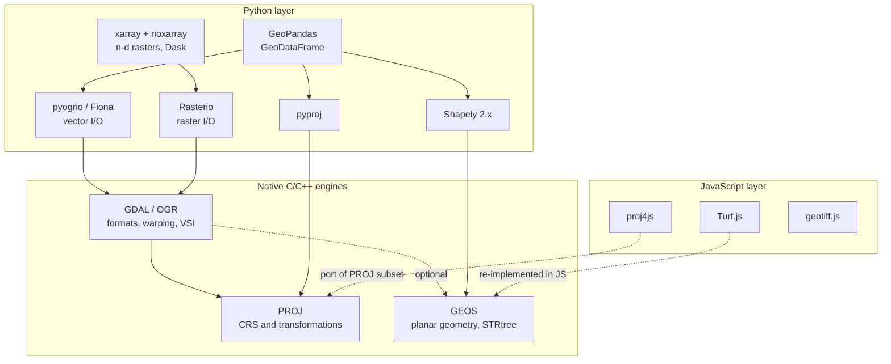
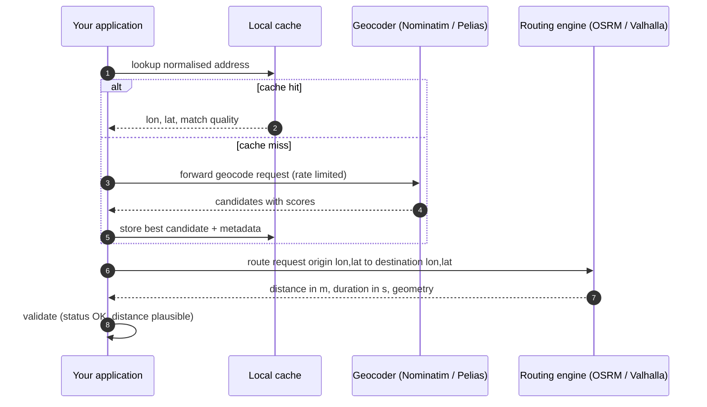
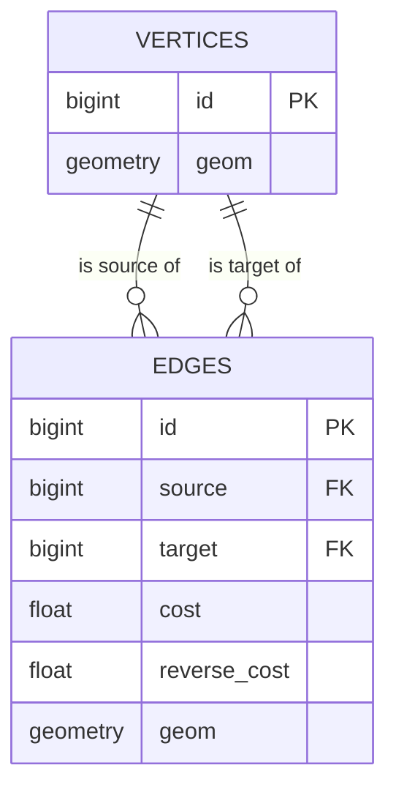
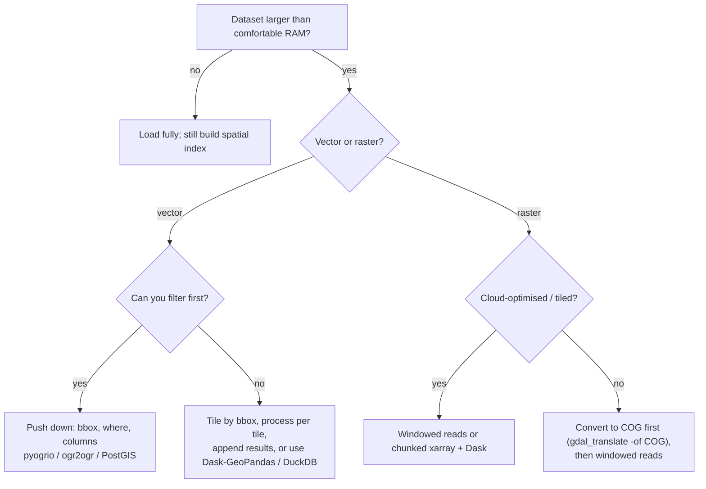

# Programmatic GIS: Automating Spatial Data Processing with GDAL, PROJ, GEOS, Python and JavaScript

> **Study note, GIS Development learning path, Phase 3** (planned duration: 4–6 weeks)
> **Audience:** a software developer who understands basic GIS concepts (CRS, vector vs raster) and now wants to *script* spatial workflows reliably.
> **Format note:** all numeric results in the worked example and exercises were computed independently (plain Python/NumPy/NetworkX arithmetic) from the stated geometry, so you can check your own output against them. The GeoPandas/Rasterio/pyproj snippets use the public APIs of Shapely 2.x, GeoPandas 1.x, Rasterio 1.3+ and pyproj 3.x; run them in your own environment and treat any mismatch as something to investigate, not ignore.

---

## 1. Learning objectives, prerequisites and expected outcomes

### 1.1 Learning objectives

After completing this note you should be able to:

1. Explain how **GDAL/OGR, PROJ and GEOS** divide responsibility, and which Python and JavaScript libraries wrap or re-implement each.
2. **Reproject** vector and raster data correctly, including handling axis order, datum shifts and projection distortion.
3. Perform the core vector operations: **clip, buffer, dissolve, overlay, spatial join, nearest join**, and choose the right one.
4. Perform the core raster operations: **reclassify, mask, zonal statistics, map algebra**, and reason about cell-centre rules and resampling.
5. Describe how **geocoding and reverse geocoding** work, and build a defensible pipeline (normalise, match, score, cache, rate-limit).
6. Model a road network as a graph and use **OSRM, Valhalla or pgRouting** (and plain Dijkstra) for routes, matrices and service areas.
7. Process data that does not fit in memory using **windowed reads, bbox/column pushdown, spatial indexes and partitioned formats**.
8. Write **verifiable** geoprocessing code: assertions on CRS, validity, areas and counts.

### 1.2 Prerequisites

| Area | You should already know |
|---|---|
| GIS concepts | What a CRS is, geographic vs projected coordinates, vector vs raster, EPSG codes |
| Python | Functions, virtual environments, NumPy arrays, pandas DataFrames |
| SQL (for pgRouting) | `SELECT`, `JOIN`, basic PostGIS (`ST_*`) |
| JavaScript (optional track) | ES modules, `fetch`, GeoJSON |
| Tooling | A terminal, `conda`/`mamba` or `pip`, optionally Docker |

### 1.3 Suggested 6-week learning path

| Week | Focus | Deliverable |
|---|---|---|
| 1 | Stack architecture, CRS handling, file I/O (GDAL/OGR CLI, pyogrio) | Reproject and convert a dataset between three formats |
| 2 | Vector processing: buffer, clip, dissolve, overlay, sjoin | Reproducible vector pipeline with assertions |
| 3 | Raster processing: Rasterio, masking, zonal stats, map algebra | Raster risk classification tied to vector zones |
| 4 | Geocoding and routing (Nominatim/Pelias, OSRM/Valhalla/pgRouting) | Route and service-area script |
| 5 | Scale: indexes, chunking, windows, Parquet/COG, Dask | Out-of-core version of Week 2–3 pipeline |
| 6 | JavaScript track (Turf.js, proj4js, geotiff.js) and capstone | End-to-end applied challenge (Section 7) |

### 1.4 Environment setup

```bash
# Recommended: conda-forge ships consistent GDAL/PROJ/GEOS binaries
mamba create -n pgis -c conda-forge python=3.12 \
    geopandas pyogrio shapely pyproj rasterio rioxarray xarray \
    rasterstats networkx geopy dask-geopandas jupyterlab
mamba activate pgis

# Sanity check: print the versions of the native engines
python - <<'EOF'
import shapely, pyproj, rasterio, geopandas, pyogrio
print("GEOS   :", shapely.geos_version)
print("PROJ   :", pyproj.proj_version_str)
print("GDAL   :", rasterio.__gdal_version__)
print("GeoPandas:", geopandas.__version__, "| pyogrio:", pyogrio.__version__)
EOF
```

`pip install geopandas pyogrio rasterio pyproj shapely` also works on common platforms because current wheels bundle GDAL/PROJ/GEOS. The risk with pip is **mixing several bundled copies of GDAL/PROJ** in one process (for example Fiona and Rasterio built against different GDAL versions). When in doubt, use one conda-forge environment.

---

## 2. Conceptual foundations

### 2.1 The three native engines

Almost every GIS library, open source or commercial, delegates to three C/C++ projects. Knowing which engine does what tells you where a bug or limitation really lives.

| Engine | Responsibility | Typical question it answers |
|---|---|---|
| **GDAL/OGR** | Read/write **hundreds of raster and vector formats**; raster warping, resampling, contouring, rasterize/polygonize; virtual file systems (`/vsicurl/`, `/vsizip/`, `/vsis3/`) | "Open this GeoPackage/GeoTIFF/Shapefile/FlatGeobuf." |
| **PROJ** | **Coordinate reference system definitions and coordinate operations** (datum shifts, projections, grid-based transformations); EPSG database | "Convert this coordinate from EPSG:4326 to EPSG:32631." |
| **GEOS** | **Planar computational geometry** on OGC Simple Features: predicates, buffer, union, intersection, validity, STR-tree index | "Do these polygons intersect? What is their union?" |

Layering: GDAL uses PROJ for coordinate transformation and (optionally) GEOS for OGR geometry operations. Higher-level libraries then wrap these:

| Task | Python | JavaScript |
|---|---|---|
| Vector I/O | **pyogrio** (default in GeoPandas 1.x), Fiona | GeoJSON natively; `flatgeobuf`, `shapefile` packages |
| Raster I/O | **Rasterio**, `osgeo.gdal`, rioxarray | **geotiff.js** |
| Transformations | **pyproj** | **proj4js** |
| Geometry operations | **Shapely** (GEOS) | **Turf.js** (own algorithms; buffer uses JSTS internally), JSTS |
| Tabular + geometry | **GeoPandas** | GeoJSON FeatureCollections |
| N-d arrays | **xarray** + rioxarray | not applicable |

### 2.2 The data model: Simple Features and rasters

**Vector (OGC Simple Features):** a *feature* = one geometry + attributes. Geometry types: `Point`, `LineString`, `Polygon` (exterior ring plus optional holes), their `Multi*` variants, and `GeometryCollection`. Rings are closed; polygon exteriors/holes must not self-intersect for a geometry to be **valid**.

**Raster:** a grid of cells, each holding one value per band. Location comes from an **affine geotransform** (GDAL ordering `(x0, dx, rx, y0, ry, dy)`):

$$X = x_0 + col \cdot dx + row \cdot rx \qquad Y = y_0 + col \cdot ry + row \cdot dy$$

For north-up rasters `rx = ry = 0` and `dy < 0` (rows increase southward). `(x0, y0)` is the **outer corner of the top-left cell**, not its centre. The centre of cell `(row, col)` is therefore at `x0 + (col + 0.5)·dx`, `y0 + (row + 0.5)·dy`.

### 2.3 Spatial relationships (DE-9IM)

GEOS predicates are defined by the **Dimensionally Extended 9-Intersection Model**: a 3×3 matrix recording the dimension of the intersection between the *interior*, *boundary* and *exterior* of geometry A and B. Common predicates:

| Predicate | Meaning (informal) | Notes |
|---|---|---|
| `intersects` | share at least one point | Includes touching; negation of `disjoint` |
| `within(A, B)` | A lies inside B, interiors intersect | A point **on B's boundary is *not* within B** |
| `contains(A, B)` | B within A | Inverse of `within` |
| `covers` / `covered_by` | like contains/within but boundary points count | Use when boundary points must count |
| `touches` | boundaries meet, interiors do not | |
| `crosses` | interiors intersect with lower dimension | Line crossing a polygon, line crossing line |
| `overlaps` | same dimension, partial overlap | |
| `dwithin(A, B, d)` | distance ≤ d | Planar distance in CRS units |

### 2.4 Operation taxonomy

| Operation | Input → Output | Mental model |
|---|---|---|
| **Reproject** | layer + target CRS → same features, new coordinates | Change the coordinate system, not the world |
| **Buffer** | geometry + distance → polygon | Everything within *d* of the geometry |
| **Clip** | layer + mask polygon → layer cut to mask | "Cookie cutter", keeps input attributes only |
| **Overlay** (intersection, union, difference, symmetric difference, identity) | two layers → new layer with **attributes from both** | Map-algebra for polygons |
| **Dissolve** | layer + key → fewer, merged geometries | `GROUP BY` + `ST_Union` |
| **Spatial join** | two layers + predicate → left rows with matched right attributes | `JOIN ... ON ST_Within(...)` |
| **Nearest join** | two layers → each left row gets closest right row | KNN lookup |
| **Reclassify** | raster + rules → raster | Value mapping |
| **Mask** | raster + polygons → raster with outside cells nodata | |
| **Zonal statistics** | raster + zones → table of stats per zone | `GROUP BY zone` over cells |
| **Map algebra** | rasters → raster | Cell-wise (local), neighbourhood (focal), zone (zonal), global |

### 2.5 Planar vs geodesic computation, and why units matter

GEOS (and therefore Shapely) works in a **plane**. It treats `(x, y)` as Cartesian numbers and has no idea whether they are degrees or metres. Consequently:

* `buffer(500)` on EPSG:4326 data means **500 degrees**, not 500 m.
* `.area` on EPSG:4326 geometries returns **square degrees**.
* Distances and areas should be computed in a **suitable projected CRS** (a local UTM zone, a national grid) or with **geodesic** functions (`pyproj.Geod`, Turf.js, which approximates on the sphere).

Length of one degree is not constant (WGS84 values at latitude 52°):

| 1° of … | Length |
|---|---|
| latitude | ≈ 111,267 m |
| longitude | ≈ 68,678 m (shrinks with cos φ) |

Web Mercator (EPSG:3857) preserves angles but inflates linear scale by `1/cos φ` and area by `1/cos² φ`: at 52° latitude about **1.62× linear and 2.64× area**; at 60° exactly 2× linear and 4× area. **Never measure area or distance in EPSG:3857 for analysis.**

Haversine great-circle distance on a sphere of radius *R* (≈ 6,371,008.8 m mean Earth radius):

$$d = 2R \arcsin\sqrt{\sin^2\!\frac{\Delta\varphi}{2} + \cos\varphi_1\cos\varphi_2\sin^2\!\frac{\Delta\lambda}{2}}$$

It is accurate to roughly 0.3% against the ellipsoid; use `pyproj.Geod` (Karney's algorithm) when you need ellipsoidal accuracy.

### 2.6 Axis order: the classic bug

| Convention | Order | Used by |
|---|---|---|
| GeoJSON (RFC 7946), Shapely, GeoPandas, proj4js, OSRM URLs, Turf.js | **lon, lat** (x, y) | most web and scripting tools |
| EPSG:4326 *as defined in the EPSG registry*, ISO 19111, some WMS 1.3.0 requests | **lat, lon** | authority-compliant software |
| Valhalla JSON (`{"lat":…, "lon":…}`), geopy `reverse((lat, lon))` | named / **lat, lon** | |

With pyproj, always create transformers with `always_xy=True` so input and output are `(x, y)` = `(lon, lat)` regardless of the CRS's formal axis order.

---

## 3. Visual explanations

### 3.1 Conceptual overview: the library stack



**How to read it.** Solid arrows mean "calls into". Dotted arrows from the JavaScript layer mean *re-implementation*, not binding: Turf.js and proj4js do not use the C libraries, so results can differ in edge cases (for example, datum-shift grids are largely unavailable in proj4js).

### 3.2 Workflow: a defensive geoprocessing pipeline


### 3.3 Schematic: the worked-example study area

The worked example (Section 5) uses this synthetic area. **This is a schematic, not a scale-accurate map**: the vertical axis is compressed. Coordinates are metres *local to the origin* `(E 500,000, N 5,700,000)` in **EPSG:32631** (WGS 84 / UTM zone 31N). The origin lies on the zone's central meridian (3°E).

```
 y (m)
 2000 ┌────────────────────┐
      │                    │
      │         C          │
      │     ● P3           │
 1000 ├────────────────────┼────────────────────┐
      │          ░░░░░░░░░░│░░░░░░░░░░          │
      │    A     ░░░░ F ░░░│░░░░░░░░░░    B     │
      │     ● P1 ░░░░░░░░░░│░░░░░● P2░          │
    0 └────────────────────┴────────────────────┘
      0         500       1000       1500       2000   x (m)

  ░ = flood zone F, box x 500–1500, y 0–1000
  A, B, C = districts (1000 m × 1000 m each)
  ● = clinics: P1 (250,500)  P2 (1250,500)  P3 (250,1500)
      P4 (2500,500) lies outside the drawing, east of B
```

### 3.4 Schematic: how common vector operations differ

```
 buffer(A, d)              clip(A, mask)                    dissolve(by key k)

 ╭───────────────╮         ┌────────────┐                   ┌──────┐ ┌──────┐     ┌─────────────┐
 │  ┌─────────┐  │         │ A          │                   │  A   │ │  B   │ ──► │   A ∪ B     │
 │  │    A    │  │         │     ┌──────┼──────┐            │ k=1  │ │ k=1  │     │   k=1       │
 │  └─────────┘  │         │     │######│ mask │            └──────┘ └──────┘     └─────────────┘
 ╰───────────────╯         └─────┼──────┘      │
 all points within d of A        └─────────────┘            merges geometries that share a key
                           ##### = result: A ∩ mask,        and aggregates their attributes
                           with A's attributes only
```

### 3.5 Schematic: raster pixel-centre rule (Rasterio `mask`, `all_touched=False`)

```
   polygon interior is to the LEFT of the edge ┆

   ┌───────┬───────┬───────┬───────┐
   │   +   │   +   │   +   │ ┆ +   │       + = cell centre
   │  (1)  │  (2)  │  (3)  │ ┆(4)  │
   └───────┴───────┴───────┴───────┘

   Cells 1-3: centre inside the polygon, selected by default.
   Cell 4:    touched by the polygon but its centre is outside, so it is excluded by
              default and included only with all_touched=True (which over-estimates area).
```

### 3.6 Sequence: geocode, then route



### 3.7 Data model: a routable road network (pgRouting style)



`cost` is the traversal cost from `source` to `target`; `reverse_cost` is the opposite direction. A negative cost means "not traversable in that direction" (one-way streets), a convention pgRouting uses for edge SQL.

### 3.8 Decision flow: which strategy for large data?



---
## 4. Technical deep dive

### 4.1 GDAL/OGR: the I/O and format layer

**Drivers.** GDAL abstracts formats behind *drivers* (`GPKG`, `GTiff`, `ESRI Shapefile`, `FlatGeobuf`, `Parquet`, `PostgreSQL`, `netCDF`, …). OGR is the vector half, GDAL (historically "GDAL" proper) the raster half; both ship in one library. **Virtual file systems** let you open remote or archived data as if local: `/vsicurl/https://…`, `/vsizip/archive.zip/file.shp`, `/vsis3/bucket/key.tif`.

**Command-line utilities** are the fastest way to prototype and often the fastest way to run a one-off conversion:

```bash
# Inspect: summary only (-so), all layers (-al)
ogrinfo -so -al districts.gpkg
gdalinfo elev.tif

# Vector: convert + reproject + rename layer in one pass
ogr2ogr -f GPKG out.gpkg in.shp -t_srs EPSG:32631 -nln districts

# Vector: spatial + attribute pushdown (-spat is in the SOURCE layer CRS unless -spat_srs is given)
ogr2ogr -f GPKG subset.gpkg big.gpkg buildings \
        -spat 500000 5700000 502000 5702000 -where "height > 20"

# Vector: modern streaming-friendly format with a built-in spatial index
ogr2ogr -f FlatGeobuf buildings.fgb big.gpkg buildings

# Raster: reproject with bilinear resampling and compression
gdalwarp -t_srs EPSG:4326 -r bilinear -co COMPRESS=DEFLATE elev.tif elev_4326.tif

# Raster: convert to a Cloud Optimized GeoTIFF (tiled + overviews, range-request friendly)
gdal_translate -of COG elev.tif elev_cog.tif
```

(Recent GDAL releases also add a unified `gdal` command; the classic utilities above remain widely used and documented.)

**Python bindings (`osgeo`)**: lower level than GeoPandas/Rasterio but sometimes necessary (for example, features that only exist in `gdal.Warp` options).

```python
from osgeo import gdal, ogr, osr
gdal.UseExceptions(); ogr.UseExceptions()        # raise exceptions instead of returning None

ds = ogr.Open("districts.gpkg")
layer = ds.GetLayer(0)
print(layer.GetFeatureCount(), layer.GetSpatialRef().GetName())

layer.SetSpatialFilterRect(500000, 5700000, 501000, 5701000)   # spatial filter (bbox) pushdown
for feat in layer:
    print(feat.GetField("name"), feat.GetGeometryRef().Area())

# GDAL >= 3 honours authority axis order (lat, lon for EPSG:4326) unless told otherwise
srs = osr.SpatialReference(); srs.ImportFromEPSG(4326)
srs.SetAxisMappingStrategy(osr.OAMS_TRADITIONAL_GIS_ORDER)     # force lon, lat
```

**Raster georeferencing check** (ties back to the geotransform in §2.2):

```python
ds = gdal.Open("elev.tif")
x0, dx, rx, y0, ry, dy = ds.GetGeoTransform()
col, row = 5, 10
x_centre = x0 + (col + 0.5) * dx
y_centre = y0 + (row + 0.5) * dy
```

### 4.2 PROJ and pyproj: coordinate operations

A **coordinate operation** is more than "apply a projection formula". Converting between two CRSs can involve (1) inverse projection to geographic coordinates, (2) a **datum transformation** (a Helmert shift, or a grid-based shift such as a national NTv2/geoid grid), and (3) a forward projection. PROJ selects among several candidate operations ranked by accuracy and area of use; **if a needed grid file is missing, it may silently fall back to a less accurate operation**.

```python
from pyproj import CRS, Transformer, TransformerGroup, Geod

crs = CRS.from_epsg(32631)
print(crs.name, crs.is_projected, [a.name for a in crs.axis_info])   # WGS 84 / UTM zone 31N, True, ['Easting','Northing']

# always_xy=True => input (lon, lat), output (x, y) regardless of authority axis order
t = Transformer.from_crs("EPSG:4326", "EPSG:32631", always_xy=True)
x, y = t.transform(3.0, 52.0)
print(x, y)     # 500000.0  ≈5761038.2  (lon 3°E is the zone's central meridian → easting 500000 exactly)

# Inspect which operations exist and whether any are unavailable (e.g. missing grids)
group = TransformerGroup("EPSG:4326", "EPSG:32631", always_xy=True)
print(len(group.transformers), group.unavailable_operations)

# Vectorised use: pass NumPy arrays, never loop point by point
import numpy as np
xs, ys = t.transform(np.array([3.0, 3.1]), np.array([52.0, 52.0]))

# Ellipsoidal (geodesic) distance and area: no projection distortion
geod = Geod(ellps="WGS84")
az12, az21, dist_m = geod.inv(3.0, 52.0, 3.1, 52.0)   # dist ≈ 6.87 km (0.1° of longitude at 52°N)
```

**Projection scale.** UTM uses a central-meridian scale factor of 0.9996, rising to about 1.0010 near the zone edge at the equator. Ground distances therefore differ from grid distances by up to roughly 0.04–0.1%, which is negligible for most analyses but not for survey work.

### 4.3 GEOS and Shapely 2.x: geometry engine

Shapely 2.0 introduced **vectorised, NumPy-style functions** (`shapely.buffer(array, d)`, `shapely.intersects(a, b)`), geometries as **immutable** objects, and a built-in **STRtree**. Prefer array functions over Python loops.

```python
import numpy as np, shapely
from shapely import Point, Polygon, box

# Validity
bowtie = Polygon([(0, 0), (1, 1), (1, 0), (0, 1)])
print(shapely.is_valid(bowtie), shapely.is_valid_reason(bowtie))   # False  Self-intersection[0.5 0.5]
fixed = shapely.make_valid(bowtie)                                   # MultiPolygon of two triangles, total area 0.5

# Vectorised point-in-polygon without constructing Point objects
poly = box(0, 0, 1000, 1000)
inside = shapely.contains_xy(poly, np.array([250., 1500.]), np.array([500., 500.]))   # [ True False ]

# DE-9IM relation string for any pair
print(shapely.relate(box(0, 0, 1, 1), box(1, 0, 2, 1)))   # 'FF2F11212'  (edge-sharing squares)
```

**Buffer parameters.** `buffer(distance, quad_segs=16, cap_style="round", join_style="round", mitre_limit=5.0)`. A circle is approximated by a polygon with `4 × quad_segs` vertices inscribed in the true circle, so the area is slightly *under*-estimated:

$$A_n = \tfrac{n}{2}\, r^2 \sin\!\left(\tfrac{2\pi}{n}\right), \qquad n = 4\cdot \texttt{quad\_segs}$$

| `quad_segs` | vertices *n* | Area / πr² |
|---|---|---|
| 1 | 4 | 0.6366 |
| 2 | 8 | 0.9003 |
| 4 | 16 | 0.9745 |
| 8 | 32 | 0.9936 |
| 16 (default) | 64 | 0.9984 |

For *r* = 500 m and the default, A = 784,137.12 m² versus the true π·500² = 785,398.16 m² (−0.16%). Always compare floating-point areas with a **tolerance**, never `==`.

**STRtree (Sort-Tile-Recursive R-tree).** Geometries are packed into a tree of bounding boxes. A query first finds candidates whose *bounding boxes* intersect (cheap), then optionally applies the exact predicate. Without an index a point-in-polygon join costs O(N·M) predicate evaluations; with the index roughly O(N · log M) plus the matches.

```python
tree = shapely.STRtree(polygons)                       # build once
hits = tree.query(Point(1250, 500), predicate="within")      # indices of tree geometries that contain the point
pairs = tree.query(points_array, predicate="within")         # 2×K array: [input_idx, tree_idx]
nearest_idx = tree.nearest(Point(1400, 600))                 # index of nearest tree geometry
```

For 10⁶ points and 10⁴ polygons that is about 10¹⁰ exact tests naively versus on the order of 10⁶ × log₂(10⁴) ≈ 1.3×10⁷ tree-node visits.

**Precision and robustness.** GEOS uses floating-point arithmetic with robust predicates, but overlay of nearly coincident edges can still raise `GEOSException: TopologyException`. Remedies: `make_valid`, snapping with `shapely.set_precision(geom, grid_size=0.001)`, or `buffer(0)` (a legacy trick that can drop parts of invalid polygons, so prefer `make_valid`).

### 4.4 GeoPandas: tabular geometry operations

A `GeoDataFrame` is a pandas `DataFrame` with a geometry column, a CRS and a lazily built spatial index (`gdf.sindex`). Operations:

| Operation | API | Key behaviour |
|---|---|---|
| Assign CRS (label only) | `gdf.set_crs("EPSG:32631")` | Does **not** move coordinates |
| Reproject | `gdf.to_crs(4326)` | Moves coordinates |
| Buffer | `gdf.buffer(d)` | `d` in CRS units; returns a `GeoSeries` |
| Clip | `gdf.clip(mask)` / `gpd.clip(gdf, mask)` | Input attributes only; faster than overlay; `keep_geom_type=True` drops stray lower-dimension fragments |
| Overlay | `gpd.overlay(a, b, how="intersection" \| "union" \| "difference" \| "symmetric_difference" \| "identity")` | Attributes from both; empty results dropped |
| Dissolve | `gdf.dissolve(by="k", aggfunc={"pop": "sum"}, as_index=False)` | Rows with a null key are dropped by default (`dropna=True`) |
| Spatial join | `gpd.sjoin(left, right, how="left", predicate="within")` | **One-to-many**: a left row matching *k* right rows becomes *k* rows |
| Nearest join | `gpd.sjoin_nearest(left, right, how="left", max_distance=500, distance_col="dist")` | Distance in CRS units; use a projected CRS |
| Raw index query | `right.sindex.query(left.geometry, predicate="within")` | Returns 2×K positional index array |

Typical I/O with pushdown:

```python
import geopandas as gpd
gdf = gpd.read_file("big.gpkg", layer="buildings", engine="pyogrio",
                    bbox=(500000, 5700000, 502000, 5702000),   # bbox is in the layer's CRS
                    columns=["id", "height"])                  # read only what you need
gdf.to_file("out.gpkg", layer="buildings_subset", driver="GPKG")
gdf.to_parquet("buildings.parquet")                            # GeoParquet: columnar, compressed
```

### 4.5 Rasterio, NumPy and rioxarray: raster processing

**Reading and writing**

```python
import numpy as np, rasterio
from rasterio.transform import from_origin

arr = np.zeros((20, 20), dtype="float32")
transform = from_origin(west=500000, north=5702000, xsize=100, ysize=100)   # north-up, 100 m cells
with rasterio.open("out.tif", "w", driver="GTiff", height=20, width=20, count=1,
                   dtype="float32", crs="EPSG:32631", transform=transform, nodata=-9999.0) as dst:
    dst.write(arr, 1)

with rasterio.open("out.tif") as src:
    print(src.crs, src.res, src.bounds, src.nodata)
    row, col = src.index(500550, 5701950)       # world → (row, col)
    x, y = src.xy(row, col)                      # (row, col) → centre of that cell (500550.0, 5701950.0)
```

**Reclassify** = value mapping. `np.digitize(a, bins)` returns, for `bins=[15, 20]`: 0 if *a* < 15, 1 if 15 ≤ *a* < 20, 2 if *a* ≥ 20.

```python
classes = np.digitize(elev, bins=[15, 20]) + 1        # 1 = low elevation (highest flood susceptibility)
```

**Mask** (`rasterio.mask.mask`) sets cells outside the shapes to nodata, optionally cropping to the shapes' bounding window. By default a cell is included if its **centre** is inside (see §3.5); `all_touched=True` includes any touched cell.

**Zonal statistics** summarise raster cells per polygon. Naïve approach: rasterize the polygon, take the cells inside, apply `mean/min/max/sum/count`. Higher-fidelity tools (`exactextract`) weight cells by the **fraction covered** by the polygon, which matters when polygons are small relative to the cell size. Mean of values weighted by coverage fraction *fᵢ*:

$$\bar{v} = \frac{\sum_i f_i v_i}{\sum_i f_i}$$

**Map algebra** (Tomlin's classification): *local* (cell-wise), *focal* (neighbourhood), *zonal* (per zone), *global* (whole raster).

```python
# Local: NDVI = (NIR - Red) / (NIR + Red), guarding against 0/0
red = np.array([[0.1, 0.2], [0.3, 0.4]]); nir = np.array([[0.5, 0.6], [0.3, 0.0]])
denom = nir + red
ndvi = np.divide(nir - red, denom, out=np.full_like(denom, np.nan), where=denom != 0)
# → [[ 0.6667  0.5 ]
#    [ 0.      -1.0 ]]

# Focal: slope from a DEM with cell size 100 m. For elev = 10 + col (1 m rise per 100 m)
dz_dy, dz_dx = np.gradient(elev, 100.0)                       # axis 0 = rows (southward), axis 1 = columns
slope_deg = np.degrees(np.arctan(np.hypot(dz_dx, dz_dy)))     # = arctan(0.01) = 0.573° everywhere
```

**Raster reprojection** (resampling choice matters: `nearest` for categorical data, `bilinear`/`cubic` for continuous data):

```python
import rasterio
from rasterio.warp import calculate_default_transform, reproject, Resampling

with rasterio.open("in.tif") as src:
    tf, w, h = calculate_default_transform(src.crs, "EPSG:4326", src.width, src.height, *src.bounds)
    meta = src.meta.copy(); meta.update(crs="EPSG:4326", transform=tf, width=w, height=h)
    with rasterio.open("out_4326.tif", "w", **meta) as dst:
        for i in range(1, src.count + 1):
            reproject(rasterio.band(src, i), rasterio.band(dst, i), resampling=Resampling.bilinear)
```

**rioxarray / xarray** adds labelled dimensions and lazy, chunked computation:

```python
import rioxarray
da = rioxarray.open_rasterio("elev.tif", chunks={"x": 512, "y": 512}, masked=True)   # lazy Dask array
clipped = da.rio.clip(flood.geometry, flood.crs, drop=True)
print(float(clipped.mean()))          # triggers computation
```

### 4.6 Geocoding and reverse geocoding

**Forward geocoding** converts a textual description (address, place name, postcode) into coordinates; **reverse geocoding** converts coordinates into a description. A production geocoder is a search system:

1. **Normalise**: case-fold, strip punctuation, expand abbreviations ("St" → "street"), Unicode-normalise.
2. **Parse**: split into components (house number, street, locality, postcode, country). Libraries such as `libpostal` do statistical address parsing.
3. **Candidate retrieval**: index lookup (Elasticsearch in Pelias; PostgreSQL full-text/trigram in Nominatim).
4. **Score and rank**: text similarity, component agreement, administrative hierarchy, popularity/importance.
5. **Position**: rooftop/parcel point, address interpolation along a street segment, street or postcode centroid, locality centroid.

| Match type | Typical positional accuracy | Risk |
|---|---|---|
| Rooftop / parcel point | metres | Best; not always available |
| Interpolated along street | tens of metres | Assumes even numbering |
| Street / postcode centroid | hundreds of metres to kilometres | Looks precise on a map but is not |
| Locality centroid | kilometres | Fine for aggregation only |

**Always store the match type and score** alongside the coordinates and filter low-confidence results.

**Reverse geocoding** takes two main forms. *Administrative reverse geocoding* is a **point-in-polygon** query against boundary polygons (use `sjoin` with `within`). *Address/place reverse geocoding* is a **nearest-feature** query against points/lines (use `sjoin_nearest` or a KNN index).

```python
# Online (Nominatim via geopy). Mind the usage policy: identify your app, ≤ 1 request/second, cache results.
from geopy.geocoders import Nominatim
from geopy.extra.rate_limiter import RateLimiter

geolocator = Nominatim(user_agent="my-gis-study-app")            # a descriptive, unique User-Agent is required
geocode = RateLimiter(geolocator.geocode, min_delay_seconds=1)
reverse = RateLimiter(geolocator.reverse, min_delay_seconds=1)

loc = geocode("Dam Square, Amsterdam")        # → Location with .latitude, .longitude, .raw (includes importance)
place = reverse((52.3731, 4.8926))           # NOTE: geopy takes (lat, lon)
```

Public geocoding services restrict bulk use and often restrict storing or redistributing results; read the provider's terms before building a cache or database from their output. For bulk work, self-host (Nominatim, Pelias, Photon) on an OpenStreetMap extract.

An **offline** reverse geocoder using only data you hold (used in the worked example):

```python
def reverse_geocode(pt_gdf, districts, clinics):
    inside = gpd.sjoin(pt_gdf, districts[["name", "geometry"]], how="left", predicate="within")
    near = gpd.sjoin_nearest(pt_gdf, clinics[["clinic", "geometry"]], how="left", distance_col="dist_m")
    return inside[["name"]].join(near[["clinic", "dist_m"]])
```

### 4.7 Routing and network analysis

**Graph model.** A road network is a directed, weighted graph *G = (V, E)*: vertices are intersections/endpoints, edges are road segments, edge weights are *cost* (length, travel time, or a composite such as time + turn penalties). One-way streets are directed edges with a single direction.

**Dijkstra's algorithm** finds shortest paths from a source with non-negative weights by repeatedly settling the unsettled vertex with minimum tentative distance *d* and *relaxing* its edges: `if d[u] + w(u,v) < d[v]: d[v] = d[u] + w(u,v)`. With a binary heap the cost is O((V + E) log V).

Worked toy graph (directed edges `A→B:4, A→C:2, C→B:1, B→D:5, C→D:8, D→E:3`), source A:

| Step | Settle | Tentative distances after relaxing |
|---|---|---|
| 0 | – | A=0, others ∞ |
| 1 | A (0) | B=4, C=2 |
| 2 | C (2) | B=min(4, 2+1)=3, D=2+8=10 |
| 3 | B (3) | D=min(10, 3+5)=8 |
| 4 | D (8) | E=11 |
| 5 | E (11) | – |

Result: dist = {A:0, C:2, B:3, D:8, E:11}; path to E is A→C→B→D→E.

**A\*** orders the frontier by *f = g + h* where *h* is an **admissible** heuristic (never over-estimates remaining cost), such as straight-line distance divided by maximum speed. **Contraction Hierarchies (CH)** pre-process the graph by ordering vertices by importance and adding *shortcut* edges, so queries run bidirectional searches that only climb "upwards"; this makes continental queries take milliseconds at the cost of long preprocessing and a fixed cost model. **Multi-Level Dijkstra (MLD)** partitions the graph into cells so edge weights can be updated (for example live traffic) with a quick re-customisation.

| Engine | Strengths | Interface | Notes |
|---|---|---|---|
| **OSRM** | Very fast CH/MLD; table (matrix), nearest, match, trip services | HTTP, `lon,lat` coordinates | Profiles (Lua) fixed at preprocessing time (`osrm-extract` → `osrm-partition`/`osrm-customize` or `osrm-contract`) |
| **Valhalla** | Dynamic costing at request time, isochrones, map matching, multimodal, tiled hierarchical graph | HTTP JSON, `{"lat","lon"}` | Costing options per request (`auto`, `pedestrian`, `bicycle`, …) |
| **pgRouting** | Routing inside PostgreSQL/PostGIS; combine with SQL; custom costs, closures | SQL functions | You manage the graph tables (source, target, cost) |

```python
import requests

# OSRM: coordinates are lon,lat; ';' separates waypoints. Distances in metres, durations in seconds.
base = "http://localhost:5000"           # your own OSRM instance (public demo servers are not for production use)
r = requests.get(f"{base}/route/v1/driving/4.8926,52.3731;4.9041,52.3676",
                 params={"overview": "false", "steps": "false"}, timeout=10)
data = r.json()
assert data["code"] == "Ok"
route = data["routes"][0]
print(route["distance"], route["duration"])

# Valhalla: JSON body; locations use lat/lon; lengths in km by default
body = {"locations": [{"lat": 52.3731, "lon": 4.8926}, {"lat": 52.3676, "lon": 4.9041}],
        "costing": "auto", "directions_options": {"units": "kilometers"}}
v = requests.post("http://localhost:8002/route", json=body, timeout=10).json()
print(v["trip"]["summary"]["length"], v["trip"]["summary"]["time"])

# Valhalla isochrone: polygons reachable within 10 minutes on foot
iso = requests.post("http://localhost:8002/isochrone", json={
    "locations": [{"lat": 52.3731, "lon": 4.8926}], "costing": "pedestrian",
    "contours": [{"time": 10}], "polygons": True}, timeout=10).json()   # GeoJSON FeatureCollection
```

**pgRouting (SQL)**

```sql
CREATE EXTENSION IF NOT EXISTS postgis;
CREATE EXTENSION IF NOT EXISTS pgrouting;

-- edges(id, source, target, cost, reverse_cost, geom); a negative (reverse_)cost = direction not allowed
SELECT seq, node, edge, cost, agg_cost
FROM pgr_dijkstra(
    'SELECT id, source, target, cost, reverse_cost FROM edges WHERE NOT flooded',
    1, 4,                 -- start vertex id, end vertex id
    directed := true);

-- Service area: all vertices within 1500 cost units of vertex 1
SELECT * FROM pgr_drivingDistance(
    'SELECT id, source, target, cost, reverse_cost FROM edges',
    1, 1500);
```

(Older tutorials build `source`/`target` with `pgr_createTopology`; newer pgRouting versions steer you towards `pgr_extractVertices` or tools like `osm2pgrouting`. Check your installed version's documentation.)

**Practical concerns**

* **Snapping**: input coordinates are *snapped* to the nearest routable edge; check the snap distance returned (OSRM `waypoints[].distance`) and reject large values.
* **Profile/cost mismatch**: car vs foot vs bicycle graphs differ in access rules, speeds and one-ways.
* **Units**: OSRM → m and s; Valhalla → km (configurable) and s; pgRouting → whatever you stored in `cost`.
* **Matrices**: `N × M` queries (OSRM `table`, Valhalla `sources_to_targets`) are far cheaper than N·M separate routes.
* **Map matching**: aligns noisy GPS traces to the network (OSRM `match`, Valhalla `trace_route`).

### 4.8 Handling large datasets

**Principle: move less data, hold less in memory.**

| Technique | How | When |
|---|---|---|
| **Pushdown** | `bbox=`, `where=`, `columns=`, `read_geometry=False` (pyogrio); `-spat`/`-where` (ogr2ogr); `WHERE`/`&&` in PostGIS | Always first |
| **Windowed raster reads** | `src.block_windows()`, `src.read(window=…)` | Rasters larger than RAM |
| **Chunking** | Process by tile bbox or by feature batch; append outputs | Vector layers larger than RAM |
| **Spatial index** | `sindex` / STRtree / GiST / GeoPackage R-tree / FlatGeobuf packed index | Any join or repeated query |
| **Efficient formats** | GeoParquet, FlatGeobuf, GeoPackage; **COG** (tiled, overviews) | Storage and exchange |
| **Lazy / parallel** | Dask-GeoPandas, xarray + Dask, DuckDB spatial, PostGIS | Embarrassingly parallel per-tile work |
| **Right dtypes** | `float32`/`uint8` rasters, categorical columns, drop unused columns | Always |

**Raster memory arithmetic.** A 20,000 × 20,000 single-band `float32` raster holds 4×10⁸ cells × 4 bytes = **1.6 GB** (1.6×10⁹ bytes) before any intermediate copies; `float64` doubles it, and a few temporaries (mask, result, classified copy) multiply it again. Reading in 512 × 512 windows costs 512 × 512 × 4 = 1,048,576 bytes = **1 MiB per block**, and there are ⌈20000/512⌉² = 40² = **1,600** blocks.

```python
# Windowed zonal-style computation: sum and count over a raster without loading it whole
import rasterio, numpy as np

total, count = 0.0, 0
with rasterio.open("huge.tif") as src:
    for _, window in src.block_windows(1):             # iterates the file's native blocks
        block = src.read(1, window=window, masked=True)  # masked array honours nodata
        total += float(block.sum()); count += int(block.count())
mean = total / count
```

Summing partial sums and counts (not averaging block means) gives the exact global mean even when blocks differ in size.

**Vector chunking by tile with border de-duplication.** Features crossing tile borders are returned by more than one bbox query. Assign each feature to exactly one tile using a *reference point rule* (for example the centroid, or the bbox lower-left corner):

```python
import pyogrio, geopandas as gpd, numpy as np

info = pyogrio.read_info("big.gpkg", layer="buildings")
print(info["features"], info["crs"])                          # feature count and CRS without reading data

xmin, ymin, xmax, ymax = (500000, 5700000, 520000, 5720000)    # overall extent
step = 5000
for x in np.arange(xmin, xmax, step):
    for y in np.arange(ymin, ymax, step):
        tile = (x, y, x + step, y + step)
        g = gpd.read_file("big.gpkg", layer="buildings", engine="pyogrio", bbox=tile)
        c = g.geometry.centroid
        g = g[(c.x >= tile[0]) & (c.x < tile[2]) & (c.y >= tile[1]) & (c.y < tile[3])]   # own each feature once
        # ... process g, then append the result:
        # g.to_file("result.gpkg", layer="out", driver="GPKG", mode="a")
```

Using `skip_features`/`max_features` offsets also works, but for some drivers large offsets must scan from the start, so bbox tiling on an indexed format is usually faster and parallelises better.

### 4.9 JavaScript counterparts

```js
// proj4js: coordinates are [lon, lat] / [x, y]
import proj4 from "proj4";
proj4.defs("EPSG:32631", "+proj=utm +zone=31 +datum=WGS84 +units=m +no_defs");
const [x, y] = proj4("EPSG:4326", "EPSG:32631", [3.0, 52.0]);   // [500000, ≈5761038.2]

// Turf.js: GeoJSON in WGS84 lon/lat; distances in km/miles/etc. (not CRS units)
import * as turf from "@turf/turf";
const clinic = turf.point([4.8926, 52.3731]);
const buffer = turf.buffer(clinic, 0.5, { units: "kilometers" });   // 500 m buffer, approximated locally
console.log(turf.area(buffer));                                      // m², ≈ 0.78 km² for the default step count

const poly = turf.polygon([[[4.88, 52.36], [4.90, 52.36], [4.90, 52.38], [4.88, 52.38], [4.88, 52.36]]]);
console.log(turf.booleanPointInPolygon(clinic, poly));               // true
// Turf 7 takes a FeatureCollection for overlay-type functions; check your installed major version:
const common = turf.intersect(turf.featureCollection([poly, buffer]));

// geotiff.js: range-request reads from a Cloud Optimized GeoTIFF
import { fromUrl } from "geotiff";
const tiff = await fromUrl("https://example.com/elev_cog.tif");     // placeholder URL
const image = await tiff.getImage();
console.log(image.getWidth(), image.getHeight(), image.getBoundingBox());
const raster = await image.readRasters({ window: [0, 0, 256, 256], samples: [0] });   // only that window is fetched
```

Caveats: Turf.js works on geographic coordinates and is **not** a substitute for projected-CRS analysis in high-accuracy work; proj4js supports common projections but not the full PROJ operation database (grid-based datum shifts are limited), so for authoritative transformations do the work server-side with pyproj or PostGIS.

---
## 5. Worked GIS example: flood exposure of districts and clinics

### 5.1 Scenario

A regional health agency wants to know **how many residents and which clinics are exposed to a flood zone**, and by how much to restrict the study area for follow-up. We build the whole pipeline on a **synthetic, hand-checkable dataset** so that every number below can be verified by arithmetic. The same workflow transfers unchanged to real data (swap the `gpd.read_file` calls).

* **CRS:** EPSG:32631 (WGS 84 / UTM zone 31N, units: metres). Coordinates are `(E 500,000 + x, N 5,700,000 + y)`; the origin sits on the 3°E central meridian.
* **Layers** (local coordinates in metres, see the schematic in §3.3):

| Layer | Features | Attributes |
|---|---|---|
| `districts` | A = (0,0)–(1000,1000); B = (1000,0)–(2000,1000); C = (0,1000)–(1000,2000) | `pop`: A 4000, B 6000, C 2000; `region`: A,B → R1, C → R2 |
| `flood` | F1 = (500,0)–(1500,1000) | `zone` |
| `clinics` | P1 (250,500); P2 (1250,500); P3 (250,1500); P4 (2500,500) | `clinic` |
| `elev` (raster) | 20 × 20 cells, 100 m, covering x 0–2000, y 0–2000 | elevation = 10 + column index (m) |

* **Questions:**
  1. Which district does each clinic belong to? (spatial join)
  2. How much of each 400 m clinic catchment lies in the flood zone? (buffer + overlay)
  3. How many residents are exposed, assuming uniform density within a district? (overlay + areal weighting)
  4. What are the district totals per region? (dissolve)
  5. What do the elevation statistics and risk classes look like inside the flood zone? (mask, zonal statistics, reclassify)

### 5.2 Complete script

```python
"""flood_exposure.py: synthetic flood-exposure workflow in EPSG:32631."""
import numpy as np
import geopandas as gpd
import rasterio
from rasterio.mask import mask
from rasterio.transform import from_origin
from shapely.geometry import Point, box

CRS = "EPSG:32631"
X0, Y0 = 500_000, 5_700_000            # origin on the 3°E central meridian


def rect(xmin, ymin, xmax, ymax):
    """Rectangle in local metres, shifted into real EPSG:32631 coordinates."""
    return box(X0 + xmin, Y0 + ymin, X0 + xmax, Y0 + ymax)


def close(a, b, tol=1.0):
    return abs(a - b) <= tol


def counts(a):
    """{class: number of cells} with plain Python ints."""
    k, n = np.unique(a, return_counts=True)
    return {int(i): int(j) for i, j in zip(k, n)}


# ── 1. Build layers ─────────────────────────────────────────────────────────
districts = gpd.GeoDataFrame(
    {"name": ["A", "B", "C"], "pop": [4000, 6000, 2000], "region": ["R1", "R1", "R2"]},
    geometry=[rect(0, 0, 1000, 1000), rect(1000, 0, 2000, 1000), rect(0, 1000, 1000, 2000)],
    crs=CRS,
)
flood = gpd.GeoDataFrame({"zone": ["F1"]}, geometry=[rect(500, 0, 1500, 1000)], crs=CRS)
clinics = gpd.GeoDataFrame(
    {"clinic": ["P1", "P2", "P3", "P4"]},
    geometry=[Point(X0 + 250, Y0 + 500), Point(X0 + 1250, Y0 + 500),
              Point(X0 + 250, Y0 + 1500), Point(X0 + 2500, Y0 + 500)],
    crs=CRS,
)

# Defensive checks BEFORE any analysis
assert districts.crs == flood.crs == clinics.crs
assert districts.is_valid.all() and flood.is_valid.all()
print("district areas (m²):", districts.area.tolist())

# ── 2. CRS sanity check ─────────────────────────────────────────────────────
origin_ll = gpd.GeoSeries([Point(X0, Y0)], crs=CRS).to_crs(4326).iloc[0]
print("origin lon/lat:", round(origin_ll.x, 6), round(origin_ll.y, 4))   # x = lon, y = lat

# ── 3. Spatial join: which district contains each clinic? ───────────────────
joined = gpd.sjoin(clinics, districts[["name", "region", "geometry"]],
                   how="left", predicate="within")
print(joined[["clinic", "name", "region"]])

# ── 4. Buffer clinics by 400 m, then intersect with the flood zone ──────────
buffers = clinics.copy()
buffers["geometry"] = clinics.buffer(400)               # CRS units are metres → 400 m
print("buffer area (m²):", buffers.area.round(0).unique())
catch_in_flood = gpd.overlay(buffers, flood, how="intersection")   # empty results are dropped
print(catch_in_flood[["clinic"]].assign(area_m2=catch_in_flood.area.round(0)))

# ── 5. Exposure: district ∩ flood, areal weighting ──────────────────────────
expo = gpd.overlay(districts, flood, how="intersection")
full_area = districts.set_index("name").area
expo["share"] = expo.area / expo["name"].map(full_area)
expo["pop_exposed"] = expo["pop"] * expo["share"]
print(expo[["name", "share", "pop_exposed"]])
print("total exposed:", expo["pop_exposed"].sum())

# ── 6. Dissolve districts into regions ──────────────────────────────────────
regions = districts.dissolve(by="region", aggfunc={"pop": "sum"}, as_index=False)
print(regions.assign(area_m2=regions.area)[["region", "pop", "area_m2"]])

# ── 7. Full overlay (union): the planar partition of districts and flood ────
parts = gpd.overlay(districts, flood, how="union")
print(len(parts), sorted(parts.area.round(0).tolist()))

# ── 8. Raster: build, mask, zonal stats, reclassify ─────────────────────────
elev = np.tile(np.arange(10, 30, dtype="float32"), (20, 1))          # elevation = 10 + column
transform = from_origin(X0, Y0 + 2000, 100, 100)                      # west, north, xsize, ysize
profile = dict(driver="GTiff", height=20, width=20, count=1, dtype="float32",
               crs=CRS, transform=transform, nodata=-9999.0)
with rasterio.open("elev.tif", "w", **profile) as dst:
    dst.write(elev, 1)

with rasterio.open("elev.tif") as src:
    out, out_tf = mask(src, flood.geometry, crop=True, nodata=src.nodata)
    band = out[0]
    vals = band[band != src.nodata]                                    # cells whose centres lie in F1
    cell_area = abs(src.transform.a * src.transform.e)
    print("masked shape:", band.shape)
    print("count/mean/min/max:", vals.size, vals.mean(), vals.min(), vals.max())
    print("raster flood area (m²):", vals.size * cell_area)

    full = src.read(1)
    classes = np.digitize(full, bins=[15, 20]) + 1                     # 1: <15, 2: 15–<20, 3: ≥20
    print("class counts (all):", counts(classes))
    inside = np.digitize(vals, bins=[15, 20]) + 1
    print("class counts (flood):", counts(inside))

# ── 9. Assertions that encode the expected results ──────────────────────────
assert close(expo["pop_exposed"].sum(), 5000.0, 1e-6)
assert close(vals.size * cell_area, expo.area.sum(), 1e-6)             # raster and vector agree
```

### 5.3 Expected results and why

| Step | Expected output | Reasoning / how to verify by hand |
|---|---|---|
| 1 | `[1000000.0, 1000000.0, 1000000.0]` | 1000 m × 1000 m squares |
| 2 | `3.0 51.4512` | Easting 500,000 m is the central meridian of zone 31 at every latitude, so lon = 3° exactly; the meridian arc for N = 5,700,000 m (÷ 0.9996 scale) gives φ ≈ 51.4512° |
| 3 | P1→A (R1), P2→B (R1), P3→C (R2), **P4→NaN** | P4 (x = 2500) lies outside every district; `how="left"` keeps it with null attributes. `index_right` is also added (float because of the NaN) |
| 4a | buffer area ≈ **501,848** m² each | 64-gon: A = 32 × 400² × sin(5.625°) = 501,847.76 (true circle: 502,654.82) |
| 4b | P1: **≈ 65,016** m²; P2: **≈ 436,832** m²; P3, P4 absent | P1's circle (x ∈ [−150, 650]) is cut by the flood edge at x = 500 (a segment of depth 150 m). P2's circle (x ∈ [850, 1650]) is cut at x = 1500 (depth 150 m), so P2 keeps the *remainder*. 65,016 + 436,832 = 501,848. P3 (y ≥ 1100) and P4 (x ≥ 2100) never reach the flood zone, so overlay drops them |
| 5 | A: share 0.5 → 2,000; B: share 0.5 → 3,000; **total 5,000** | A ∩ F = 500 × 1000 = 500,000 m² (half of A); same for B; C ∩ F = ∅ |
| 6 | R1: pop 10,000, area 2,000,000; R2: pop 2,000, area 1,000,000 | R1 = A ∪ B = (0,0)–(2000,1000) |
| 7 | **5** parts, areas `[500000, 500000, 500000, 500000, 1000000]` | A∩F, A∖F, B∩F, B∖F, C. F ∖ districts is empty and dropped |
| 8a | masked shape `(10, 10)` | F spans columns 5–14 and rows 10–19 (centres at x = 550…1450, y = 50…950) |
| 8b | count **100**, mean **19.5**, min **15.0**, max **24.0** | values 10 + c for c = 5…14 → 15…24; mean = (15 + 24)/2 = 19.5 |
| 8c | raster flood area **1,000,000** m² | 100 cells × 10,000 m²; equals the vector result |
| 8d | all cells: `{1: 100, 2: 100, 3: 200}`; flood cells: `{2: 50, 3: 50}` | Class 1: c = 0…4 (5 columns × 20 rows); class 2: c = 5…9; class 3: c = 10…19. Within F: c = 5…9 → 5 columns × 10 rows = 50 cells; c = 10…14 → 50 cells |

**Interpretation.** About **5,000 of 12,000 residents (41.7%)** live in the flooded area *under the uniform-density assumption*. Clinic **P2** sits inside the flood zone; P1's 400 m catchment is only ≈ 13% in the flood zone (65,016 / 501,848); P3 and P4 are unaffected. The raster and vector areas agree **only because the flood edges align exactly with cell edges** (x = 500, 1500; y = 0, 1000 are multiples of 100). With a misaligned polygon the raster area differs (centre-in rule) and the difference shrinks as cells get smaller relative to the polygon.

**What to notice**

* The 64-gon underestimates a true circle's flood segment (65,016 vs the analytic 65,244 m² for a perfect circle), because the buffer is an **inscribed polygon**. For tighter fidelity raise `quad_segs` (or `resolution` in GeoPandas); never compare against analytic values with `==`.
* Clinic P4 shows why `how="left"` plus an explicit null check matters: a silent inner join would drop it and understate the dataset size.
* The areal-weighting estimate is a *model*. Real populations are not uniform; dasymetric mapping (using building footprints or land cover to redistribute population) improves it.

---

## 6. Common pitfalls and best practices

### 6.1 Pitfalls by area

| Area | Pitfall | Symptom | Remedy |
|---|---|---|---|
| **CRS** | Missing CRS on input | `to_crs` raises; silent wrong overlays | Obtain CRS from the data owner; `set_crs` only when you *know* it |
| | `set_crs` used instead of `to_crs` | Coordinates unchanged, data "in the ocean" | `set_crs` labels, `to_crs` transforms |
| | Buffering or measuring in EPSG:4326 | "500 m" buffer is 500° | Reproject to a metric CRS first, or use geodesic functions |
| | Area/distance in EPSG:3857 | ≈ 2.6× area at 52° lat | Use local projected or equal-area CRS |
| | Axis order (lat/lon vs lon/lat) | Features appear mirrored or in wrong hemisphere | `always_xy=True`; check against a known point |
| | Missing datum-shift grid | Metre-level offsets without error | Inspect `TransformerGroup`; install grids / enable PROJ network |
| | Data spans a UTM zone boundary or antimeridian | Distorted or split shapes | Use a CRS suited to the extent; split/shift at the antimeridian |
| **Geometry** | Invalid polygons | `TopologyException`, wrong overlays | `is_valid_reason`, `make_valid`; validate on ingest |
| | Overlay returns mixed types (GeometryCollection) | Write errors; lines in polygon layer | `keep_geom_type=True`; `explode()`; filter by type |
| | Point on polygon boundary | Not `within`; is `intersects`/`covered_by` | Pick the predicate deliberately |
| | Many-to-one assumed in `sjoin` | Row count grows | Check `len` before/after; dedupe or aggregate |
| | Null dissolve key | Features vanish from `dissolve` | Fill keys or `dropna=False` |
| | Slivers after overlay | Tiny polygons with huge ratios | Area thresholds; snap with `set_precision` |
| **Accuracy** | Comparing floats with `==` | Flaky tests | Tolerances (`math.isclose`, `np.isclose`) |
| | Treating buffer circles as exact | 0.16% area error at 64 vertices | Increase `quad_segs`, document tolerance |
| **Raster** | Ignoring `nodata` | Statistics contaminated by −9999 | Masked arrays; compare against `src.nodata` |
| | Integer dtype overflow | `uint8` wrap-around | Cast to wider type before arithmetic |
| | Wrong resampling | Class codes blended into fractions | `nearest` for categorical data |
| | Rasters on different grids | Misaligned map algebra | Reproject/resample to one grid first |
| | Slope/area with degree cell sizes | Nonsense units | Reproject to metres first |
| | `all_touched=True` by default assumption | Overstated zone area | Use deliberately; know the centre-in rule |
| **Geocoding** | Ignoring match quality | Street-centroid treated as rooftop | Store and filter on match type/score |
| | Violating usage policy | IP blocked | Respect rate limits, identify app, cache, or self-host |
| | Ambiguous names | "Springfield" resolves elsewhere | Constrain by country/bbox/viewbox |
| | Storing results against terms | Legal exposure | Read provider terms; addresses can be personal data |
| **Routing** | Large snap distances | Route starts "in a river" | Check snapping distance; reject outliers |
| | Wrong profile | Walking route over a motorway | Select costing/profile intentionally |
| | Unit confusion | km vs m, s vs min | Normalise units at the API boundary |
| | Straight-line vs network distance | Underestimated access | Use network distance for access analysis |
| | Negative edge weights in Dijkstra | Wrong or looping results | Only non-negative weights; use `-1` convention for "closed" in pgRouting |
| **Scale** | `iterrows`/Python loops over geometries | Hours instead of seconds | Vectorise; use `sindex` |
| | Rebuilding an index repeatedly | Slow repeated joins | Build once, reuse |
| | Loading whole layer for small area | Memory blow-up | bbox/where/columns pushdown |
| | Shapefile limits | 2 GB cap, 10-character field names, no null geometry mix | Use GeoPackage, FlatGeobuf or GeoParquet |
| | Dask partitions with random spatial order | Every partition hits every other in joins | Spatially sort/partition data (for example Hilbert-curve order) |

### 6.2 Best practices

1. **Make the CRS explicit at every boundary**: assert on input, reproject once to an analysis CRS, record the CRS in outputs.
2. **Validate early, assert often**: CRS equality, `is_valid`, no empty geometries, expected row counts, expected areas/totals with tolerances.
3. **Prefer vectorised and indexed operations** over loops; profile before optimising.
4. **Keep raw data immutable**; write derived data to new files; record provenance (source, date, tool versions: `shapely.geos_version`, `pyproj.proj_version_str`, `rasterio.__gdal_version__`).
5. **Test with tiny synthetic fixtures** (like §5) whose answers you can derive by hand, then run on real data.
6. **Choose formats intentionally**: GeoPackage for general vector exchange, GeoParquet/FlatGeobuf for analytics and streaming, COG for rasters on object storage.
7. **Separate concerns**: I/O, geometry logic and reporting in different functions so each can be tested and chunked.
8. **Respect external services**: rate limits, caching, retries with back-off, timeouts, and provider terms.
9. **Visual QA**: open outputs in QGIS or a notebook map; automated checks cannot see a map shifted by an axis-order error that still passes bbox tests.

---
## 7. Progressive exercises

The four exercises form one chain: **Exercise 1** creates a reusable fixture module and CRS discipline; **Exercise 2** builds the vector pipeline on those fixtures; **Exercise 3** adds rasters and scale techniques; **Exercise 4** combines everything with geocoding and routing. Complete them in order; each reuses the code you wrote before. Use the same synthetic study area as §5 (EPSG:32631, origin E 500,000 / N 5,700,000, local coordinates in metres). Solutions are in §8; try each exercise before reading its solution.

| # | Level | Skills practised | Builds on |
|---|---|---|---|
| 1 | Beginner | CRS assignment, reprojection, I/O, validation, unit pitfalls | – |
| 2 | Intermediate | buffer, overlay, dissolve, spatial join, nearest join, predicate semantics | 1 |
| 3 | Advanced | raster mask/zonal stats/reclassify, windowed processing, spatial index vs naive | 1–2 |
| 4 | Applied challenge | network analysis, flood closures, geocoding, reverse geocoding, pgRouting SQL, reporting | 1–3 |

---

### Exercise 1 (Beginner): fixtures and CRS discipline

**Task.** Create `fixtures.py` exposing functions `make_districts()`, `make_flood()`, `make_clinics(extra_boundary=False)` that return `GeoDataFrame`s in EPSG:32631 for the data below. Then write `check_ex1.py` that:

1. asserts all three layers share one CRS and all geometries are valid;
2. prints district areas;
3. transforms the lon/lat point `(3.0, 52.0)` to EPSG:32631 with `pyproj` (`always_xy=True`) and checks it against the expected values;
4. checks round-trip accuracy for `(3.7, 51.9)` through EPSG:32631 and back;
5. demonstrates the **degrees pitfall**: convert the clinics to EPSG:4326 and buffer the first one by `400`, printing the buffer's `.area` and explaining what unit it is in;
6. writes the layers to one GeoPackage (`ex1.gpkg`) and reads one back, checking the CRS and feature counts.

**Prerequisites.** §2.5, §2.6, §4.2, §4.4.

**Sample input.** (local metres; add `X0 = 500000`, `Y0 = 5700000` to get real coordinates)

| Layer | Data |
|---|---|
| districts | A (0,0)–(1000,1000) pop 4000 region R1; B (1000,0)–(2000,1000) pop 6000 region R1; C (0,1000)–(1000,2000) pop 2000 region R2 |
| flood | F1 (500,0)–(1500,1000), attribute `zone="F1"` |
| clinics | P1 (250,500), P2 (1250,500), P3 (250,1500), P4 (2500,500) with `clinic` = "P1"…"P4" and `label` = "Clinic 1"…"Clinic 4". When `extra_boundary=True`, add P5 = (1000, 500) with label "Clinic 5" |

**Expected deliverable.** `fixtures.py`, `check_ex1.py`, `ex1.gpkg` (three layers), and the console output of the checks.

**Success criteria.**

* All assertions pass; district areas are exactly 1,000,000 m² each.
* `(3.0, 52.0)` → easting 500,000.0 (to better than a micrometre) and northing 5,761,038.2 (±0.1 m).
* Round-trip error below 10⁻⁸ degrees (about 1 mm).
* You can state in one sentence why the printed buffer area in step 5 is meaningless as square metres.
* `ex1.gpkg` reads back with `crs.to_epsg() == 32631`, with 3, 1 and 4 features per layer.

**Hint.** `GeoDataFrame(..., geometry=[...], crs="EPSG:32631")`; a shared `rect()` helper that adds the origin keeps the code readable.

---

### Exercise 2 (Intermediate): the vector pipeline

**Task.** Using `fixtures.py`, write `vector_ops.py` with a function `exposure_report(districts, flood, clinics, buffer_m=400)` that returns a dict containing:

* `joined`: clinics with their containing district (`name`, `region`), keeping clinics outside every district;
* `catchment_in_flood`: each clinic's `buffer_m` catchment intersected with the flood zone, with an `area_m2` column;
* `exposure`: district ∩ flood with an areal-weighted `pop_exposed`;
* `regions`: districts dissolved by `region` with summed population.

The function must assert that all inputs share a *projected* CRS. Then write `test_vector_ops.py` that checks the §5 expected results **and** answers these questions about predicates using `make_clinics(extra_boundary=True)`:

* How many rows does `sjoin(..., predicate="within", how="left")` return, and what happens to P5?
* How many rows does `predicate="intersects"` return, and why?
* What does `sjoin_nearest(<P4 only>, districts, distance_col="d")` return for P4?

**Prerequisites.** Exercise 1; §2.3, §4.3, §4.4.

**Sample input.** Fixtures from Exercise 1.

**Expected deliverable.** `vector_ops.py`, `test_vector_ops.py` (runnable with `pytest`), and a short written answer (3–5 sentences) to the predicate questions.

**Success criteria.**

* Total exposed population = 5,000 (tolerance 10⁻⁶).
* Catchment areas inside the flood zone exist only for P1 (≈ 65,016 m²) and P2 (≈ 436,832 m²), tolerance 1 m².
* Regions: R1 population 10,000, area 2,000,000 m²; R2 population 2,000, area 1,000,000 m².
* `within` yields 5 rows (P5 unmatched); `intersects` yields 6 rows (P5 matched to both A and B); P4's nearest district is B at distance 500 m.
* You can explain, in terms of DE-9IM interior/boundary, why a boundary point is not `within` either district.

**Hint.** To compute the exposure share use the **district's full area** (not the flood area) as denominator; `districts.set_index("name").area` gives a Series you can `.map`.

---

### Exercise 3 (Advanced): rasters and scale

**Task.** Write `raster_ops.py` and `scale_demo.py`:

1. **Raster build and zonal statistics.** Create the 20 × 20, 100 m cell `elev.tif` (elevation = 10 + column index, `float32`, nodata −9999, EPSG:32631, top-left corner at local (0, 2000)). Using `rasterio.mask.mask` with the flood zone from Exercise 1, compute count, mean, min, max and the flooded area (count × cell area), and compare the area with the vector overlay result from Exercise 2.
2. **Reclassify.** Classify elevation into 1 (< 15), 2 (15 to < 20), 3 (≥ 20) and write `risk.tif` as `uint8` with nodata 0. Report the class counts for the whole raster and inside the flood zone.
3. **Windowed processing.** Without reading the whole raster at once, use `src.block_windows(1)` to compute (a) class counts for the whole raster and (b) zonal count/sum/mean for the flood zone (use `rasterio.features.geometry_mask` with `src.window_transform(window)` for each window). Verify both equal the full-read results.
4. **Spatial index vs naive.** Generate 100,000 random points (`numpy.random.default_rng(42)`, uniform over local x, y ∈ [0, 2000]) and count how many fall in each district with (i) `gpd.sjoin`, (ii) `shapely.contains_xy`, and (iii) a naive Python loop over 5,000 points against the district geometries; time (iii) against an indexed query on the same 5,000 points.
5. **Memory budget.** Compute the in-memory size of a 20,000 × 20,000 `float32` raster, the size of a 512 × 512 block, and the number of such blocks.

**Prerequisites.** Exercises 1 and 2; §3.5, §4.5, §4.8.

**Sample input.** Fixtures; the raster definition above.

**Expected deliverable.** The two scripts, `elev.tif`, `risk.tif`, and printed results.

**Success criteria.**

* Zonal stats: count 100, mean 19.5, min 15.0, max 24.0, area 1,000,000 m²; area equals the vector flood area.
* Class counts all cells `{1: 100, 2: 100, 3: 200}`; inside flood `{2: 50, 3: 50}`.
* Windowed results are **identical** to the full-read results (integer counts exactly; mean within 10⁻⁹).
* Methods (i) and (ii) give identical per-district counts; each of A, B, C holds approximately 25,000 points (within ±500), and roughly 25,000 points are in no district.
* Indexed query is clearly faster than the naive loop on the same points (record both timings).
* Memory: 1.6×10⁹ bytes (1.6 GB); block 1,048,576 bytes (1 MiB); 1,600 blocks.

**Hint.** For (iii) `[any(g.contains(Point(x, y)) for g in geoms) for ...]` is the naive baseline; for the indexed version use `shapely.STRtree(geoms).query(points_array, predicate="within")`. `np.bincount(classes, minlength=4)` accumulates class counts across blocks.

---

### Exercise 4 (Applied challenge): flood-resilient clinic access

**Scenario.** Roads connect the clinics. When a road touches the flood zone it is **closed**. Quantify how flooding changes access and report which clinics are cut off and how many residents live in the affected district.

**Task.** Extend `fixtures.py` with `make_roads()` and write `capstone.py` that:

1. builds the road layer (nodes: P1, P2, P3, P4 and an extra junction N at local (2500, 1500)):

| edge_id | u | v | local coordinates (m) |
|---|---|---|---|
| R12 | P1 | P2 | (250,500) → (1250,500) |
| R13 | P1 | P3 | (250,500) → (250,1500) |
| R23 | P2 | P3 | (1250,500) → (250,1500) |
| R24 | P2 | P4 | (1250,500) → (2500,500) |
| R3N | P3 | N | (250,1500) → (2500,1500) |
| RN4 | N | P4 | (2500,1500) → (2500,500) |

2. computes each road's length and **flooded length** (length of its intersection with the flood zone); marks a road *closed* if flooded length > 0 (state this modelling choice in your report and one alternative);
3. builds an undirected NetworkX graph with all roads and one with open roads only (keep all nodes in both graphs);
4. compares the shortest P1 → P4 path before and after closures: path, length, **detour factor**;
5. computes the service area within 1,500 m of P1 before and after closures;
6. identifies clinics with no open road and the population of the district that hosts each (from Exercise 2);
7. implements an **offline geocoder** over the clinic labels (normalise, fuzzy match with a cutoff, return a score) and an **offline reverse geocoder** (containing district and nearest clinic with distance) for the local points (1400, 600) and (2500, 900);
8. writes `capstone_results.gpkg` with layers `roads` (including `length`, `flooded_len`, `closed`) and `reverse_geocoded`, and produces a short Markdown summary table;
9. (stretch) translates steps 2, 4 and 5 into **pgRouting SQL** on PostGIS tables, giving the expected output.

**Prerequisites.** Exercises 1–3; §4.6, §4.7.

**Sample input.** Fixtures from Exercise 1; roads above; geocoder queries `"clinik 2"`, `"CLINIC   3"`, `"hospital"`, `"clinic 9"`.

**Expected deliverable.** `capstone.py`, `capstone_results.gpkg`, `capstone_report.md` (summary table plus half a page on assumptions and limitations), and optionally `capstone.sql`.

**Success criteria.**

* Flooded lengths: R12 = 750 m, R23 ≈ 707.11 m, R24 = 250 m; R13, R3N, RN4 = 0. Closed: R12, R23, R24.
* Before closures: P1 → P4 = P1–P2–P4, **2,250 m**. After: P1–P3–N–P4, **4,250 m**; detour factor **1.889** (+2,000 m, +88.9%).
* Service area ≤ 1,500 m from P1: before {P1: 0, P2: 1000, P3: 1000}; after {P1: 0, P3: 1000}.
* Isolated clinic: P2 (all incident roads closed); its district B holds 6,000 residents.
* Reverse geocoding: (1400, 600) → district B, nearest clinic P2 at 180.28 m; (2500, 900) → no district, nearest clinic P4 at 400.00 m.
* Geocoding: `"clinik 2"` → Clinic 2 (score 0.875); `"CLINIC   3"` → Clinic 3 (score 1.0); `"hospital"` → no match; `"clinic 9"` must **not** silently resolve to a clinic (plain fuzzy matching returns Clinic 4 with score 0.875, so your code needs an extra rule, for example requiring numeric tokens to match exactly).
* If implemented, the pgRouting query on open edges returns vertices 1 → 3 → 5 → 4 with final `agg_cost` 4250, and on all edges 1 → 2 → 4 with 2250.

**Hint.** Use `roads.intersection(flood_geom).length` for flooded length. Build graphs with `nx.Graph().add_edge(u, v, weight=length)` and call `G.add_nodes_from(...)` so that an isolated node is present. For the stretch goal, use vertex ids P1=1, P2=2, P3=3, P4=4, N=5.

---
## 8. Solutions and explanations

> **Verification status.** Every numeric result below was derived independently by direct arithmetic (circle-polygon clipping, meridian-arc series, NumPy raster maths, NetworkX shortest paths and `difflib`). The GeoPandas/Rasterio/pyproj calls follow the documented APIs, but run them yourself: where this note says "≈", compare using the stated tolerance.

### Solution 1: fixtures and CRS discipline

`fixtures.py`

```python
"""fixtures.py: synthetic study area in EPSG:32631 (local metres + origin)."""
import geopandas as gpd
from shapely.geometry import LineString, Point, box

CRS = "EPSG:32631"
X0, Y0 = 500_000, 5_700_000


def rect(xmin, ymin, xmax, ymax):
    return box(X0 + xmin, Y0 + ymin, X0 + xmax, Y0 + ymax)


def pt(x, y):
    return Point(X0 + x, Y0 + y)


def line(*coords):
    return LineString([(X0 + x, Y0 + y) for x, y in coords])


def make_districts():
    return gpd.GeoDataFrame(
        {"name": ["A", "B", "C"], "pop": [4000, 6000, 2000], "region": ["R1", "R1", "R2"]},
        geometry=[rect(0, 0, 1000, 1000), rect(1000, 0, 2000, 1000), rect(0, 1000, 1000, 2000)],
        crs=CRS,
    )


def make_flood():
    return gpd.GeoDataFrame({"zone": ["F1"]}, geometry=[rect(500, 0, 1500, 1000)], crs=CRS)


def make_clinics(extra_boundary=False):
    rows = [("P1", "Clinic 1", 250, 500), ("P2", "Clinic 2", 1250, 500),
            ("P3", "Clinic 3", 250, 1500), ("P4", "Clinic 4", 2500, 500)]
    if extra_boundary:
        rows.append(("P5", "Clinic 5", 1000, 500))          # exactly on the A/B shared edge
    return gpd.GeoDataFrame(
        {"clinic": [r[0] for r in rows], "label": [r[1] for r in rows]},
        geometry=[pt(r[2], r[3]) for r in rows], crs=CRS)
```

`check_ex1.py`

```python
import numpy as np
import geopandas as gpd
from pyproj import Transformer
from fixtures import make_districts, make_flood, make_clinics

d, f, c = make_districts(), make_flood(), make_clinics()

# 1. one CRS, valid geometries
assert d.crs == f.crs == c.crs == "EPSG:32631"
assert d.is_valid.all() and f.is_valid.all() and c.is_valid.all()

# 2. areas
print(d.area.tolist())                                   # [1000000.0, 1000000.0, 1000000.0]
assert np.allclose(d.area, 1e6)

# 3. lon/lat -> UTM 31N
fwd = Transformer.from_crs(4326, 32631, always_xy=True)
x, y = fwd.transform(3.0, 52.0)
print(x, y)                                              # 500000.0  5761038.2...
assert abs(x - 500_000) < 1e-6 and abs(y - 5_761_038.2) < 0.1

# 4. round trip
inv = Transformer.from_crs(32631, 4326, always_xy=True)
lon, lat = inv.transform(*fwd.transform(3.7, 51.9))
assert abs(lon - 3.7) < 1e-8 and abs(lat - 51.9) < 1e-8

# 5. the degrees pitfall
ll = c.to_crs(4326)
print(ll.geometry.iloc[0].buffer(400).area)              # ≈ 501,847.8 (square DEGREES)

# 6. GeoPackage round trip
d.to_file("ex1.gpkg", layer="districts", driver="GPKG")
f.to_file("ex1.gpkg", layer="flood", driver="GPKG")
c.to_file("ex1.gpkg", layer="clinics", driver="GPKG")
for layer, n in [("districts", 3), ("flood", 1), ("clinics", 4)]:
    back = gpd.read_file("ex1.gpkg", layer=layer)
    assert back.crs.to_epsg() == 32631 and len(back) == n
```

**Explanation.**

* Step 3: lon 3°E is the central meridian of zone 31 (false easting 500,000 m), so the easting must be 500,000 regardless of latitude. The northing is 0.9996 × the meridian arc length from the equator to 52°N, which gives ≈ 5,761,038 m. Verify independently with `gdaltransform` or an online calculator.
* Step 4: pyproj transformations are numerically stable to far below a millimetre for this projection; 10⁻⁸° ≈ 1.1 mm of latitude gives ample margin.
* Step 5: the geometry lives in EPSG:4326, so `buffer(400)` creates a circle of radius **400 degrees** (a nonsense shape wrapping beyond the globe) and `.area` is in **square degrees**. The value 501,847.8 happens to equal the §5 metre-based buffer numerically because the shape is the same 64-gon scaled by the unit, which is exactly why this bug passes silently. Use a metric CRS (or geodesic tools) for distance-based operations.
* Step 6: `to_file` with different `layer=` names appends layers to one GeoPackage; re-reading checks that CRS metadata survives.

### Solution 2: the vector pipeline

`vector_ops.py`

```python
import geopandas as gpd


def exposure_report(districts, flood, clinics, buffer_m=400):
    assert districts.crs == flood.crs == clinics.crs, "CRS mismatch"
    assert districts.crs.is_projected, "use a projected (metric) CRS"

    joined = gpd.sjoin(clinics, districts[["name", "region", "geometry"]],
                       how="left", predicate="within")
    assert len(joined) == len(clinics)          # districts do not overlap, so 'within' cannot duplicate

    buffers = clinics.assign(geometry=clinics.buffer(buffer_m))
    catch = gpd.overlay(buffers, flood, how="intersection")
    catch["area_m2"] = catch.area

    expo = gpd.overlay(districts, flood, how="intersection")
    full_area = districts.set_index("name").area
    expo["pop_exposed"] = expo["pop"] * expo.area / expo["name"].map(full_area)

    regions = districts.dissolve(by="region", aggfunc={"pop": "sum"}, as_index=False)
    return {"joined": joined, "catchment_in_flood": catch, "exposure": expo, "regions": regions}
```

`test_vector_ops.py`

```python
import geopandas as gpd
import pytest
from fixtures import make_districts, make_flood, make_clinics
from vector_ops import exposure_report


@pytest.fixture
def report():
    return exposure_report(make_districts(), make_flood(), make_clinics())


def test_exposure(report):
    assert report["exposure"]["pop_exposed"].sum() == pytest.approx(5000.0, abs=1e-6)


def test_catchments(report):
    a = report["catchment_in_flood"].set_index("clinic")["area_m2"]
    assert set(a.index) == {"P1", "P2"}                         # P3, P4 never touch the flood zone
    assert a["P1"] == pytest.approx(65_015.88, abs=1.0)
    assert a["P2"] == pytest.approx(436_831.87, abs=1.0)


def test_regions(report):
    r = report["regions"].set_index("region")
    assert r.loc["R1", "pop"] == 10_000 and r.loc["R2", "pop"] == 2_000
    assert r.loc["R1", "geometry"].area == pytest.approx(2_000_000, abs=1e-3)
    assert r.loc["R2", "geometry"].area == pytest.approx(1_000_000, abs=1e-3)


def test_predicates_and_nearest():
    d = make_districts()
    c5 = make_clinics(extra_boundary=True)
    within = gpd.sjoin(c5, d[["name", "geometry"]], how="left", predicate="within")
    inter = gpd.sjoin(c5, d[["name", "geometry"]], how="left", predicate="intersects")
    assert len(within) == 5 and within.loc[within.clinic == "P5", "name"].isna().all()
    assert len(inter) == 6 and sorted(inter.loc[inter.clinic == "P5", "name"]) == ["A", "B"]

    p4 = c5[c5.clinic == "P4"]
    near = gpd.sjoin_nearest(p4, d[["name", "geometry"]], distance_col="d")
    assert near["name"].iloc[0] == "B" and near["d"].iloc[0] == pytest.approx(500.0)
```

**Answers to the predicate questions.**

* `within`: 5 rows. P5 lies on the shared edge x = 1000, which is the **boundary** of both A and B. `within(P5, A)` requires P5's *interior* to intersect A's *interior* and P5 to have no part in A's exterior; since P5 touches only the boundary, the DE-9IM interior/interior cell is empty, so `within` is false for both. P5 therefore gets null attributes under `how="left"`.
* `intersects`: 6 rows. `intersects` is true when the geometries share *any* point, including boundary points, so P5 matches both A and B and the join returns **two rows for one clinic**: a one-to-many fan-out. If you then summed a clinic-level measure you would double count; deduplicate (`drop_duplicates("clinic")`) or aggregate deliberately. (`covered_by` would also match both.)
* `sjoin_nearest`: P4 is 500 m east of B's edge at x = 2000, so the result is B with `d = 500.0`. Ties (P5 is at distance 0 from both A and B) return *all* tied rows, which is a further row-multiplication source.

### Solution 3: rasters and scale

`raster_ops.py`

```python
import numpy as np
import rasterio
from rasterio.features import geometry_mask
from rasterio.mask import mask
from rasterio.transform import from_origin
from fixtures import CRS, X0, Y0, make_flood


def build_elev(path="elev.tif"):
    elev = np.tile(np.arange(10, 30, dtype="float32"), (20, 1))          # 10 + column
    profile = dict(driver="GTiff", height=20, width=20, count=1, dtype="float32", crs=CRS,
                   transform=from_origin(X0, Y0 + 2000, 100, 100), nodata=-9999.0)
    with rasterio.open(path, "w", **profile) as dst:
        dst.write(elev, 1)


def counts(a):
    k, n = np.unique(a, return_counts=True)
    return {int(i): int(j) for i, j in zip(k, n)}


def zonal_and_classes(path, flood):
    with rasterio.open(path) as src:
        out, _ = mask(src, flood.geometry, crop=True, nodata=src.nodata)
        vals = out[0][out[0] != src.nodata]
        cell_area = abs(src.transform.a * src.transform.e)
        stats = dict(count=int(vals.size), mean=float(vals.mean()), min=float(vals.min()),
                     max=float(vals.max()), area=float(vals.size * cell_area))
        full = src.read(1)
        profile = src.profile.copy()
    classes = (np.digitize(full, bins=[15, 20]) + 1).astype("uint8")
    inside = np.digitize(vals, bins=[15, 20]) + 1
    profile.update(dtype="uint8", nodata=0)
    with rasterio.open("risk.tif", "w", **profile) as dst:
        dst.write(classes, 1)
    return stats, counts(classes), counts(inside)


def windowed(path, zone_geom):
    """Class counts (whole raster) and zonal count/sum/mean, one block at a time."""
    cls_counts = np.zeros(4, dtype=np.int64)
    n, total = 0, 0.0
    with rasterio.open(path) as src:
        for _, win in src.block_windows(1):
            data = src.read(1, window=win)
            valid = data != src.nodata
            cls_counts += np.bincount(np.digitize(data[valid], [15, 20]) + 1, minlength=4)
            zone = geometry_mask([zone_geom], out_shape=data.shape,
                                 transform=src.window_transform(win), invert=True) & valid
            n += int(zone.sum()); total += float(data[zone].sum())
    return {i: int(cls_counts[i]) for i in (1, 2, 3)}, n, total, total / n


if __name__ == "__main__":
    flood = make_flood()
    build_elev()
    stats, all_cls, flood_cls = zonal_and_classes("elev.tif", flood)
    print(stats)       # {'count': 100, 'mean': 19.5, 'min': 15.0, 'max': 24.0, 'area': 1000000.0}
    print(all_cls)     # {1: 100, 2: 100, 3: 200}
    print(flood_cls)   # {2: 50, 3: 50}
    w_cls, n, total, mean = windowed("elev.tif", flood.geometry.iloc[0])
    assert w_cls == all_cls and n == stats["count"] and abs(mean - stats["mean"]) < 1e-9
    print(n, total, mean)   # 100 1950.0 19.5
```

`scale_demo.py`

```python
from time import perf_counter
import numpy as np, shapely, geopandas as gpd
from shapely.geometry import Point
from fixtures import CRS, X0, Y0, make_districts

districts = make_districts()
rng = np.random.default_rng(42)
n = 100_000
xs = X0 + rng.uniform(0, 2000, n)
ys = Y0 + rng.uniform(0, 2000, n)
pts = gpd.GeoDataFrame(geometry=gpd.points_from_xy(xs, ys), crs=CRS)

# (i) sjoin  (ii) vectorised contains_xy: identical per-district counts
j = gpd.sjoin(pts, districts[["name", "geometry"]], how="left", predicate="within")
c_sjoin = j["name"].value_counts(dropna=False)
c_xy = {nm: int(shapely.contains_xy(g, xs, ys).sum())
        for nm, g in districts.set_index("name").geometry.items()}
assert all(int(c_sjoin[k]) == c_xy[k] for k in c_xy)
print(c_xy, "unmatched:", int(j["name"].isna().sum()))     # each ≈ 25,000 (binomial sd ≈ 137)

# (iii) naive Python loop vs STRtree on 5,000 points
sub = 5_000
geoms = list(districts.geometry)
t0 = perf_counter()
naive = [next((i for i, g in enumerate(geoms) if g.contains(Point(x, y))), -1)
         for x, y in zip(xs[:sub], ys[:sub])]
t_naive = perf_counter() - t0

tree = shapely.STRtree(geoms)
t0 = perf_counter()
pairs = tree.query(shapely.points(xs[:sub], ys[:sub]), predicate="within")   # 2×K: [point idx, polygon idx]
res = np.full(sub, -1); res[pairs[0]] = pairs[1]
t_tree = perf_counter() - t0
assert (res == np.array(naive)).all()
print(f"naive {t_naive:.3f}s  indexed {t_tree:.4f}s")

# Memory budget
cells = 20_000 * 20_000
print(cells * 4, 512 * 512 * 4, int(np.ceil(20_000 / 512)) ** 2)   # 1600000000  1048576  1600
```

**Explanation.**

* **Zonal statistics.** The flood polygon spans x 500–1500 and y 0–1000, i.e. columns 5–14 and rows 10–19. The default centre-in rule selects the 10 × 10 = 100 cells whose centres lie inside; their values are 15…24, so mean = 19.5, min = 15, max = 24, area = 100 × 10,000 = 1,000,000 m². This equals the vector area because polygon edges coincide with cell edges.
* **Reclassification.** `np.digitize(a, [15, 20])` returns 0/1/2 for `< 15`, `15 ≤ a < 20`, `≥ 20`; adding 1 gives classes 1–3. Columns 0–4 → class 1 (5 × 20 = 100 cells), 5–9 → class 2 (100), 10–19 → class 3 (200). Inside the flood zone: columns 5–9 (5 × 10 = 50 cells) and 10–14 (50 cells).
* **Windowed processing.** Counts and sums are *additive* across blocks, so accumulating partial counts, sums and cell counts and dividing at the end reproduces the global values exactly. Averaging block means would be wrong when blocks differ in size. `src.window_transform(win)` gives the correct georeferencing for each window so the polygon is rasterised in the right place.
* **Index vs naive.** With only three polygons the *asymptotic* advantage of the R-tree is invisible; the large speed-up here comes mainly from the **vectorised C loop** replacing Python-level `Point` construction and predicate calls. The tree pays off as polygon count grows (for 10⁴ polygons a naive scan needs 10⁴ tests per point; the tree visits roughly log₂(10⁴) ≈ 13 nodes plus candidates). Equal counts from three methods confirm correctness; the expected ≈ 25,000 per district follows from area fractions (each district is 1/4 of the 2000 × 2000 m square, as is the empty north-east corner).
* **Memory.** 20,000² = 4×10⁸ cells × 4 bytes = 1.6×10⁹ bytes; a 512 × 512 `float32` block = 1,048,576 bytes; ⌈20000/512⌉ = 40, so 40² = 1,600 blocks.

### Solution 4: flood-resilient clinic access

Add to `fixtures.py`:

```python
def make_roads():
    spec = [("R12", "P1", "P2", [(250, 500), (1250, 500)]),
            ("R13", "P1", "P3", [(250, 500), (250, 1500)]),
            ("R23", "P2", "P3", [(1250, 500), (250, 1500)]),
            ("R24", "P2", "P4", [(1250, 500), (2500, 500)]),
            ("R3N", "P3", "N",  [(250, 1500), (2500, 1500)]),
            ("RN4", "N",  "P4", [(2500, 1500), (2500, 500)])]
    return gpd.GeoDataFrame(
        {"edge_id": [s[0] for s in spec], "u": [s[1] for s in spec], "v": [s[2] for s in spec]},
        geometry=[line(*s[3]) for s in spec], crs=CRS)
```

`capstone.py`

```python
import difflib, re
import geopandas as gpd
import networkx as nx
from fixtures import (CRS, make_districts, make_flood, make_clinics, make_roads, pt)

districts, flood, clinics, roads = make_districts(), make_flood(), make_clinics(), make_roads()
flood_geom = flood.geometry.iloc[0]

# 2. lengths and closures (modelling choice: closed if ANY part is flooded)
roads["length"] = roads.length
roads["flooded_len"] = roads.intersection(flood_geom).length
roads["closed"] = roads["flooded_len"] > 0
print(roads[["edge_id", "length", "flooded_len", "closed"]].round(2))

# 3. graphs (keep every node, so isolated nodes exist in the open graph)
nodes = sorted(set(roads.u) | set(roads.v))

def build_graph(df):
    G = nx.Graph(); G.add_nodes_from(nodes)
    for r in df.itertuples():
        G.add_edge(r.u, r.v, weight=r.length, edge_id=r.edge_id)
    return G

G_all, G_open = build_graph(roads), build_graph(roads[~roads["closed"]])

# 4. before / after route
def route(G, a, b):
    try:
        path = nx.shortest_path(G, a, b, weight="weight")
        return path, nx.path_weight(G, path, "weight")
    except nx.NetworkXNoPath:
        return None, float("inf")

p0, d0 = route(G_all, "P1", "P4")
p1, d1 = route(G_open, "P1", "P4")
print(p0, d0, p1, d1, round(d1 / d0, 3))       # ['P1','P2','P4'] 2250 ['P1','P3','N','P4'] 4250 1.889

# 5. service areas within 1500 m of P1
sa0 = nx.single_source_dijkstra_path_length(G_all, "P1", cutoff=1500, weight="weight")
sa1 = nx.single_source_dijkstra_path_length(G_open, "P1", cutoff=1500, weight="weight")
print(sa0, sa1)                                # {P1:0,P2:1000,P3:1000}  {P1:0,P3:1000}

# 6. isolated clinics and the population of their host district
isolated = [n for n in nodes if n.startswith("P") and G_open.degree(n) == 0]
hosts = gpd.sjoin(clinics[clinics.clinic.isin(isolated)],
                  districts[["name", "pop", "geometry"]], how="left", predicate="within")
print(isolated, hosts[["clinic", "name", "pop"]].values.tolist())    # ['P2'] [['P2','B',6000]]

# 7a. offline forward geocoder: normalise, require identical numeric tokens, then fuzzy match
norm = lambda s: " ".join(s.lower().split())
digits = lambda s: re.findall(r"\d+", s)
GAZ = {norm(r.label): r.geometry for r in clinics.itertuples()}

def geocode(query, cutoff=0.6):
    q = norm(query)
    cands = [k for k in GAZ if digits(k) == digits(q)]            # "clinic 9" cannot become "clinic 4"
    best = difflib.get_close_matches(q, cands, n=1, cutoff=cutoff)
    if not best:
        return None
    g = GAZ[best[0]]
    return {"match": best[0], "score": round(difflib.SequenceMatcher(None, q, best[0]).ratio(), 3),
            "x": g.x, "y": g.y}

for q in ["clinik 2", "CLINIC   3", "hospital", "clinic 9"]:
    print(q, "->", geocode(q))

# 7b. offline reverse geocoder
def reverse_geocode(xy_list):
    pts = gpd.GeoDataFrame({"qid": range(len(xy_list))},
                           geometry=[pt(x, y) for x, y in xy_list], crs=CRS)
    inside = gpd.sjoin(pts, districts[["name", "geometry"]], how="left",
                       predicate="within")[["qid", "name"]].rename(columns={"name": "district"})
    near = gpd.sjoin_nearest(pts, clinics[["clinic", "geometry"]], how="left",
                             distance_col="dist_m")[["qid", "clinic", "dist_m"]]
    return pts.merge(inside, on="qid").merge(near, on="qid")

rg = reverse_geocode([(1400, 600), (2500, 900)])
print(rg[["qid", "district", "clinic", "dist_m"]].round(2))
# qid 0: B,  P2, 180.28     qid 1: NaN, P4, 400.00

# 8. outputs
roads.to_file("capstone_results.gpkg", layer="roads", driver="GPKG")
rg.to_file("capstone_results.gpkg", layer="reverse_geocoded", driver="GPKG")

rows = [("P1→P4 route length (m)", f"{d0:.0f}", f"{d1:.0f}"),
        ("P1→P4 path", "-".join(p0), "-".join(p1)),
        ("Clinics within 1,500 m of P1", ", ".join(sorted(sa0)), ", ".join(sorted(sa1))),
        ("Isolated clinics", "none", ", ".join(isolated))]
md = "| Metric | Before closures | After closures |\n|---|---|---|\n" + \
     "\n".join(f"| {a} | {b} | {c} |" for a, b, c in rows)
open("capstone_report.md", "w").write(md + "\n")
```

**Expected output highlights** (the `.round(2)` road table):

| edge_id | length | flooded_len | closed |
|---|---|---|---|
| R12 | 1000.00 | 750.00 | True |
| R13 | 1000.00 | 0.00 | False |
| R23 | 1414.21 | 707.11 | True |
| R24 | 1250.00 | 250.00 | True |
| R3N | 2250.00 | 0.00 | False |
| RN4 | 1000.00 | 0.00 | False |

Geocoder results: `"clinik 2"` → `clinic 2`, score 0.875; `"CLINIC   3"` → `clinic 3`, score 1.0; `"hospital"` → `None`; `"clinic 9"` → `None`.

**Summary table in `capstone_report.md`:**

| Metric | Before closures | After closures |
|---|---|---|
| P1→P4 route length (m) | 2250 | 4250 |
| P1→P4 path | P1-P2-P4 | P1-P3-N-P4 |
| Clinics within 1,500 m of P1 | P1, P2, P3 | P1, P3 |
| Isolated clinics | none | P2 |

**Reasoning and verification.**

* **Flooded lengths.** R12 runs along y = 500 from x = 250 to 1250; the flood zone starts at x = 500, so 1250 − 500 = 750 m are inside. R23 enters the flood box where it crosses y = 1000 at x = 750 and runs to (1250, 500): √(500² + 500²) = 707.11 m. R24 is inside from x = 1250 to 1500 = 250 m. R13 (x = 250), R3N (y = 1500) and RN4 (x = 2500) never touch the box.
* **Shortest paths.** Before: P1→P2→P4 = 1000 + 1250 = 2250 (alternatives: P1→P3→P2→P4 = 1000 + 1414.21 + 1250 = 3664.21; P1→P3→N→P4 = 4250; P1→P2→P3→N→P4 = 5664.21). After closing R12, R23, R24 only the northern route remains: 1000 + 2250 + 1000 = 4250. Detour factor 4250/2250 = 1.889.
* **Service area.** Before: P2 at 1000 and P3 at 1000 are within 1500; P4 is 2250 away. After: only P3. P2 has degree 0 in the open graph, so it is isolated; its host district B holds 6,000 residents.
* **Reverse geocoding.** (1400, 600) is inside B; nearest clinic P2 at √(150² + 100²) = 180.28 m. (2500, 900) is east of every district (x > 2000) so `district` is null; the nearest clinic is P4 at 400 m.
* **Geocoder lesson.** Pure fuzzy matching of `"clinic 9"` returns Clinic 4 at 0.875 similarity because strings differ by one character. For identifiers and addresses, *numbers are not fuzzy*: require house numbers/IDs to match exactly and use fuzziness only on the text.
* **Limitations to list in the report.** "Closed if any part is flooded" is conservative; an alternative is a threshold on the flooded fraction or a depth-based speed penalty instead of a hard closure. Euclidean (planar UTM) lengths are used as costs; real networks need travel time and one-way attributes. Population is allocated by area, not by address.

**Stretch: pgRouting translation (`capstone.sql`).** Edge ids 1–6 = R12, R13, R23, R24, R3N, RN4; vertex ids P1 = 1, P2 = 2, P3 = 3, P4 = 4, N = 5.

```sql
CREATE EXTENSION IF NOT EXISTS postgis;
CREATE EXTENSION IF NOT EXISTS pgrouting;

CREATE TABLE vertices (id int PRIMARY KEY, label text, geom geometry(Point, 32631));
INSERT INTO vertices VALUES
  (1,'P1',ST_SetSRID(ST_MakePoint(500250,5700500),32631)),
  (2,'P2',ST_SetSRID(ST_MakePoint(501250,5700500),32631)),
  (3,'P3',ST_SetSRID(ST_MakePoint(500250,5701500),32631)),
  (4,'P4',ST_SetSRID(ST_MakePoint(502500,5700500),32631)),
  (5,'N', ST_SetSRID(ST_MakePoint(502500,5701500),32631));

CREATE TABLE edges (id int PRIMARY KEY, source int REFERENCES vertices(id),
                    target int REFERENCES vertices(id), cost double precision,
                    reverse_cost double precision, geom geometry(LineString, 32631), flooded boolean);
INSERT INTO edges (id, source, target, geom)
SELECT e.id, e.s, e.t, ST_MakeLine(vs.geom, vt.geom)
FROM (VALUES (1,1,2),(2,1,3),(3,2,3),(4,2,4),(5,3,5),(6,5,4)) AS e(id, s, t)
JOIN vertices vs ON vs.id = e.s JOIN vertices vt ON vt.id = e.t;

UPDATE edges SET cost = ST_Length(geom), reverse_cost = ST_Length(geom);       -- two-way roads
UPDATE edges SET flooded =
  ST_Length(ST_Intersection(geom, ST_MakeEnvelope(500500,5700000,501500,5701000,32631))) > 0;
-- expected: flooded = true for edges 1, 3, 4

-- After closures: expect nodes 1, 3, 5, 4 with final agg_cost = 4250
SELECT seq, node, edge, cost, agg_cost FROM pgr_dijkstra(
  'SELECT id, source, target, cost, reverse_cost FROM edges WHERE NOT flooded', 1, 4, directed := false);

-- Before closures: expect nodes 1, 2, 4 with final agg_cost = 2250
SELECT seq, node, edge, cost, agg_cost FROM pgr_dijkstra(
  'SELECT id, source, target, cost, reverse_cost FROM edges', 1, 4, directed := false);

-- Service area after closures: expect vertices 1 (0) and 3 (1000)
SELECT node, agg_cost FROM pgr_drivingDistance(
  'SELECT id, source, target, cost, reverse_cost FROM edges WHERE NOT flooded', 1, 1500, directed := false);
```

**Extensions to try next.** Replace length with travel time and add turn restrictions; replace the synthetic roads with an OpenStreetMap extract served by OSRM or Valhalla and compare network distance against Euclidean distance; compute isochrones instead of a fixed distance cutoff; scale the pipeline with the techniques of §4.8.

---

## 9. Summary, glossary and further reading

### 9.1 Key takeaways

1. **GDAL/OGR (I/O), PROJ (CRS) and GEOS (geometry)** underlie nearly every GIS tool. Python wrappers (pyogrio, Rasterio, pyproj, Shapely) and GeoPandas make them scriptable; Turf.js and proj4js re-implement subsets in JavaScript.
2. **Planar libraries are unit-blind.** Reproject to an appropriate metric CRS before buffering or measuring; always set `always_xy=True` and check axis order.
3. **Vector workflow vocabulary:** reproject → clip → buffer → overlay → dissolve → spatial join. Know the row-count behaviour of each (`sjoin` is one-to-many; overlay drops empties; dissolve drops null keys).
4. **Raster workflow vocabulary:** reclassify, mask, zonal statistics, map algebra. Cell-centre rules, `nodata` and resampling choices determine correctness.
5. **Geocoding** is search plus scoring plus positional accuracy; store match quality, respect usage terms, and never fuzzy-match identifiers.
6. **Routing** is graph shortest-path; OSRM/Valhalla/pgRouting differ in speed, flexibility and where the graph lives. Always check snapping and units.
7. **Scale** comes from pushdown, windows/tiles, spatial indexes, efficient formats and vectorisation, not from bigger machines first.
8. **Verify:** build tiny fixtures with hand-computable answers; assert CRS, validity, counts and areas with tolerances.

### 9.2 Glossary

| Term | Definition |
|---|---|
| **Affine geotransform** | Six parameters mapping raster `(col, row)` to `(x, y)` in a CRS |
| **Areal weighting** | Allocating a quantity to a sub-area in proportion to its share of the source area |
| **Buffer** | Polygon of all points within a given distance of a geometry |
| **Clip** | Cut a layer to a mask extent, retaining only the input layer's attributes |
| **COG** | Cloud Optimized GeoTIFF: tiled GeoTIFF with overviews enabling HTTP range reads |
| **Contraction Hierarchies** | Routing preprocessing that adds shortcut edges for very fast queries |
| **CRS** | Coordinate Reference System: datum + coordinate system (+ projection) |
| **DE-9IM** | Dimensionally Extended 9-Intersection Model defining topological predicates |
| **Dissolve** | Merge features that share an attribute value into single geometries |
| **Dijkstra's algorithm** | Shortest-path algorithm for non-negative edge weights |
| **EPSG code** | Identifier of a CRS or operation in the EPSG registry (for example 4326, 32631) |
| **GeoParquet** | Parquet-based columnar storage format for geometries |
| **Geocoding / reverse geocoding** | Text → coordinates / coordinates → text or administrative unit |
| **Geodesic** | Shortest path/distance on the ellipsoid surface |
| **GEOS** | C++ library implementing OGC Simple Features geometry operations |
| **GDAL / OGR** | Library for raster (GDAL) and vector (OGR) data access and processing |
| **Isochrone** | Area reachable within a given travel time |
| **Map algebra** | Raster calculations by cell (local), neighbourhood (focal), zone (zonal) or whole grid (global) |
| **Nodata** | Sentinel value marking cells with no valid measurement |
| **Overlay** | Combine two layers' geometries and attributes (intersection, union, difference …) |
| **PROJ** | Library for coordinate transformations and CRS definitions |
| **R-tree / STRtree** | Spatial index of nested bounding boxes (STR = Sort-Tile-Recursive packing) |
| **Resampling** | Computing new cell values when a raster grid changes (nearest, bilinear, cubic …) |
| **Simple Features** | OGC/ISO model for 2D vector geometry types |
| **Snapping** | Moving an input coordinate to the nearest routable edge or vertex |
| **Spatial join** | Attach attributes between layers according to a spatial predicate |
| **UTM** | Universal Transverse Mercator: 60 north-south zones, 6° wide, metric coordinates |
| **Zonal statistics** | Summary statistics of raster values within polygon zones |

### 9.3 Further reading (authoritative sources)

Official documentation (search each project's name to reach the current site; versions and APIs change, so prefer the docs matching your installed version):

* **GDAL/OGR**: gdal.org (driver pages, utility reference, raster and vector data model, Python API).
* **PROJ**: proj.org (coordinate operations, transformation pipelines, grid files, `projinfo`).
* **GEOS**: libgeos.org (geometry operations and predicates).
* **Shapely**: shapely.readthedocs.io (vectorised functions, STRtree, `make_valid`).
* **GeoPandas**: geopandas.org (user guide for overlay, `sjoin`, `dissolve`, I/O, performance notes).
* **pyogrio**, **Fiona**, **pyproj** (pyproj4.github.io/pyproj), **Rasterio** (rasterio.readthedocs.io), **xarray** (docs.xarray.dev), **rioxarray** (corteva.github.io/rioxarray), **Dask-GeoPandas** (dask-geopandas.readthedocs.io).
* **Turf.js**: turfjs.org; **proj4js**: the `proj4js` GitHub organisation; **geotiff.js**: geotiffjs.github.io.
* **OSRM**: project-osrm.org (HTTP API, profiles, MLD/CH); **Valhalla**: valhalla.github.io/valhalla (API reference, costing options); **pgRouting**: pgrouting.org (function reference per version).
* **Nominatim**: nominatim.org (including the public instance usage policy); **Pelias**: pelias.io.
* **Formats and standards**: OGC Simple Features (ogc.org), RFC 7946 GeoJSON (IETF), GeoParquet (geoparquet.org), Cloud Optimized GeoTIFF (cogeo.org), EPSG Geodetic Parameter Registry (epsg.org).

Books and papers (verify current editions and availability yourself):

* *Geocomputation with Python* (Dorman, Graser, Nowosad, Lovelace): a free online book covering GeoPandas, Shapely and Rasterio workflows.
* C. F. F. Karney, "Algorithms for geodesics", *Journal of Geodesy* (2013): the geodesic algorithms used by `pyproj.Geod` and GeographicLib.
* C. F. F. Karney, "Transverse Mercator with an accuracy of a few nanometers", *Journal of Geodesy* (2011): the series behind modern UTM implementations.
* C. D. Tomlin, *Geographic Information Systems and Cartographic Modeling* (1990): origin of the local/focal/zonal/global map-algebra classification.
* Geisberger et al., "Exact routing in large road networks using contraction hierarchies", *Transportation Science* (2012).
* *PostGIS in Action* (Obe and Hsu): practical SQL-based spatial analysis, including routing with pgRouting.

*End of study note.*
