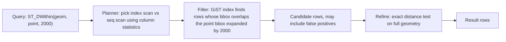
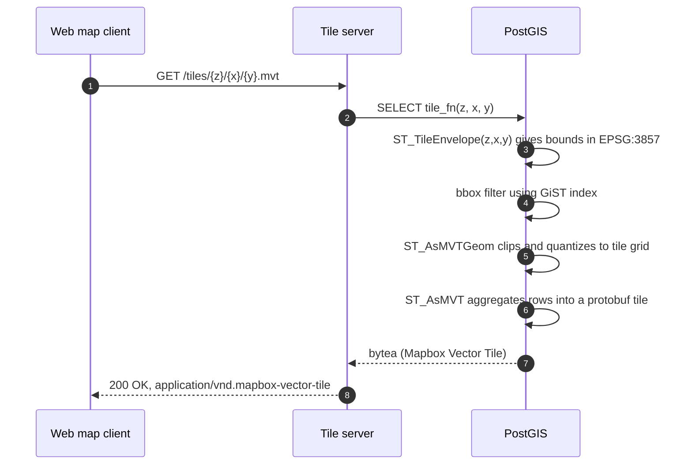
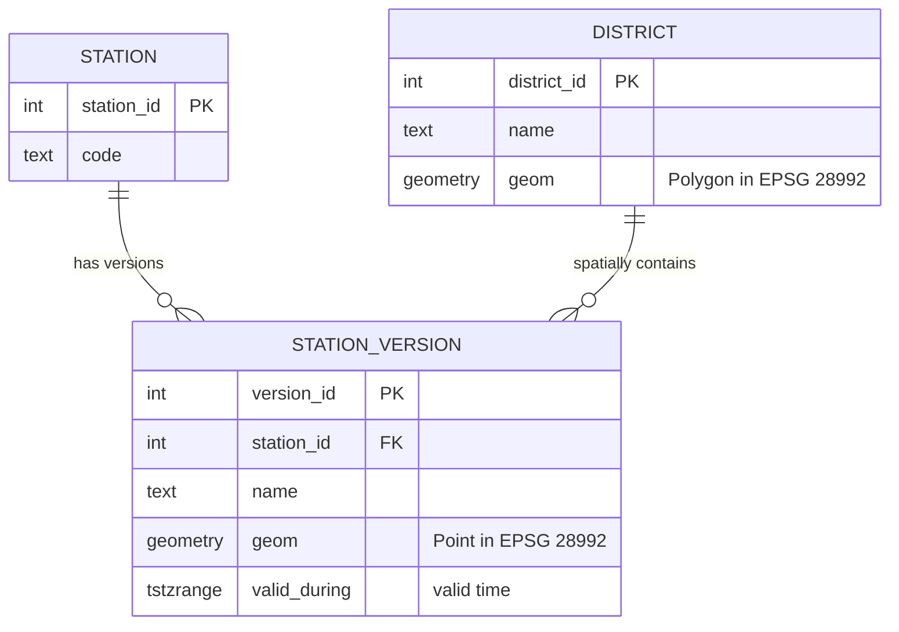
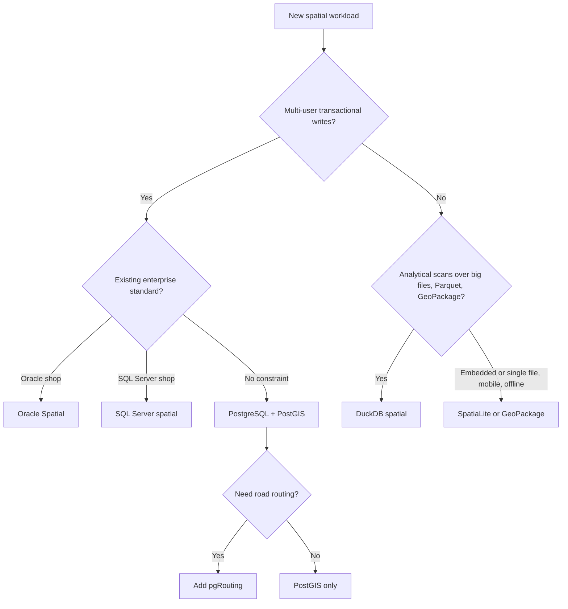

# Phase 4 — Spatial Databases: PostGIS, Spatial SQL, pgRouting, Alternatives, and Data Modeling

> **Study note · GIS Development · Level: developer new to spatial databases, comfortable with SQL basics**
> **Version assumptions:** PostgreSQL 14–17, PostGIS 3.3+, GEOS 3.11+, pgRouting 3.x/4.x, DuckDB `spatial` extension 1.x. Function availability and output column names change between versions; when a section says *verify*, check the documentation for the version you installed.
> **Conventions:** `EPSG:4326` = WGS 84 longitude/latitude in degrees (axis order used by PostGIS: **x = longitude, y = latitude**). `EPSG:28992` = Amersfoort / RD New (metres; used for the synthetic examples). `EPSG:3857` = Web Mercator (metres, strongly distorted away from the equator). All example coordinates are **synthetic** unless stated otherwise, and all ASCII drawings are **schematics, not scale-accurate maps**.

---

## 1. Title, Learning Objectives, Prerequisites

### 1.1 Learning objectives

After completing this note you should be able to:

1. Choose between PostGIS `geometry`, `geography`, `raster`, and `topology` models and justify the choice (units, accuracy, function coverage, performance).
2. Create and tune **GiST** (and recognise **SP-GiST / BRIN**) spatial indexes, and explain why `ST_Distance(a,b) < d` cannot use them while `ST_DWithin(a,b,d)` can.
3. Read `EXPLAIN (ANALYZE, BUFFERS)` output for spatial queries and explain the **filter-and-refine** execution model.
4. Write correct spatial SQL for **k-nearest-neighbour (KNN)**, **distance-bounded search**, **clustering**, and **vector-tile generation**.
5. Build a small routable graph, run **pgRouting** shortest-path, many-to-many cost, and service-area queries, and verify the results by hand.
6. Compare PostGIS with **SpatiaLite/GeoPackage**, **DuckDB spatial**, **Oracle Spatial**, and **SQL Server spatial**.
7. Design schemas that handle **versioning**, **valid-time data**, **topology rules**, and **data-quality constraints**.

### 1.2 Prerequisites

| Area | What you need |
|---|---|
| SQL | `SELECT`, joins, aggregates, `CREATE TABLE`, indexes, `EXPLAIN` basics |
| GIS (Phases 1–3) | CRS vs datum, EPSG codes, axis order, OGC Simple Features, geometry validity, GeoJSON/GeoPackage, GDAL/OGR basics |
| Tooling | A PostgreSQL + PostGIS instance (Docker image `postgis/postgis` or a local install), `psql` or any SQL client, optionally QGIS to eyeball results |

### 1.3 Suggested 3–4 week learning path

| Week | Focus | Sections | Checkpoint |
|---|---|---|---|
| 1 | PostGIS foundations: types, SRIDs, `ST_*`, GiST | §2, §4.1–4.3 | Exercise 1 |
| 2 | Query planning and spatial SQL patterns (KNN, `ST_DWithin`, clustering, tiling) | §4.4–4.5, §5 | Exercise 2 |
| 3 | pgRouting and alternative engines | §4.6–4.7 | Exercise 3 |
| 4 | Data modeling, quality, and the capstone | §4.8, §6 | Exercise 4 (applied challenge) |

---

## 2. Conceptual Foundations

### 2.1 What is a spatial database?

A **spatial database** is a database management system that stores geometric/geographic values as first-class types and provides (a) **spatial functions** (distance, intersection, buffering, …), (b) **spatial indexes** that make spatial predicates fast, and (c) usually **metadata** about coordinate reference systems. A plain relational database can store coordinates in two `float` columns, but it cannot index "which rectangles overlap this window" efficiently, and it knows nothing about CRSs.

**PostGIS** is the spatial extension for PostgreSQL. It adds types (`geometry`, `geography`, `raster`, `box2d`, `box3d`, …), several hundred `ST_*` functions, GiST/SP-GiST/BRIN index support, and the `spatial_ref_sys` table that stores CRS definitions.

### 2.2 Key terminology

| Term | Definition |
|---|---|
| **SRID** | Spatial Reference ID stored *inside* each PostGIS geometry; usually an EPSG code. `0` means "unknown". |
| **Simple Features** | OGC/ISO model: `Point`, `LineString`, `Polygon`, `Multi*`, `GeometryCollection`. |
| **WKT / WKB / EWKT / EWKB** | Text/binary encodings of geometries. The "E" variants (PostGIS extensions) embed the SRID, e.g. `SRID=4326;POINT(4.9 52.37)`. |
| **Bounding box (bbox / MBR)** | Smallest axis-aligned rectangle enclosing a geometry. Indexes store bboxes, not full shapes. |
| **Typmod** | Column type modifier: `geometry(Point, 28992)` constrains type, SRID, and (optionally) dimensionality. |
| **GiST** | *Generalized Search Tree*. PostgreSQL's balanced-tree framework; PostGIS uses it to implement an **R-tree-like** index over bboxes. |
| **Filter-and-refine** | Two-phase evaluation: the index quickly returns *candidates* by bbox (filter); exact geometry tests then discard false positives (refine). |
| **KNN** | k-nearest neighbours: return the *k* features closest to a query location. |
| **DE-9IM** | *Dimensionally Extended 9-Intersection Model*: a 3×3 matrix describing how the interior, boundary, and exterior of two geometries intersect. All named predicates (`ST_Contains`, `ST_Touches`, …) are patterns over it. |
| **Topology (graph sense)** | Explicit nodes/edges/faces with shared boundaries stored once; guarantees no gaps/overlaps by construction. |
| **Valid time** | The period during which a fact is true *in the real world* (as opposed to when the database recorded it). |

### 2.3 `geometry` vs `geography`

| Aspect | `geometry` | `geography` |
|---|---|---|
| Model | Planar (Cartesian) | Ellipsoidal (angular coordinates on the WGS 84 spheroid by default) |
| Coordinates | Any CRS (projected or geographic) | Longitude/latitude only (SRID 4326 default) |
| Distance/length units | CRS units (**degrees** if SRID is 4326!) | **Metres** |
| Area units | CRS units² | m² |
| Function coverage | Very large | Smaller subset (e.g. `ST_Distance`, `ST_DWithin`, `ST_Area`, `ST_Length`, `ST_Intersects`, `ST_Buffer`, `ST_Covers`, …) |
| Speed | Faster (planar math) | Slower (spheroidal math) |
| Best for | Local/regional work in a suitable projected CRS; heavy analysis; tiling | Global datasets, "how many metres between two lon/lat points" with minimal CRS thinking |

**Rule of thumb:** for a regional dataset, store `geometry` in a **local projected CRS** (e.g. EPSG:28992 in the Netherlands, a UTM zone elsewhere) and do metric work there. Use `geography` when data is global or you want correct metres without choosing a projection. Avoid doing metric work on `geometry` in EPSG:4326 (the result is in degrees) or in EPSG:3857 (distances inflated by roughly `1/cos(latitude)`; at 52.4° N that is ≈ 1.64×, areas ≈ 2.7×).

Worked comparison (verifiable): two points on the equator, one degree of longitude apart.

```sql
SELECT ST_Distance('SRID=4326;POINT(0 0)'::geometry,
                   'SRID=4326;POINT(1 0)'::geometry);      -- 1            (degrees)

SELECT ST_Distance('SRID=4326;POINT(0 0)'::geography,
                   'SRID=4326;POINT(1 0)'::geography);     -- ≈ 111319.49  (metres)
```

The geography result equals `a · π/180` with the WGS 84 semi-major axis `a = 6 378 137 m`: `6378137 × 0.0174532925 ≈ 111 319.49 m`. (Along a meridian from latitude 0° to 1°, the result is ≈ 110 574 m, because the ellipsoid's radius of curvature differs by direction.)

For reference, the spherical (haversine) formula used by simple spherical functions is

```
d = 2R · asin( sqrt( sin²(Δφ/2) + cos φ₁ · cos φ₂ · sin²(Δλ/2) ) )
```

with φ = latitude, λ = longitude in radians, and `R ≈ 6 371 008.8 m` (mean Earth radius). PostGIS `geography` functions use a spheroidal solution (GeographicLib) by default for `ST_Distance`, so results differ slightly (up to ~0.3%) from a spherical calculation.

### 2.4 Spatial relationships and DE-9IM

The DE-9IM matrix is read row-wise: rows = Interior, Boundary, Exterior of geometry **A**; columns = Interior, Boundary, Exterior of **B**. Each cell holds the dimension of the intersection: `F` (empty), `0` (point), `1` (line), `2` (area). `T` means "any non-empty".

| Predicate | Pattern (`ST_Relate` mask) | Notes |
|---|---|---|
| `ST_Intersects(A,B)` | not disjoint (any of `T********`, `*T*******`, `***T*****`, `****T****`) | True if they share *any* point, boundary included |
| `ST_Contains(A,B)` | `T*****FF*` | No point of B lies in A's exterior **and** B touches A's *interior*. A point **on** A's boundary is *not* contained |
| `ST_Covers(A,B)` | `T*****FF*` or `*T****FF*` or `***T**FF*` or `****T*FF*` | Like contains, but boundary contact is allowed |
| `ST_Within(A,B)` | `T*F**F***` | `ST_Contains` with arguments swapped |
| `ST_Touches(A,B)` | `FT*******`, `F**T*****`, or `F***T****` | Boundaries meet, interiors do not |

Two matrices you will meet in the worked example (A = polygon, B = point):

```
Point strictly inside the polygon      ST_Relate = 0F2FF1FF2
Point exactly on the polygon boundary  ST_Relate = FF20F1FF2
```

The second matrix has `F` in the (Interior, Interior) cell, which is why `ST_Contains` is **false** for a boundary point while `ST_Intersects` and `ST_Covers` are **true**.

### 2.5 Why spatial indexes exist: bbox filtering

Testing every pair of geometries is O(n·m) with expensive exact tests. A spatial index stores each feature's bbox in a tree. A query window is compared against node bboxes, so whole subtrees are skipped. Two bboxes overlap if and only if

```
a.xmin ≤ b.xmax  AND  a.xmax ≥ b.xmin  AND  a.ymin ≤ b.ymax  AND  a.ymax ≥ b.ymin
```

This is exactly what the PostGIS operator `&&` computes. Because bboxes over-approximate shapes, the index can return **false positives** (diagonal lines and L-shaped polygons have large, mostly empty bboxes) — hence the *refine* step.

---

## 3. Visual Explanations

### 3.1 Conceptual overview: the Phase 4 landscape

```mermaid
flowchart TD
    SDB["Spatial database"]
    SDB --> TYPES["Data types"]
    SDB --> INDEX["Indexing and planning"]
    SDB --> SQLP["Spatial SQL patterns"]
    SDB --> NET["Network analysis"]
    SDB --> MODEL["Data modeling"]
    SDB --> ALT["Alternative engines"]

    TYPES --> T1["geometry (planar)"]
    TYPES --> T2["geography (ellipsoidal)"]
    TYPES --> T3["raster, topology"]

    INDEX --> I1["GiST bbox index"]
    INDEX --> I2["Filter and refine"]
    INDEX --> I3["EXPLAIN ANALYZE, ANALYZE stats"]

    SQLP --> S1["KNN with the distance operator"]
    SQLP --> S2["ST_DWithin vs ST_Distance"]
    SQLP --> S3["Clustering: DBSCAN, KMeans, grids"]
    SQLP --> S4["Tiling: ST_TileEnvelope, ST_AsMVT"]

    NET --> N1["pgRouting: Dijkstra, A*, service areas"]
    MODEL --> M1["Valid-time versioning"]
    MODEL --> M2["Topology-aware schemas"]
    MODEL --> M3["Quality constraints"]
    ALT --> A1["SpatiaLite / GeoPackage"]
    ALT --> A2["DuckDB spatial"]
    ALT --> A3["Oracle Spatial / SQL Server"]
```



**How to read it:** the centre node is the capability; each branch is a skill area in this phase. Types determine *what is stored*, indexing/planning determines *how fast it can be queried*, SQL patterns are *how you ask*, and modeling decides *whether the data stays trustworthy over time*.

### 3.2 Workflow: filter-and-refine for a spatial predicate



**Interpretation:** the index never answers "is it within 2000 m"; it answers "could it be". The cost of the refine step grows with vertex count, which is why large polygons are subdivided (§4.4).

### 3.3 Sequence: serving a vector tile from PostGIS



### 3.4 Data model: valid-time versioned features (used in §4.8 and the capstone)



The relationship between `DISTRICT` and `STATION_VERSION` is **derived spatially** (via `ST_Covers`), not by a foreign key — a common spatial-modeling idiom.

### 3.5 Choosing an engine



---
## 4. Technical Deep Dive

### 4.1 PostGIS spatial types and storage

```sql
CREATE EXTENSION IF NOT EXISTS postgis;
SELECT postgis_full_version();           -- confirms PostGIS, GEOS, PROJ versions

-- Typmod constrains geometry type AND SRID
CREATE TABLE poi (
    poi_id  integer PRIMARY KEY,
    name    text NOT NULL,
    geom    geometry(Point, 28992) NOT NULL
);

-- Geography column (lon/lat, metres)
CREATE TABLE poi_geog (
    poi_id integer PRIMARY KEY,
    geog   geography(Point, 4326) NOT NULL
);

-- Constructing values
SELECT ST_SetSRID(ST_MakePoint(120000, 487000), 28992);        -- build a point, tag it with an SRID
SELECT ST_GeomFromText('POINT(120000 487000)', 28992);          -- from WKT
SELECT ST_GeomFromEWKT('SRID=28992;POINT(120000 487000)');      -- from EWKT
SELECT ST_AsText(geom), ST_AsEWKT(geom), ST_SRID(geom) FROM poi;
```

Important distinction: **`ST_SetSRID` only relabels** the coordinates (no math). **`ST_Transform` reprojects** them (requires a correct source SRID).

```sql
-- Wrong: claims lon/lat numbers are RD New metres
SELECT ST_SetSRID(ST_MakePoint(4.9, 52.37), 28992);
-- Right: label as 4326, then reproject
SELECT ST_Transform(ST_SetSRID(ST_MakePoint(4.9, 52.37), 4326), 28992);
```

Useful catalog objects: `spatial_ref_sys` (CRS definitions), views `geometry_columns` / `geography_columns` (registered spatial columns with type, SRID, dimension).

Other types: `raster` (via the `postgis_raster` extension in PostGIS 3+), `topogeometry` (via `postgis_topology`, §4.8), `box2d`/`box3d` (bboxes), and 3D/measured coordinates (`PointZ`, `PointM`, `PointZM`).

### 4.2 GiST and other spatial indexes

```sql
CREATE INDEX poi_geom_gix ON poi USING gist (geom);
ANALYZE poi;                                  -- refresh statistics after bulk loads
```

| Index | Structure | Choose when |
|---|---|---|
| **GiST** (default) | R-tree-like tree of bboxes | General purpose: polygons, lines, points, mixed workloads, KNN ordering |
| **SP-GiST** | Space-partitioning tree (quadtree/k-d) | Mostly points, highly non-overlapping data |
| **BRIN** | Min/max bbox per block range | Huge, **physically ordered** (e.g. by space or time) append-mostly tables; tiny index, coarse pruning |
| **GiST n-D** (`gist_geometry_ops_nd`) | N-dimensional tree | 3D/4D queries using `&&&` |

PostGIS **index-assisted** operators:

| Operator | Meaning |
|---|---|
| `a && b` | bboxes overlap (2D) |
| `a &&& b` | n-D bboxes overlap |
| `a @ b` / `a ~ b` | bbox of a is contained in / contains bbox of b |
| `a <-> b` | distance, usable in `ORDER BY` for KNN |
| `a <#> b` | bbox-to-bbox distance, usable in `ORDER BY` |

Index-aware functions: `ST_Intersects`, `ST_Contains`, `ST_Within`, `ST_Covers`, `ST_CoveredBy`, `ST_Overlaps`, `ST_Touches`, `ST_Crosses`, `ST_Equals`, `ST_DWithin`, `ST_DFullyWithin` (PostGIS 3+ inlines the `&&` test automatically through planner support functions). **Not** index-aware: `ST_Distance(...) < x`, `ST_Area(...) > x`, `ST_Buffer(...)` used inside a predicate on the indexed column, and expressions that wrap the indexed column (e.g. `ST_Transform(geom, 3857)`) unless you build a matching **expression index**.

```sql
-- Expression index: lets queries filtering on the geography cast use an index
CREATE INDEX poi_geom_geog_gix ON poi USING gist ((geom::geography));  -- only valid if geom is in a geodetic SRID

-- Generated column alternative (store a 3857 copy for tiling)
ALTER TABLE poi ADD COLUMN geom_3857 geometry(Point, 3857)
    GENERATED ALWAYS AS (ST_Transform(geom, 3857)) STORED;
CREATE INDEX poi_geom3857_gix ON poi USING gist (geom_3857);
```

Maintenance notes: run `ANALYZE` after bulk loads; `VACUUM` regularly; on PostgreSQL 14+ with PostGIS 3.1+, GiST builds use a faster sorted-build strategy. `CLUSTER poi USING poi_geom_gix;` physically reorders the table by the index (one-time, takes an `ACCESS EXCLUSIVE` lock) to improve locality for window queries.

### 4.3 The `ST_*` function families

| Family | Examples | Notes |
|---|---|---|
| Constructors | `ST_MakePoint`, `ST_MakeEnvelope`, `ST_GeomFromText`, `ST_GeomFromGeoJSON`, `ST_Collect` | `ST_MakeEnvelope(xmin,ymin,xmax,ymax,srid)` builds a rectangle |
| Accessors | `ST_SRID`, `ST_GeometryType`, `ST_NPoints`, `ST_X`, `ST_Y`, `ST_Envelope`, `ST_Dump` | `ST_Dump` explodes multi-geometries into rows |
| Relationships | `ST_Intersects`, `ST_Contains`, `ST_Within`, `ST_Covers`, `ST_Touches`, `ST_Relate`, `ST_DWithin` | Predicates return `boolean`; see §2.4 |
| Measurement | `ST_Distance`, `ST_Length`, `ST_Area`, `ST_Perimeter`, `ST_Azimuth` | Units follow the CRS (geometry) or metres (geography) |
| Processing | `ST_Buffer`, `ST_Union`, `ST_Intersection`, `ST_Difference`, `ST_Simplify`, `ST_Subdivide`, `ST_Centroid`, `ST_PointOnSurface`, `ST_ConvexHull` | `ST_Centroid` of a concave polygon may lie *outside* it; use `ST_PointOnSurface` for a guaranteed interior point |
| Validation/repair | `ST_IsValid`, `ST_IsValidReason`, `ST_MakeValid`, `ST_IsEmpty` | Many functions raise errors or give wrong results on invalid input |
| Reprojection | `ST_Transform`, `ST_SetSRID` | See §4.1 |
| Output | `ST_AsText`, `ST_AsGeoJSON`, `ST_AsMVT`, `ST_AsMVTGeom`, `ST_AsBinary` | |
| Linear referencing | `ST_LineLocatePoint`, `ST_LineInterpolatePoint`, `ST_LineSubstring` | Used to snap points onto network edges (§4.6) |

Annotated predicate example, using the polygon/point pair from the worked example (§5):

```sql
SELECT ST_Contains(d.geom, i.geom) AS contains,     -- false when the point is on the boundary
       ST_Covers(d.geom, i.geom)   AS covers,       -- true
       ST_Intersects(d.geom, i.geom) AS intersects, -- true
       ST_Relate(d.geom, i.geom)   AS de9im         -- FF20F1FF2
FROM district d, incident i
WHERE d.name = 'West' AND i.incident_id = 2;
```

### 4.4 Query planning for spatial queries

**Execution model.** For `WHERE ST_Intersects(geom, :window)` PostgreSQL's planner rewrites the call to `geom && :window AND <exact test>`. The GiST scan evaluates the `&&` (the *Index Cond*), and the exact test is applied to each candidate (the *Filter* / *Recheck*).

**Reading a plan.** (Illustrative output — your costs and timings will differ; on tiny tables the planner correctly prefers a sequential scan. For learning only, `SET enable_seqscan = off;` forces index use in the current session.)

```text
EXPLAIN (ANALYZE, BUFFERS)
SELECT * FROM incident WHERE ST_DWithin(geom, ST_SetSRID(ST_MakePoint(120000,487000),28992), 2000);

 Index Scan using incident_geom_gix on incident  (cost=0.14..8.16 rows=1 width=...) (actual time=0.03..0.04 rows=2 loops=1)
   Index Cond: (geom && '0102...'::geometry)            <-- filter: bbox expanded by 2000
   Filter: st_dwithin(geom, '0101...'::geometry, 2000)  <-- refine: exact distance
   Rows Removed by Filter: 0
   Buffers: shared hit=3
```

What to look for:

| Signal | Meaning | Typical action |
|---|---|---|
| `Seq Scan` on a large table with a spatial predicate | Index missing, not usable (wrapped column, `ST_Distance < x`), SRIDs differ, or stale statistics | Add/rewrite index; run `ANALYZE` |
| Large `Rows Removed by Filter` | Bboxes are poor approximations (long diagonal lines, large polygons) | `ST_Subdivide`, split features, simplify |
| Huge `Buffers: read` for few rows | Poor physical locality or toasted large geometries | `CLUSTER`, subdivide, tune memory |
| Nested loop with inner `Index Scan` | Standard spatial-join plan (outer = smaller table) | Ensure the inner table has a GiST index |
| Estimates far from actual rows | Stale or insufficient statistics | `ANALYZE`; raise `default_statistics_target` for the column |

**Statistics.** `ANALYZE` builds a 2D (and n-D) histogram of feature bboxes. The planner uses it to estimate how many rows a window will touch and therefore whether an index scan beats a sequential scan.

**Large geometries.** A single country polygon with millions of vertices makes every refine test expensive and is **TOASTed** (stored out-of-line and de-toasted on every access). `ST_Subdivide` splits geometries into pieces with at most N vertices (minimum 5), so each piece gets a tight bbox:

```sql
CREATE TABLE region_sub AS
SELECT region_id, ST_Subdivide(geom, 255) AS geom
FROM region;
CREATE INDEX region_sub_gix ON region_sub USING gist (geom);
```

Query against the pieces and de-duplicate by `region_id`: `SELECT DISTINCT region_id FROM region_sub WHERE ST_Intersects(geom, :pt);`.

**Other tuning levers:** `random_page_cost` (≈1.1 on SSDs), `work_mem` for sorts/hash joins, `max_parallel_workers_per_gather` (PostGIS functions are marked `PARALLEL SAFE`), declarative partitioning for very large tables (one GiST index per partition).

### 4.5 Spatial SQL patterns

#### 4.5.1 Nearest neighbour (KNN)

The `<->` operator in `ORDER BY ... LIMIT k` lets the GiST index return rows in increasing distance order without scanning the whole table.

```sql
-- The 3 stations nearest to a location (single query point)
SELECT station_id, name,
       ST_Distance(geom, ST_SetSRID(ST_MakePoint(121000, 488000), 28992)) AS dist_m
FROM fire_station
ORDER BY geom <-> ST_SetSRID(ST_MakePoint(121000, 488000), 28992)
LIMIT 3;

-- Nearest station for EVERY incident: LATERAL gives one KNN probe per outer row
SELECT i.incident_id, s.name, ST_Distance(i.geom, s.geom) AS dist_m
FROM incident i
CROSS JOIN LATERAL (
    SELECT name, geom
    FROM fire_station
    ORDER BY geom <-> i.geom
    LIMIT 1
) s;
```

Behaviour and caveats:

* For `geometry`, `<->` returns the true 2D planar distance between geometries (PostgreSQL 9.5+ / PostGIS 2.2+); for `geography` it is a spherical distance in metres (very slightly different from the spheroidal `ST_Distance`). `<#>` is bbox-to-bbox distance only.
* The index ordering is only used when one side of `<->` is a **constant or an outer-row value** and the expression appears in `ORDER BY`.
* A selective `WHERE` on another column is applied *after* index ordering and may force the index to walk many rows. For "nearest 5 *open* stations", consider a partial index (`WHERE status = 'open'`) or bound the search with `ST_DWithin` first.
* Compute KNN on `geometry` in a **projected CRS** if you need metric correctness; `geometry` in EPSG:4326 ranks neighbours by *degrees*, which skews east–west vs north–south at high latitude.
* Ties: equal distances have undefined relative order. Add a deterministic tiebreaker (`ORDER BY geom <-> p, station_id`) only if you can accept losing pure index ordering for ties.

#### 4.5.2 `ST_DWithin` vs `ST_Distance`

```sql
-- BAD: computes distance for every row; cannot use the index
SELECT * FROM incident
WHERE ST_Distance(geom, :p) < 2000;

-- GOOD: bbox expanded by 2000 uses the index, then exact distance recheck
SELECT * FROM incident
WHERE ST_DWithin(geom, :p, 2000);
```

* `ST_DWithin(a, b, d)` is true when `distance(a,b) <= d` (**inclusive**).
* Units: the CRS units for `geometry`; **metres** for `geography`. With `geometry` in EPSG:4326, `ST_DWithin(a, b, 1000)` means 1000 *degrees* — a classic bug.
* Use `ST_Distance` for *reporting* a distance, `ST_DWithin` for *filtering*, `<->` for *ordering*.

#### 4.5.3 Clustering

| Need | Tool | Notes |
|---|---|---|
| Density-based clusters, noise detection | `ST_ClusterDBSCAN(geom, eps, minpoints) OVER ()` | `eps` in CRS units; returns `NULL` for noise points |
| Fixed number of clusters | `ST_ClusterKMeans(geom, k) OVER ()` | Centroid-based; sensitive to initial conditions and outliers |
| Connected groups | `ST_ClusterIntersecting(geom)`, `ST_ClusterWithin(geom, d)` (aggregates) | Return arrays of geometries |
| Aggregation to a grid for maps | `ST_SquareGrid`, `ST_HexagonGrid` (PostGIS 3.1+), `ST_SnapToGrid` | Fast "heat-map" style counts |
| Physical table ordering | `CLUSTER table USING gist_index` | Different meaning: storage layout, not analysis |

```sql
SELECT incident_id,
       ST_ClusterDBSCAN(geom, eps := 2000, minpoints := 2) OVER () AS cluster_id
FROM incident;

-- Hexagon-binned counts (cell size = 1000 CRS units)
SELECT h.i, h.j, h.geom, count(*) AS n
FROM ST_HexagonGrid(1000, (SELECT ST_Extent(geom) FROM incident)) AS h
JOIN incident i ON ST_Intersects(h.geom, i.geom)
GROUP BY h.i, h.j, h.geom;
```

(Note: `ST_Extent` returns a `box2d`; cast with `::geometry` if your version of the grid function requires a geometry argument.)

#### 4.5.4 Tiling queries (vector tiles)

Web map tiles use the XYZ scheme in EPSG:3857: at zoom `z` the world is divided into `2^z × 2^z` tiles, `y = 0` is the northern row, and the Web Mercator extent is ±20 037 508.342789244 m on each axis. Tile edge length is `40 075 016.68557849 / 2^z` metres (in projected units).

Lon/lat to tile indices (verify with a calculator or in code):

```
n = 2^z
x = floor( (lon + 180) / 360 · n )
y = floor( (1 − asinh(tan(lat)) / π) / 2 · n )        (lat in radians)
```

PostGIS functions:

| Function | Role |
|---|---|
| `ST_TileEnvelope(z, x, y)` | Tile bounds as an EPSG:3857 polygon (PostGIS 3.0+) |
| `ST_AsMVTGeom(geom, bounds, extent, buffer, clip)` | Transforms geometry to tile-local integer coordinates (default extent 4096) and clips |
| `ST_AsMVT(row, layer_name, extent, geom_column)` | Aggregates rows into one protobuf tile (`bytea`) |

Expected values you can check: `ST_TileEnvelope(0,0,0)` spans `(-20037508.34, -20037508.34)` to `(20037508.34, 20037508.34)`; `ST_TileEnvelope(1,1,0)` (east-north quadrant) spans `(0, 0)` to `(20037508.34, 20037508.34)`.

```sql
CREATE OR REPLACE FUNCTION incident_mvt(z integer, x integer, y integer)
RETURNS bytea
LANGUAGE sql STABLE PARALLEL SAFE AS $$
    WITH bounds AS (
        SELECT ST_TileEnvelope(z, x, y) AS b3857
    ),
    mvtgeom AS (
        SELECT i.incident_id,
               ST_AsMVTGeom(ST_Transform(i.geom, 3857), b.b3857, 4096, 64, true) AS geom
        FROM incident i, bounds b
        -- Transform the TILE (cheap) into the data CRS so the GiST index on i.geom is used
        WHERE i.geom && ST_Transform(b.b3857, 28992)
    )
    SELECT ST_AsMVT(mvtgeom.*, 'incidents', 4096, 'geom') FROM mvtgeom;
$$;
```

Tile servers such as `pg_tileserv` and Martin expose functions like this over HTTP. Strategy for production: precompute simplified/aggregated layers for low zooms, apply `ST_Simplify`/`ST_RemoveRepeatedPoints` or attribute filters, and cap features per tile.

### 4.6 pgRouting for network analysis

**pgRouting** extends PostGIS with graph algorithms. A routable network is a table of **edges** (road segments) between **vertices** (nodes), each edge having a `cost` and optionally a `reverse_cost`.

| Concept | Meaning |
|---|---|
| Edge query | SQL string returning `id, source, target, cost, reverse_cost` (plus `x1,y1,x2,y2` for A\*) |
| `directed` | If true, `cost` applies source→target and `reverse_cost` target→source; a negative value (by convention −1) means the edge cannot be traversed in that direction. If false, the graph is undirected |
| Cost | Any additive non-negative quantity: length in metres, travel time in seconds, a weighted blend |

Common functions (verify exact signatures and output columns in your version; they differ between 3.x and 4.x):

| Function | Purpose |
|---|---|
| `pgr_dijkstra` | Shortest path(s), one-to-one / one-to-many / many-to-many |
| `pgr_dijkstraCost` | Only the aggregate costs, no path geometry |
| `pgr_aStar` | Heuristic search; needs coordinates; faster on large networks |
| `pgr_KSP` | K shortest alternative paths |
| `pgr_drivingDistance` | **Service area / isochrone** nodes reachable within a cost budget |
| `pgr_connectedComponents` | Detect disconnected sub-networks (data-quality check) |
| `pgr_contraction` | Contraction hierarchies preprocessing for large graphs |

Dijkstra's algorithm maintains the best known cost `d(v)` to each vertex and repeatedly settles the unsettled vertex with the smallest `d`, relaxing `d(w) = min(d(w), d(v) + cost(v,w))`. Complexity with a binary heap is `O((V + E) log V)`.

**Toy graph (abstract costs, not a map).** Edge costs are in arbitrary units and every edge is two-way (`cost = reverse_cost`). Adjacency list (`neighbour(cost)`), followed by the authoritative edge table:

```text
1: 2(4)  3(2)
2: 1(4)  3(1)  4(5)
3: 1(2)  2(1)  4(8)  5(10)
4: 2(5)  3(8)  5(2)  6(6)
5: 3(10) 4(2)  6(3)
6: 4(6)  5(3)
```

| edge id | source | target | cost | reverse_cost |
|---|---|---|---|---|
| 1 | 1 | 2 | 4 | 4 |
| 2 | 1 | 3 | 2 | 2 |
| 3 | 2 | 3 | 1 | 1 |
| 4 | 2 | 4 | 5 | 5 |
| 5 | 3 | 4 | 8 | 8 |
| 6 | 3 | 5 | 10 | 10 |
| 7 | 4 | 5 | 2 | 2 |
| 8 | 4 | 6 | 6 | 6 |
| 9 | 5 | 6 | 3 | 3 |

```sql
CREATE EXTENSION IF NOT EXISTS pgrouting CASCADE;     -- pulls in postgis if absent

CREATE TABLE toy_edge (
    id int PRIMARY KEY, source int, target int,
    cost float8, reverse_cost float8
);
INSERT INTO toy_edge VALUES
 (1,1,2,4,4),(2,1,3,2,2),(3,2,3,1,1),(4,2,4,5,5),(5,3,4,8,8),
 (6,3,5,10,10),(7,4,5,2,2),(8,4,6,6,6),(9,5,6,3,3);

-- Shortest path from vertex 1 to vertex 6
SELECT * FROM pgr_dijkstra(
  'SELECT id, source, target, cost, reverse_cost FROM toy_edge', 1, 6, true);
```

**Expected result (verify by hand).** The cheapest route is `1 → 3 → 2 → 4 → 5 → 6` using edges 2, 3, 4, 7, 9 with total cost **13**. Note that the greedy first hop `1 → 3` (cost 2) leads to `2` at cost 3, which beats the direct edge `1 → 2` (cost 4).

| path_seq | node | edge | cost | agg_cost |
|---|---|---|---|---|
| 1 | 1 | 2 | 2 | 0 |
| 2 | 3 | 3 | 1 | 2 |
| 3 | 2 | 4 | 5 | 3 |
| 4 | 4 | 7 | 2 | 8 |
| 5 | 5 | 9 | 3 | 10 |
| 6 | 6 | −1 | 0 | 13 |

(Your version may add columns such as `seq`, `start_vid`, `end_vid`.)

Many-to-many costs and a service area:

```sql
SELECT start_vid, end_vid, agg_cost
FROM pgr_dijkstraCost(
  'SELECT id, source, target, cost, reverse_cost FROM toy_edge',
  ARRAY[1,6], ARRAY[3,4,5], true)
ORDER BY start_vid, end_vid;
-- (1,3,2) (1,4,8) (1,5,10) (6,3,11) (6,4,5) (6,5,3)

SELECT node, agg_cost
FROM pgr_drivingDistance(
  'SELECT id, source, target, cost, reverse_cost FROM toy_edge', 1, 8, true)
ORDER BY agg_cost, node;
-- nodes 1 (0), 3 (2), 2 (3), 4 (8)    -- node 5 costs 10, outside the budget of 8
```

**From roads to a graph (real data).** Typical pipeline: import road lines (OSM via `osm2pgrouting`, or your authority data via `ogr2ogr`/`COPY`) → **node** the lines at intersections (e.g. `ST_Node` over a collected set of lines, or the tool's own noding) → assign integer `source`/`target` vertex ids (modern pgRouting favours building a vertices table with `pgr_extractVertices`; the older `pgr_createTopology` is deprecated and removed in recent major versions) → compute `cost = ST_Length(geom)` in metres (projected CRS or `geom::geography`) or travel time → encode one-way streets with `reverse_cost = -1` → run `pgr_connectedComponents` to find isolated pieces. To route between arbitrary coordinates, **snap** each point to its nearest edge/vertex using the KNN pattern (`ORDER BY geom <-> point LIMIT 1`) and, for mid-edge snapping, `ST_LineLocatePoint`.

### 4.7 Alternatives to PostGIS

| Engine | Spatial types & index | Strengths | Limitations / cautions |
|---|---|---|---|
| **SpatiaLite** (SQLite extension; related: **GeoPackage**, an OGC SQLite container) | Geometry blobs; R\*Tree virtual-table index created with `CreateSpatialIndex` (GeoPackage uses `rtree_<table>_<geom>` tables) | Single file, zero admin, embedded/mobile/offline, GDAL-friendly | Single-writer concurrency model; smaller function set; no geography type; index must be queried explicitly in SpatiaLite |
| **DuckDB + `spatial`** | `GEOMETRY` type (planar), `ST_*` functions, R-tree indexes (check your version's supported query shapes), `ST_Read` for GDAL formats, GeoParquet interchange | Columnar, vectorised analytics over large files/Parquet; excellent for ETL and one-off analysis | Not a multi-user transactional server; no `geography` type (some sphere/spheroid helper functions exist); fewer planning/index features than PostGIS |
| **Oracle Spatial** | `SDO_GEOMETRY`; metadata in `USER_SDO_GEOM_METADATA`; `MDSYS.SPATIAL_INDEX_V2` (R-tree); operators `SDO_RELATE`, `SDO_WITHIN_DISTANCE`, `SDO_NN` | Enterprise integration, geodetic and projected support, network and topology data models | Licensing/edition dependent; different SQL idioms; metadata must be registered before indexing |
| **SQL Server spatial** | `geometry` and `geography`; **grid-tessellation** spatial index (not an R-tree); methods like `STIntersects`, `STDistance`, `STBuffer` | Tight Microsoft stack integration, ellipsoidal `geography` | Fewer analytical functions; index requires a `BOUNDING_BOX` for `geometry`; method-call syntax |

Illustrative equivalents of "stations within 2000 m of (120000, 487000)":

```sql
-- PostGIS
SELECT station_id FROM fire_station
WHERE ST_DWithin(geom, ST_SetSRID(ST_MakePoint(120000,487000),28992), 2000);

-- SpatiaLite (index probed explicitly through the SpatialIndex virtual table)
SELECT s.name FROM station s
WHERE s.ROWID IN (SELECT ROWID FROM SpatialIndex
                  WHERE f_table_name = 'station'
                    AND search_frame = BuildMbr(118000,485000,122000,489000, 28992))
  AND ST_Distance(s.geom, MakePoint(120000,487000,28992)) <= 2000;

-- DuckDB spatial (INSTALL spatial; LOAD spatial;)
SELECT id FROM station
WHERE ST_DWithin(geom, ST_Point(120000, 487000), 2000);

-- Oracle Spatial (index and metadata required; bounds below are illustrative)
SELECT id FROM station s
WHERE SDO_WITHIN_DISTANCE(s.geom,
        SDO_GEOMETRY(2001, 28992, SDO_POINT_TYPE(120000,487000,NULL), NULL, NULL),
        'distance=2000 unit=METER') = 'TRUE';

-- SQL Server
SELECT id FROM dbo.station
WHERE geom.STDistance(geometry::Point(120000, 487000, 28992)) <= 2000;
```

Tip: the *concepts* (bbox index, filter-and-refine, SRID discipline, validity) transfer across engines; only syntax and operational details change.

### 4.8 Data modeling

#### 4.8.1 Schema design basics

* **One geometry type and one SRID per column** (typmod enforces it). Store in a single authoritative CRS; derive other CRSs with generated columns, views, or on-the-fly `ST_Transform`.
* **Separate layers by geometry type** instead of mixing points and polygons in one column.
* Use **surrogate integer keys** plus a stable **business key** (e.g. `station_code`).
* Partition very large tables (by region, tile, or time) and index each partition.
* Keep derived data (simplified geometries, tile layers) in **materialized views** with a refresh policy.

#### 4.8.2 Data-quality constraints

```sql
CREATE TABLE district (
    district_id integer PRIMARY KEY,
    name        text NOT NULL UNIQUE,
    geom        geometry(Polygon, 28992) NOT NULL,           -- type + SRID enforced
    CONSTRAINT district_valid CHECK (ST_IsValid(geom)),     -- no self-intersections etc.
    CONSTRAINT district_nonempty CHECK (NOT ST_IsEmpty(geom)),
    CONSTRAINT district_area CHECK (ST_Area(geom) BETWEEN 1 AND 1e10),    -- sanity bounds in m²
    CONSTRAINT district_extent CHECK (geom && ST_MakeEnvelope(0, 289000, 300000, 629000, 28992)) -- illustrative national extent
);
```

Other tools: `ST_MakeValid` in an ingestion step (not inside a `CHECK`, which should reject rather than repair silently); `ST_SnapToGrid`/`ST_ReducePrecision` to fix near-duplicate vertices; `ST_NDims` to enforce 2D; point-uniqueness via `EXCLUDE USING gist (geom WITH &&)` (for points, bbox overlap means identical location). Audit existing data with queries rather than constraints when rules are expensive or need tolerance:

```sql
SELECT district_id, ST_IsValidReason(geom) FROM district WHERE NOT ST_IsValid(geom);
```

#### 4.8.3 Versioning and temporal data

Three different ideas are often conflated:

| Concept | Question answered | Typical implementation |
|---|---|---|
| **Valid time** | "When was this true in the real world?" | `tstzrange` column on each version row |
| **Transaction (system) time** | "When did the database know it?" | History table + trigger, or extension-based system versioning |
| **Bitemporal** | Both | Two range columns; more complex queries |

A robust valid-time pattern in PostgreSQL uses a **range column plus an exclusion constraint** so the database itself forbids two overlapping versions of the same feature:

```sql
CREATE EXTENSION IF NOT EXISTS btree_gist;     -- allows "=" on scalar columns inside a GiST index

CREATE TABLE station_version (
    version_id   bigint GENERATED ALWAYS AS IDENTITY PRIMARY KEY,
    station_id   integer NOT NULL,
    name         text NOT NULL,
    geom         geometry(Point, 28992) NOT NULL,
    valid_during tstzrange NOT NULL,
    CONSTRAINT no_overlapping_versions
        EXCLUDE USING gist (station_id WITH =, valid_during WITH &&)
);
CREATE INDEX station_version_geom_gix ON station_version USING gist (geom);

-- As-of query: what existed at a given instant?
SELECT * FROM station_version WHERE valid_during @> timestamptz '2026-06-01 00:00+00';
```

Range conventions: use half-open ranges `[start, end)` so that consecutive versions touch without overlapping; `NULL` as the upper bound means "still current". Always store timestamps as `timestamptz`.

#### 4.8.4 Topology-aware schemas

"Topology-aware" can mean two things:

1. **Topological data model** (`postgis_topology` extension): nodes, edges, and faces stored once, features reference them as `TopoGeometry` values. Shared boundaries cannot drift apart because there is only one copy. Typical API: `CreateTopology`, `AddTopoGeometryColumn`, `ST_CreateTopoGeo`, `ValidateTopology`. Powerful but heavier to load, query, and maintain.
2. **Simple features + enforced topological rules** (more common): keep ordinary polygons and verify rules with queries/triggers — *no overlaps*, *no gaps*, *must be covered by*, *lines must end at nodes*. PostGIS also provides coverage functions (e.g. `ST_CoverageUnion`, `ST_CoverageInvalidEdges`, `ST_CoverageSimplify`, available in recent PostGIS/GEOS versions — verify).

Overlap check for a polygon layer (parcels, districts):

```sql
SELECT a.district_id AS a_id, b.district_id AS b_id,
       ST_Area(ST_Intersection(a.geom, b.geom)) AS overlap_m2
FROM district a
JOIN district b
  ON a.district_id < b.district_id            -- each pair once
 AND ST_Intersects(a.geom, b.geom)             -- index-assisted
WHERE ST_Area(ST_Intersection(a.geom, b.geom)) > 0.01;   -- ignore boundary-only contact
```

Gap check (holes in the dissolved coverage): `SELECT ST_NumInteriorRings(g) FROM (SELECT (ST_Dump(ST_Union(geom))).geom AS g FROM district) t;` — any interior ring in the union is a gap (or an intentional enclave).

Because `ST_Contains`/`ST_Overlaps` are functions, not operators, they cannot appear in an `EXCLUDE` constraint; enforce "no overlapping polygons" with a `BEFORE INSERT OR UPDATE` trigger or by periodic audit queries.

---
## 5. Worked GIS Example — Emergency Response Analysis

**Scenario.** A city fire service wants to (1) find the nearest station for each incident, (2) count incidents within a 2 km response radius of each station, (3) report incidents per district, (4) detect incident hot spots, and (5) serve incidents as vector tiles. The data below is **synthetic**: coordinates are plain numbers in **EPSG:28992 (metres)**, chosen so every result can be computed by hand with Pythagoras. They are not real locations.

### 5.1 Schematic layout (not to scale)

```text
 y=491000 +-------------------------+-------------------------+
          |                         |                         |
 y=490000 |  S3                     |                         |
          |                         |                         |
 y=489000 |              I3         |                         |
          |                         |                         |
 y=487300 |   I1                    |                         |
 y=487000 |  S1                     I2           S2           |
          |       District West     |      District East      |
 y=486000 +-------------------------+-------------------------+
       x=119000                  x=122000                  x=125000

 S = fire station   I = incident   | at x=122000 is the shared district boundary
 Exact coordinates are in the table below.
```

| Feature | x (m) | y (m) | Notes |
|---|---|---|---|
| S1 | 120000 | 487000 | inside West |
| S2 | 123000 | 487000 | inside East |
| S3 | 120000 | 490000 | inside West |
| I1 | 120400 | 487300 | |
| I2 | 122000 | 487000 | **exactly on the West/East boundary** |
| I3 | 121400 | 489000 | |
| District West | 119000–122000 | 486000–491000 | 3000 m × 5000 m = 15 km² |
| District East | 122000–125000 | 486000–491000 | 15 km² |

### 5.2 Step 1 — Schema, data, indexes

```sql
CREATE EXTENSION IF NOT EXISTS postgis;

CREATE TABLE fire_station (
    station_id integer PRIMARY KEY,
    name       text NOT NULL,
    geom       geometry(Point, 28992) NOT NULL
);
CREATE TABLE incident (
    incident_id integer PRIMARY KEY,
    geom        geometry(Point, 28992) NOT NULL
);
CREATE TABLE district (
    district_id integer PRIMARY KEY,
    name        text NOT NULL UNIQUE,
    geom        geometry(Polygon, 28992) NOT NULL,
    CONSTRAINT district_valid CHECK (ST_IsValid(geom))
);

INSERT INTO fire_station VALUES
 (1,'S1',ST_SetSRID(ST_MakePoint(120000,487000),28992)),
 (2,'S2',ST_SetSRID(ST_MakePoint(123000,487000),28992)),
 (3,'S3',ST_SetSRID(ST_MakePoint(120000,490000),28992));

INSERT INTO incident VALUES
 (1,ST_SetSRID(ST_MakePoint(120400,487300),28992)),
 (2,ST_SetSRID(ST_MakePoint(122000,487000),28992)),
 (3,ST_SetSRID(ST_MakePoint(121400,489000),28992));

INSERT INTO district VALUES
 (1,'West',ST_MakeEnvelope(119000,486000,122000,491000,28992)),
 (2,'East',ST_MakeEnvelope(122000,486000,125000,491000,28992));

CREATE INDEX fire_station_geom_gix ON fire_station USING gist (geom);
CREATE INDEX incident_geom_gix     ON incident     USING gist (geom);
CREATE INDEX district_geom_gix     ON district     USING gist (geom);
ANALYZE;
```

### 5.3 Step 2 — Validate the load

```sql
SELECT f_table_name, f_geometry_column, srid, type
FROM geometry_columns
WHERE f_table_name IN ('fire_station','incident','district')
ORDER BY f_table_name;
-- district|geom|28992|POLYGON ; fire_station|geom|28992|POINT ; incident|geom|28992|POINT

SELECT name, ST_Area(geom) FROM district ORDER BY name;
-- East|15000000 ; West|15000000
```

### 5.4 Step 3 — Nearest station per incident (KNN)

```sql
SELECT i.incident_id, s.name,
       round(ST_Distance(i.geom, s.geom)::numeric, 2) AS dist_m
FROM incident i
CROSS JOIN LATERAL (
    SELECT name, geom FROM fire_station ORDER BY geom <-> i.geom LIMIT 1
) s
ORDER BY i.incident_id;
```

**Expected result and hand check**

| incident_id | name | dist_m | Hand calculation |
|---|---|---|---|
| 1 | S1 | 500.00 | √(400² + 300²) = 500 |
| 2 | S2 | 1000.00 | S2 is 1000 m east; S1 is 2000 m west |
| 3 | S3 | 1720.47 | √(1400² + 1000²) = √2 960 000 ≈ 1720.47 (S1: ≈ 2441.31, S2: ≈ 2561.25) |

### 5.5 Step 4 — Response radius with `ST_DWithin` (inclusive)

```sql
SELECT s.name, count(i.incident_id) AS incidents_within_2km
FROM fire_station s
LEFT JOIN incident i ON ST_DWithin(s.geom, i.geom, 2000)
GROUP BY s.name
ORDER BY s.name;
```

**Expected:** `S1 | 2`, `S2 | 1`, `S3 | 1`.

Hand check: S1–I1 = 500 ✔, S1–I2 = **exactly 2000** ✔ (inclusive), S1–I3 ≈ 2441.31 ✘. S2–I2 = 1000 ✔, S2–I1 ≈ 2617.25 ✘, S2–I3 ≈ 2561.25 ✘. S3–I3 ≈ 1720.47 ✔, S3–I1 ≈ 2729.47 ✘, S3–I2 ≈ 3605.55 ✘.

### 5.6 Step 5 — Incidents per district: boundary behaviour

```sql
-- Any contact counts
SELECT d.name, count(i.incident_id) AS n_intersects
FROM district d LEFT JOIN incident i ON ST_Intersects(d.geom, i.geom)
GROUP BY d.name ORDER BY d.name;
-- East|1 ; West|3        (I2 lies on the shared boundary, so it intersects BOTH)

-- Strictly interior only
SELECT d.name, count(i.incident_id) AS n_contains
FROM district d LEFT JOIN incident i ON ST_Contains(d.geom, i.geom)
GROUP BY d.name ORDER BY d.name;
-- East|0 ; West|2        (I2 is in neither interior)

SELECT d.name, ST_Relate(d.geom, i.geom)
FROM district d, incident i WHERE i.incident_id = 2 ORDER BY d.name;
-- East|FF20F1FF2 ; West|FF20F1FF2
```

Lesson: the sum of `ST_Intersects` counts is 4 but there are only 3 incidents (double counting), while `ST_Contains` counts sum to 2 (one incident lost). Assigning each point to exactly one polygon requires a deterministic tiebreak rule, for example `DISTINCT ON (incident_id) ... ORDER BY incident_id, district_id`.

### 5.7 Step 6 — Hot spots with DBSCAN

```sql
SELECT incident_id,
       ST_ClusterDBSCAN(geom, eps := 2000, minpoints := 2) OVER () AS cluster_id
FROM incident ORDER BY incident_id;
```

Pairwise distances: I1–I2 ≈ 1627.88, I1–I3 ≈ 1972.31, I2–I3 ≈ 2088.06. With `eps = 2000`, I1 is within reach of both others, so all three form **one cluster** (`cluster_id = 0` for all rows) even though I2–I3 alone exceed `eps` (density-reachability is transitive through I1). With `eps = 1000` no pair qualifies and every `cluster_id` is `NULL` (noise).

### 5.8 Step 7 — Check the plan

```sql
SET enable_seqscan = off;      -- learning only: tables are tiny
EXPLAIN SELECT * FROM incident WHERE ST_DWithin(geom, ST_SetSRID(ST_MakePoint(120000,487000),28992), 2000);
RESET enable_seqscan;
```

You should see `Index Scan using incident_geom_gix` with an `Index Cond` containing `&&`. Without `enable_seqscan = off`, a sequential scan on 3 rows is the correct planner choice — index benefits appear at thousands of rows and above.

### 5.9 Step 8 — Vector tile

Create `incident_mvt(z,x,y)` from §4.5.4. Because the incidents are regional data in EPSG:28992, request tiles that cover them; transforming the bounds of a very low-zoom (whole-world) tile into a regional CRS can fail or give meaningless bounds, which is why production services usually store tile-served data in EPSG:4326/3857 or restrict minimum zoom.

Locating the tile for a lon/lat (Amsterdam city centre ≈ 4.9° E, 52.37° N) at zoom 10 with the formulas of §4.5.4:

```
n = 2^10 = 1024
x = floor((4.9 + 180) / 360 × 1024) = floor(525.9) = 525
y = floor((1 − asinh(tan(52.37°)) / π) / 2 × 1024) ≈ floor(336.5) = 336
→ tile 10/525/336
```

---

## 6. Common Pitfalls and Best Practices

| # | Pitfall | Symptom | Best practice |
|---|---|---|---|
| 1 | **Axis order confusion** (lat/lon vs lon/lat) | Points land in the wrong hemisphere or at sea | PostGIS is **x = lon, y = lat**. `ST_MakePoint(lon, lat)`. Check GeoJSON (always lon,lat) vs EPSG:4326 definitions in other tools |
| 2 | **`ST_SetSRID` used instead of `ST_Transform`** | Coordinates are labeled correctly but are numerically wrong | `SetSRID` relabels; `Transform` reprojects. Verify with a known point |
| 3 | **SRID mismatch** | Error "Operation on mixed SRID geometries"; or empty results when SRID `0` is mixed in | Enforce typmod SRIDs; transform at the query boundary, not on the indexed column |
| 4 | **Metric operations in EPSG:4326 or EPSG:3857** | Distances in degrees; 3857 distances/areas inflated (≈ 1.64× linear at 52° N) | Use a local projected CRS, or `geography` |
| 5 | **`ST_Distance(...) < d` in `WHERE`** | Sequential scan, slow joins | `ST_DWithin` for filtering; `<->` for ordering |
| 6 | **Wrapping the indexed column** (`ST_Transform(geom, 3857) && x`) | Index not used | Transform the *constant*, or create an expression index / generated column |
| 7 | **Missing `ANALYZE` after bulk load** | Bad plans, wrong row estimates | `ANALYZE` after loads; consider autovacuum tuning |
| 8 | **Invalid geometries** | `TopologyException`, wrong areas, failing `ST_Union` | `CHECK (ST_IsValid(geom))` for clean data; `ST_MakeValid` in the ingestion pipeline; log what was repaired |
| 9 | **Huge polygons** | Slow joins, large `Rows Removed by Filter` | `ST_Subdivide`; keep simplified copies for display |
| 10 | **Boundary semantics** | Points on edges missed or double counted | Choose `ST_Covers` vs `ST_Contains` deliberately; define a tiebreak rule (§5.6) |
| 11 | **Geography limits** | Missing functions, slower queries; antimeridian/pole edge cases | Prefer `geometry` + projected CRS for heavy analysis; cast to `geography` for specific distance/area calls |
| 12 | **KNN with extra filters** | Index walks many rows | Partial indexes, bound with `ST_DWithin`, or restructure the query |
| 13 | **Floating-point equality** | `ST_Equals` fails on "same" points after reprojection | Snap with `ST_SnapToGrid`/`ST_ReducePrecision`, compare with tolerance (`ST_DWithin(a,b,0.001)`) |
| 14 | **Empty / NULL geometries** | `NULL` predicates, empty results | `NOT NULL` + `NOT ST_IsEmpty` constraints where appropriate |
| 15 | **Routing graph quality** | No route found, absurd detours | Check `pgr_connectedComponents`, one-way encoding (`reverse_cost = -1`), non-negative costs, unit consistency |
| 16 | **Temporal overlaps** | Two "current" versions of one feature | Range type + `EXCLUDE USING gist (id WITH =, range WITH &&)` |
| 17 | **Cross-engine assumptions** | Function behaves differently in DuckDB/SQL Server/Oracle | Re-test semantics (e.g. boundary rules, units, validity handling) per engine |

**Validation habits.** (1) Reconcile row counts after every load. (2) Assert `ST_SRID`, `GeometryType`, validity, and extent. (3) Spot-check ten random features in QGIS. (4) Keep a regression suite of small hand-verifiable datasets like §5 and run it after upgrades — GEOS/PROJ upgrades can change edge-case results. (5) Use `EXPLAIN (ANALYZE, BUFFERS)` on every query you intend to ship.

---
## 7. Progressive Exercises

The four exercises build on one another and reuse the synthetic dataset from §5 (EPSG:28992, metres). Work in a scratch database. Do **not** look at §8 until you have attempted each exercise and checked your results against the stated success criteria.

---

### Exercise 1 — Beginner: Foundations, SRIDs, and the geometry/geography difference

**Task.** Build the schema from scratch using only the coordinate table in §5.1 (if you already ran §5, drop the tables first). Then:

1. Create `fire_station`, `incident`, and `district` with typmod geometry columns (type + SRID 28992), a `CHECK (ST_IsValid(geom))` on `district`, and a GiST index on each geometry column. Run `ANALYZE`.
2. Query `geometry_columns` to confirm type and SRID of each table.
3. Prove the typmod works: try to insert a point labeled EPSG:4326 into `incident` and capture the error message.
4. Compute `ST_Distance` between `POINT(0 0)` and `POINT(1 0)` as `geometry` (SRID 4326) **and** as `geography`; explain the unit difference.
5. Use `ST_Relate` to show the DE-9IM string for incident 2 against each district.

**Prerequisites.** PostGIS installed; §2 and §4.1–4.3.

**Sample input.** Coordinates in §5.1.

**Expected deliverable.** One SQL script plus a short text file containing your query outputs for steps 2–5.

**Success criteria.**
* `geometry_columns` shows three rows with SRID 28992 and the correct types (`POINT`, `POINT`, `POLYGON`).
* The wrong-SRID insert is **rejected**.
* The geometry distance is `1` and the geography distance is ≈ `111319.49`.
* Both `ST_Relate` strings equal `FF20F1FF2`.

**Hint.** `ST_MakeEnvelope(xmin, ymin, xmax, ymax, srid)` builds each district polygon.

---

### Exercise 2 — Intermediate: Index-aware spatial SQL

**Task.** Using your Exercise 1 database:

1. A colleague wrote `SELECT … FROM incident i, fire_station s WHERE ST_Distance(i.geom, s.geom) < 2000;`. Rewrite it so the GiST index can be used, and show with `EXPLAIN` (with `enable_seqscan = off`) that an index scan with an `&&` condition appears.
2. For each incident return its **two** nearest stations with rank and distance (KNN with `LATERAL`).
3. Assign each incident to **exactly one** district, using `ST_Covers` and the deterministic rule "if several districts match, choose the smallest `district_id`".
4. Run `ST_ClusterDBSCAN` with `eps = 1000` and then `eps = 2000` (`minpoints = 2`) and explain the difference.

**Prerequisites.** Exercise 1; §4.4–4.5, §5.6.

**Sample input.** Your three tables.

**Expected deliverable.** A SQL script with four labeled queries, the `EXPLAIN` output for query 1, and a two-sentence explanation for query 4.

**Success criteria.**
* Query 1 returns 4 station/incident pairs (S1–I1, S1–I2, S2–I2, S3–I3) and the plan references the GiST index.
* Query 2 returns six rows with the ranks/distances given in §8.2.
* Query 3 returns three rows, each incident assigned once; incident 2 goes to `West`.
* Query 4 returns all `NULL` for `eps = 1000` and all `0` for `eps = 2000`.

**Hint.** For query 3 use `SELECT DISTINCT ON (i.incident_id) …  ORDER BY i.incident_id, d.district_id`.

---

### Exercise 3 — Advanced: Network analysis with pgRouting

**Task.** Extend the analysis from straight-line to **travel-cost** thinking, using the abstract graph from §4.6 (`toy_edge`). Assume this *invented* mapping between the incident data and graph vertices (costs are abstract units, not metres):

| Entity | Graph vertex |
|---|---|
| Station S1 | 1 |
| Station S2 | 6 |
| Incident I1 | 3 |
| Incident I2 | 4 |
| Incident I3 | 5 |

1. Create `toy_edge` and compute, for each incident, the travel cost from each of the two stations with `pgr_dijkstraCost`.
2. For each incident, pick the station with the lowest travel cost (the *network-nearest* station) and compare it with the Euclidean-nearest of {S1, S2} computed from the §5 coordinates. Explain any disagreement.
3. Use `pgr_drivingDistance` from S1's vertex with a budget of 8 to find which incidents lie inside S1's service area.
4. **Stretch:** make edge 9 (between vertices 5 and 6) one-way from 5 to 6 only, recompute the cost from S2's vertex to I3's vertex, and state whether the best station for I3 changes.

**Prerequisites.** Exercises 1–2; §4.6.

**Sample input.** The edge table in §4.6; the mapping above.

**Expected deliverable.** SQL script, a result table for step 1, and a short paragraph for step 2.

**Success criteria.**
* Costs match: I1 (vertex 3): S1 = 2, S2 = 11; I2 (vertex 4): S1 = 8, S2 = 5; I3 (vertex 5): S1 = 10, S2 = 3.
* You identify that I3's network-nearest station (S2) differs from its Euclidean-nearest station among {S1, S2} (S1).
* The service area of S1 (budget 8) covers vertices 1, 3, 2, 4, hence incidents I1 and I2 but not I3.
* Stretch: the S2→I3 cost becomes 8 and S2 remains the best station.

**Hint.** One-way edges are expressed with `reverse_cost = -1`.

---

### Exercise 4 — Applied challenge: A versioned, validated, queryable station registry

**Scenario.** Station S2 is relocated to `(125000, 487000)` effective `2026-01-01 00:00 UTC`. The dispatch analytics team must be able to answer "which station was nearest to each incident **as of** date X?" for any past or present date, and the registry must be protected against bad data.

**Task.** Design and implement, in one SQL script:

1. A `station_version` table (valid-time model from §4.8.3) with typmod geometry, an exclusion constraint preventing overlapping versions per station, a GiST index on the geometry, and data-quality checks (`ST_IsValid`, not empty, inside the extent `(0, 289000)–(300000, 629000)`).
2. Initial data: S1 and S3 current since `2020-01-01`; S2 at `(123000, 487000)` valid `[2020-01-01, 2026-01-01)` and at `(125000, 487000)` valid `[2026-01-01, ∞)`.
3. A function `relocate_station(p_station_id int, p_new_geom geometry, p_effective timestamptz)` that **atomically** closes the current version and inserts the new one, rejecting an effective date that is not after the current version's start.
4. A function `nearest_station_asof(p_point geometry, p_asof timestamptz)` returning station id, name, and distance using KNN on the versions valid at `p_asof`.
5. Evidence of three negative tests: overlapping validity, wrong SRID, and a point outside the extent each fail.
6. A short written note (5–8 lines) explaining why the as-of KNN filter on `valid_during` may become a performance concern at scale and one mitigation.

**Prerequisites.** Exercises 1–3; §4.5.1, §4.8.

**Sample input.** Incidents I1–I3 from §5; as-of dates `2025-06-01` and `2026-06-01`.

**Expected deliverable.** `registry.sql` (schema, data, functions), a results file with the as-of outputs and the three error messages, and the note from step 6.

**Success criteria.**
* As of `2025-06-01`: I1 → S1 (500.00), I2 → S2 (1000.00), I3 → S3 (1720.47).
* As of `2026-06-01`: I1 → S1 (500.00), **I2 → S1 (2000.00)**, I3 → S3 (1720.47).
* Inserting an overlapping version for station 2 fails with an exclusion-constraint violation (SQLSTATE `23P01`); the other two negative tests fail with check/typmod errors.
* `relocate_station` leaves exactly one open-ended version per station and no overlaps even if run twice for the same date (the second call must be rejected).

**Hint.** Close the old version with `valid_during = tstzrange(lower(valid_during), p_effective, '[)')`, then insert `tstzrange(p_effective, NULL, '[)')`. You need `btree_gist` for the exclusion constraint.

---

## 8. Solutions and Explanations

> Attempt the exercises first. Outputs below were derived by hand from the synthetic coordinates and should be reproducible in PostGIS 3.x.

### 8.1 Solution to Exercise 1

```sql
CREATE EXTENSION IF NOT EXISTS postgis;

CREATE TABLE fire_station (station_id integer PRIMARY KEY, name text NOT NULL,
                           geom geometry(Point,28992) NOT NULL);
CREATE TABLE incident     (incident_id integer PRIMARY KEY,
                           geom geometry(Point,28992) NOT NULL);
CREATE TABLE district     (district_id integer PRIMARY KEY, name text NOT NULL UNIQUE,
                           geom geometry(Polygon,28992) NOT NULL,
                           CONSTRAINT district_valid CHECK (ST_IsValid(geom)));

INSERT INTO fire_station VALUES
 (1,'S1',ST_SetSRID(ST_MakePoint(120000,487000),28992)),
 (2,'S2',ST_SetSRID(ST_MakePoint(123000,487000),28992)),
 (3,'S3',ST_SetSRID(ST_MakePoint(120000,490000),28992));
INSERT INTO incident VALUES
 (1,ST_SetSRID(ST_MakePoint(120400,487300),28992)),
 (2,ST_SetSRID(ST_MakePoint(122000,487000),28992)),
 (3,ST_SetSRID(ST_MakePoint(121400,489000),28992));
INSERT INTO district VALUES
 (1,'West',ST_MakeEnvelope(119000,486000,122000,491000,28992)),
 (2,'East',ST_MakeEnvelope(122000,486000,125000,491000,28992));

CREATE INDEX fire_station_geom_gix ON fire_station USING gist (geom);
CREATE INDEX incident_geom_gix     ON incident     USING gist (geom);
CREATE INDEX district_geom_gix     ON district     USING gist (geom);
ANALYZE;

-- 2. Metadata
SELECT f_table_name, srid, type FROM geometry_columns
WHERE f_table_name IN ('fire_station','incident','district') ORDER BY 1;

-- 3. Typmod protection (expected: ERROR  Geometry SRID (4326) does not match column SRID (28992))
INSERT INTO incident VALUES (99, ST_SetSRID(ST_MakePoint(4.9, 52.37), 4326));

-- 4. Units
SELECT ST_Distance('SRID=4326;POINT(0 0)'::geometry,  'SRID=4326;POINT(1 0)'::geometry)  AS deg,
       ST_Distance('SRID=4326;POINT(0 0)'::geography, 'SRID=4326;POINT(1 0)'::geography) AS metres;

-- 5. DE-9IM
SELECT d.name, ST_Relate(d.geom, i.geom)
FROM district d, incident i WHERE i.incident_id = 2 ORDER BY d.name;
```

**Expected output.** Step 2: `district POLYGON 28992`, `fire_station POINT 28992`, `incident POINT 28992`. Step 4: `deg = 1`, `metres ≈ 111319.49`. Step 5: `East | FF20F1FF2`, `West | FF20F1FF2`.

**Why.** The typmod makes the column reject a different SRID instead of silently storing inconsistent data. The `geometry` distance is the planar distance in the CRS unit (degrees for EPSG:4326), whereas `geography` computes on the spheroid and returns metres (`6378137 × π/180 ≈ 111319.49` along the equator). `FF20F1FF2` has `F` in the interior/interior cell, confirming the point is on the boundary and in neither interior.

**How to verify.** Row counts (`3, 3, 2`), `ST_AsText` on each table, and checking in QGIS that points fall where the schematic (§5.1) shows them.

### 8.2 Solution to Exercise 2

```sql
-- 1. Index-friendly rewrite
SET enable_seqscan = off;
EXPLAIN
SELECT s.name, i.incident_id
FROM incident i JOIN fire_station s ON ST_DWithin(i.geom, s.geom, 2000);
-- expect: Nested Loop with Index Scan using ..._geom_gix, Index Cond containing &&
RESET enable_seqscan;

SELECT s.name, i.incident_id
FROM incident i JOIN fire_station s ON ST_DWithin(i.geom, s.geom, 2000)
ORDER BY s.name, i.incident_id;
-- S1|1 ; S1|2 ; S2|2 ; S3|3

-- 2. Two nearest stations per incident, with rank
SELECT i.incident_id,
       row_number() OVER (PARTITION BY i.incident_id ORDER BY ST_Distance(i.geom, s.geom)) AS rnk,
       s.name,
       round(ST_Distance(i.geom, s.geom)::numeric, 2) AS dist_m
FROM incident i
CROSS JOIN LATERAL (
    SELECT name, geom FROM fire_station ORDER BY geom <-> i.geom LIMIT 2
) s
ORDER BY i.incident_id, rnk;

-- 3. One district per incident (deterministic tiebreak)
SELECT DISTINCT ON (i.incident_id) i.incident_id, d.name AS district
FROM incident i
JOIN district d ON ST_Covers(d.geom, i.geom)
ORDER BY i.incident_id, d.district_id;

-- 4. DBSCAN
SELECT incident_id, ST_ClusterDBSCAN(geom, eps := 1000, minpoints := 2) OVER () AS c1000,
                    ST_ClusterDBSCAN(geom, eps := 2000, minpoints := 2) OVER () AS c2000
FROM incident ORDER BY incident_id;
```

**Expected results**

| Query | Result |
|---|---|
| 2 | I1: rank 1 S1 500.00, rank 2 S2 2617.25 · I2: rank 1 S2 1000.00, rank 2 S1 2000.00 · I3: rank 1 S3 1720.47, rank 2 S1 2441.31 |
| 3 | I1 West · I2 West (boundary tie broken by smaller `district_id`) · I3 West |
| 4 | `c1000` = NULL, NULL, NULL; `c2000` = 0, 0, 0 |

**Why.** (1) `ST_DWithin` is expanded to an `&&` index condition plus an exact recheck; `ST_Distance(...) < d` is opaque to the planner. (2) KNN returns the *k* closest rows per outer row; ranks are recomputed from exact distances. (3) A boundary point is covered by both polygons, so an explicit tiebreak makes the assignment deterministic; `ST_Contains` would have assigned it to none. (4) With `eps = 1000` no pair of incidents is that close (closest pair ≈ 1627.88 m), so all are noise; with `eps = 2000` I1 reaches I2 (≈ 1627.88) and I3 (≈ 1972.31), linking all three although I2–I3 (≈ 2088.06) exceeds `eps`.

**How to verify.** Recompute distances with Pythagoras; compare the pair list in query 1 with §5.5.

### 8.3 Solution to Exercise 3

```sql
CREATE EXTENSION IF NOT EXISTS pgrouting CASCADE;
CREATE TABLE toy_edge (id int PRIMARY KEY, source int, target int, cost float8, reverse_cost float8);
INSERT INTO toy_edge VALUES
 (1,1,2,4,4),(2,1,3,2,2),(3,2,3,1,1),(4,2,4,5,5),(5,3,4,8,8),
 (6,3,5,10,10),(7,4,5,2,2),(8,4,6,6,6),(9,5,6,3,3);

-- 1. Costs from stations (vertices 1 and 6) to incident vertices (3, 4, 5)
SELECT start_vid, end_vid, agg_cost
FROM pgr_dijkstraCost('SELECT id, source, target, cost, reverse_cost FROM toy_edge',
                      ARRAY[1,6], ARRAY[3,4,5], true)
ORDER BY end_vid, start_vid;

-- 3. Service area of S1 with budget 8
SELECT node, agg_cost
FROM pgr_drivingDistance('SELECT id, source, target, cost, reverse_cost FROM toy_edge', 1, 8, true)
ORDER BY agg_cost, node;

-- 4. Stretch: edge 9 one-way 5 -> 6
SELECT end_vid, agg_cost
FROM pgr_dijkstraCost(
  'SELECT id, source, target, cost,
          CASE WHEN id = 9 THEN -1 ELSE reverse_cost END AS reverse_cost
   FROM toy_edge', 6, 5, true);
```

**Expected results**

| Incident (vertex) | Cost from S1 (vertex 1) | Cost from S2 (vertex 6) | Network-nearest |
|---|---|---|---|
| I1 (3) | 2 | 11 | S1 |
| I2 (4) | 8 | 5 | S2 |
| I3 (5) | 10 | 3 | S2 |

Service area (budget 8): vertices `1 (0), 3 (2), 2 (3), 4 (8)` → incidents I1 (vertex 3) and I2 (vertex 4) are covered; I3 (vertex 5, cost 10) is not. Stretch: S2→I3 becomes `6→4→5 = 6 + 2 = 8`, so S2 (8) still beats S1 (10).

**Why.** From the §5 coordinates, I3 is Euclidean-closer to S1 (≈ 2441.31) than S2 (≈ 2561.25), but in the invented network S2 reaches I3 through a cheap link (cost 3). Straight-line proximity ignores connectivity, one-way restrictions, and travel cost — the reason network analysis exists. (The mapping is an exercise device; real workflows snap actual coordinates to a noded road network and use lengths or travel times.)

**How to verify.** Hand-run Dijkstra: from vertex 1, settle 1 (0), 3 (2), 2 (3, via 3 rather than the direct edge of 4), 4 (8), 5 (10), 6 (13). From vertex 6: 5 (3), 4 (5, via 5), 2 (10), 3 (11).

### 8.4 Solution to Exercise 4

```sql
CREATE EXTENSION IF NOT EXISTS postgis;
CREATE EXTENSION IF NOT EXISTS btree_gist;

CREATE TABLE station_version (
    version_id   bigint GENERATED ALWAYS AS IDENTITY PRIMARY KEY,
    station_id   integer NOT NULL,
    name         text NOT NULL,
    geom         geometry(Point, 28992) NOT NULL,
    valid_during tstzrange NOT NULL,
    CONSTRAINT sv_valid   CHECK (ST_IsValid(geom)),
    CONSTRAINT sv_nonempty CHECK (NOT ST_IsEmpty(geom)),
    CONSTRAINT sv_extent  CHECK (geom && ST_MakeEnvelope(0, 289000, 300000, 629000, 28992)),
    CONSTRAINT sv_nonempty_range CHECK (NOT isempty(valid_during)),
    CONSTRAINT no_overlapping_versions
        EXCLUDE USING gist (station_id WITH =, valid_during WITH &&)
);
CREATE INDEX station_version_geom_gix ON station_version USING gist (geom);
CREATE INDEX station_version_valid_gix ON station_version USING gist (valid_during);

INSERT INTO station_version (station_id, name, geom, valid_during) VALUES
 (1,'S1',ST_SetSRID(ST_MakePoint(120000,487000),28992), tstzrange('2020-01-01 00:00+00', NULL, '[)')),
 (3,'S3',ST_SetSRID(ST_MakePoint(120000,490000),28992), tstzrange('2020-01-01 00:00+00', NULL, '[)')),
 (2,'S2',ST_SetSRID(ST_MakePoint(123000,487000),28992), tstzrange('2020-01-01 00:00+00','2026-01-01 00:00+00','[)')),
 (2,'S2',ST_SetSRID(ST_MakePoint(125000,487000),28992), tstzrange('2026-01-01 00:00+00', NULL, '[)'));

CREATE OR REPLACE FUNCTION relocate_station(p_station_id int, p_new_geom geometry, p_effective timestamptz)
RETURNS void LANGUAGE plpgsql AS $$
DECLARE
    cur station_version%ROWTYPE;
BEGIN
    SELECT * INTO cur FROM station_version
    WHERE station_id = p_station_id AND upper_inf(valid_during)
    FOR UPDATE;                                           -- serialise concurrent relocations

    IF NOT FOUND THEN
        RAISE EXCEPTION 'No open version for station %', p_station_id;
    END IF;
    IF p_effective <= lower(cur.valid_during) THEN
        RAISE EXCEPTION 'Effective date % must be after current version start %',
                        p_effective, lower(cur.valid_during);
    END IF;

    UPDATE station_version
       SET valid_during = tstzrange(lower(valid_during), p_effective, '[)')
     WHERE version_id = cur.version_id;

    INSERT INTO station_version (station_id, name, geom, valid_during)
    VALUES (p_station_id, cur.name, p_new_geom, tstzrange(p_effective, NULL, '[)'));
END $$;

CREATE OR REPLACE FUNCTION nearest_station_asof(p_point geometry, p_asof timestamptz)
RETURNS TABLE (station_id int, name text, dist_m double precision)
LANGUAGE sql STABLE AS $$
    SELECT sv.station_id, sv.name, ST_Distance(sv.geom, p_point)
    FROM station_version sv
    WHERE sv.valid_during @> p_asof
    ORDER BY sv.geom <-> p_point
    LIMIT 1;
$$;

-- As-of queries
SELECT i.incident_id, n.name, round(n.dist_m::numeric, 2) AS dist_m
FROM incident i, LATERAL nearest_station_asof(i.geom, timestamptz '2025-06-01 00:00+00') n
ORDER BY i.incident_id;
SELECT i.incident_id, n.name, round(n.dist_m::numeric, 2) AS dist_m
FROM incident i, LATERAL nearest_station_asof(i.geom, timestamptz '2026-06-01 00:00+00') n
ORDER BY i.incident_id;

-- Negative tests (each must FAIL)
INSERT INTO station_version (station_id,name,geom,valid_during)         -- overlaps S2's current version
VALUES (2,'S2',ST_SetSRID(ST_MakePoint(124000,487000),28992), tstzrange('2025-12-01 00:00+00','2026-03-01 00:00+00','[)'));
INSERT INTO station_version (station_id,name,geom,valid_during)         -- wrong SRID
VALUES (4,'X',ST_SetSRID(ST_MakePoint(4.9,52.37),4326), tstzrange('2020-01-01 00:00+00', NULL, '[)'));
INSERT INTO station_version (station_id,name,geom,valid_during)         -- outside the extent
VALUES (5,'Y',ST_SetSRID(ST_MakePoint(900000,487000),28992), tstzrange('2020-01-01 00:00+00', NULL, '[)'));
```

**Expected results**

| As-of | I1 | I2 | I3 |
|---|---|---|---|
| 2025-06-01 | S1, 500.00 | S2, 1000.00 | S3, 1720.47 |
| 2026-06-01 | S1, 500.00 | **S1, 2000.00** | S3, 1720.47 |

Negative tests: the first raises `conflicting key value violates exclusion constraint "no_overlapping_versions"` (SQLSTATE `23P01`); the second raises `Geometry SRID (4326) does not match column SRID (28992)`; the third violates `sv_extent` (check-constraint violation, `23514`). Calling `relocate_station(2, <new point>, '2026-01-01 00:00+00')` against this data is rejected by the function, because the effective date is not after the start of the station's open version (which already begins on 2026-01-01).

**Why.** Half-open ranges let one version end exactly where the next begins without overlapping, and the exclusion constraint makes that invariant a database guarantee rather than an application convention. After S2 moves 2 km farther east, I2's distance to S2 grows to 3000 m, so S1 (2000 m) becomes nearest — this is exactly the history-dependent answer an overwritten-in-place `UPDATE` would have destroyed. The extent check uses the `&&` operator so the constraint is cheap and also catches coordinates accidentally entered in the wrong CRS.

**Performance note (step 6).** In `nearest_station_asof`, the `valid_during @> p_asof` filter is applied *after* the GiST KNN ordering returns candidates. If most rows are historical versions, the index scan may walk many non-current rows before finding one valid at the requested date, degrading the query as history accumulates. Mitigations: a **partial index** on current rows (`WHERE upper_inf(valid_during)`) for the very common "now" query; a combined GiST index on `(geom, valid_during)` using `btree_gist`/range operator support; or moving closed versions to an **archive partition** so the hot table stays small. Always confirm with `EXPLAIN (ANALYZE, BUFFERS)` on realistic data volumes.

**How to verify.** Count open versions per station (`SELECT station_id, count(*) FROM station_version WHERE upper_inf(valid_during) GROUP BY 1` → exactly one each); check there are no overlaps with a self-join on `valid_during && valid_during` (should return zero rows); recompute the two as-of tables by hand with Pythagoras (§5.4).

---
## 9. Summary, Glossary, and Further Reading

### 9.1 Key takeaways

1. **Types follow the question.** Use `geometry` in a suitable projected CRS for regional, analysis-heavy work; use `geography` when you need metres on a global scale with minimal CRS handling. Never trust units until you have checked the SRID.
2. **Indexes are bbox filters.** GiST makes spatial predicates fast through *filter-and-refine*. Write predicates the planner can rewrite to `&&`: `ST_DWithin`, `ST_Intersects`, `ST_Contains`, … — not `ST_Distance(...) < d`, and not expressions that wrap the indexed column.
3. **Read plans, not hunches.** `EXPLAIN (ANALYZE, BUFFERS)`, fresh statistics (`ANALYZE`), and `ST_Subdivide` for large polygons solve most spatial performance problems.
4. **Pattern vocabulary.** `ST_DWithin` to filter, `<->` with `ORDER BY … LIMIT` for KNN, `ST_ClusterDBSCAN`/grids for clustering, `ST_TileEnvelope` + `ST_AsMVTGeom` + `ST_AsMVT` for tiles.
5. **Boundaries matter.** `ST_Contains` vs `ST_Covers` vs `ST_Intersects` differ for boundary contact; encode a deterministic tiebreak when you must assign features to exactly one polygon.
6. **Networks need graphs, not straight lines.** pgRouting turns noded, costed edges into shortest paths, cost matrices, and service areas; straight-line proximity can rank facilities differently.
7. **Choose the engine for the workload.** PostGIS for multi-user transactional systems; SpatiaLite/GeoPackage for single-file portability; DuckDB for analytics over files; Oracle/SQL Server when the enterprise already standardises on them.
8. **Model for trust.** Typmod, `CHECK` constraints, exclusion constraints on valid-time ranges, and topology audits keep spatial data correct over time.

### 9.2 Glossary

| Term | Meaning |
|---|---|
| **Bounding box (MBR)** | Axis-aligned rectangle enclosing a geometry; what spatial indexes store |
| **BRIN** | Block Range INdex; tiny index storing summaries per block range, effective for physically ordered data |
| **Covers / Contains** | `Covers` allows boundary contact; `Contains` requires interior contact (see DE-9IM) |
| **DBSCAN** | Density-Based Spatial Clustering of Applications with Noise; clusters points that are density-reachable within `eps` with at least `minpoints` |
| **DE-9IM** | 3×3 matrix of interior/boundary/exterior intersection dimensions defining spatial predicates |
| **Edge / vertex (graph)** | Road segment / intersection or endpoint in a routing network |
| **EPSG code** | Numeric identifier of a CRS in the EPSG registry (e.g. 4326, 28992, 3857) |
| **Exclusion constraint** | PostgreSQL constraint ensuring no two rows satisfy given operators simultaneously (e.g. same id and overlapping range) |
| **Filter-and-refine** | Index-based candidate selection followed by exact geometry testing |
| **GiST** | Generalized Search Tree; PostGIS's default spatial index access method |
| **KNN** | k-nearest neighbours search, supported through `ORDER BY geom <-> point LIMIT k` |
| **MVT** | Mapbox Vector Tile; protobuf-encoded vector tile format |
| **Noding** | Splitting lines at intersections so they connect at vertices in a routing graph |
| **R-tree** | Tree index of nested bounding rectangles; GiST spatial indexes are R-tree-like |
| **SRID** | Spatial Reference ID stored with a PostGIS geometry |
| **Service area (isochrone)** | Set of locations reachable within a cost budget |
| **TOAST** | PostgreSQL mechanism for storing large values out-of-line |
| **Typmod** | Type modifier restricting a column's geometry type, SRID, and dimensions |
| **Valid time** | Period during which a fact is true in the real world |
| **XYZ tiles** | Web map tile addressing scheme: zoom `z`, column `x`, row `y` (origin at top-left of the Web Mercator extent) |

### 9.3 Further reading

Links are given as top-level sites or well-known documentation roots only; navigate from there to the page for your installed version.

* **PostGIS documentation and manual** — `https://postgis.net` (function reference, `geometry`/`geography` FAQ, performance tips, tiling and raster chapters).
* **PostgreSQL documentation** — `https://www.postgresql.org/docs/` (GiST/SP-GiST/BRIN indexes, `EXPLAIN`, range types, exclusion constraints, partitioning).
* **pgRouting documentation** — `https://docs.pgrouting.org` (function signatures per version, migration notes from 3.x to 4.x).
* **DuckDB spatial extension** — `https://duckdb.org` (extension documentation under *Extensions → Spatial*).
* **SpatiaLite** — `https://www.gaia-gis.it` (SpatiaLite SQL function reference and cookbook).
* **Oracle Spatial** — `https://docs.oracle.com` (*Spatial and Graph Developer's Guide*).
* **SQL Server spatial data** — `https://learn.microsoft.com` (search for *Spatial Data (SQL Server)*).
* **OGC Simple Features** — `https://www.ogc.org` (Simple Feature Access specification; ISO 19125 equivalent).
* **EPSG Geodetic Parameter Dataset** — `https://epsg.org` (authoritative CRS definitions).
* **Book:** Regina O. Obe and Leo S. Hsu, *PostGIS in Action* (Manning Publications) — practical, example-driven coverage of PostGIS and related tooling.

### 9.4 Where to go next

* Port the §5 dataset to DuckDB and SpatiaLite and compare results and syntax.
* Build a real road graph from an OSM extract with `osm2pgrouting`, snap points with KNN, and compute service areas.
* Add `pg_tileserv` or Martin in front of `incident_mvt` and render the tiles in a web map.
* Write an automated spatial-QA script that runs the validity, overlap, and gap queries of §4.8 on every load.
