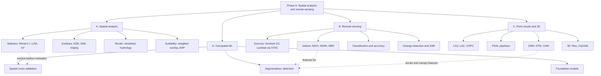
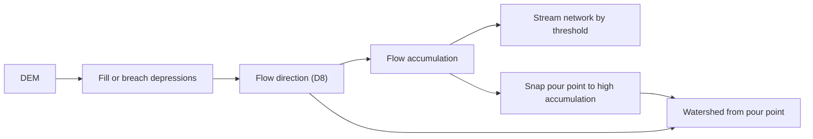
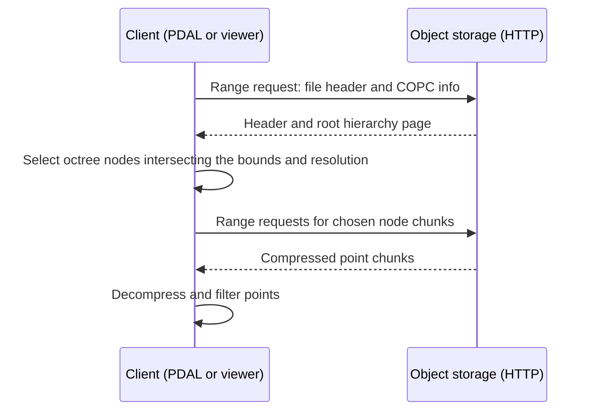
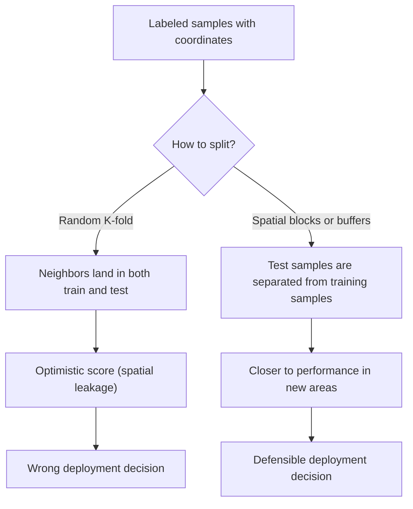

# Spatial Analysis, Remote Sensing, Point Clouds/3D, and Geospatial ML

**Study note — GIS Development, Phase 6 (suggested pace: 4–6 weeks)**

---

## 1. Title, Learning Objectives, Prerequisites

### 1.1 Scope

Phase 6 moves from *handling* geospatial data (formats, CRS, databases, APIs) to *extracting knowledge* from it. It has four tracks that share one theme: **space is not just another column**. Nearby things are more alike than distant things, measurements carry a footprint and a scale, and models that ignore this give results that look better than they are.

| Track | Topics |
|---|---|
| A. Spatial analysis | Density surfaces, interpolation (IDW, kriging), viewshed, hydrology, suitability modeling, spatial statistics (autocorrelation, hotspots) |
| B. Remote sensing | Sentinel/Landsat sources, spectral indices (NDVI), classification, change detection, SAR basics |
| C. Point clouds and 3D | LiDAR (LAS/LAZ, COPC), PDAL, DEM/DSM/DTM, 3D Tiles, CityGML |
| D. ML on geospatial data | Segmentation, object detection, spatial cross-validation, geospatial foundation models |

### 1.2 Learning objectives

After working through this note you should be able to:

1. Explain spatial dependence (Tobler's first law), spatial heterogeneity, and the modifiable areal unit problem (MAUP), and say how each affects analysis design.
2. Implement and tune **kernel density**, **IDW**, and describe **ordinary kriging** (semivariogram, nugget/sill/range) well enough to choose between them.
3. Compute a **viewshed** with the earth-curvature correction, and derive **flow direction, flow accumulation, and watersheds** from a DEM (D8), including why sink filling is needed.
4. Build a **weighted-overlay suitability model** with constraints and normalization, and know what AHP adds.
5. Compute and interpret **global Moran's I**, **local Moran's I (LISA)**, and **Getis-Ord Gi\***, including permutation inference and multiple-testing caveats.
6. Find and read **Sentinel-2 / Landsat / Sentinel-1** data through **STAC**, apply the correct scale/offset and cloud masks, and compute **NDVI, NDWI/MNDWI, NBR**.
7. Run a supervised classification and report an honest **accuracy assessment** (confusion matrix, producer's/user's accuracy, F1, area-adjusted estimates).
8. Perform **change detection** (differencing, thresholding, post-classification) and explain SAR geometry, speckle, backscatter in dB, and SAR flood mapping.
9. Read/write **LAS/LAZ/COPC**, build **PDAL pipelines**, produce **DSM/DTM/CHM** rasters, and describe **3D Tiles** and **CityGML/CityJSON**.
10. Train/evaluate geospatial ML models with **spatial cross-validation**, and describe when a **foundation model** is appropriate.

### 1.3 Prerequisites

- CRS fundamentals: projected vs. geographic CRS, EPSG codes, units (Phase 1).
- Raster and vector formats (GeoTIFF/COG, GeoPackage, GeoJSON), GDAL/OGR basics (Phases 2–3).
- Python with NumPy; GeoPandas and rasterio are helpful. Linear algebra and basic statistics (mean, variance, correlation, hypothesis tests).
- For Track D: scikit-learn basics; PyTorch is helpful but not required for the exercises.

### 1.4 Suggested schedule

| Week | Focus | Checkpoint |
|---|---|---|
| 1 | Foundations, density, interpolation, spatial statistics | Worked Examples 1–2 reproduced by hand and in code |
| 2 | Viewshed, hydrology, suitability modeling | D8 example reproduced; suitability model on your own data |
| 3 | Remote-sensing data access, indices, classification | Beginner and Intermediate exercises |
| 4 | Change detection, SAR | Worked Example 3 and Intermediate exercise |
| 5 | Point clouds, PDAL, DEM/DSM/DTM/CHM, 3D Tiles, CityGML | CHM produced from a real LAZ tile |
| 6 | Geospatial ML, spatial CV, foundation models, capstone | Worked Example 4, Advanced exercise, Applied challenge |

With 4 weeks, merge weeks 1–2 and weeks 5–6, and treat kriging, SAR, and 3D Tiles as reading-only.

> **Conventions in this note.** `x, y` are in map units of the stated CRS. Code is Python 3 unless stated. Numbers shown as "Expected output" in Sections 5 and 8 were produced by running the code shown. Code marked **(unexecuted sketch)** depends on network services or large data and is intended as a starting point. ASCII figures are **schematics, not scale-accurate maps**.

---

## 2. Conceptual Foundations

### 2.1 Why spatial analysis is different

| Principle | Statement | Consequence for developers |
|---|---|---|
| **Spatial dependence** (Tobler, 1970) | "Everything is related to everything else, but near things are more related than distant things." | Observations are not independent. Interpolation works because of it; naive statistics and ML validation break because of it. |
| **Spatial heterogeneity** (non-stationarity) | Relationships vary across space. | One global model/regression may fit nowhere well; consider local models or stratification. |
| **Scale and support** | Every measurement has a footprint (a 10 m pixel, a 1 km county). | Results depend on the resolution. Do not compare values with different supports without thought. |
| **MAUP** | Aggregating points into different zones/zone sizes changes statistics. | Report the zoning; test sensitivity; prefer analysis at the finest defensible unit. |
| **Ecological fallacy** | A relationship across zones need not hold for individuals within them. | Be careful with claims about individuals from area-level data. |
| **Edge effects** | Near the study-area border, neighbors are missing. | Statistics (KDE, Moran's I, Gi\*) are biased near edges; buffer the study area where possible. |

### 2.2 A taxonomy of spatial analysis

- **Surface creation:** turn samples into a continuous field (density, IDW, kriging).
- **Terrain analysis:** derive properties from elevation (slope, aspect, viewshed, flow).
- **Overlay/suitability:** combine layers to rank locations (weighted overlay, MCDA).
- **Spatial statistics:** test whether patterns are random (autocorrelation, clusters, hotspots).
- **Image analysis:** extract information from raster imagery (indices, classification, change).
- **3D analysis:** work with elevation-bearing point clouds and city models.
- **Predictive modeling:** learn a mapping from spatial predictors to a target, then map it.

### 2.3 Remote sensing in one page

**Remote sensing** is measuring a surface from a distance, usually with a sensor on a satellite, aircraft, or drone. **Passive** sensors (optical) record reflected sunlight; **active** sensors (SAR, LiDAR) emit their own signal and record the return.

Four resolutions define what a sensor can do:

| Resolution | Meaning | Example |
|---|---|---|
| Spatial | Ground footprint of one pixel | Sentinel-2: 10, 20, or 60 m depending on band |
| Spectral | Number and width of wavelength bands | Sentinel-2 MSI: 13 bands, visible to SWIR |
| Temporal | Revisit interval | Sentinel-2 constellation: about 5 days at the equator; Landsat 8 and 9 combined: about 8 days |
| Radiometric | Number of distinguishable brightness levels | 12-bit data stored in 16-bit integers |

**Processing levels** (names vary by mission):

- **Top-of-atmosphere (TOA) reflectance** (Sentinel-2 Level-1C): includes atmospheric effects.
- **Surface (bottom-of-atmosphere) reflectance** (Sentinel-2 Level-2A, Landsat Collection 2 Level-2): atmosphere corrected. Use this for indices, classification, and time series unless you have a reason not to.

**Why vegetation indices work.** Healthy leaves absorb red light (chlorophyll) and strongly reflect near-infrared (NIR) from internal leaf structure. A normalized difference of NIR and red therefore separates vegetation from soil, water, and built surfaces.

### 2.4 Point clouds in one page

A **point cloud** is a set of 3D points, each with attributes. Airborne LiDAR measures distance by timing laser pulses, and one pulse can produce several **returns** (canopy top, branches, ground). Key ideas:

- **DSM** (digital surface model): top of everything (canopy, roofs).
- **DTM** (digital terrain model): bare earth.
- **DEM**: umbrella term; in many datasets it means DTM, in others DSM. Always read the metadata.
- **CHM** (canopy height model) $=$ DSM $-$ DTM, the height of objects above ground.

### 2.5 Geospatial ML in one page

Geospatial ML differs from generic ML in three ways: (1) data are **big rasters** that must be tiled into chips, (2) **labels** are scarce, noisy, and often misregistered, and (3) **validation** must respect spatial autocorrelation, otherwise performance is overestimated (Section 4.D).

---

## 3. Visual Explanations

### 3.1 Concept map of Phase 6



**How to read it:** the four tracks are not independent. Spatial statistics (A4) explains *why* spatial cross-validation (D2) is required; spectral indices (B2) and elevation-derived rasters (C3) are the features that ML models consume.

### 3.2 Typical remote-sensing workflow


**Interpretation:** every path goes through *scale/offset and masking* before any math. The accuracy-assessment step is not optional; a map without an error estimate is an unvalidated hypothesis.

### 3.3 Hydrological processing chain



### 3.4 COPC: why a point cloud can be streamed



**Interpretation:** a COPC file is a LAZ file whose chunks are organized as an octree with an index in the header area, so a client downloads only the nodes it needs (by area and level of detail) instead of the whole file.

### 3.5 Spatial vs. random cross-validation



### 3.6 Schematic: viewshed line of sight

```text
 elevation
   ^
   |        O (observer, z_obs + h_obs)
   |         \
   |          \        ridge (blocks the view)
   |           \      /\
   |            \    /  \             T1 (hidden: below the ray's grazing angle)
   |             \  /    \___        x
   |              \/         \___   .
   |                              \ T2 (visible: above all intermediate angles)
   |                               x
   +-----------------------------------------> distance along the ray
```

*Schematic, not to scale.* A target is visible if the angle from observer to target is greater than every intermediate angle along the ray.

### 3.7 Schematic: D8 flow directions

```text
   Cell (r,c) drains to the neighbor with the steepest downward slope.
   Neighbor indices (cardinal distance = 1 cell, diagonal distance = sqrt(2) cells):

        NW   N   NE
          \  |  /
      W  --  *  --  E
          /  |  \
        SW   S   SE
```

### 3.8 Schematic: SAR side-looking geometry

```text
      satellite flight direction: out of the page (azimuth)
                    *  <- sensor
                   /|\
                  / | \      look direction (range) ->
                 /  |  \
  near range    /   |   \   far range
   ____________/____|____\_____________  ground
     layover  foreshortening   shadow
   (slope faces sensor)       (hidden from sensor)
```

*Schematic only.* Layover and foreshortening occur on slopes facing the sensor; shadow occurs behind steep slopes facing away.

---

## 4. Technical Deep Dive

## Part A — Spatial Analysis

### A.1 Density surfaces

**Goal:** convert discrete events (crime incidents, tree locations, accidents) into a continuous intensity surface.

| Method | Idea | Notes |
|---|---|---|
| Point-in-cell count | Count points per grid cell | Fast, but depends on grid origin and cell size |
| Kernel density estimation (KDE) | Place a smooth bump at each point and sum | Bandwidth $h$ controls smoothness |
| Heatmap (rendering) | KDE-like visual | Fine for display, not for quantitative analysis |

**Quartic (biweight) kernel in 2D.** For $n$ points $s_i$ and a location $s$, with $d_i = \lVert s - s_i \rVert$:

$$
\hat\lambda(s) = \frac{1}{h^2} \sum_{i=1}^{n} K\!\left(\frac{d_i}{h}\right), \qquad
K(u) = \begin{cases} \dfrac{3}{\pi}\,(1-u^2)^2 & u < 1 \\ 0 & u \ge 1 \end{cases}
$$

$K$ integrates to 1 over the plane, so $\hat\lambda$ integrates to $n$ and has units **points per unit area** (for a metric CRS, points per m²; multiply by 10⁶ for points per km²).

```python
import numpy as np

def kde_quartic(points, grid_x, grid_y, h):
    """points: (n,2) array in a projected CRS (metres). Returns intensity [points / m^2]."""
    gx, gy = np.meshgrid(grid_x, grid_y)                      # (ny, nx)
    out = np.zeros_like(gx, dtype=float)
    for px, py in points:
        d2 = (gx - px) ** 2 + (gy - py) ** 2
        u2 = d2 / h**2
        mask = u2 < 1
        out[mask] += (3 / np.pi) * (1 - u2[mask]) ** 2
    return out / h**2
```

**Choosing the bandwidth $h$.** It is the single most influential parameter. Too small gives a spiky "one bump per point" surface; too large washes out structure. Use domain knowledge (the process scale, e.g. walking distance), a rule of thumb, or cross-validation, and always state $h$ with the map. **Never run KDE in a geographic CRS** (EPSG:4326): degrees are not equal distances in x and y. Project first.

### A.2 Interpolation: from samples to a continuous surface

**Problem:** given values $z_i$ at sample locations $s_i$, estimate $z(s_0)$ at an unsampled location.

#### A.2.1 Inverse distance weighting (IDW)

$$
\hat z(s_0) = \frac{\sum_{i=1}^{n} w_i\, z_i}{\sum_{i=1}^{n} w_i}, \qquad w_i = d_i^{-p}, \quad d_i = \lVert s_0 - s_i \rVert
$$

- Power $p$ (commonly 2) controls how fast influence decays: higher $p$ is more local.
- **Exact interpolator:** at a sample location, $d_i = 0$, so return $z_i$ directly (avoid division by zero).
- **Bounded:** estimates never go below the minimum or above the maximum sample, so IDW cannot predict a peak between samples.
- Produces "bull's-eye" artifacts around samples. No uncertainty estimate.

```python
import numpy as np

def idw(x0, y0, pts, p=2.0, k=None):
    """pts: array of rows (x, y, z). k: use only the k nearest samples if given."""
    d = np.hypot(pts[:, 0] - x0, pts[:, 1] - y0)
    if np.any(d == 0):
        return float(pts[d == 0][0, 2])
    if k is not None:
        nearest = np.argsort(d)[:k]
        d, pts = d[nearest], pts[nearest]
    w = d ** (-p)
    return float((w * pts[:, 2]).sum() / w.sum())
```

#### A.2.2 Kriging (geostatistics)

Kriging is the *best linear unbiased predictor* under a model of spatial correlation, and it returns a **prediction variance** too. The model is the **semivariogram**.

**Empirical semivariogram.** For lag distance $h$:

$$
\hat\gamma(h) = \frac{1}{2\,N(h)} \sum_{(i,j)\in N(h)} \bigl(z(s_i) - z(s_j)\bigr)^2
$$

where $N(h)$ is the set of pairs separated by about $h$. Fit a parametric model with:

| Parameter | Meaning |
|---|---|
| **Nugget** $c_0$ | Semivariance at $h \to 0^+$: measurement error plus variation finer than the sample spacing |
| **Partial sill** $c$ | Spatially structured variance; **sill** $= c_0 + c$ |
| **Range** $a$ | Distance beyond which pairs are essentially uncorrelated |

Common models for $h > 0$ (with $\gamma(0)=0$ by definition):

$$
\text{Spherical: } \gamma(h)=\begin{cases} c_0 + c\left(\dfrac{3h}{2a}-\dfrac{h^3}{2a^3}\right) & 0<h\le a\\[4pt] c_0+c & h>a\end{cases}
$$

$$
\text{Exponential: } \gamma(h)=c_0+c\left(1-e^{-h/a}\right), \qquad
\text{Gaussian: } \gamma(h)=c_0+c\left(1-e^{-h^2/a^2}\right)
$$

For the exponential and Gaussian models the *practical* range (about 95% of the sill) is $3a$ and $\sqrt{3}\,a$ respectively.

**Ordinary kriging system.** Predict $\hat z(s_0)=\sum_i \lambda_i z(s_i)$ with weights found from

$$
\begin{bmatrix}
\gamma(s_1-s_1) & \cdots & \gamma(s_1-s_n) & 1\\
\vdots & \ddots & \vdots & \vdots\\
\gamma(s_n-s_1) & \cdots & \gamma(s_n-s_n) & 1\\
1 & \cdots & 1 & 0
\end{bmatrix}
\begin{bmatrix}\lambda_1\\ \vdots\\ \lambda_n\\ \mu\end{bmatrix}
=
\begin{bmatrix}\gamma(s_1-s_0)\\ \vdots\\ \gamma(s_n-s_0)\\ 1\end{bmatrix}
$$

with $\sum_i \lambda_i = 1$ (this enforces unbiasedness; $\mu$ is a Lagrange multiplier). The kriging variance is $\sigma^2(s_0)=\sum_i \lambda_i\,\gamma(s_i-s_0)+\mu$.

**Assumptions:** (intrinsic) stationarity (the semivariogram depends only on separation, not location), and no strong trend. If there is a trend (e.g. temperature vs. elevation), model it first (universal kriging, regression kriging) or kriging results are misleading.

**IDW vs. kriging:**

| | IDW | Ordinary kriging |
|---|---|---|
| Needs a model of spatial structure | No | Yes (semivariogram) |
| Uncertainty map | No | Yes (kriging variance, valid if the model is) |
| Can exceed sample min/max | No | Yes |
| Handles clustered samples | Poorly (clusters get extra weight) | Better (weights account for redundancy) |
| Effort | Low | Higher; needs diagnostics |

**Always validate interpolators** with leave-one-out or spatial cross-validation (Part D), reporting RMSE and bias. Never judge a surface by how it looks.

```python
# (unexecuted sketch; pip install pykrige)
from pykrige.ok import OrdinaryKriging
ok = OrdinaryKriging(x, y, z, variogram_model="spherical", nlags=12, enable_plotting=False)
z_grid, var_grid = ok.execute("grid", grid_x, grid_y)   # prediction and kriging variance
```

### A.3 Terrain analysis: slope, aspect, viewshed

#### A.3.1 Slope and aspect (Horn's method)

With a 3×3 window (row 1 is north):

```text
 a b c
 d e f        z values; Δx, Δy = cell size in map units (same units as z)
 g h i
```

$$
\frac{\partial z}{\partial x}=\frac{(c+2f+i)-(a+2d+g)}{8\,\Delta x},\qquad
\frac{\partial z}{\partial y}=\frac{(a+2b+c)-(g+2h+i)}{8\,\Delta y},\qquad
\text{slope}=\arctan\!\sqrt{\left(\frac{\partial z}{\partial x}\right)^2+\left(\frac{\partial z}{\partial y}\right)^2}
$$

If the DEM is in a geographic CRS, convert cell sizes to metres first, otherwise slopes are wrong (Section 6).

#### A.3.2 Viewshed

**Definition:** the set of cells visible from one or more observer points. Inputs: DEM (or DSM), observer location, observer height $h_o$, target height $h_t$, maximum distance.

**Line-of-sight test.** For each target cell, walk the ray from the observer. Let $\theta_k$ be the elevation angle to intermediate cell $k$. The target is visible if its angle exceeds the maximum of all intermediate angles.

**Earth curvature and refraction.** Over long distances, the Earth's surface drops below the tangent line at the observer by approximately

$$
\Delta z \approx \frac{d^2}{2R}\,(1-k)
$$

where $R \approx 6{,}371{,}000$ m, $d$ is the distance, and $k \approx 0.13$ is the standard atmospheric refraction coefficient (set $k=0$ to ignore refraction). Check: at $d=10$ km, $d^2/2R \approx 7.85$ m and with $k=0.13$ the correction is about $6.83$ m. Subtract $\Delta z$ from the apparent target elevation (equivalently raise the terrain in between). At 1 km the effect is only about 0.07 m; at 20 km it is about 27 m, which matters for tall-structure visibility.

```python
import numpy as np

def line_of_sight_visible(dem, cs, obs_rc, tgt_rc, h_obs=1.7, h_tgt=0.0, k=0.13, R=6_371_000.0):
    """dem: 2D array (metres), cs: cell size (metres). obs_rc/tgt_rc: (row, col)."""
    (r0, c0), (r1, c1) = obs_rc, tgt_rc
    n = int(max(abs(r1 - r0), abs(c1 - c0)))
    if n == 0:
        return True
    rows = np.linspace(r0, r1, n + 1)
    cols = np.linspace(c0, c1, n + 1)
    z = dem[np.rint(rows).astype(int), np.rint(cols).astype(int)].astype(float)
    d = np.hypot((rows - r0) * cs, (cols - c0) * cs)
    z_eff = z - (1 - k) * d**2 / (2 * R)                # curvature/refraction drop
    z_obs = z[0] + h_obs
    ang = (z_eff[1:] - z_obs) / d[1:]                    # tangent of elevation angle
    ang[-1] = (z_eff[-1] + h_tgt - z_obs) / d[-1]        # target gets its own height
    return bool(ang[-1] >= ang[:-1].max()) if len(ang) > 1 else True
```

Efficient full-raster viewsheds use the **R2** or **R3** sweep algorithms rather than testing every cell independently; GDAL's `gdal_viewshed` and GRASS `r.viewshed` implement production versions. Be explicit about observer height, target height, and whether you use a DSM (blocked by trees and buildings) or DTM (bare earth).

### A.4 Hydrology

#### A.4.1 Concepts

| Term | Meaning |
|---|---|
| **Sink / depression** | Cell or region with no lower neighbor; often a DEM artifact |
| **Flow direction** | The neighbor a cell drains to |
| **Flow accumulation** | Number of upstream cells draining through a cell (multiply by cell area for contributing area) |
| **Stream network** | Cells with accumulation above a threshold |
| **Watershed (catchment)** | All cells draining to a given pour point |
| **Pour point** | Outlet location defining a catchment |

#### A.4.2 D8 flow direction

For each cell, compute the slope to each of its 8 neighbors,

$$
s_k = \frac{z_{\text{center}}-z_k}{\Delta_k},\qquad
\Delta_k=\begin{cases} \Delta x & \text{cardinal neighbor}\\ \sqrt{2}\,\Delta x & \text{diagonal neighbor}\end{cases}
$$

and send all flow to the neighbor with the largest positive $s_k$. D8 forces flow into a single direction, so it cannot represent divergent flow on hillslopes. Alternatives: **D∞** (Tarboton, 1997) splits flow between two neighbors by angle; **MFD** methods spread flow over all downslope neighbors.

#### A.4.3 Worked mini-example: why sink filling matters

DEM (5×5, metres, cell size 1 m). The lowest border cell is the outlet at row 4, col 2 (value 2); the centre cell (row 2, col 2, value 3) is a **pit**, because all its neighbors are higher (the lowest neighbor, row 3 col 2, is 4):

```text
        col0 col1 col2 col3 col4
 row0 [  9    8    7    8    9 ]
 row1 [  8    6    5    6    8 ]
 row2 [  7    5    3    5    7 ]     <- (2,2) = 3 is a pit
 row3 [  8    6    4    6    8 ]
 row4 [  9    7    2    7    9 ]     <- (4,2) = 2 is the outlet
```

```python
import numpy as np

dem = np.array([[9,8,7,8,9],
                [8,6,5,6,8],
                [7,5,3,5,7],
                [8,6,4,6,8],
                [9,7,2,7,9]], float)

def d8(dem, cs=1.0):
    r, c = dem.shape
    fd = -np.ones((r, c, 2), int)                    # (-1,-1) means no outflow (pit/outlet)
    for i in range(r):
        for j in range(c):
            best, tgt = 0.0, None
            for di in (-1, 0, 1):
                for dj in (-1, 0, 1):
                    if not (di or dj):
                        continue
                    a, b = i + di, j + dj
                    if 0 <= a < r and 0 <= b < c:
                        s = (dem[i, j] - dem[a, b]) / (cs * (2**0.5 if di and dj else 1))
                        if s > best:
                            best, tgt = s, (a, b)
            if tgt:
                fd[i, j] = tgt
    return fd

def accumulate(dem, fd):
    r, c = dem.shape
    acc = np.ones((r, c))                            # each cell counts itself
    for _, i, j in sorted(((dem[i, j], i, j) for i in range(r) for j in range(c)), reverse=True):
        a, b = fd[i, j]
        if a >= 0:
            acc[a, b] += acc[i, j]
    return acc

print(accumulate(dem, d8(dem)).astype(int))
```

**Expected output (raw DEM):**

```text
[[ 1  1  1  1  1]
 [ 1  2  4  2  1]
 [ 1  4 17  4  1]
 [ 1  2  1  2  1]
 [ 1  1  8  1  1]]
```

The pit collects 17 cells and stops, so the outlet appears to drain only 8 cells. After filling the depression to its spill elevation (the pit is raised to 4, then nudged by a tiny epsilon, here 4.001, so that it drains toward the cell below it), re-running with `dem[2, 2] = 4.001` gives:

```text
[[ 1  1  1  1  1]
 [ 1  2  4  2  1]
 [ 1  4 17  4  1]
 [ 1  2 18  2  1]
 [ 1  1 25  1  1]]
```

All 25 cells now reach the outlet. This is exactly the failure that real pipelines prevent with **depression filling** (Planchon-Darboux; priority-flood methods such as Wang & Liu, 2006) or **breaching**, followed by flat-area resolution. Production tools: GRASS `r.watershed`, WhiteboxTools, TauDEM, RichDEM, `pysheds`.

**Stream extraction and watersheds.** Streams are cells with accumulation $\ge T$ (a threshold chosen by drainage density, not a universal number). To delineate a catchment, **snap** the pour point to the nearest high-accumulation cell (GPS points rarely sit exactly on the DEM-derived stream), then collect all cells that drain to it.

### A.5 Suitability modeling (weighted overlay and MCDA)

**Goal:** rank locations for a purpose (solar farm, new clinic, conservation priority).

**Workflow.**

1. **Criteria and constraints.** *Constraints* are hard exclusions (protected areas, water); *factors* are graded criteria (slope, distance to road).
2. **Standardize** each factor to a common scale, e.g. 0–1, using monotonic functions (linear, sigmoidal, fuzzy). Decide whether higher raw values are better or worse.
3. **Weight** factors so $\sum_k w_k = 1$.
4. **Combine:**

$$
S(x) = C(x)\cdot \sum_{k=1}^{m} w_k\, f_k\bigl(v_k(x)\bigr), \qquad C(x)\in\{0,1\}
$$

where $C$ is the product of constraint masks, $v_k$ the raw factor value, and $f_k$ the standardization.

5. **Test sensitivity.** Perturb weights and thresholds and see whether the top-ranked cells change.

**AHP (Analytic Hierarchy Process, Saaty).** Weights come from pairwise comparisons on a 1–9 scale. The weight vector is the principal eigenvector of the comparison matrix $A$; check consistency with

$$
\text{CI}=\frac{\lambda_{\max}-m}{m-1},\qquad \text{CR}=\frac{\text{CI}}{\text{RI}}
$$

where $m$ is the number of criteria and RI is a tabulated random index (about 0.58, 0.90, 1.12 for $m=3,4,5$). Conventionally $\text{CR}<0.1$ is accepted. AHP organizes expert judgment; it does not make the weights objective.

```python
import numpy as np

def minmax(a, lo, hi, higher_is_better=True):
    s = np.clip((a - lo) / (hi - lo), 0, 1)
    return s if higher_is_better else 1 - s

slope_deg = np.array([[2, 8], [15, 4]], float)           # factor 1 (lower is better)
dist_road_m = np.array([[100, 800], [300, 2500]], float) # factor 2 (lower is better)
protected = np.array([[0, 0], [0, 1]], bool)             # constraint: 1 = excluded

f1 = minmax(slope_deg, 0, 15, higher_is_better=False)
f2 = minmax(dist_road_m, 0, 2500, higher_is_better=False)
score = (0.6 * f1 + 0.4 * f2) * (~protected)
print(np.round(score, 3))
```

**Expected output:**

```text
[[0.904 0.552]
 [0.352 0.   ]]
```

Hand check for cell (0,0): $f_1 = 1-2/15 = 0.8667$ and $f_2 = 1-100/2500 = 0.96$, so $S = 0.6\cdot 0.8667 + 0.4\cdot 0.96 = 0.904$. Cell (1,1) is zero because it is a protected (excluded) cell, regardless of its factor scores.

### A.6 Spatial statistics: autocorrelation and hotspots

#### A.6.1 Spatial weights

A **spatial weights matrix** $W=(w_{ij})$ encodes who is a neighbor of whom ($w_{ii}=0$ for standard autocorrelation statistics).

| Scheme | Neighbors | Typical use |
|---|---|---|
| Rook | Share an edge | Raster grids, regular zones |
| Queen | Share an edge or a corner | Raster grids, administrative zones |
| k-nearest | $k$ closest centroids | Irregular points; guarantees no islands |
| Distance band | All within distance $d$ | Point processes; choose $d$ to avoid islands |
| Inverse distance | Weight $d_{ij}^{-p}$ | When influence decays smoothly |

**Row-standardization** rescales each row to sum to 1 (each location's neighbors average out). Results depend on the weights; report them.

#### A.6.2 Global Moran's I

Let $z_i = x_i-\bar x$ and $S_0=\sum_{i}\sum_{j} w_{ij}$:

$$
I=\frac{n}{S_0}\;\frac{\sum_i\sum_j w_{ij}\,z_i z_j}{\sum_i z_i^2}
$$

- Under spatial randomness, $E[I]=-1/(n-1)$ (slightly negative, close to 0 for large $n$).
- $I$ clearly above $E[I]$ means **positive autocorrelation** (similar values cluster). Clearly below means **negative** (checkerboard-like).
- $I$ is *not* bounded by exactly $[-1,1]$ for arbitrary $W$, though it is usually in that range for row-standardized weights.
- **Inference:** compare with a **permutation distribution** (shuffle values over locations many times, recompute $I$) or use analytic moments. Prefer permutation for small $n$.

Related: **Geary's C** (based on squared differences, more sensitive to local contrasts).

#### A.6.3 Local indicators (LISA)

**Local Moran's I:**

$$
I_i=\frac{z_i}{m_2}\sum_j w_{ij}z_j,\qquad m_2=\frac{1}{n}\sum_i z_i^2
$$

Each location is classified as **High-High**, **Low-Low** (clusters), **High-Low**, **Low-High** (spatial outliers) by comparing $z_i$ with its neighbors' average.

**Getis-Ord $G_i^*$ (hotspot analysis)** includes the location itself in its neighborhood ($w_{ii}=1$):

$$
G_i^*=\frac{\sum_j w_{ij}x_j-\bar X\sum_j w_{ij}}{S\sqrt{\dfrac{n\sum_j w_{ij}^2-\left(\sum_j w_{ij}\right)^2}{n-1}}},\qquad
\bar X=\frac1n\sum_j x_j,\quad S=\sqrt{\frac1n\sum_j x_j^2-\bar X^2}
$$

$G_i^*$ is already a z-score: large positive means a **hot spot** (high values surrounded by high values), large negative a **cold spot**.

**Caveats for local statistics:**

1. **Multiple testing.** You run one test per location. Adjust (e.g. Benjamini-Hochberg false-discovery-rate control) or treat results as exploratory.
2. **Weights and edge effects** change results.
3. **Normality assumptions** of the analytic z-score may fail for skewed data; check with permutations.
4. **Counts need rates.** Clusters of raw counts often just mirror population; analyze rates (events per population) and consider smoothing for small denominators.

```python
# (API of recent PySAL releases; check the docs for your versions)
from libpysal.weights import Queen
from esda.moran import Moran, Moran_Local
from esda.getisord import G_Local

w = Queen.from_dataframe(gdf)          # gdf: GeoDataFrame with a numeric column 'rate'
w.transform = "r"                      # row-standardize for Moran
mi = Moran(gdf["rate"], w, permutations=999)
print(mi.I, mi.EI, mi.p_sim)

lisa = Moran_Local(gdf["rate"], w, permutations=999)       # lisa.q: quadrant, lisa.p_sim
w_b = Queen.from_dataframe(gdf); w_b.transform = "b"       # binary for Gi*
gi = G_Local(gdf["rate"], w_b, star=True, permutations=999)  # gi.Zs, gi.p_sim
```

---

## Part B — Remote Sensing

### B.1 Imagery sources and access

| Mission / product | Sensor type | Resolution | Revisit | Notes |
|---|---|---|---|---|
| **Sentinel-2** (ESA/Copernicus) L1C, L2A | Optical multispectral (MSI), 13 bands | 10 m (B2, B3, B4, B8), 20 m (B5, B6, B7, B8A, B11, B12), 60 m (B1, B9, B10) | About 5 days at the equator with two satellites | Free and open. L2A is surface reflectance with a scene classification layer (SCL) |
| **Landsat 8 and 9** (USGS/NASA) Collection 2 Level-2 | Optical (OLI) and thermal (TIRS) | 30 m multispectral, 15 m panchromatic, thermal resampled to 30 m | 16 days each, about 8 days combined | Free and open. Archive back to 1972 across the Landsat family, ideal for long time series |
| **Sentinel-1** (ESA/Copernicus) GRD, SLC | C-band SAR | IW mode: about 250 km swath, 10 m pixel spacing (effective resolution coarser) | 12 days per satellite; shorter with two operating | Works through cloud and at night |
| Commercial (Planet, Maxar, Airbus) | Optical, some SAR | Sub-metre to a few metres | Daily to weekly | License terms apply; some programs offer research access |

**Sentinel-2 band cheat sheet (the ones you will use most):**

| Band | Name | Centre wavelength (approx.) | Resolution |
|---|---|---|---|
| B2 | Blue | 490 nm | 10 m |
| B3 | Green | 560 nm | 10 m |
| B4 | Red | 665 nm | 10 m |
| B8 | NIR | 842 nm | 10 m |
| B11 | SWIR 1 | 1610 nm | 20 m |
| B12 | SWIR 2 | 2190 nm | 20 m |

**Landsat band numbers differ by sensor generation.** This is a classic source of silent errors:

| Quantity | Landsat 8/9 (OLI) | Landsat 4–7 (TM/ETM+) | Sentinel-2 |
|---|---|---|---|
| Green | B3 | B2 | B3 |
| Red | **B4** | **B3** | B4 |
| NIR | **B5** | **B4** | B8 |
| SWIR 1 | B6 | B5 | B11 |
| SWIR 2 | B7 | B7 | B12 |

**STAC (SpatioTemporal Asset Catalog)** is the standard way to search and read cloud-hosted imagery. A search returns *Items* (one acquisition) whose *assets* are links to Cloud-Optimized GeoTIFFs (COGs). Public STAC APIs include Element 84's Earth Search and Microsoft's Planetary Computer; the Copernicus Data Space Ecosystem also offers STAC. Asset names and any signing requirements differ per catalog, so read the catalog's documentation.

```python
# (unexecuted sketch; pip install pystac-client odc-stac)
from pystac_client import Client
import odc.stac

bbox = [min_lon, min_lat, max_lon, max_lat]                 # EPSG:4326 order: lon, lat
cat = Client.open("https://earth-search.aws.element84.com/v1")
items = cat.search(
    collections=["sentinel-2-l2a"],
    bbox=bbox,
    datetime="2026-06-01/2026-08-31",
    query={"eo:cloud_cover": {"lt": 20}},
).item_collection()

ds = odc.stac.load(items, bands=["red", "nir", "swir22", "scl"],
                   bbox=bbox, resolution=10, chunks={}, groupby="solar_day")
# Check whether the loader applied the scale/offset from each asset's 'raster:bands'
# metadata. Do not assume. See B.2.
```

### B.2 Scale, offset, and cloud masking

**Always convert integers to physical reflectance before computing indices.**

| Product | Conversion to surface reflectance |
|---|---|
| Sentinel-2 L2A | $\rho = (\text{DN} + \text{BOA\_ADD\_OFFSET}) / 10000$. Since processing baseline 04.00 (early 2022) the offset is $-1000$; older data have offset 0. Read the metadata or STAC `raster:bands` |
| Landsat Collection 2 Level-2 (surface reflectance bands) | $\rho = \text{DN}\times 0.0000275 - 0.2$ |
| Landsat Collection 2 Level-2 (surface temperature band) | $T_K = \text{DN}\times 0.00341802 + 149.0$ |

Ignoring the Sentinel-2 offset is not a harmless rounding error. Worked Example 3 shows NDVI of dense vegetation shifting from about 0.77 to about 0.52 when the offset is forgotten, which quietly breaks every threshold.

**Sentinel-2 L2A scene classification layer (SCL) values:**

| SCL | Class | SCL | Class |
|---|---|---|---|
| 0 | No data | 6 | Water |
| 1 | Saturated or defective | 7 | Unclassified |
| 2 | Dark area pixels | 8 | Cloud, medium probability |
| 3 | Cloud shadows | 9 | Cloud, high probability |
| 4 | Vegetation | 10 | Thin cirrus |
| 5 | Not vegetated | 11 | Snow or ice |

A common "valid pixel" rule is to exclude SCL in {0, 1, 3, 8, 9, 10} (and 11 if snow matters). The SCL is a useful but imperfect mask: thin clouds, cloud edges, and haze can slip through, so dilate the mask by a pixel or two for sensitive analyses.

**Landsat Collection 2 `QA_PIXEL` bits** (Landsat 8/9): bit 0 fill, 1 dilated cloud, 2 cirrus, 3 cloud, 4 cloud shadow, 5 snow, 6 clear, 7 water. Test bits with bitwise AND:

```python
import numpy as np

def landsat_clear(qa_pixel):
    bad = (1 << 0) | (1 << 1) | (1 << 2) | (1 << 3) | (1 << 4)   # fill, dilated cloud, cirrus, cloud, shadow
    return (qa_pixel & bad) == 0

def s2_l2a_reflectance(dn, offset=-1000, scale=10000.0):
    return (dn.astype("float64") + offset) / scale

def landsat_c2_reflectance(dn):
    return dn.astype("float64") * 0.0000275 - 0.2
```

### B.3 Spectral indices

A **normalized-difference index** has the form $(a-b)/(a+b)$, bounded in $[-1,1]$ for non-negative inputs, and it cancels some multiplicative illumination effects.

| Index | Formula | Highlights | Typical reading |
|---|---|---|---|
| **NDVI** (Rouse et al.) | $\dfrac{\text{NIR}-\text{Red}}{\text{NIR}+\text{Red}}$ | Green vegetation | Water $<0$; bare/built about 0 to 0.2; dense vegetation often above 0.6 (sensor and season dependent) |
| **EVI** (Huete et al.) | $2.5\,\dfrac{\text{NIR}-\text{Red}}{\text{NIR}+6\,\text{Red}-7.5\,\text{Blue}+1}$ | Vegetation, less saturation in dense canopy | Reflectance inputs scaled 0–1 |
| **NDWI** (McFeeters) | $\dfrac{\text{Green}-\text{NIR}}{\text{Green}+\text{NIR}}$ | Open water | Positive over water |
| **MNDWI** (Xu) | $\dfrac{\text{Green}-\text{SWIR1}}{\text{Green}+\text{SWIR1}}$ | Water, better suppression of built-up noise | Positive over water |
| **NBR** | $\dfrac{\text{NIR}-\text{SWIR2}}{\text{NIR}+\text{SWIR2}}$ | Burned area, vegetation moisture | Drops after fire |
| **NDBI** | $\dfrac{\text{SWIR1}-\text{NIR}}{\text{SWIR1}+\text{NIR}}$ | Built-up land | Higher over built surfaces |

**Rules of thumb.** Thresholds (e.g. "NDVI > 0.3 is vegetation") are *not* universal; they depend on sensor, atmospheric correction, season, and the landscape. Calibrate against reference samples. Guard against divide-by-zero (`np.where(den == 0, np.nan, num/den)`).

```python
import numpy as np

def nd(a, b):
    a, b = a.astype("float64"), b.astype("float64")
    den = a + b
    return np.where(den == 0, np.nan, (a - b) / den)

ndvi  = nd(nir, red)
mndwi = nd(green, swir1)
nbr   = nd(nir, swir2)
```

### B.4 Classification

**Goal:** assign each pixel (or segment/object) to a class (water, forest, crop, built).

**Pipeline.**

1. **Define the legend** (mutually exclusive, collectively exhaustive, observable at the sensor resolution).
2. **Collect reference samples** via field data, high-resolution imagery interpretation, or existing products. Use **probability-based** sampling for accuracy assessment; training samples and validation samples must be independent.
3. **Build features:** spectral bands, indices, temporal statistics (e.g. seasonal median NDVI), texture, terrain (slope, elevation), SAR backscatter.
4. **Train:** random forest, gradient boosting, SVM, or a CNN (Part D). Unsupervised alternatives (k-means, ISODATA) cluster pixels, then clusters are labeled by an analyst.
5. **Predict** the full raster in chunks, **post-process** (majority filter, minimum mapping unit), and **assess accuracy**.

**Object-based image analysis (OBIA)** classifies segments instead of pixels, which reduces "salt-and-pepper" noise for high-resolution imagery.

#### Accuracy assessment

Build the **confusion (error) matrix** with rows as map classes and columns as reference classes. With $n_{ij}$ pixels mapped as class $i$ and reference class $j$, $N=\sum n_{ij}$:

$$
\text{OA}=\frac{\sum_k n_{kk}}{N},\qquad
\text{UA}_k=\frac{n_{kk}}{n_{k+}}\;(\text{precision}),\qquad
\text{PA}_k=\frac{n_{kk}}{n_{+k}}\;(\text{recall})
$$

$$
\kappa=\frac{p_o-p_e}{1-p_e},\quad p_o=\text{OA},\quad p_e=\sum_k \frac{n_{k+}\,n_{+k}}{N^2},
\qquad
F_1=\frac{2\,\text{UA}\,\text{PA}}{\text{UA}+\text{PA}}
$$

- **User's accuracy** (UA, commission error is $1-\text{UA}$): "if the map says forest, how often is it forest?" 
- **Producer's accuracy** (PA, omission error is $1-\text{PA}$): "of the true forest, how much did the map capture?"
- Overall accuracy hides poor performance on rare classes. Report per-class UA and PA.
- Kappa is widely reported but also widely criticized (Pontius & Millones, 2011); prefer reporting the confusion matrix with UA/PA/F1.
- **Area estimation.** Pixel counting from a map is biased by classification errors. Following Olofsson et al. (2014), use a stratified random reference sample and estimate the area proportion of class $k$ as
$$\hat p_k=\sum_i W_i\,\frac{n_{ik}}{n_{i+}}$$
where $W_i$ is the mapped-area proportion of map class $i$ (the strata), then report it with a confidence interval. This matters for deforestation statistics and any area-based reporting.

### B.5 Change detection

| Method | How | Strengths | Weaknesses |
|---|---|---|---|
| **Image differencing** | $\Delta = I_{t_2}-I_{t_1}$ (for an index), then threshold | Simple, transparent | Threshold choice; phenology, illumination, and registration errors look like change |
| **Ratioing / log-ratio** | $\log(I_{t_2}/I_{t_1})$ | Standard for SAR (multiplicative noise) | Same |
| **Post-classification comparison** | Classify each date, then compare maps | Gives "from-to" transitions | Errors compound: two maps at 85% accuracy can disagree for many pixels that did not change |
| **Time-series methods** | Fit trajectories per pixel and detect breaks (e.g. BFAST, LandTrendr, CCDC) | Separates seasonal cycles from true change; dates of change | Needs dense, well-masked series; more compute |
| **Deep-learning change detection** | Siamese or bi-temporal networks | Handles complex change | Needs labeled change data and careful validation |

**Thresholding.** Pick the threshold from reference data (maximize F1 or balance omission/commission), or use an automatic rule (Otsu's method on the difference histogram; mean $\pm k$ standard deviations for roughly symmetric noise). Report the threshold.

**Burn severity example (dNBR).** $\text{dNBR}=\text{NBR}_{\text{pre}}-\text{NBR}_{\text{post}}$. Classes widely cited from Key and Benson put roughly $-0.1$ to $0.1$ as unburned, above about $0.1$ low severity, above about $0.27$ moderate-low, above about $0.44$ moderate-high, and above about $0.66$ high severity. Treat these as starting points and calibrate regionally.

**Typical pitfalls:** compare **same season** (or model seasonality), use consistent atmospheric correction, check co-registration (a half-pixel shift creates fake change at edges), mask clouds and shadows in *both* dates, and apply a **minimum mapping unit** to remove isolated pixels.

### B.6 SAR basics

**What SAR measures.** Synthetic Aperture Radar emits microwave pulses sideways and records the **backscatter**: the fraction of energy returned to the sensor. It is *active*, so it works at night and through cloud. Sentinel-1 operates at **C-band** (frequency about 5.405 GHz, wavelength about 5.5 cm).

**Geometry and distortions** (see schematic 3.8):

- **Slant range** (distance along the line of sight) vs. **ground range** (projected on the ground).
- **Foreshortening:** slopes facing the sensor are compressed.
- **Layover:** very steep sensor-facing slopes: tops are imaged before bases.
- **Shadow:** areas hidden behind steep slopes facing away; no information.

**Scattering mechanisms (intuition).**

| Surface | Typical backscatter | Why |
|---|---|---|
| Calm open water | Very low (dark) | Smooth surface reflects away from the sensor (specular reflection) |
| Bare rough soil | Medium | Diffuse scattering |
| Vegetation | Medium to high; more cross-polarized (VH) energy | Volume scattering |
| Urban areas | High | Double-bounce between walls and ground |

**Polarization.** Sentinel-1 over land typically acquires **VV** and **VH** (transmit vertical; receive vertical or horizontal). Cross-polarization (VH) is more sensitive to volume scattering such as vegetation.

**Speckle.** Coherent imaging creates granular multiplicative noise. Reduce it with **multilooking** (averaging neighbors) or adaptive filters (Lee, refined Lee, Gamma-MAP) at the cost of resolution.

**Decibels.** Backscatter coefficients are often shown in dB:

$$
\sigma^0_{\text{dB}}=10\log_{10}\sigma^0_{\text{linear}}
$$

For example, $\sigma^0=0.01$ is $-20$ dB and $\sigma^0=0.1$ is $-10$ dB. **Average and filter in linear units, then convert to dB.** Averaging dB values biases the result.

**Typical preprocessing chain (e.g. in ESA SNAP or ASF's tools):** apply precise orbit file → thermal-noise removal → radiometric calibration to $\sigma^0$ (or $\gamma^0$) → speckle filtering → **terrain correction** (range-Doppler, using a DEM) → convert to dB. Analysis-ready SAR products exist; if you use them, read the processing description.

**SAR flood mapping (basic).** Open water appears dark in VV. Threshold the post-event image (a common scene-dependent range is roughly $-15$ to $-20$ dB; derive it from the histogram, e.g. with Otsu) or compare with a pre-event image (change in backscatter), then remove permanent water with a reference water mask and remove terrain-shadow areas with a DEM-derived mask. Failure modes: wind-roughened water looks bright, smooth surfaces (tarmac, dry sand) look dark, and flooded vegetation or urban areas can brighten via double-bounce.

**InSAR (preview).** Comparing the *phase* of two acquisitions measures surface displacement at millimetre-to-centimetre scale (subsidence, earthquakes, landslides). It requires coherence between acquisitions and careful atmospheric handling; treat as a specialization after the basics.

---

## Part C — Point Clouds and 3D

### C.1 LiDAR data model

Each LiDAR point is a record with attributes. The most important in LAS:

| Attribute | Meaning |
|---|---|
| X, Y, Z | Coordinates (stored as scaled integers with a scale and offset in the header) |
| Intensity | Strength of the return (relative; not calibrated reflectance unless processed) |
| Return number / Number of returns | Which return of a multi-return pulse this is |
| Classification | ASPRS class code (below) |
| GPS time | Acquisition time, used to separate flight lines |
| Scan angle, Point source ID | Geometry and flight line identity |
| RGB (some formats) | Colour from imagery |

**Common ASPRS classification codes:**

| Code | Class | Code | Class |
|---|---|---|---|
| 0 | Never classified | 6 | Building |
| 1 | Unassigned | 7 | Low point (noise) |
| 2 | Ground | 9 | Water |
| 3 | Low vegetation | 11 | Road surface |
| 4 | Medium vegetation | 17 | Bridge deck |
| 5 | High vegetation | 18 | High noise |

### C.2 File formats

| Format | What it is | When to use |
|---|---|---|
| **LAS** (ASPRS) | Standard binary LiDAR format; header, optional variable-length records (including CRS), point records | Interchange; uncompressed |
| **LAZ** | LAS compressed losslessly with LASzip, commonly several times smaller | Storage and distribution |
| **COPC** (Cloud Optimized Point Cloud) | A LAZ 1.4 file with an octree organization and index so clients can read subsets via HTTP range requests | Web-accessible point clouds; one file, still readable by LAZ-aware tools |
| **EPT** (Entwine Point Tile) | A directory tree of many octree files plus JSON metadata | Very large datasets on object storage (COPC is the single-file alternative) |

LAS stores coordinates as integers: $X = X_{\text{int}}\times s_x + o_x$. The scale factors (e.g. 0.01 m) set the coordinate precision, so a bad scale silently truncates precision.

### C.3 PDAL pipelines

**PDAL** is the "GDAL for point clouds": a library and CLI that runs a pipeline of **readers → filters → writers**. A pipeline is JSON.

The pipeline below reads a tile, flags statistical outliers as class 7, classifies ground with SMRF (Pingel et al., 2013), and writes a 1 m DTM from the ground points only:

```json
{
  "pipeline": [
    { "type": "readers.las", "filename": "tile.laz" },
    { "type": "filters.outlier", "method": "statistical", "mean_k": 8, "multiplier": 3.0 },
    { "type": "filters.smrf", "ignore": "Classification[7:7]" },
    { "type": "filters.range", "limits": "Classification[2:2]" },
    { "type": "writers.gdal",
      "filename": "dtm.tif",
      "resolution": 1.0,
      "output_type": "idw",
      "window_size": 6,
      "nodata": -9999,
      "gdaldriver": "GTiff" }
  ]
}
```

Run with `pdal pipeline dtm.json`. **(unexecuted sketch: requires PDAL and a LAZ tile.)** A second pipeline produces the DSM from all non-noise points using the maximum Z per cell:

```json
{
  "pipeline": [
    { "type": "readers.las", "filename": "tile.laz" },
    { "type": "filters.outlier", "method": "statistical", "mean_k": 8, "multiplier": 3.0 },
    { "type": "filters.range", "limits": "Classification![7:7]" },
    { "type": "writers.gdal",
      "filename": "dsm.tif",
      "resolution": 1.0,
      "output_type": "max",
      "nodata": -9999,
      "gdaldriver": "GTiff" }
  ]
}
```

Other stages worth knowing: `readers.copc` (read a COPC file, optionally restricted by `bounds` and `resolution`), `filters.reprojection`, `filters.hag_nn` (height above ground per point), `filters.csf` (cloth simulation ground filter), `writers.copc`. Stage options can change between PDAL versions, so confirm against the documentation for yours.

**CHM from DSM and DTM** (after both rasters are produced on the same grid):

```python
import numpy as np
import rasterio

with rasterio.open("dsm.tif") as dsm_src, rasterio.open("dtm.tif") as dtm_src:
    dsm = dsm_src.read(1).astype("float32")
    dtm = dtm_src.read(1).astype("float32")
    prof = dsm_src.profile
    nodata = dsm_src.nodata
    assert dsm.shape == dtm.shape and dsm_src.transform == dtm_src.transform, "grids must match"

valid = (dsm != nodata) & (dtm != nodata)
chm = np.where(valid, np.maximum(dsm - dtm, 0.0), nodata).astype("float32")
prof.update(dtype="float32", nodata=nodata)
with rasterio.open("chm.tif", "w", **prof) as dst:
    dst.write(chm, 1)
```

Clamping negatives to 0 removes small interpolation noise; a CHM with many large negative values signals a bad ground classification or misaligned grids.

### C.4 DEM, DSM, DTM, CHM: choosing and checking

| Product | Built from | Use |
|---|---|---|
| **DTM** | Ground-classified points (class 2), interpolated | Hydrology, slope, flood modeling, engineering |
| **DSM** | Highest return per cell | Viewshed with obstructions, solar analysis, building heights |
| **CHM** | DSM − DTM | Forest height and biomass proxies |
| **nDSM** | DSM − DTM for built-up areas | Building and object heights |

**Checks:** inspect the **vertical datum** (ellipsoidal height vs. orthometric/geoid-based height; mixing them produces offsets of tens of metres), vertical units (metres vs. US survey feet), voids (water, dense canopy, building footprints in a DTM), and a few ground-truth heights.

### C.5 3D Tiles

**3D Tiles** is an open specification (originating at Cesium and standardized through OGC) for streaming large, heterogeneous 3D content (photogrammetry meshes, buildings, point clouds, BIM) to web and native viewers. The core ideas:

- A **tileset** is described by `tileset.json`: a tree of tiles, each with a `boundingVolume`, a `geometricError`, optional `content`, and `children`.
- **Bounding volumes** are a `box`, a `sphere`, or a geographic `region` given as `[west, south, east, north, minHeight, maxHeight]` with angles in **radians** and heights in metres.
- **Refinement** is `ADD` (children add detail to the parent) or `REPLACE` (children replace the parent).
- **Content** is usually glTF (3D Tiles 1.1) or the older 1.0 tile formats (b3dm, i3dm, pnts).
- **Level of detail** is driven by **screen-space error** (SSE): the viewer refines a tile while

$$
\text{SSE}=\frac{\text{geometricError}\times \text{viewportHeight}}{\text{distance}\times 2\tan(\text{fov}_y/2)}
$$

exceeds a threshold (commonly 16 pixels). Geometric error is the world-space error (metres) introduced by *not* refining a tile.

A minimal tileset skeleton:

```json
{
  "asset": { "version": "1.1" },
  "geometricError": 500,
  "root": {
    "boundingVolume": { "region": [-1.3197, 0.6988, -1.3196, 0.6989, 0, 100] },
    "geometricError": 100,
    "refine": "REPLACE",
    "content": { "uri": "root.glb" },
    "children": []
  }
}
```

Generators include `py3dtiles` (point clouds), `pg2b3dm` (from PostGIS geometries), and Cesium ion's tiling service. Spot-check any tileset in a viewer for orientation, units, and vertical placement.

### C.6 CityGML and CityJSON

**CityGML** (OGC) is a semantic 3D city model standard: objects are not just geometry but typed features such as `Building`, `BuildingPart`, `RoofSurface`, `WallSurface`, `GroundSurface`, each with attributes and relationships. It uses **levels of detail (LoD)**:

| LoD (CityGML 2.0) | Typical content |
|---|---|
| LoD0 | Footprint/roof-edge polygons (2.5D) |
| LoD1 | Block model (extruded footprint) |
| LoD2 | Roof shapes and semantic surfaces |
| LoD3 | Detailed architecture (windows, doors) |
| LoD4 | Interior |

CityGML 3.0 reorganized the model (LoD0–3, with interior modeled through separate space concepts). Implementations in the wild still use 2.0 heavily, so check which version you receive.

**CityJSON** is a JSON encoding of the CityGML data model that is far easier to parse. A minimal valid-in-spirit example: one 10 m × 10 m × 6 m LoD1 building (CRS metadata omitted for brevity; real files declare it in `metadata.referenceSystem`):

```json
{
  "type": "CityJSON",
  "version": "2.0",
  "transform": { "scale": [1.0, 1.0, 1.0], "translate": [0.0, 0.0, 0.0] },
  "CityObjects": {
    "bldg-1": {
      "type": "Building",
      "attributes": { "measuredHeight": 6.0 },
      "geometry": [
        {
          "type": "Solid",
          "lod": "1",
          "boundaries": [[
            [[0, 3, 2, 1]],
            [[4, 5, 6, 7]],
            [[0, 1, 5, 4]],
            [[1, 2, 6, 5]],
            [[2, 3, 7, 6]],
            [[3, 0, 4, 7]]
          ]]
        }
      ]
    }
  },
  "vertices": [
    [0, 0, 0], [10, 0, 0], [10, 10, 0], [0, 10, 0],
    [0, 0, 6], [10, 0, 6], [10, 10, 6], [0, 10, 6]
  ]
}
```

Each face is a list of rings of **vertex indices**; the six faces form the closed shell of a `Solid`. Vertices are shared and referenced by index. Storage and tooling: `3DCityDB` (database schema), `cjio` and `citygml-tools` (conversion and validation). Related practice: validate solids (closed, consistently oriented, no self-intersections) before running volume or shadow analyses.

**How the 3D formats relate:** point clouds (LAZ/COPC) are *measurements*; DSM/DTM are *rasterized surfaces*; CityGML/CityJSON are *semantic models* (objects with meaning); 3D Tiles is a *delivery format* for visualization. A typical pipeline goes LiDAR → classification → building footprints/heights → CityJSON → 3D Tiles for the web.

---

## Part D — ML on Geospatial Data

### D.1 Task types

| Task | Output | Typical models | Metric |
|---|---|---|---|
| Scene/patch classification | One label per image chip | CNNs, ViTs | Accuracy, F1 |
| **Semantic segmentation** | A class per pixel | U-Net, DeepLab, SegFormer | IoU, F1 |
| **Object detection** | Boxes (axis-aligned or oriented) with classes | Faster R-CNN, YOLO variants (with oriented boxes for aerial imagery) | mAP at IoU thresholds |
| Instance segmentation | Mask per object | Mask R-CNN | mAP (mask) |
| Change detection | Change mask between dates | Siamese networks | IoU/F1 of the change class |
| Pixel-wise regression | Continuous value per pixel or area (biomass, canopy height, yield) | Random forest, gradient boosting, CNNs | RMSE, bias, $R^2$ |

**Metrics for segmentation:**

$$
\text{IoU}=\frac{TP}{TP+FP+FN},\qquad \text{Dice}=F_1=\frac{2\,TP}{2\,TP+FP+FN}
$$

Compute IoU per class and average (mean IoU). In class-imbalanced problems (roads, buildings, change), overall pixel accuracy is meaningless: a model that predicts "background" everywhere can exceed 95% accuracy.

### D.2 Data preparation

1. **Chipping.** Cut large rasters into fixed-size tiles (commonly 256 or 512 px), usually with overlap at inference to avoid border artifacts. Keep the geotransform of each chip so predictions can be georeferenced and stitched.
2. **Labels.** Sources: manual annotation, vector layers (OpenStreetMap, cadastre), or existing maps (ESA WorldCover, Dynamic World). Existing maps are *weak labels* with their own errors; vector labels from another date or source may be misregistered by metres.
3. **Rasterize** vector labels onto the image grid, same CRS and resolution as the imagery.
4. **Normalize** per band using statistics from the training set; keep a consistent band order and scale/offset handling (Part B.2). A model trained on Sentinel-2 L2A reflectance should not receive TOA data.
5. **Split** training/validation/test **spatially** (D.3), never by randomly shuffled chips.
6. **Augment** with flips and 90° rotations (usually safe for nadir imagery), brightness or noise jitter; avoid augmentations that destroy meaning (e.g. vertical flips for shadow-direction-dependent tasks).

Useful libraries: TorchGeo (datasets, samplers, pretrained weights for PyTorch), `segmentation_models_pytorch`, Raster Vision, Ultralytics YOLO (including oriented boxes), and `segment-geospatial` for promptable segmentation.

### D.3 Spatial cross-validation

**The problem.** Because of spatial autocorrelation (Section 2.1), a test sample whose near neighbor is in the training set is *almost a copy of the training data*. Random K-fold splits therefore let the model "interpolate" between neighbors and report accuracy that will not hold when it is applied to **new areas**. This inflates scores especially when models use coordinates or spatially smooth covariates, and it can drive bad variable selection and overconfident decisions (Roberts et al., 2017; Ploton et al., 2020).

**Remedies.**

| Strategy | How | Notes |
|---|---|---|
| **Spatial block CV** | Partition the area into blocks (grid cells, clusters, administrative units); put whole blocks into folds | Block size should be at least about the range of residual spatial autocorrelation (estimate with a variogram of the response or residuals) |
| **Buffered leave-one-out** | Leave one sample out and also remove training samples within a buffer distance | Good for small point datasets |
| **Spatial clustering folds** | K-means (or similar) on coordinates to create compact groups | Simple with `GroupKFold` |
| **Leave-one-region-out** | Hold out a whole region/country/biome | Tests transfer to a new region |
| **Temporal or space-time blocking** | Hold out years, seasons, or both | Needed if the model will predict future or other-year data |

**Choose the validation to match the deployment.** If the model will be applied to *new areas*, validate on held-out *areas*. If it only fills gaps *inside* the sampled area, random CV may be fair. Also quantify the **area of applicability** (Meyer & Pebesma, 2021): do not trust predictions where predictor values fall outside the training domain.

**Related leakage sources:** overlapping or adjacent chips split across train and test; the same scene (or same date) in both; labels derived from the very predictors used; tuning hyperparameters on the test folds (use nested CV); normalization statistics computed on the full dataset.

### D.4 Foundation models for Earth observation

**Geospatial foundation models** are large models pretrained (usually self-supervised, e.g. masked autoencoding or contrastive learning) on huge archives of imagery, then reused for downstream tasks through fine-tuning or by training a small head on frozen **embeddings**. Examples at the time of writing include the IBM/NASA **Prithvi** family (trained on Harmonized Landsat-Sentinel-2 data), **SatMAE**, **Clay**, **SatlasPretrain** models, and Google DeepMind's **AlphaEarth Foundations** embedding layers. This is a fast-moving area: verify current model availability, licences, input bands, and benchmarks before choosing one.

**When a foundation model helps:** few labels, many tasks, or a need for robust features across regions. **When a simple baseline wins:** small well-defined task with ample labels, or where interpretability and low compute matter (random forest on indices and terrain features is a strong baseline).

**Practical workflow.**

1. Establish a **baseline** (e.g. random forest on indices) with *spatial CV*.
2. Try **frozen embeddings + linear/logistic head** (cheap; tests whether the representation is useful).
3. **Fine-tune** if embeddings are insufficient and you have enough labels.
4. Evaluate on **held-out regions** and report the gap versus the baseline. Check input requirements: sensor, bands, scale/offset, normalization, and chip size must match what the model was pretrained on.

Frameworks such as TorchGeo and TerraTorch help load pretrained backbones and run fine-tuning. Evaluate with community benchmarks where they match your task, but treat leaderboard gains cautiously when your region, sensor, or label quality differs.

---

## 5. Worked GIS Examples

All code in this section was executed; the output shown is what it printed. Library versions and random streams can change last digits, so compare to the stated tolerance, not character by character.

### 5.1 Worked Example 1 — Interpolating rainfall with IDW

**Scenario.** Four rain gauges in a local projected CRS (coordinates in km) report 24-hour rainfall in mm. Estimate the rainfall at an ungauged village at $(3, 4)$.

| Gauge | x (km) | y (km) | Rainfall (mm) |
|---|---|---|---|
| G1 | 0 | 0 | 10 |
| G2 | 10 | 0 | 20 |
| G3 | 0 | 10 | 30 |
| G4 | 10 | 10 | 40 |

**Step 1: distances to $(3,4)$** (Euclidean, valid because the CRS is projected and planar):

| Gauge | $d$ (km) | $w = d^{-2}$ | $w\cdot z$ |
|---|---|---|---|
| G1 | $\sqrt{9+16}=5.0000$ | 0.040000 | 0.400000 |
| G2 | $\sqrt{49+16}=8.0623$ | 0.015385 | 0.307692 |
| G3 | $\sqrt{9+36}=6.7082$ | 0.022222 | 0.666667 |
| G4 | $\sqrt{49+36}=9.2195$ | 0.011765 | 0.470588 |
| **Sum** | | **0.089371** | **1.844947** |

**Step 2: estimate.** $\hat z = 1.844947 / 0.089371 \approx 20.64$ mm.

**Step 3: verify with code and test sensitivity to the power $p$.**

```python
import numpy as np

pts = np.array([[0, 0, 10], [10, 0, 20], [0, 10, 30], [10, 10, 40]], float)

def idw(x0, y0, pts, p=2.0):
    d = np.hypot(pts[:, 0] - x0, pts[:, 1] - y0)
    if np.any(d == 0):
        return float(pts[d == 0][0, 2])
    w = d ** (-p)
    return float((w * pts[:, 2]).sum() / w.sum())

for p in (1, 2, 3):
    print(f"p={p}: {idw(3, 4, pts, p):.3f} mm")
print("at a gauge (0,0):", idw(0, 0, pts))
```

**Expected output:**

```text
p=1: 22.854 mm
p=2: 20.644 mm
p=3: 18.527 mm
at a gauge (0,0): 10.0
```

**Interpretation.** G1 is the closest gauge (5 km) and reads 10 mm. Raising $p$ gives G1 more weight, so the estimate falls toward 10 mm (22.9 → 20.6 → 18.5). The estimate is a plausible but *assumption-dependent* number; there is no uncertainty attached. In practice, choose $p$ (and neighbor count) by leave-one-out cross-validation.

### 5.2 Worked Example 2 — Is a pattern clustered? Moran's I on a 3×3 grid

**Scenario.** A 3×3 grid of cells holds a variable (e.g. a density index). Compare two layouts with **rook** contiguity (cells sharing an edge are neighbors; 12 neighbor pairs, so $S_0=24$ with a binary, symmetric $W$).

```text
 Gradient layout          Checkerboard layout
  1  2  3                  1  9  1
  4  5  6                  9  1  9
  7  8  9                  1  9  1
```

**Hand check for the gradient layout.** Mean is 5, so $z=(-4,\dots,4)$ and $\sum z_i^2=60$. Summing $z_iz_j$ over the 12 neighbor pairs gives $36$ (horizontal pairs) $+\,4$ (vertical pairs) $=40$; because $W$ is symmetric, $\sum_i\sum_j w_{ij}z_iz_j = 2\times 40 = 80$. Then

$$
I=\frac{9}{24}\cdot\frac{80}{60}=0.5 .
$$

For the checkerboard, every cell's neighbors have the opposite deviation from the mean, so $I=-1$.

```python
import numpy as np

def rook_weights(nrow, ncol):
    W = np.zeros((nrow * ncol, nrow * ncol))
    for i in range(nrow):
        for j in range(ncol):
            for di, dj in ((1, 0), (-1, 0), (0, 1), (0, -1)):
                a, b = i + di, j + dj
                if 0 <= a < nrow and 0 <= b < ncol:
                    W[i * ncol + j, a * ncol + b] = 1.0
    return W

def morans_i(x, W):
    x = np.asarray(x, float)
    z = x - x.mean()
    return len(x) / W.sum() * (z @ W @ z) / (z @ z)

def permutation_test(x, W, n_perm=9999, seed=42):
    rng = np.random.default_rng(seed)
    obs = morans_i(x, W)
    sims = np.array([morans_i(rng.permutation(x), W) for _ in range(n_perm)])
    p = (1 + np.sum(np.abs(sims - sims.mean()) >= abs(obs - sims.mean()))) / (n_perm + 1)
    return obs, sims.mean(), sims.std(), (obs - sims.mean()) / sims.std(), p

W = rook_weights(3, 3)
gradient     = np.arange(1, 10, dtype=float)
checkerboard = np.array([1, 9, 1, 9, 1, 9, 1, 9, 1], float)

for name, x in (("gradient", gradient), ("checkerboard", checkerboard)):
    I, m, s, z, p = permutation_test(x, W)
    print(f"{name:13s} I={I:6.3f}  E[I]={-1/8:6.3f}  sim_mean={m:6.3f}  sim_sd={s:5.3f}  z={z:5.2f}  p={p:.4f}")
```

**Expected output:**

```text
gradient      I= 0.500  E[I]=-0.125  sim_mean=-0.123  sim_sd=0.248  z= 2.52  p=0.0129
checkerboard  I=-1.000  E[I]=-0.125  sim_mean=-0.125  sim_sd=0.259  z=-3.38  p=0.0078
```

**Interpretation.** The gradient is positively autocorrelated ($I=0.5\gg E[I]=-0.125$) and the checkerboard strongly negatively autocorrelated. The simulated mean matches $E[I]=-1/(n-1)$ as theory predicts. With only 9 cells, the p-values are approximate (there are only $9!/(5!\,4!)=126$ distinct arrangements of the checkerboard values), which is a reminder that small samples limit inference. The p-values will vary slightly with the random seed.

### 5.3 Worked Example 3 — NDVI change detection with scale/offset and cloud masking

**Scenario.** Two Sentinel-2 L2A acquisitions (same season) over a 4×4 pixel window (10 m pixels). Between dates, a 2×2 block was cleared and, on date 2, one pixel is covered by cloud. The data are digital numbers (DN) with processing baseline ≥ 04.00, so reflectance $=(\text{DN}-1000)/10000$. The synthetic values are chosen so that every step is checkable by hand.

```python
import numpy as np

red_t1 = np.array([[1500, 1500, 1550, 1500],
                   [1500, 1520, 1500, 1500],
                   [1500, 1500, 2800, 2900],
                   [1500, 1500, 1400, 1450]])
nir_t1 = np.array([[4800, 4800, 4850, 4800],
                   [4800, 4820, 4800, 4800],
                   [4800, 4800, 3000, 3100],
                   [4800, 4800, 1150, 1100]])
red_t2, nir_t2 = red_t1.copy(), nir_t1.copy()
red_t2[:2, :2], nir_t2[:2, :2] = 3000, 3600          # 2x2 clearing (rows 0-1, cols 0-1)
red_t2[3, 0],   nir_t2[3, 0]   = 6000, 6200          # bright cloud pixel
scl_t2 = np.full((4, 4), 4)                           # vegetation
scl_t2[2, 2:] = 5                                     # not vegetated
scl_t2[3, 2:] = 6                                     # water
scl_t2[3, 0] = 9                                      # cloud, high probability

def reflectance(dn, offset=-1000.0, scale=10000.0):
    return (dn.astype("float64") + offset) / scale

def ndvi(red, nir):
    return (nir - red) / (nir + red)

n1 = ndvi(reflectance(red_t1), reflectance(nir_t1))
n2 = ndvi(reflectance(red_t2), reflectance(nir_t2))
np.set_printoptions(precision=3, suppress=True)
print("NDVI t1:\n", n1)
print("NDVI t2:\n", n2)

valid = ~np.isin(scl_t2, [0, 1, 3, 8, 9, 10, 11])
diff = n2 - n1
change = (diff < -0.30) & valid
pixel_area_ha = 10 * 10 / 10_000
print("valid pixels:", valid.sum(), "of", valid.size)
print("change mask (1 = loss):\n", change.astype(int))
print("changed pixels:", change.sum(), "-> area (ha):", change.sum() * pixel_area_ha)
print("without cloud mask:", (diff < -0.30).sum(), "pixels")
wrong = ndvi(red_t1 / 10000.0, nir_t1 / 10000.0)       # forgot the -1000 offset
print("t1 row 0 NDVI with offset ignored:", np.round(wrong[0], 3))
```

**Expected output:**

```text
NDVI t1:
 [[ 0.767  0.767  0.75   0.767]
 [ 0.767  0.76   0.767  0.767]
 [ 0.767  0.767  0.053  0.05 ]
 [ 0.767  0.767 -0.455 -0.636]]
NDVI t2:
 [[ 0.13   0.13   0.75   0.767]
 [ 0.13   0.13   0.767  0.767]
 [ 0.767  0.767  0.053  0.05 ]
 [ 0.02   0.767 -0.455 -0.636]]
valid pixels: 15 of 16
change mask (1 = loss):
 [[1 1 0 0]
 [1 1 0 0]
 [0 0 0 0]
 [0 0 0 0]]
changed pixels: 4 -> area (ha): 0.04
without cloud mask: 5 pixels
t1 row 0 NDVI with offset ignored: [0.524 0.524 0.516 0.524]
```

**Hand check (pixel (0,0), date 1).** $\text{red}=(1500-1000)/10000=0.05$, $\text{NIR}=(4800-1000)/10000=0.38$, so $\text{NDVI}=(0.38-0.05)/(0.38+0.05)=0.33/0.43=0.767$. ✓ On date 2 the cleared pixel has red $=0.20$, NIR $=0.26$, so NDVI $=0.06/0.46=0.130$ and $\Delta\text{NDVI}=-0.637$.

**What the example teaches.**

1. **The cloud pixel is a false alarm.** The cloudy pixel at (3,0) has NDVI 0.02, a drop of $-0.747$. Without the SCL mask, it is counted as change (5 pixels instead of 4).
2. **Forgetting the offset changes the numbers materially.** The first row's NDVI is 0.52 instead of 0.77. Any threshold tuned on correctly scaled data would fail.
3. **Water has negative NDVI and built/bare surfaces sit near 0.05** (pixels in rows 2–3, cols 2–3), as expected from Section B.3.
4. **Area = pixels × pixel area:** 4 px × 100 m² = 400 m² = 0.04 ha.

### 5.4 Worked Example 4 — How much does random cross-validation overstate skill?

**Scenario.** 1,500 samples are scattered over a 100 × 100 unit area. The target $y$ follows a smooth spatial field plus noise. Predictors are the sample coordinates, a noisy covariate that tracks the field, and an irrelevant noise covariate. Compare random 5-fold CV with spatial-block CV.

```python
import numpy as np
from sklearn.ensemble import RandomForestRegressor
from sklearn.metrics import r2_score
from sklearn.model_selection import GroupKFold, KFold, cross_val_predict

rng = np.random.default_rng(0)
n = 1500
xy = rng.uniform(0, 100, (n, 2))                       # sample coordinates in a 100 x 100 study area

# Smooth random field (sum of random cosines): spatially autocorrelated over roughly 10-20 units
K = 40
w = rng.normal(0, 0.1, (K, 2))
phase = rng.uniform(0, 2 * np.pi, K)
field = np.sqrt(2 / K) * np.cos(xy @ w.T + phase).sum(axis=1)

x_cov   = field + rng.normal(0, 0.5, n)                # a noisy covariate that tracks the field
x_noise = rng.normal(size=n)                           # an irrelevant covariate
y = field + rng.normal(0, 0.3, n)                      # target

rf = RandomForestRegressor(n_estimators=200, random_state=0, n_jobs=-1)

def cv_r2(X, cv, groups=None):
    pred = cross_val_predict(rf, X, y, cv=cv, groups=groups)
    return r2_score(y, pred)

blocks_20 = (np.floor(xy[:, 0] / 20) * 5 + np.floor(xy[:, 1] / 20)).astype(int)   # 5 x 5 blocks
blocks_25 = (np.floor(xy[:, 0] / 25) * 4 + np.floor(xy[:, 1] / 25)).astype(int)   # 4 x 4 blocks
random_cv = KFold(5, shuffle=True, random_state=0)

X_with_xy = np.c_[xy, x_cov, x_noise]
X_no_xy   = np.c_[x_cov, x_noise]
print(f"with coordinates   random 5-fold: R2={cv_r2(X_with_xy, random_cv):.3f}")
print(f"with coordinates   20-unit blocks: R2={cv_r2(X_with_xy, GroupKFold(5), blocks_20):.3f}")
print(f"with coordinates   25-unit blocks: R2={cv_r2(X_with_xy, GroupKFold(5), blocks_25):.3f}")
print(f"without coordinates random 5-fold: R2={cv_r2(X_no_xy, random_cv):.3f}")
print(f"without coordinates 20-unit blocks: R2={cv_r2(X_no_xy, GroupKFold(5), blocks_20):.3f}")
```

**Expected output (scikit-learn 1.9, NumPy 2.5; other versions may differ in the last digits):**

```text
with coordinates   random 5-fold: R2=0.646
with coordinates   20-unit blocks: R2=0.502
with coordinates   25-unit blocks: R2=0.464
without coordinates random 5-fold: R2=0.454
without coordinates 20-unit blocks: R2=0.432
```

**Interpretation.**

- With coordinates as predictors, random CV reports $R^2\approx0.65$ while blocked CV reports about $0.46$–$0.50$. The random score is optimistic by roughly 0.15–0.18 because each held-out point has training neighbors a few units away, so the forest can look up the field's value from coordinates.
- Without coordinates, the gap shrinks (0.454 vs. 0.432): the model has less ability to exploit proximity. Leakage is largest when predictors encode location or are themselves smooth in space.
- Blocked CV answers the question that matters for mapping new areas: "how well do I predict where I have no samples?" The blocked score is the one to report in that setting. (Exercise 3 sweeps the block size.)

### 5.5 Worked Example 5 — LiDAR to canopy height model (annotated pipeline)

The PDAL pipelines and the CHM script in Section C.3 form a complete workflow: **(1)** run the DTM pipeline (outlier flagging → SMRF ground classification → ground points only → 1 m IDW raster), **(2)** run the DSM pipeline (all non-noise points → maximum Z per cell), **(3)** subtract with `np.maximum(dsm - dtm, 0)`. Because this requires a LAZ tile and PDAL, it is not executed here. Verify your result by checking that (a) forest areas show plausible heights (for example, 15–40 m in mature temperate forest), (b) open fields and roads are near 0 m, and (c) buildings show their roof heights if you rasterize with `max`.

---

## 6. Common Pitfalls and Best Practices

| Area | Pitfall | Best practice |
|---|---|---|
| **CRS and units** | Running distance-based methods (KDE, IDW, buffers, slope) in EPSG:4326 | Project to an appropriate metric CRS first; record the EPSG code with every output |
| **CRS and units** | DEM in degrees but heights in metres: slope computed with $\Delta x$ in degrees | Convert cell size to metres or reproject before computing slope, aspect, or flow |
| **CRS and units** | Mixed horizontal/vertical units (feet vs. metres), mixed vertical datums (ellipsoidal vs. geoid-based) | Read metadata; normalize units and datum before differencing surfaces |
| **Interpolation** | Judging IDW/kriging by how smooth the map looks | Validate with leave-one-out or spatial CV; report RMSE and bias |
| **Interpolation** | Kriging with a strong trend or without checking the variogram fit | Detrend or use regression kriging; inspect the fitted variogram and nugget |
| **Density** | Bandwidth chosen arbitrarily; edge effects | State $h$; test several; buffer the study area; analyze rates for count data |
| **Hydrology** | Not filling sinks; stream threshold copied from a tutorial | Condition the DEM; choose threshold by drainage density; snap pour points |
| **Viewshed** | DTM vs. DSM confusion; ignoring observer height and curvature | State heights and the surface used; apply curvature/refraction for long distances |
| **Suitability** | Weights presented as objective; classes with arbitrary breaks | Document criteria and reasons; run sensitivity analysis; keep constraints separate from factors |
| **Spatial statistics** | Interpreting clusters of raw counts that mirror population | Use rates or standardized values; adjust for multiple tests; report the weights used |
| **Spatial statistics** | One-sided vs. two-sided p-value chosen after seeing the data | State the hypothesis first (Exercise 3 shows how this changes a conclusion) |
| **Remote sensing** | Ignoring scale/offset (e.g. Sentinel-2 offset of −1000) | Convert to reflectance using metadata; unit-test with a known pixel |
| **Remote sensing** | Wrong band numbers across Landsat generations | Map by band *name* (red, nir) through a lookup, not by number |
| **Remote sensing** | Clouds, shadows, snow in time series | Mask each scene (SCL, `QA_PIXEL`, or Fmask); dilate; composite (median) |
| **Remote sensing** | Comparing dates in different seasons | Same-season pairs or model seasonality with time series |
| **Classification** | Training and test samples drawn from the same spatial blocks or polygons | Split by polygon/region; use independent probability-based reference samples |
| **Classification** | Reporting only overall accuracy; area by pixel counting | Report the confusion matrix, UA/PA/F1 per class; use area-adjusted estimators with confidence intervals |
| **SAR** | Averaging in dB; ignoring terrain distortions | Convert to linear before averaging; apply terrain correction; mask layover/shadow |
| **Point clouds** | Assuming class 2 means perfect ground; filtering too aggressively in dense canopy or steep terrain | Inspect cross-sections; tune SMRF/CSF parameters; check DTM voids |
| **Point clouds** | Loading whole LAZ files into memory | Stream with COPC/EPT or tile; use `readers.copc` with bounds |
| **3D** | Invalid solids (non-closed, wrongly oriented) used for volume/shadow analysis | Validate geometry (e.g. with `cjio` or `val3dity`) before analysis |
| **ML** | Random splits for spatially autocorrelated data | Spatial block/buffer CV matched to deployment; report area of applicability |
| **ML** | Leakage via overlapping chips, shared scenes, global normalization | Split before preprocessing; compute normalization on training data only |
| **ML** | Accuracy as the segmentation metric on imbalanced classes | Use IoU/F1 per class; inspect predictions visually |
| **Reproducibility** | Unpinned data and code versions | Record STAC item IDs, processing baselines, software versions, random seeds |

**Validation checklist before sharing any result:** (1) CRS and units declared, (2) no-data handled explicitly, (3) a hand-checkable test case passes, (4) uncertainty or accuracy reported with a method appropriate for spatial data, (5) parameters (bandwidth, threshold, weights, block size) stated.

---

## 7. Progressive Exercises

The exercises build on one another. Exercises 1–3 reuse the same 4 × 4 Landsat-like scene (30 m pixels) so the output of each step feeds the next; Exercise 3 then moves to the larger synthetic dataset from Worked Example 4; the Applied Challenge brings everything together on real data. Do not read Section 8 before attempting each exercise.

### Shared dataset for Exercises 1–3

Each cell of the scene is one pixel of 30 m × 30 m (900 m² = 0.09 ha). Each pixel belongs to one of five spectral types with these surface-reflectance values:

| Code | Surface | Red | NIR |
|---|---|---|---|
| `V` | Dense vegetation | 0.05 | 0.45 |
| `S` | Sparse vegetation | 0.10 | 0.20 |
| `B` | Bare / built | 0.20 | 0.28 |
| `W` | Water | 0.04 | 0.02 |
| `C` | Cloud (date 2 only; reflectance not usable) | 0.30 | 0.35 |

Layouts (rows top to bottom, columns left to right, indices `(row, col)` from 0):

```python
T1 = ["VVVS",
      "VVVS",
      "VVBB",
      "VVWW"]          # date 1 (clear)

T2 = ["BBVB",
      "BBBS",
      "VVBB",
      "CSWW"]          # date 2 (C = cloud at (3, 0))

# Reference (ground-truth) change cells, from field and high-resolution imagery:
REFERENCE_CHANGE = [(0, 0), (0, 1), (1, 0), (1, 1), (1, 2), (0, 3)]
```

---

### Exercise 1 — Beginner: from digital numbers to an NDVI map

**Task.**

a. A Landsat 8 Collection 2 Level-2 pixel has digital numbers $\text{DN}_{\text{red}}=10909$ and $\text{DN}_{\text{NIR}}=14545$. Convert them to surface reflectance using $\rho=\text{DN}\times0.0000275-0.2$, then compute NDVI.

b. Build the red and NIR arrays for `T1` and `T2` from the lookup table and compute NDVI for both dates.

c. Mask the cloud pixel on date 2 (set it to `NaN`).

d. Classify the date 1 NDVI into **water** ($<0$), **bare** ($0$ to $<0.2$), **sparse vegetation** ($0.2$ to $<0.5$), and **dense vegetation** ($\ge0.5$). Report the number of pixels and the area in hectares for each class.

**Prerequisites.** NumPy; Sections B.2 and B.3.

**Sample input.** The shared dataset above.

**Expected deliverable.** A short script that prints (a) NDVI for the single pixel, (b) two 4 × 4 NDVI arrays, (c) the masked date 2 array, (d) a class table (class, pixels, hectares).

**Success criteria.**
- NDVI values are computed from reflectance, not from raw DN.
- The cloud pixel is `NaN` and not silently treated as a valid low-NDVI pixel.
- The class areas sum to $16\times0.09=1.44$ ha.

**Hint.** `np.select` with a list of conditions makes the classification a single expression. Use `np.nan` for masked values and `np.where` for the mask.

---

### Exercise 2 — Intermediate: change detection and accuracy assessment

**Task.** Using your NDVI arrays from Exercise 1:

a. Compute $\Delta\text{NDVI}=\text{NDVI}_{t2}-\text{NDVI}_{t1}$ and flag **vegetation loss** where $\Delta\text{NDVI}<-0.30$ and the pixel is valid.

b. Build the confusion matrix against `REFERENCE_CHANGE` (valid pixels only). Report TP, FP, FN, TN, overall accuracy, user's accuracy and producer's accuracy for the *change* class, F1, and Cohen's kappa. Report the detected area in hectares.

c. Repeat (a)–(b) for thresholds $-0.15$, $-0.30$, $-0.50$, and $-0.70$. Present a table and state which threshold you would choose and why.

d. Identify the one false-positive and the one false-negative pixel at threshold $-0.30$. Propose a physically plausible explanation for each.

**Prerequisites.** Exercise 1; Sections B.4 and B.5.

**Sample input.** NDVI arrays and valid mask from Exercise 1; `REFERENCE_CHANGE`.

**Expected deliverable.** A function `evaluate(threshold)` that returns the metrics, plus the threshold table and a short written justification (3–5 sentences).

**Success criteria.**
- Counts add up to the number of valid pixels (15).
- The cloud pixel appears in neither the numerator nor the denominator of any metric.
- Your justification mentions the trade-off between omission and commission errors and acknowledges that 15 pixels is far too few for a real accuracy assessment.

**Hint.** With rows as map and columns as reference, $\text{UA}=TP/(TP+FP)$ and $\text{PA}=TP/(TP+FN)$ for the change class.

---

### Exercise 3 — Advanced: spatial structure of change, and spatial cross-validation

**Part A (builds on Exercise 2, threshold $-0.30$ map and the $\Delta\text{NDVI}$ array).**

a. Compute **global Moran's I** for $\Delta\text{NDVI}$ over the 15 valid pixels using **queen** contiguity (binary weights; drop the cloud pixel from both the values and the weights matrix). Use a permutation test with 9,999 permutations and seed 42. Report $I$, $E[I]$, the simulated mean and standard deviation, the z-score, and *both* a two-sided p-value and a one-sided (upper-tail) p-value.

b. Compute **Getis-Ord $G_i^*$** (binary queen weights including the pixel itself) for each valid pixel and list the pixels with $|z|>1.96$.

c. Explain in 3–5 sentences: Why can the local statistic find a significant cold spot even when the global statistic is only borderline? Why is a positive $G_i^*$ here *not* evidence of vegetation gain? Why should you be cautious about these p-values with $n=15$?

**Part B (links the autocorrelation concept to model validation; uses the generator from Worked Example 4).**

d. Compute Moran's I of $y$ with $k=8$ nearest-neighbor binary weights, and compute an empirical semivariogram of $y$ with 5-unit lags up to 55. Estimate the **range** (where the semivariogram levels off).

e. Run the random-forest experiment with random 5-fold CV and with block CV for block sizes 10, 20, 25, and 34 units. Plot or tabulate $R^2$ against block size.

f. Choose and defend a block size, and describe how the score changes as blocks approach and exceed the range.

**Prerequisites.** Exercises 1–2; Sections A.6 and D.3; Worked Examples 2 and 4.

**Sample input.** $\Delta\text{NDVI}$ and valid mask from Exercise 2; the generator code from Section 5.4.

**Expected deliverable.** One script or notebook with a results table for Part A (statistics and a 4 × 4 grid of $G_i^*$ z-scores with `NaN` for the cloud pixel) and Part B (semivariogram table, Moran's I, $R^2$ per block size), plus a half-page written interpretation.

**Success criteria.**
- Weights matrices are symmetric with a zero diagonal for Moran's I and a unit diagonal for $G_i^*$.
- The permutation test uses the same observed statistic and weights as the analytic calculation.
- The block-size choice is justified by the semivariogram range, not by picking the highest score.

**Hint.** Build the 16 × 16 queen matrix first, then subset rows and columns with `np.ix_` to remove the cloud pixel. For the semivariogram, `scipy.spatial.distance.pdist` gives pairwise distances and half squared differences in two calls.

---

### Exercise 4 — Applied challenge: end-to-end change analysis on real data

**Scenario.** A forestry agency wants a map of vegetation loss between two summers in a 10 km × 10 km area of interest (AOI), with an honest accuracy statement, a hotspot map to target field inspection, and a classifier-based second opinion.

**Task.**

1. **Data.** Choose an AOI (an area you know, with some visible change such as clearing, burn, or construction). Using STAC, find cloud-filtered Sentinel-2 L2A scenes for the same season in two different years. Build a median composite for each year after applying scale/offset and cloud masks.
2. **Indices.** Compute NDVI and NBR for both composites. Produce $\Delta$NDVI and dNBR.
3. **Change map.** Threshold with a method you can defend (reference-based or Otsu). Apply a minimum mapping unit of your choice. Report the area of change in hectares.
4. **Hotspots.** Aggregate the change to a 500 m grid as the **fraction of changed pixels per cell**. Compute global Moran's I and $G_i^*$ with queen weights, and map cells with significant hot spots (state your multiple-testing approach).
5. **Accuracy.** Create a stratified random reference sample of at least 100 points (strata: mapped change and mapped no-change). Label them from high-resolution imagery or independent evidence. Report the confusion matrix, UA/PA/F1 and an **area-adjusted** change estimate with a confidence interval.
6. **ML second opinion.** Train a random forest to predict your reference labels (or a larger labeled set) from per-pixel features (bands, indices, slope if available). Evaluate with **spatial block CV** where the block size is justified by a semivariogram or Moran's I analysis, and compare with random CV.
7. **Optional 3D extension.** If a LiDAR tile covers part of the AOI, derive a CHM with PDAL and examine whether the cleared areas show reduced canopy height.

**Prerequisites.** Exercises 1–3 and Sections B.1–B.5, D.3 (and C.3 for the extension).

**Sample input.**

```text
AOI:      bbox = [min_lon, min_lat, max_lon, max_lat]   (about 10 km x 10 km, your choice)
Dates:    summer window year A, summer window year B (e.g. 2024-06-01/2024-08-31 and 2026-06-01/2026-08-31)
Catalog:  a public STAC API and the "sentinel-2-l2a" collection
```

**Expected deliverable.** A reproducible repository containing: a README with the AOI, dates, STAC item IDs, software versions, and random seeds; scripts or a notebook that run end to end; outputs (change raster as a COG, hotspot GeoPackage, reference sample, accuracy tables); and a 2-page report with maps, the accuracy statement, and a limitations section.

**Success criteria.**
- The workflow re-runs from raw STAC queries to final tables without manual edits.
- Scale/offset and cloud masking are unit-tested on a pixel you verified by hand.
- The report states the **area-adjusted** change area with an interval, not only the pixel-count area.
- The random-versus-spatial CV gap is reported and discussed.
- Every threshold, bandwidth, weight scheme, and block size is stated and justified.

**Hint.** Start with a tiny sub-AOI (1 km × 1 km) and a single scene pair to debug, then scale up. Keep the reference sample out of every training and threshold-tuning step. For the area-adjusted estimator, use the formula in Section B.4 with the two mapped classes as strata.

---

## 8. Solutions and Explanations

Shared setup used by the solutions to Exercises 1–3 (Part A):

```python
import numpy as np
np.set_printoptions(precision=3, suppress=True, linewidth=120)

SPECTRA = {"V": (0.05, 0.45), "S": (0.10, 0.20), "B": (0.20, 0.28),
           "W": (0.04, 0.02), "C": (0.30, 0.35)}          # class -> (red, NIR)
T1 = ["VVVS", "VVVS", "VVBB", "VVWW"]
T2 = ["BBVB", "BBBS", "VVBB", "CSWW"]

def bands(layout):
    red = np.array([[SPECTRA[c][0] for c in row] for row in layout])
    nir = np.array([[SPECTRA[c][1] for c in row] for row in layout])
    return red, nir

def ndvi(red, nir):
    return (nir - red) / (nir + red)
```

### Solution 1

```python
# (a) DN -> reflectance -> NDVI
r = 10909 * 0.0000275 - 0.2
n = 14545 * 0.0000275 - 0.2
print("1a reflect", round(r, 4), round(n, 4), "NDVI", round((n - r) / (n + r), 4))

# (b) and (c)
red1, nir1 = bands(T1)
red2, nir2 = bands(T2)
N1, N2 = ndvi(red1, nir1), ndvi(red2, nir2)
cloud = np.array([[c == "C" for c in row] for row in T2])
valid = ~cloud
print("N1\n", N1)
print("N2 (cloud -> nan)\n", np.where(valid, N2, np.nan))

# (d) classes on date 1
def klass(v):
    return np.select([v < 0, v < 0.2, v < 0.5], ["water", "bare", "sparse"], "dense")

k1 = klass(N1)
for c in ("dense", "sparse", "bare", "water"):
    cnt = (k1 == c).sum()
    print("1d", c, cnt, "px", round(cnt * 900 / 1e4, 2), "ha")
```

**Output:**

```text
1a reflect 0.1 0.2 NDVI 0.3333
N1
 [[ 0.8    0.8    0.8    0.333]
 [ 0.8    0.8    0.8    0.333]
 [ 0.8    0.8    0.167  0.167]
 [ 0.8    0.8   -0.333 -0.333]]
N2 (cloud -> nan)
 [[ 0.167  0.167  0.8    0.167]
 [ 0.167  0.167  0.167  0.333]
 [ 0.8    0.8    0.167  0.167]
 [   nan  0.333 -0.333 -0.333]]
1d dense 10 px 0.9 ha
1d sparse 2 px 0.18 ha
1d bare 2 px 0.18 ha
1d water 2 px 0.18 ha
```

**Reasoning and verification.**

- (a) $10909\times0.0000275=0.29999$, minus $0.2$ gives $\approx0.100$; $14545\times0.0000275=0.39999$, minus $0.2$ gives $\approx0.200$. NDVI $=(0.2-0.1)/(0.2+0.1)=0.333$, which is a sparse-vegetation pixel, consistent with the `S` row of the lookup table.
- (b) Hand check for `V`: $(0.45-0.05)/(0.45+0.05)=0.80$. For `B`: $(0.28-0.20)/(0.28+0.20)=0.1667$. For `W`: $(0.02-0.04)/(0.02+0.04)=-0.333$.
- (d) The class areas are $0.90+0.18+0.18+0.18=1.44$ ha, equal to $16\times0.09$. ✓
- The cloud pixel's computed NDVI would be $0.05/0.65=0.077$, a plausible-looking "bare" value. This is the reason the mask must be applied *before* any change calculation and not inferred from NDVI values.

### Solution 2

```python
d = N2 - N1
ref = np.zeros((4, 4), bool)
for rc in [(0, 0), (0, 1), (1, 0), (1, 1), (1, 2), (0, 3)]:
    ref[rc] = True

def metrics(det):
    TP = (det & ref & valid).sum();  FP = (det & ~ref & valid).sum()
    FN = (~det & ref & valid).sum(); TN = (~det & ~ref & valid).sum()
    N = TP + FP + FN + TN
    oa = (TP + TN) / N
    pe = ((TP + FP) * (TP + FN) + (FN + TN) * (FP + TN)) / N**2
    ua = TP / (TP + FP) if TP + FP else float("nan")
    pa = TP / (TP + FN)
    f1 = 2 * TP / (2 * TP + FP + FN)
    kappa = (oa - pe) / (1 - pe)
    return TP, FP, FN, TN, oa, ua, pa, f1, kappa

print("2 dNDVI\n", np.where(valid, d, np.nan))
for t in (-0.15, -0.30, -0.50, -0.70):
    det = (d < t) & valid
    TP, FP, FN, TN, oa, ua, pa, f1, kappa = metrics(det)
    print(f"2 thr {t:5.2f} detected={det.sum()} TP={TP} FP={FP} FN={FN} TN={TN} "
          f"OA={oa:.3f} UA={ua:.3f} PA={pa:.3f} F1={f1:.3f} kappa={kappa:.3f} area={det.sum()*0.09:.2f} ha")
```

**Output:**

```text
2 dNDVI
 [[-0.633 -0.633  0.    -0.167]
 [-0.633 -0.633 -0.633  0.   ]
 [ 0.     0.     0.     0.   ]
 [   nan -0.467  0.     0.   ]]
2 thr -0.15 detected=7 TP=6 FP=1 FN=0 TN=8 OA=0.933 UA=0.857 PA=1.000 F1=0.923 kappa=0.865 area=0.63 ha
2 thr -0.30 detected=6 TP=5 FP=1 FN=1 TN=8 OA=0.867 UA=0.833 PA=0.833 F1=0.833 kappa=0.722 area=0.54 ha
2 thr -0.50 detected=5 TP=5 FP=0 FN=1 TN=9 OA=0.933 UA=1.000 PA=0.833 F1=0.909 kappa=0.857 area=0.45 ha
2 thr -0.70 detected=0 TP=0 FP=0 FN=6 TN=9 OA=0.600 UA=nan PA=0.000 F1=0.000 kappa=0.000 area=0.00 ha
```

**Answers.**

- (a)/(b) At $-0.30$: 6 pixels detected (0.54 ha), $TP=5$, $FP=1$, $FN=1$, $TN=8$ (total 15). $\text{OA}=13/15=0.867$, $\text{UA}=\text{PA}=5/6=0.833$, $F_1=0.833$, $\kappa=0.722$.
- (c) The best $F_1$ in this table is at $-0.15$ (0.923), then $-0.50$ (0.909). A threshold of $-0.15$ catches the subtle loss at (0,3) (sparse vegetation becoming bare, $\Delta\text{NDVI}=-0.167$) but would be fragile on real data, where seasonal and illumination noise easily exceeds 0.15. The threshold $-0.50$ is conservative: no false alarms and one omission. A defensible choice is **$-0.50$ for a "high-confidence loss" map** (no commission error) with a note that it misses subtle loss, or $-0.15$ if the agency prefers not to miss changes and can afford to review false alarms. The key point is that the choice depends on the cost of omission vs. commission. With only 15 valid pixels, these differences are one pixel each, so no threshold can be called statistically better; a real assessment needs hundreds of independent samples.
- (d) The **false positive** at (3,1) went from dense vegetation to sparse vegetation ($\Delta=-0.467$), but the reference says no change: plausible causes are crop harvest or mowing, phenology, or a thin cloud/shadow edge next to the masked cloud pixel at (3,0). The **false negative** at (0,3) is a sparse-vegetation pixel that became bare ($\Delta=-0.167$): its NDVI started low, so a change in absolute NDVI is small even though the *relative* change is large. This hints that a ratio or a class-aware rule might help.

### Solution 3

**Part A.**

```python
def queen(nr, nc):
    W = np.zeros((nr * nc, nr * nc))
    for i in range(nr):
        for j in range(nc):
            for di in (-1, 0, 1):
                for dj in (-1, 0, 1):
                    if (di or dj) and 0 <= i + di < nr and 0 <= j + dj < nc:
                        W[i * nc + j, (i + di) * nc + j + dj] = 1
    return W

idx = np.flatnonzero(valid.ravel())
Wv = queen(4, 4)[np.ix_(idx, idx)]            # drop the cloud pixel from the weights
x = d.ravel()[idx]                            # and from the values

def morans_i(x, W):
    z = x - x.mean()
    return len(x) / W.sum() * (z @ W @ z) / (z @ z)

rng = np.random.default_rng(42)
I = morans_i(x, Wv)
sims = np.array([morans_i(rng.permutation(x), Wv) for _ in range(9999)])
p_two = (1 + np.sum(np.abs(sims - sims.mean()) >= abs(I - sims.mean()))) / 10000
p_up  = (1 + np.sum(sims >= I)) / 10000
print(f"3a n={len(x)} S0={Wv.sum():.0f} I={I:.3f} E[I]={-1/(len(x)-1):.3f} "
      f"sim_mean={sims.mean():.3f} sim_sd={sims.std():.3f} z={(I-sims.mean())/sims.std():.2f} "
      f"p_two={p_two:.4f} p_upper={p_up:.4f}")

Ws = Wv + np.eye(len(x))                      # include the pixel itself for Gi*
nn, xb = len(x), x.mean()
S = np.sqrt((x**2).mean() - xb**2)
gi = []
for i in range(nn):
    w = Ws[i]; sw = w.sum()
    gi.append((w @ x - xb * sw) / (S * np.sqrt((nn * (w**2).sum() - sw**2) / (nn - 1))))
G = np.full(16, np.nan); G[idx] = gi
print("3b Gi*\n", G.reshape(4, 4))
```

**Output:**

```text
3a n=15 S0=78 I=0.169 E[I]=-0.071 sim_mean=-0.071 sim_sd=0.126 z=1.91 p_two=0.0534 p_upper=0.0435
3b Gi*
 [[-2.925 -2.861 -0.95   0.411]
 [-1.76  -1.54   0.371  1.251]
 [-0.843 -0.58   0.95   1.54 ]
 [   nan  1.444  1.83   1.95 ]]
```

**Answers.**

- (a) $I=0.169$ versus $E[I]=-0.071$: weakly positive autocorrelation. The two-sided permutation p-value is $0.053$ (not significant at 5%) while the one-sided upper-tail p-value is $0.0435$ (significant). This is exactly why the **alternative hypothesis must be chosen before looking at the data**: with positive clustering expected (a clearing is contiguous), a one-sided test is defensible, but switching to it only after a borderline two-sided result is not.
- (b) Pixels with $|z|>1.96$: **(0,0) with $-2.93$** and **(0,1) with $-2.86$**, both **cold spots** (clustered large losses). The pixel at (3,3) is $1.95$, just below the threshold.
- (c) The global statistic averages over the whole scene, where most pixels have $\Delta\text{NDVI}=0$ and several isolated pixels differ; the *local* statistic focuses on the neighborhood around the clearing, where a large concentration of strongly negative values stands out. A **positive $G_i^*$** here means "less negative than the scene average": the scene mean is negative because of the clearing, so unchanged pixels sit above it. It is **not** a sign of vegetation gain. With $n=15$ the analytic z-score's normality assumption is weak, edge pixels have few neighbors (so $G_i^*$ is noisier there), and testing 15 locations at 5% means about one false alarm is expected; adjust for multiple testing and treat results as exploratory.

**Part B.**

```python
# Uses the data generator from Section 5.4 (rng seed 0, n = 1500, rf = RandomForestRegressor(...)).
import numpy as np
from scipy.spatial import cKDTree
from scipy.spatial.distance import pdist
from sklearn.ensemble import RandomForestRegressor
from sklearn.metrics import r2_score
from sklearn.model_selection import GroupKFold, KFold, cross_val_predict

rng = np.random.default_rng(0)
n = 1500
xy = rng.uniform(0, 100, (n, 2))
K = 40
w = rng.normal(0, 0.1, (K, 2)); phase = rng.uniform(0, 2 * np.pi, K)
field = np.sqrt(2 / K) * np.cos(xy @ w.T + phase).sum(axis=1)
x_cov = field + rng.normal(0, 0.5, n); x_noise = rng.normal(size=n)
y = field + rng.normal(0, 0.3, n)
X = np.c_[xy, x_cov, x_noise]

# (d) Moran's I with 8 nearest neighbors, then the empirical semivariogram
_, nb = cKDTree(xy).query(xy, k=9)                    # column 0 is the point itself
W = np.zeros((n, n)); W[np.repeat(np.arange(n), 8), nb[:, 1:].ravel()] = 1
z = y - y.mean()
print("Moran I (kNN=8):", round(n / W.sum() * (z @ W @ z) / (z @ z), 3), " E[I]=", round(-1 / (n - 1), 4))

dist = pdist(xy); gamma = 0.5 * pdist(y[:, None], "sqeuclidean")
bins = np.arange(0, 60, 5)
for lo, hi in zip(bins[:-1], bins[1:]):
    m = (dist >= lo) & (dist < hi)
    print(f"lag {lo:2d}-{hi:2d}: gamma={gamma[m].mean():.3f} (pairs={m.sum()})")
print("var(y) =", round(y.var(), 3))

# (e) block-size sweep
rf = RandomForestRegressor(n_estimators=200, random_state=0, n_jobs=-1)
def r2(cv, groups=None):
    return r2_score(y, cross_val_predict(rf, X, y, cv=cv, groups=groups))

print("random 5-fold:", round(r2(KFold(5, shuffle=True, random_state=0)), 3))
for size in (10, 20, 25, 34):
    nb_ = int(np.ceil(100 / size))
    g_ = (np.floor(xy[:, 0] / size) * nb_ + np.floor(xy[:, 1] / size)).astype(int)
    print(f"block size {size:2d} ({len(np.unique(g_))} blocks): R2 =", round(r2(GroupKFold(5), g_), 3))
```

**Output:**

```text
Moran I (kNN=8): 0.793  E[I]= -0.0007
lag  0- 5: gamma=0.130 (pairs=8406)
lag  5-10: gamma=0.247 (pairs=23815)
lag 10-15: gamma=0.419 (pairs=37406)
lag 15-20: gamma=0.549 (pairs=48264)
lag 20-25: gamma=0.581 (pairs=57378)
lag 25-30: gamma=0.577 (pairs=65420)
lag 30-35: gamma=0.580 (pairs=71033)
lag 35-40: gamma=0.587 (pairs=74834)
lag 40-45: gamma=0.617 (pairs=77589)
lag 45-50: gamma=0.619 (pairs=78224)
lag 50-55: gamma=0.616 (pairs=77508)
var(y) = 0.603
random 5-fold: 0.646
block size 10 (100 blocks): R2 = 0.543
block size 20 (25 blocks): R2 = 0.502
block size 25 (16 blocks): R2 = 0.464
block size 34 (9 blocks): R2 = 0.479
```

**Answers.**

- (d) Moran's I $=0.79$ is far above $E[I]\approx0$: $y$ is strongly spatially autocorrelated. The semivariogram rises from about 0.13 at short lags and **levels off near the total variance (about 0.58–0.62) at a lag of roughly 20 units**, so the **range is about 20**. The non-zero value at the shortest lag reflects the nugget (the added noise).
- (e) $R^2$ falls from 0.646 (random CV) to 0.543 (10-unit blocks, smaller than the range) to about 0.46–0.50 (blocks at or above the range). The values for blocks of 25 and 34 (0.464 and 0.479) differ by less than the noise you would expect from different fold compositions, so treat them as the same plateau.
- (f) A sound choice is a block size **at least about the range (20 units or more)**, here 20–25, because then most held-out samples have no training neighbor inside the correlated distance. The score decreases as blocks grow toward the range and then levels off; that plateau is the estimate of performance in unsampled areas. Picking the block size that gives the highest score defeats the purpose. A real study would also check that each fold still has enough samples and covers the predictor range (area of applicability).

### Solution 4 (Applied Challenge) — approach and grading rubric

Because the data and area are your own, there is no single numeric answer. A strong solution follows this structure:

1. **Skeleton (unexecuted sketch).**

```python
# 1. Search and load (see B.1), with per-asset scale/offset verified
items = search(bbox, "YEAR_A-06-01/YEAR_A-08-31", cloud_lt=30) ; items_b = search(bbox, "YEAR_B-06-01/YEAR_B-08-31", cloud_lt=30)
ds_a, ds_b = load(items_a), load(items_b)

# 2. Mask, convert, composite
def composite(ds):
    refl = {b: s2_l2a_reflectance(ds[b]) for b in ("red", "nir", "swir22")}
    valid = ~ds.scl.isin([0, 1, 3, 8, 9, 10, 11])
    return {b: refl[b].where(valid).median("time") for b in refl}

# 3. Indices, difference, threshold (Otsu or reference-based), minimum mapping unit
# 4. Aggregate to a 500 m grid -> fraction changed; Moran + Gi* (libpysal/esda); FDR adjustment
# 5. Stratified random reference sample -> confusion matrix -> Olofsson area-adjusted estimate + CI
# 6. RandomForest with random vs. spatial-block CV (block size from the semivariogram)
```

2. **Self-checks that verify your work.**
   - Pick one pixel, read its raw DN values from the COG, and compute NDVI by hand; it must equal your pipeline's value.
   - The sum of the confusion-matrix cells equals the number of reference samples.
   - The area-adjusted change area is generally *different from* the pixel-counted area (it corrects for commission and omission error); if they are identical, you did not use the estimator.
   - The random-CV score is greater than or equal to the spatial-CV score in most repeated runs; if not, check for a bug or a very small autocorrelation range.
   - Re-running with a different random seed changes the permutation p-values only in the last digits.

3. **Rubric (100 points).** Data handling and masking correctness (20); change map and justification of threshold/MMU (15); hotspot analysis with weights stated and multiple testing addressed (15); accuracy assessment with sound sampling and area-adjusted estimate (25); ML with spatially valid CV and block-size justification (15); reproducibility and report quality (10). The optional CHM extension can earn up to 10 bonus points.

---

## 9. Summary, Glossary, and Further Reading

### 9.1 Key takeaways

1. **Space matters statistically.** Spatial dependence makes nearby observations similar; use it (interpolation) and respect it (validation, inference).
2. **Pick the method to match the question.** KDE for event intensity, IDW as a quick exact interpolator, kriging when you need uncertainty and have a defensible variogram, weighted overlay for ranking decisions, Moran's I/$G_i^*$ for clustering questions.
3. **Terrain analysis lives or dies on the DEM.** Fill sinks, know whether you have a DTM or DSM, use metric cell sizes, and state observer heights and curvature settings.
4. **Convert imagery to physical units before computing anything:** scale, offset, cloud mask, then indices.
5. **Indices are not thresholds.** NDVI = 0.3 does not mean the same thing across sensors, seasons, or sites; calibrate with reference data.
6. **A map is a measurement: report its error.** Confusion matrix, UA/PA, and area-adjusted estimates beat overall accuracy and pixel counting.
7. **Change detection needs the same season, the same masks, and the same geometry.** Most "change" in naive differencing is noise.
8. **SAR is a different physics.** Backscatter, geometry distortions, speckle, and dB arithmetic are separate from optical intuition.
9. **Point clouds are measurements; rasters and city models are derived products.** COPC and PDAL make large point clouds practical; 3D Tiles delivers, CityGML/CityJSON describes.
10. **Spatial leakage is the most common reason geospatial ML disappoints in deployment.** Validate on held-out places (and times) that mirror how the model will be used.

### 9.2 Glossary

| Term | Definition |
|---|---|
| **AOI** | Area of interest |
| **AHP** | Analytic Hierarchy Process: a method for deriving criteria weights from pairwise comparisons |
| **Backscatter ($\sigma^0$)** | Fraction of radar energy returned to the sensor per unit area, often in dB |
| **BOA / TOA** | Bottom-of-atmosphere (surface) / top-of-atmosphere reflectance |
| **CHM** | Canopy height model, DSM minus DTM |
| **COG** | Cloud-Optimized GeoTIFF; tiled, internally organized for range reads |
| **COPC** | Cloud Optimized Point Cloud; LAZ 1.4 with an octree index for partial HTTP reads |
| **D8** | Flow-direction method sending all flow to the steepest of 8 neighbors |
| **DEM / DSM / DTM** | Digital elevation / surface / terrain model |
| **Flow accumulation** | Count of upstream cells draining through a cell |
| **$G_i^*$** | Getis-Ord local statistic for hot/cold spots (z-score) |
| **IDW** | Inverse distance weighting interpolation |
| **IoU** | Intersection over union: $TP/(TP+FP+FN)$ |
| **Kriging** | Geostatistical interpolation that uses a semivariogram and gives a prediction variance |
| **LAS / LAZ** | Binary LiDAR format / its lossless-compressed form |
| **LISA** | Local Indicators of Spatial Association (local Moran's I) |
| **LoD** | Level of detail in a 3D city model |
| **MAUP** | Modifiable areal unit problem |
| **Moran's I** | Global spatial autocorrelation statistic |
| **Nugget / sill / range** | Semivariogram parameters: micro-scale variance / total plateau / distance of correlation |
| **NDVI** | Normalized difference vegetation index, $(\text{NIR}-\text{Red})/(\text{NIR}+\text{Red})$ |
| **OBIA** | Object-based image analysis |
| **Pour point** | Outlet cell defining a watershed |
| **SCL** | Scene classification layer in Sentinel-2 L2A |
| **SAR** | Synthetic Aperture Radar |
| **Spatial autocorrelation** | Similarity of values at nearby locations |
| **STAC** | SpatioTemporal Asset Catalog, a standard for describing and searching geospatial assets |
| **Speckle** | Granular multiplicative noise inherent in coherent radar imaging |
| **Viewshed** | Set of locations visible from an observer |
| **UA / PA** | User's accuracy (precision) / producer's accuracy (recall) |

### 9.3 Further reading

Titles are given so you can locate them; verify editions and current URLs with a library or search engine before citing.

**Spatial analysis and statistics**
- Tobler, W. R. (1970). "A computer movie simulating urban growth in the Detroit region." *Economic Geography*, 46.
- Anselin, L. (1995). "Local indicators of spatial association — LISA." *Geographical Analysis*, 27.
- Getis, A., and Ord, J. K. (1992). "The analysis of spatial association by use of distance statistics." *Geographical Analysis*, 24.
- Cressie, N. (1993). *Statistics for Spatial Data*. Wiley.
- Horn, B. K. P. (1981). "Hill shading and the reflectance map." *Proceedings of the IEEE*, 69.
- Tarboton, D. G. (1997). "A new method for the determination of flow directions and upslope areas in grid digital elevation models." *Water Resources Research*, 33.
- Wang, L., and Liu, H. (2006). "An efficient method for identifying and filling surface depressions in digital elevation models for hydrologic analysis and modelling." *International Journal of Geographical Information Science*, 20.
- Saaty, T. L. (1980). *The Analytic Hierarchy Process*. McGraw-Hill.
- Benjamini, Y., and Hochberg, Y. (1995). "Controlling the false discovery rate." *Journal of the Royal Statistical Society B*, 57.
- Software documentation: PySAL (`libpysal`, `esda`), GDAL, GRASS GIS, WhiteboxTools, PyKrige.

**Remote sensing**
- Lillesand, T., Kiefer, R., and Chipman, J. *Remote Sensing and Image Interpretation*. Wiley.
- Olofsson, P., et al. (2014). "Good practices for estimating area and assessing accuracy of land change." *Remote Sensing of Environment*, 148.
- Pontius, R. G., and Millones, M. (2011). "Death to Kappa: birth of quantity disagreement and allocation disagreement for accuracy assessment." *International Journal of Remote Sensing*, 32.
- Key, C. H., and Benson, N. C. (2006). "Landscape Assessment: Ground measure of severity, the Composite Burn Index; and remote sensing of severity, the Normalized Burn Ratio." In *FIREMON*, USDA Forest Service.
- Kennedy, R. E., Yang, Z., and Cohen, W. B. (2010). "Detecting trends in forest disturbance and recovery using yearly Landsat time series: 1. LandTrendr." *Remote Sensing of Environment*, 114.
- Verbesselt, J., et al. (2010). "Detecting trend and seasonal changes in satellite image time series." *Remote Sensing of Environment*, 114.
- Zhu, Z., and Woodcock, C. E. (2014). "Continuous change detection and classification of land cover using all available Landsat data." *Remote Sensing of Environment*, 144.
- Mission documentation: ESA Sentinel-2 and Sentinel-1 user guides; USGS Landsat Collection 2 Level-2 science product guide; the STAC specification (stacspec.org).

**Point clouds and 3D**
- Pingel, T. J., Clarke, K. C., and McBride, W. A. (2013). "An improved simple morphological filter for the terrain classification of airborne LIDAR data." *ISPRS Journal of Photogrammetry and Remote Sensing*, 77.
- ASPRS. *LAS Specification* (version 1.4).
- PDAL documentation (pdal.io) and the COPC specification (copc.io).
- Cesium / OGC. *3D Tiles specification*.
- OGC. *CityGML Standard* and the CityJSON specification (cityjson.org); 3DCityDB documentation.

**Geospatial ML**
- Ronneberger, O., Fischer, P., and Brox, T. (2015). "U-Net: Convolutional networks for biomedical image segmentation." MICCAI.
- Roberts, D. R., et al. (2017). "Cross-validation strategies for data with temporal, spatial, hierarchical, or phylogenetic structure." *Ecography*, 40.
- Valavi, R., et al. (2019). "blockCV: An R package for generating spatially or environmentally separated folds for k-fold cross-validation of species distribution models." *Methods in Ecology and Evolution*, 10.
- Ploton, P., et al. (2020). "Spatial validation reveals poor predictive performance of large-scale ecological mapping models." *Nature Communications*, 11.
- Meyer, H., and Pebesma, E. (2021). "Predicting into unknown space? Estimating the area of applicability of spatial prediction models." *Methods in Ecology and Evolution*, 12.
- Documentation and papers for TorchGeo, Prithvi (IBM/NASA), SatMAE, Clay, and AlphaEarth Foundations. Foundation-model offerings change quickly, so check current model cards and licences.
